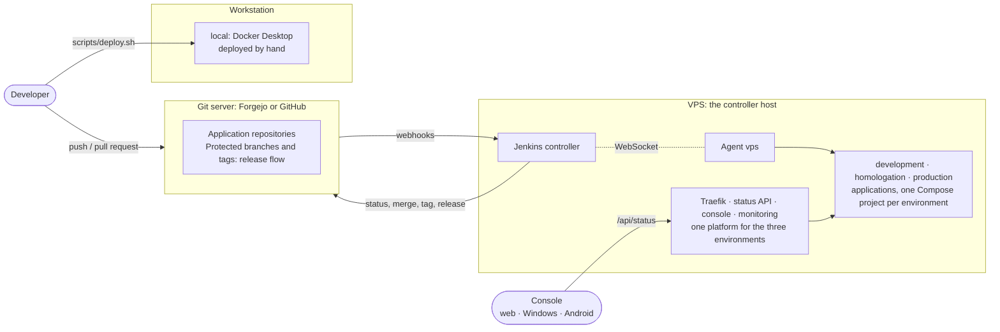
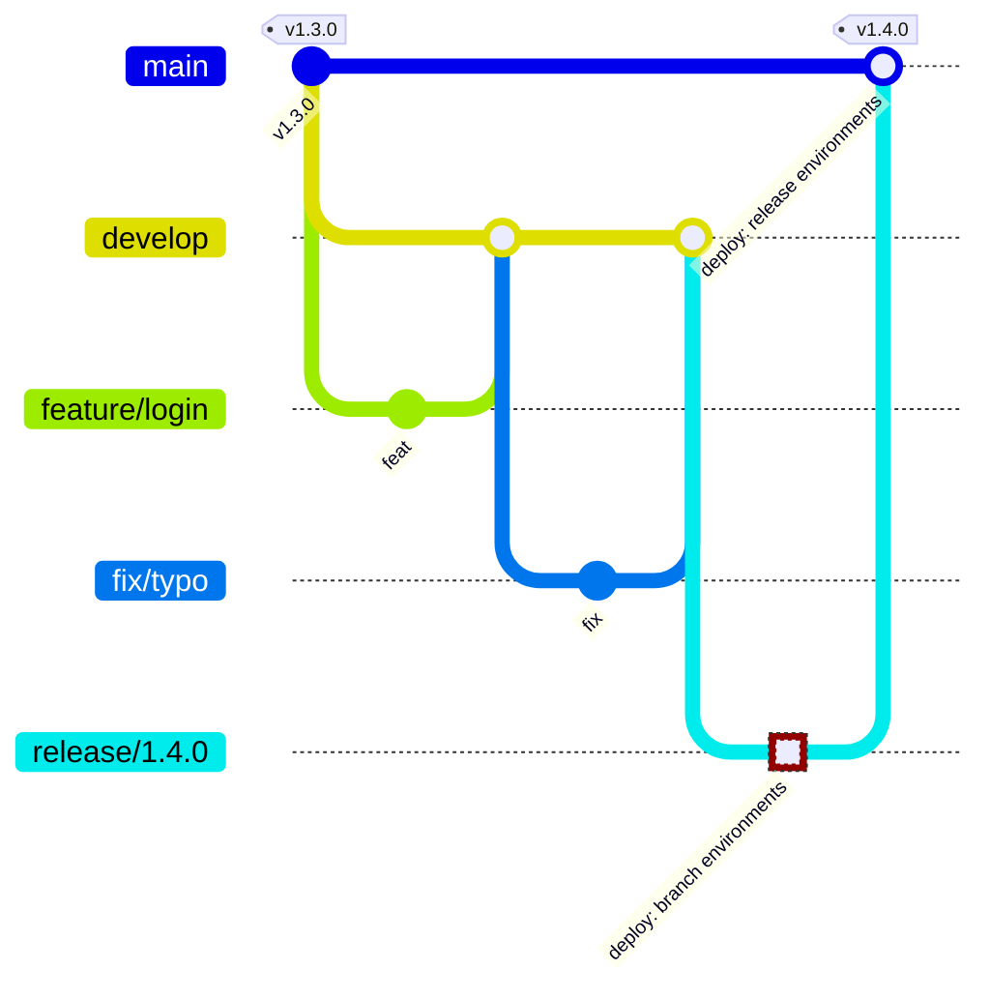
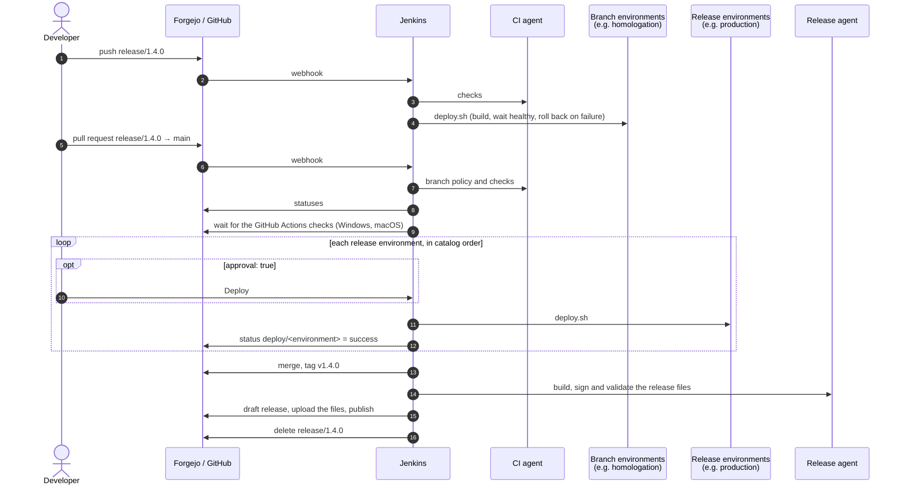
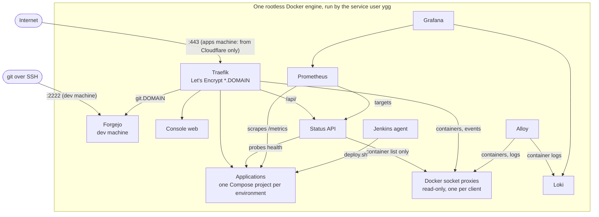

# yggdrasil

> [!NOTE]
> This is the real, open-source code of yggdrasil. Its home is Forgejo, at
> https://git.techcraftsmen.net/artur-rios/yggdrasil; the copy on GitHub is a read-only mirror, for viewing only, and
> its issues and pull requests are not followed. If you want to contribute, email me at
> arturdev@duck.com.

A self-hosted **deploy manager** for Docker applications. You describe your **systems** (products
made of one or more applications, such as an API and its web front end) and your **environments**
(development, homologation, production, or as many as you need, several of them on one host if you
like) in one catalog file. yggdrasil then:

- **Enforces a release flow on Forgejo or GitHub**: `feature/`/`fix/` → `develop` → `release/x.y.z` → `main`, tagged `vx.y.z`.
- **Checks and releases with a self-hosted Jenkins**: each repository's `yggdrasil.yml` lists its checks, which run in containers on a CI agent and are reported as commit statuses, and the files of a release, which are built, signed and validated on a release agent of their own. Libraries get their NuGet packages pushed from an owner's tag. Renovate keeps dependencies current.
- **Deploys with the same Jenkins**, according to each environment's options:
  - on branch pushes, on a green release pull request, or by hand
  - with or without a manual approval
  - on the host that runs the environment, which may run others too
- **Rolls back** to the previous image when a deploy doesn't become healthy.
- **Serves applications** behind Traefik with Let's Encrypt wildcard certificates (DNS-01, any DNS provider).
- **Monitors everything**: Prometheus metrics and Loki logs, in Grafana.
- **Runs environments on demand**: development and homologation can stay stopped until someone uses them (`ygg env start development`), next to an always-on production.
- **Shows it all in a console** for the web, Windows and Android. Each system has a status per environment; expand it to see each application's health, version, commit, deploy time and container state.

Adding an application, an environment or a whole system is a catalog entry, not a change to the platform.

This repository lives at [git.techcraftsmen.net/artur-rios/yggdrasil](https://git.techcraftsmen.net/artur-rios/yggdrasil)
(`git clone https://git.techcraftsmen.net/artur-rios/yggdrasil.git`).
[github.com/artur-rios/yggdrasil](https://github.com/artur-rios/yggdrasil) is a read-only mirror of it, where the
console's Windows builds run on GitHub Actions; the releases are published on both.

That is the default setup, and [the worked example](docs/examples/docker-desktop-and-vps/README.md).
Each environment can also have a host of its own, or any mix: every host runs its own platform and
an agent that dials out to the one controller.

## Concepts

| | |
|---|---|
| **Application** | One deployable unit (an API, a web UI, a worker) with its own repository, container image and release cycle. |
| **System** | What users think of as one product: a group of applications that work together. The console shows a system's status and, expanded, each of its applications. |
| **Environment** | A stage applications run in, such as local, development, homologation or production. Options: exposure (`proxy` through Traefik or host `ports`), `trigger` (`manual`, `branch` or `release`), which Jenkins `agent` deploys it, whether it needs `approval`, `hostSuffix` (its host names, `heimdall-dev.<domain>`), `onDemand` (runs only while used), timeouts and rollback depth. Each application deploys to all environments or to its own list, and can override any option per environment. |
| **Host** | A machine (a VPS, a VM) with a role, `dev` or `apps` ([docs/hosts.md](docs/hosts.md)): Ubuntu 24.04 or 26.04 LTS, where every service user runs its own rootless Docker engine. An **apps** host runs one environment or several, with one platform stack (Traefik, status API, console, monitoring), one Jenkins agent and one or more domains for all of them; each application runs once per environment, as its own Compose project. The **dev** host runs Forgejo, the Jenkins controller and the build agents. A workstation's `ports` environment needs no platform. |
| **Variables store** | An encrypted SQLite database per machine that holds the platform's and every application's environment variables and secrets, in layers (a value shared by several applications or environments is defined once), with history and rollback. Opt-in: without it the scripts read env files. Reference: [docs/variables.md](docs/variables.md). |
| **Catalog** | [`catalog.yaml`](catalog.yaml): the environments, systems and applications. Jenkins jobs and agents, the git server's branch rules, deploys, the status API, Prometheus and the console all read it. Reference: [docs/catalog.md](docs/catalog.md). |

### Branches and releases

- `develop` and `main` only change through pull requests. Required checks: `branch-policy`, the application's checks (the catalog's `checks`, reported by Jenkins; `actionsChecks` are GitHub Actions jobs, required on `develop`), and on `main` one `deploy/<environment>` status per release environment.
- Into `develop` go only `feature/*`, `fix/*` and `renovate/*` branches cut from `develop`.
- Into `main` go only `release/x.y.z` branches that are snapshots of `develop`, for a version not yet tagged.
- Version tags (`v*`, or an owner-tagged repository's own pattern) are created only by Jenkins (applications) or the
  owner. On GitHub, and on a Forgejo installation's GitHub copies, nobody can move or delete them, admins
  included. On Forgejo whoever creates them can also move or delete them (an accepted gap): the daily
  `tag-check` job fails naming any that moved or were deleted, and they are repaired from the GitHub copy
  ([setup.md](docs/setup.md#version-tags-tag-check-and-repairs)).
- Repository admins (on Forgejo, the owner) can bypass the branch rules, for emergencies; not the tag rules.

### What a release does

If a deploy fails, it rolls back to the image that was running, `deploy/<environment>` is set to failure, and the pull request stays open, blocked by the protected branch. The release files come from the repository's `yggdrasil.yml` and are validated before anything is published; the release is published on Forgejo first and its GitHub copy last. If the GitHub Actions checks don't finish, Jenkins asks whether to **Deploy without GitHub Actions checks**; after that the release goes out on Forgejo only. A failure after the merge says so, and the `release-resume` job finishes the release from its tag. A GitHub repository without a `yggdrasil.yml` releases as it always did (every GitHub Actions check waited for, `releaseArtifacts: true`'s workflow). The details: [The pipeline](docs/setup.md#the-pipeline). **Rollback does not undo database migrations**, so keep each migration compatible with the previous release.

### Inside a host

Two Docker networks connect them: `edge` (Traefik, applications, status API) and `telemetry` (Prometheus and everything it scrapes). On both, an application is `<application>.<environment>` (`heimdall-api.production`), so the environments of a host never mix. No container publishes a port except Traefik (80, 443) and, on the dev machine, Forgejo's git over SSH (2222). Metrics are served on a private port that is neither published nor routed.

The engine is **rootless**: it runs as the service user `ygg`, and "root" inside a container is that user on the host, so a compromised container reaches only what `ygg` can. Only the Jenkins agent holds the Docker socket, since it deploys. Traefik, Alloy and the status API each read Docker through a socket proxy of their own, on a private network, that allows only the read-only requests that client makes. The status API, the one behind a token on the internet, gets the container list and nothing else: not the container inspect, which carries every application's secrets. The two machines, their users and their firewall are in [docs/hosts.md](docs/hosts.md).

## The console

The same Flutter app on three platforms:

| | How to get it | Hosts |
|---|---|---|
| **Web** | `https://yggdrasil.<DOMAIN>` on each host | Starts on the host that serves it |
| **Windows** | `yggdrasil-console-<version>-setup.exe` from the [releases](https://git.techcraftsmen.net/artur-rios/yggdrasil/releases) (or their GitHub copies). Per-user install by default, no administrator rights | Add each one (URL and token) in the **Hosts** screen, then switch from the overview |
| **Android** | `yggdrasil-console-<version>.apk` from the same releases | Same as Windows (HTTPS only) |

- A **host** shows every environment it runs, each with its status, e.g. `Development · Stopped`, `Homologation · Stopped`, `Production · Up`.
- Every **system** is a card with one status chip per environment: its applications there taken together, `down` when every deployed one is down, `degraded` when any is down or degraded, else `unknown` or `up`; `not deployed` ones don't count ([the rules](docs/status-api.md#roll-up)). Problems sort first.
- **`Stopped`** is an on-demand environment switched off: neutral, not a problem.
- **Expanding** a system shows a section per environment, listing its applications, each with:
  - status and kind
  - version, commit and deploy time
  - latest health probe and latency
  - container state, health and restarts
  - links to the application and its repository
- Data comes from each host's **status API** (`GET /api/status`, bearer token), one for all its environments. The console refreshes every 30 s while visible; the API probes every 15 s.
- Contract: [docs/status-api.md](docs/status-api.md).

The installer and the APK are attached to every `v*` release of this repository by its own pipeline: Jenkins builds
the APK (`ci/release-build.sh`) and has GitHub Actions on the mirror build the installer
(`.github/workflows/release-windows.yml`), as [`yggdrasil.yml`](yggdrasil.yml) declares
([CONTRIBUTING.md](CONTRIBUTING.md#releasing)).

## Getting started

**[docs/setup.md](docs/setup.md) is the step-by-step guide**, from an empty GitHub account to a
first release. In short:

| | Step | Guide |
|---|---|---|
| **Prepare** | Plan environments and hosts, install the tools, fork this repository | [0–2](docs/setup.md#0-plan-the-installation) |
| | Write `catalog.yaml` and the stack files | [3–4](docs/setup.md#3-write-the-catalog), [catalog.md](docs/catalog.md) |
| | Add the [`templates/application/`](templates/application) files to each application repository | [5](docs/setup.md#5-prepare-each-application-repository) |
| **Accounts** | A domain and its DNS (Cloudflare, or free with DuckDNS), and a GitHub App for Jenkins | [6–7](docs/setup.md#6-domain-and-dns), [dns.md](docs/dns.md) |
| **Hosts** | Prepare each machine with `ygg install --role dev\|apps`, bring up the dev machine (the controller host) and the apps machine, then the application env files | [8–11](docs/setup.md#8-prepare-each-machine), [hosts.md](docs/hosts.md) |
| **Finish** | Apply the branch rules, check everything, cut the first `release/x.y.z` | [12–14](docs/setup.md#12-apply-the-branch-rules) |

**Moving an installation that runs today** (one VPS deploying from GitHub) to the two machines and Forgejo:
[docs/cutover.md](docs/cutover.md), the runbook for the machines, the maintenance window and the clean-up, and then
[docs/moving-repositories.md](docs/moving-repositories.md), the guide to landing each repository's prepared branch on
Forgejo and Jenkins, one at a time.

On an Ubuntu host, [`ygg`](docs/cli.md) does the host steps, as a command or from an arrow-key
menu: it installs the tools, sets up and deploys applications, shows what runs, and shows, changes
and rolls back each application's variables and secrets (`scripts/ygg.sh self-install` installs it).

[docs/examples/docker-desktop-and-vps](docs/examples/docker-desktop-and-vps/README.md) is the
default setup worked through on real hardware:
- `local` on Docker Desktop (Windows), deployed by hand
- `development` and `homologation`, on demand, and `production`, always on, all three on one
  Ubuntu VPS that also runs Jenkins

## Layout

| Path | What |
|---|---|
| `catalog.yaml` | Environments, systems and applications: what everything else reads |
| `stacks/` | Per-application Compose files and overlays: `<app>.proxy.yml`, `<app>.ports.yml`, optional `<app>.<environment>.yml` |
| `scripts/ygg.py`, `scripts/yggcli/` | `ygg`, the host's command line app: commands, an arrow-key menu where every command and option is too, tab completion ([docs/cli.md](docs/cli.md)). `scripts/ygg` is the launcher `/usr/local/bin/ygg` links to; `scripts/ygg.sh` runs it for older command lines |
| `scripts/host.sh` | The host operations `ygg` runs: check, install, add an application, status, configuration, deploys, environments |
| `scripts/vars.py` | The variables store: layers, references, encryption, history, import and backup, behind `ygg vars` ([docs/variables.md](docs/variables.md)) |
| `scripts/deploy.sh` | Build, label, deploy, health-wait and roll back one application in one environment, as the Compose project `<application>-<environment>`. Jenkins runs it; so can you |
| `scripts/catalog.py` | Validates the catalog and resolves each application's environment options |
| `scripts/platform.sh` | Brings a host's platform up or down: one per host, for all its environments |
| `scripts/forge.sh` | The git server's side of a release, the same commands on Forgejo and GitHub: set and read statuses, merge, tag, create, upload and publish releases, delete the branch ([docs/setup.md](docs/setup.md#the-git-server-commands)) |
| `scripts/github.sh` | The GitHub Actions side of a release: read the checks of a commit, wait for a tag, run a workflow, download its files (and the old GitHub-only release path). The rest it hands to `forge.sh` |
| `scripts/pipeline_config.py`, `scripts/branch-policy.sh`, `scripts/run-check.sh` | A repository's `yggdrasil.yml` read and validated against the catalog; the branching model checked on a pull request; one check run in its container on a build agent ([docs/catalog.md](docs/catalog.md#repository-pipeline-file)) |
| `scripts/publish-release.sh`, `scripts/release_notes.py`, `scripts/nuget-push.sh` | A release made on the git server (and its GitHub copy) with its files checked and its notes written; a library's NuGet packages pushed |
| `scripts/renovate.sh` | One Renovate run against the catalog's repositories, by the `renovate` user on the dev machine |
| `scripts/rules.py` | Applies the branching model (protected branches, tags, required checks, webhooks) to every catalog repository, on Forgejo or GitHub |
| `scripts/migrate.py`, `scripts/cloudflare_dns.py`, `scripts/volumes.sh`, `scripts/prove-machine.sh` | The move from one VPS on GitHub to the two machines: the repositories imported into Forgejo with their GitHub copies and push mirrors, the DNS records of both domains, the Docker volumes carried across, and the rootless setup proved on each machine ([docs/cutover.md](docs/cutover.md)) |
| `platform/` | One host's platform: Traefik, status API, console, Docker socket proxies, Prometheus, Loki, Alloy, Grafana, the Jenkins controller and the deploy agent (`platform/build-agent.yml` is the CI and release agents') |
| `jenkins/Jenkinsfile.default`, `jenkins/library/` | The one Jenkinsfile every job runs (a repository's own is never read) and the pinned library it calls: checks, deploys, releases |
| `github/rulesets.py` | Moved: runs `scripts/rules.py` with the same arguments |
| `status/` | The status API (.NET 10) |
| `console/` | The console (Flutter): web, Android, Windows |
| `env/` | Templates for each host's `platform.env` and `acme.env` (what `vars import` reads) |
| `templates/application/` | Files each application repository needs |
| `docs/` | Catalog reference, setup guide, the two machines (`hosts.md`), the cutover runbook (`cutover.md`), the guide to moving each repository (`moving-repositories.md`, with `migration-checklist.md`), host helper, variables store, DNS and certificates, status API contract, worked example (`docs/examples/docker-desktop-and-vps/`) |

## Day to day

| Task | How |
|---|---|
| Release an application | `git switch -c release/1.4.0 develop && git push -u origin release/1.4.0`, then open the PR into `main` |
| Release a library, or yggdrasil itself (`release: owner-tag`) | An annotated tag on `main`: `git tag -a 1.4.0 -m 1.4.0 && git push origin 1.4.0` ([setup.md](docs/setup.md#owner-tags-and-nuget)) |
| Finish a release that stopped, or make its GitHub copy | Jenkins › `release-resume` › Build with Parameters: `REPOSITORY`, `TAG` ([setup.md](docs/setup.md#finishing-a-release-that-stopped)) |
| Upgrade the pipeline | Release yggdrasil, set `YGGDRASIL_LIBRARY_VERSION` to the new tag in the controller's `platform.env`, `scripts/platform.sh up` ([setup.md](docs/setup.md#how-a-build-runs)) |
| Deploy by hand | `scripts/deploy.sh <environment> <application> <checkout> <version>` on the environment's host, or "Build with Parameters" → `DEPLOY_TO` in Jenkins for `branch` environments and `manual` ones that set an `agent` (an on-demand environment is left running) |
| Use an on-demand environment | `ygg env start development` on its host, then `env stop development` when done. Jenkins keeps deploying to it while it is stopped, and leaves it stopped ([setup.md](docs/setup.md#on-demand-environments)) |
| See which environments are on | `ygg env status`, or the console |
| Add an application, environment or system | `ygg add` for an application ([docs/cli.md](docs/cli.md#set-up-an-application)); [docs/setup.md#adding-things](docs/setup.md#adding-things) for all three |
| See what runs on a host | `ygg status`: every environment of the host |
| Change an application's variables and redeploy it | `ygg config <application> <environment>` |
| Set or read a variable | `ygg vars set heimdall-api@development KEY=value` (`KEY=-` types it hidden); `vars list heimdall-api@development --resolved` ([docs/variables.md](docs/variables.md)) |
| Read a secret | `ygg vars get heimdall-api@production KEY --reveal`, or `ygg` › Applications › heimdall-api › production › the variable › Show value |
| See who changed a variable, or undo it | `ygg vars history`, then `vars rollback <id>` |
| Update a host's platform or catalog | `cd /opt/yggdrasil && git pull && scripts/platform.sh up`, then restart `yggdrasil-status-1` (and `yggdrasil-jenkins-1` on the controller host) after a catalog change: [setup.md](docs/setup.md#where-jenkins-and-the-hosts-read-the-catalog) |
| Change the branch rules | `python3 scripts/rules.py --dry-run`, then without ([setup.md, step 12](docs/setup.md#12-apply-the-branch-rules)); on an existing GitHub installation, first [adopt `yggdrasil.yml`](docs/setup.md#an-existing-github-installation) |
| See what runs where | The console, or `curl -H "Authorization: Bearer $TOKEN" https://yggdrasil.<DOMAIN>/api/status` |

## Upgrading

Upgrading an existing installation from one release to the next is described in
[CHANGELOG.md](./CHANGELOG.md), under each release that asks something of the operator: from 0.4
to 0.5 (several environments per host), see
[Upgrading from 0.4 to 0.5](./CHANGELOG.md#upgrading-from-04-to-05); from 0.5 to 0.6 (the variables store, optional), see
[Upgrading from 0.5 to 0.6](./CHANGELOG.md#upgrading-from-05-to-06); from 0.6 to 0.7 (the `ygg` command), see
[Upgrading from 0.6 to 0.7](./CHANGELOG.md#upgrading-from-06-to-07).

## Changelog

Notable changes in each release are recorded in [CHANGELOG.md](./CHANGELOG.md). Releases follow
[Semantic Versioning](https://semver.org/).

## Contributing

Building and testing the status API, the console and the platform scripts, the branching model and the release
process of this repository are described in [CONTRIBUTING.md](./CONTRIBUTING.md).

## Legal

Proprietary. See [LICENSE](LICENSE). Copyright (c) 2026 Artur Rios. All rights reserved.

The license lets you fork or copy this repository, change it and run it on your own hosts to deploy your own
applications. It does not let you redistribute it, or offer it to others as a service.
