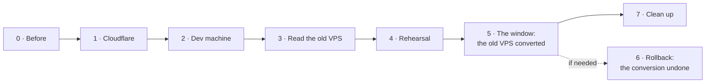

# The cutover: from one VPS on GitHub to two machines on Forgejo

This is the runbook for moving an installation from what runs today, **one rootful VPS that deploys from
GitHub**, to the default setup of [setup.md](setup.md): a **dev machine** (Forgejo, the Jenkins controller,
the build agents) and an **apps machine** (every environment), both rootless, with **Forgejo** as the git
server and **GitHub** as a push-mirrored copy. Only the dev machine is new: the apps machine is **the old VPS
itself, converted in place** during the window, as [hosts.md, Upgrading a host from rootful
Docker](hosts.md#9-upgrading-a-host-from-rootful-docker) describes. It covers rollout steps 2 to 5 and 8 of the
[design](superpowers/specs/2026-10-22-self-hosted-git-and-ci-design.md#rollout): Cloudflare, the two machines,
the maintenance window, and the clean-up. The work per repository afterwards (rollout steps 6 and 7: each
repository's `yggdrasil.yml`, `ci/` scripts, Renovate configuration and first release) is not here: it is
[moving-repositories.md](moving-repositories.md), which lands the branch prepared for each repository.

It does not repeat how to set a machine up: [setup.md](setup.md) does, and this page says which of its steps to
follow, in which order, and with which answers. What this page adds is the order, the checks between the
steps, and the window itself. Follow it from top to bottom. Every step says what to type, what you should see
(**Success looks like**), what to do when you don't (**If it fails**) and how to undo it (**Back out**). Stop
at the first step that does not look like its success line: the steps after it assume it.



| Section | Where | When | Time |
|---|---|---|---|
| [0. Before you start](#0-before-you-start) | Paper, the old VPS, GitHub | Days before | 1 hour |
| [1. Cloudflare](#1-cloudflare) | Cloudflare, your machine | Days before | 1 hour, plus name-server propagation |
| [2. The dev machine](#2-the-dev-machine) | Dev machine | Days before | 2 hours |
| [3. The apps machine](#3-the-apps-machine) | The old VPS, read only | Days before | 30 min |
| [4. Rehearse the move](#4-rehearse-the-move) | Your machine, the old VPS, the dev machine | The days before | 2 hours |
| [5. The window](#5-the-window) | Everywhere; the old VPS is converted into the apps machine | One long evening; production is off | 4 to 8 hours |
| [6. Rollback](#6-rollback) | Everywhere; the apps machine is turned back into the old VPS | Only if the window goes wrong | 2 hours |
| [7. Clean up](#7-clean-up) | GitHub, the apps machine | After the apps machine has run a release | 30 min |
| [8. What you check by hand](#8-what-you-check-by-hand) | Browser, your machine | After the window | 30 min |

The window is longer than it would be with a second new machine: besides the repositories (one import after the
other, 4.4 says how long each takes), it archives every volume, dumps the databases, copies the archives off the
server, converts the server (about an hour: the packages, the install, the platform and its certificates), restores
the volumes and the databases and sets the backups up. 4.7 measures how long one volume's archive takes; scale it by
the sizes of 4.6. The databases are small (about 10 MB each): their dumps and their six restores (5.4, 5.6a) take
minutes, not hours.

**The databases move too.** heimdall-api and fortuna-api keep their data in a PostgreSQL that runs on the old VPS
itself, outside Docker (`DB_HOST=host.docker.internal`), not in a volume. A rootless engine's containers cannot reach
a PostgreSQL on the host, so the window moves each database into the `db` container its stack now has
(`stacks/heimdall-api.proxy.yml`, `stacks/fortuna-api.proxy.yml`): one per application and environment, on `ygg`'s
engine, reached as `DB_HOST=db`. They are dumped in 5.4, once production is stopped, and restored in 5.6a. The host's
PostgreSQL is left running and untouched until 7.1: it is the rollback's copy.

**Conventions.**

- Each command says where it runs: **your machine** (Git Bash on Windows; `python` if `python3` isn't on the
  path), **the old VPS**, **the apps machine** or **the dev machine**, and as whom. **The old VPS and the apps
  machine are the same server**: this page calls it the old VPS until its conversion in 5.5, and the apps machine
  from then on. Its admin, `<old admin>`, stays its admin (the user with `sudo`); the conversion adds `ygg`. The
  dev machine's admin is `artur`. Placeholders are in angle brackets: `<apps ip>` (the old VPS's own address, which
  stays the apps machine's) and `<dev ip>`.
- **26.04's own tools.** Ubuntu 26.04 ships Rust coreutils and `sudo-rs` by default, not GNU's. Where this page leans
  on GNU behaviour (`cp -aT`, `mv -T`, `install -m 600 /dev/null`, the set-group-ID note of 5.5), the `stat`, `ls`
  and `diff` checks after each step are what tell: a step whose check does not match its success line stops there,
  whatever the command printed.
- **No secret goes on a command line.** Tokens are read with `read -rs` into a variable of the shell and
  exported; the scripts take them from the environment, and `curl` gets them on its standard input
  (`--config -`), from `printf`, a shell builtin that starts no process. Nothing in this page needs a real
  secret written into it: where one is asked for, the text says `<owner token>` and which token it is.
- On your machine, run the migration commands from a clone of your fork of yggdrasil (`cd <your clone of
  yggdrasil>`), and keep what they print. Make a folder for it, and let a piped command fail as itself:
  ```bash
  mkdir -p ~/cutover-log && set -o pipefail
  ```

## 0. Before you start

### 0.1 Write down today's setup

Fill this in first; later steps use every line.

| What | How to find it | Yours |
|---|---|---|
| The old VPS's address, name and admin | Your provider; on the old VPS, `hostname`, and `whoami` as the user you log in as. `<old admin>` is a user with `sudo` that is **not root**: `ygg install` refuses root, and its SSH part lets only `<old admin>` and `ygg` log in. If you log in as root, 3.1's **If it fails** makes one | `<apps ip>`, e.g. `srv1937950`, `<old admin>` |
| The release the old VPS runs | On the old VPS: `git -C /opt/yggdrasil describe --tags` | e.g. `v0.7.4` |
| Where its settings are | On the old VPS: `ls /etc/yggdrasil`. `vars.db` (and `vars.key`) is the [variables store](variables.md): `platform.sh` renders `platform.env` from it on each run and keeps the last copy that worked in `/etc/yggdrasil/last-good/`, so there is no `/etc/yggdrasil/platform.env` | e.g. the store |
| The old controller's address | On the old VPS: `ygg vars get platform JENKINS_URL` (the store's own reader, v0.7.4's `scripts/vars.py get`; a host without a store: `grep '^JENKINS_URL=' /etc/yggdrasil/platform.env`) | e.g. `https://jenkins.techcraftsmen.net/` |
| Today's domain(s) | `ygg vars get platform DOMAIN` the same way (v0.7.4 has no `EXTRA_DOMAINS`), and any other domain the applications' variables name (0.4) | e.g. `techcraftsmen.net` |
| The environments it runs | `ygg vars get platform ENVIRONMENTS` | e.g. `development,homologation,production` |
| What production runs, per application | On the old VPS: `ygg status`: the `VERSION` and `COMMIT` columns of production | e.g. heimdall-api, heimdall-ui, fortuna-api and fortuna-ui, each like `heimdall-api 1.4.0 3f2a9c1` |
| What homologation has deployed, per application | The same columns of homologation (on demand: `stopped` is expected); 5.17 deploys exactly that again | e.g. `heimdall-api 1.5.0 9b81d07`, or **nothing deployed** |
| `<installer commit>` | On your machine, once this release's database move (the branch `fix/cutover-in-place-apps`) is merged into `develop` (4.8): `git fetch origin && git log -1 --merges --format='%H %s' --grep='fix/cutover-in-place-apps' origin/develop`. 2.1 and 5.5 run `ygg install` from it | e.g. `4c1d2e9... Merge pull request #82 from artur-rios/fix/cutover-in-place-apps` |
| How the names reach it today | Cloudflare, **DNS → Records** of `techcraftsmen.net` | e.g. `A *` → `<apps ip>`, **DNS only** |
| The new machine | One fresh Ubuntu 24.04 or 26.04 LTS server for the dev machine, rented now: its address is needed for DNS in section 1. Rent it on the release the old VPS runs (3.1; 26.04 here), so that 2.1 to 2.6 prove that release before the window. The apps machine is the old VPS: `<apps ip>` is its address | `<dev ip>` |
| Whether the old VPS serves names under `techcraftsmen.net` or `artur-rios.tech` | Is its `DOMAIN` one of them? | yes / no |
| The databases, their owners and their logins | The three queries below | The table below |
| The whole connection strings | The loop below: per application and environment, how many are set, where, and whether they name `host.docker.internal` | e.g. `heimdall-api@production: 1`, `HEIMDALL_MIGRATIONS_CONNECTIONSTRING (app@env)`, `1` |

`ygg vars get` needs the store's key, `vars.key`, which v0.7.4 makes readable by the `docker` group, the admin's. If
it says `cannot read the key`, read the last copy that worked instead:
`sudo grep -E '^(JENKINS_URL|DOMAIN|ENVIRONMENTS)=' /etc/yggdrasil/last-good/platform.env` (values single-quoted:
`DOMAIN='techcraftsmen.net'`).

Write `<old domains>` as an extended regular expression for the searches below, the dots escaped:
`old\.example\.com|other\.example\.org`: the domains of that list that are **neither** `techcraftsmen.net` nor
`artur-rios.tech`, whose names change. Where there is none (`DOMAIN` is `techcraftsmen.net` and no variable names
another), nothing moves to a new name: skip the searches of 0.4, 3.4 and 5.7 (an empty pattern would match every
line).

`~/cutover-log/0.1-today.md` already holds part of the table above (the release, production's versions, the
domains, what DNS shows); add the rest there, the databases below included.

**The databases.** heimdall-api and fortuna-api keep their data in the old VPS's own PostgreSQL (18.6, Ubuntu's
package), one database per application and environment. As found on 2026-10-25:

| Database | Owner (runs the migrations) | The API's login (`DB_USER`) |
|---|---|---|
| `heimdall` (production) | `heimdall_owner` | `heimdall` |
| `heimdall_development` | `heimdall_development_owner` | `heimdall_development_svc` |
| `heimdall_homologation` | `heimdall_homologation_owner` | `heimdall_homologation_svc` |
| `fortuna` (production) | `fortuna` | `fortuna` |
| `fortuna_development` | `fortuna_development` | `fortuna_development` |
| `fortuna_homologation` | `fortuna_homologation` | `fortuna_homologation` |

5.4 dumps these six, and 5.6a restores each into its own container with only its own roles: read them again shortly
before the window, on the old VPS as `<old admin>` (from `/`: run from your home, `sudo -u postgres` first says
`could not change directory`). The roles, whether each is a superuser, may log in, and has a SCRAM password; then
which role is a member of which; then who owns each database; then each database's extensions:

```bash
cd /
sudo -u postgres psql -XAt -c "select rolname, rolsuper, rolcanlogin, coalesce(rolpassword like 'SCRAM-SHA-256\$%', false) from pg_authid where rolname not like 'pg\_%' order by 1"
sudo -u postgres psql -XAt -c "select r.rolname || ' is in ' || g.rolname from pg_auth_members m join pg_roles r on r.oid = m.member join pg_roles g on g.oid = m.roleid where r.rolname not like 'pg\_%'"
sudo -u postgres psql -XAt -c "select datname, pg_get_userbyid(datdba) from pg_database where not datistemplate order by 1"
for db in heimdall heimdall_development heimdall_homologation fortuna fortuna_development fortuna_homologation; do
  sudo -u postgres psql -XAt -d "$db" -c "select current_database(), extname, extversion from pg_extension where extname <> 'plpgsql'"
done
```

Then the variables the APIs reach the database with. `DB_HOST`, `DB_NAME` and `DB_USER` are no secret. A whole
connection string is one (it holds a password), so the loop prints only how many there are, the scope each comes
from, and how many name the host; no value:

```bash
for scope in heimdall-api@production heimdall-api@development heimdall-api@homologation fortuna-api@production fortuna-api@development fortuna-api@homologation; do
  echo "$scope: $(ygg vars list "$scope" --resolved | grep -cE 'MIGRATIONS_CONNECTIONSTRING=.+|DATA_CONNECTIONSTRING=.+') whole connection string(s)"
  ygg vars list "$scope" --resolved | grep -E '^DB_(HOST|PORT|NAME|USER|CONNECTION_EXTRA)=|REQUIRE_TLS=|CONNECTIONSTRING=' | sed -E 's/^([A-Z_]*CONNECTIONSTRING)=.*  \(/\1  (/'
  echo "  naming host.docker.internal: $(ygg vars render "${scope%@*}" "${scope#*@}" | grep 'CONNECTIONSTRING=' | grep -c 'host\.docker\.internal')"
  echo "  asking for TLS: $(ygg vars render "${scope%@*}" "${scope#*@}" | grep 'CONNECTIONSTRING=' | grep -ciE 'ssl ?mode=(require|verify)')"
done
```

(`--resolved` masks every secret; `render` reveals them, but only into `grep -c`, which prints a count.)

**Success looks like:**
- The roles: the nine of the table and `postgres`; `t` in the second column for `postgres` only (the only superuser),
  and `t` in the last column for each of the nine (a SCRAM password). `postgres` has `f` there: Ubuntu gives it no
  password (it logs in over the socket as the system user `postgres`), and 5.6a never carries it; each container's
  `postgres` gets `DB_SUPERUSER_PASSWORD` instead.
- The members: nothing.
- The owners: the table's six databases with their owners, and `postgres`, which holds nothing of the applications.
- The extensions: nothing, or only PostgreSQL's own contrib ones (`pgcrypto`, `citext`, `uuid-ossp` and the like),
  which the image has too.
- The loop: `DB_HOST=host.docker.internal` for each, `DB_NAME` and `DB_USER` as the table says, and per application and
  environment the number of whole connection strings. heimdall-api splits the owner from the login, so expect
  `HEIMDALL_MIGRATIONS_CONNECTIONSTRING` in each of its environments, with `Host=host.docker.internal`; fortuna-api may
  set `FORTUNA_DATA_CONNECTIONSTRING` instead of the `DB_*` parts. Write each one down with its name and the scope it
  comes from, as 5.6a names it: `heimdall-api` for `(app)`, `heimdall-api@production` for `(app@env)`, `@production`
  for `(env)`. 5.6a changes it there, and only there.
- TLS: `DB_CONNECTION_EXTRA` empty (0.1 found `DB_CONNECTION_EXTRA=` on 2026-10-25), no `...REQUIRE_TLS=true` (such
  as heimdall-api's `HEIMDALL_DATA_REQUIRE_TLS`), and `asking for TLS: 0`. Ubuntu's PostgreSQL has TLS on, the image
  has it off: anything that requires it fails against the container. Write down each one that does: 5.6a switches
  it off.

**If it fails:**
- A role with `f` in the last column has an `md5` password: the containers accept SCRAM only. Before the window, give
  it a new password on the host (`sudo -u postgres psql -c '\password <role>'`, which stores SCRAM) and the same one
  in the store (`ygg vars set <scope> DB_PASSWORD=-`, or the connection string that names it), then redeploy that
  application and check that it starts.
- A membership: 5.6a carries each database's owner and login only, no `GRANT` between roles. Note it, and add it to
  5.6a by hand.
- Another database, or a role the table does not have: find which application uses it. 5.6a restores only the six;
  add a line there for any other that must move.
- No whole connection string: 5.6a has none to change. One the loop finds that is not in this list: write it down
  the same way.
- An extension that is not PostgreSQL's own (a third party's, from its own package): the image may not have it, and
  5.6a's `pg_restore --exit-on-error` would stop at it. 4.7's rehearsal shows it; stop and report it.

**Back out:** read only.

### 0.2 The old controller's library is pinned

From [CHANGELOG, Upgrading an existing GitHub installation](../CHANGELOG.md#upgrading-an-existing-github-installation-to-the-pipeline):
before the release with this pipeline reached your fork's `main`, the old controller's library was pinned to
the release it ran, so that it keeps deploying from GitHub until the window.

On the old controller: **Manage Jenkins → System → Global Trusted Pipeline Libraries** (Global Pipeline
Libraries on older versions) → `yggdrasil` → **Default version**.

**Success looks like:** the Default version is the tag of 0.1 (`v0.7.4`), not `main`, and the old VPS's
checkout is at that tag too (0.1's `git describe`).
**If it fails:** set it now, as the CHANGELOG says, and keep the checkout at that tag (`git -C /opt/yggdrasil
checkout <tag>`).
**Back out:** nothing to undo: the pin stays as long as the old controller exists (5.3 stops it; 7.1 deletes it). A restart of the old controller drops
it (Configuration as Code applies `casc.yaml`'s `defaultVersion: main` again), so set it again after any restart,
before a build runs: `main` has 0.8.0 since before the window, and 0.9.0 after 5.8a, neither of them the old
controller's pipeline (and 0.9.0 has the `db` stacks, which the old VPS's deploys must never use).

### 0.3 The GitHub paths were tried on a scratch repository

From [CHANGELOG, Before relying on it on GitHub](../CHANGELOG.md#upgrading-an-existing-github-installation-to-the-pipeline)
and [setup.md, An existing GitHub installation](setup.md#an-existing-github-installation): the pipeline's
GitHub paths were tested against fakes only. The scratch run is the check: a throwaway GitHub repository with
a `yggdrasil.yml`, a catalog entry with `forge.type: github` and a release environment, run through a pull
request into `develop`, a push that deploys, and a release pull request into `main`.

**Success looks like:** the pull request shows `branch-policy` and its checks as statuses; the push deploys;
the release pull request deploys, merges, tags `v0.1.0` and publishes its release.
**If it fails:** do not merge the release into your fork's `main`; the old controller keeps the release it
has. Report what failed.
**Back out:** delete the scratch repository's catalog entry; keep the repository itself until 4.5, which uses it.

The window itself does not need the GitHub paths (from section 5 on, Forgejo is the git server), but the
weeks between the release and the window run the old controller's pinned library against `main`'s scripts,
and a rollback (section 6) goes back to them.

### 0.4 Where the old host names are

If the applications use another domain today, their addresses move to `techcraftsmen.net`: every env file
that names the old one (public host, API base URLs compiled into the web bundles) changes before the first
deploy on the apps machine. Find every place now. On your machine, with every application repository cloned
next to each other under `<your clones>`:

```bash
old='<old domains>'
for repo in <your clones>/*/; do
  git -C "$repo" fetch --quiet origin
  git -C "$repo" grep -nIE "$old" \
    $(git -C "$repo" for-each-ref --format='%(refname:short)' refs/remotes/origin/main refs/remotes/origin/develop) -- \
    | sed "s|^|$(basename "$repo"): |"
done
```

(`for-each-ref` names `origin/main` and `origin/develop`, whichever of them the repository has.)

and on the old VPS, the env files (`-o` prints only the name that matched, never the secret on its line):

```bash
sudo grep -rnoE '<old domains>' /etc/yggdrasil
```

With the variables store on the old VPS, read each scope instead: `ygg vars list <application>@<environment>
--resolved | grep -E '<old domains>'` (secrets stay masked).

**Success looks like:** a list of `file:line` places. Variables are fixed in 3.4 or 5.7. A place in an application's
code that runs (not documentation, not tests) is a release of that application with the fix, before the
window, or it breaks on the new name.
**If it fails:** `fatal: not a git repository` means a folder that is not a clone: ignore its line.
**Back out:** read only; nothing to undo.

### 0.5 The tokens

Five secrets are used during the move. Make the ones you can now and keep them in your password manager.

| Token | Make it | Used by |
|---|---|---|
| Cloudflare DNS token | 1.2 | `cloudflare_dns.py`, the dev machine's `acme.env`, the apps machine's store (`platform:acme`, 5.5) |
| Forgejo owner token, scopes **`write:repository` and `read:user`** | 2.4, once Forgejo is up | `migrate.py`, `rules.py` (`FORGE_TOKEN`) |
| GitHub token for the window: a classic token with the `repo` scope, 7 days | 4.1 | `migrate.py`, `rules.py` (`GH_TOKEN`) |
| GitHub mirror token: fine-grained, Contents and Workflows **Read and write** on all your repositories | 4.1 | `migrate.py mirrors`, then Forgejo keeps it (`MIRROR_GITHUB_TOKEN`) |
| The webhook secret | setup.md 9.7 makes it on the dev machine | `rules.py` (`FORGE_WEBHOOK_SECRET`) |

**`read:user` is needed:** `migrate.py collaborators` looks each bot account up (`GET /users/<name>`), which
Forgejo refuses to a token with `write:repository` alone (`403 token does not have at least one of required
scope(s): [read:user]`, seen against Forgejo 16 while writing this page). The rest of the move works with
`write:repository` only.

## 1. Cloudflare

Rollout step 2. Both zones on Cloudflare, the token, the two settings the token cannot change, and the
records. Nothing in this section changes what the old VPS serves.

### 1.1 `artur-rios.tech` on Cloudflare

Only if it is not a Cloudflare zone yet (the dashboard's account home lists your zones). Its records come with
it, so `www.` and `blog.` keep pointing at Vercel until their sites move.

1. At the current DNS provider, export the zone or write down every record (name, type, value): it is what
   you check the import against, and the way back.
2. Follow [dns.md A2](dns.md#a2-move-its-dns-to-cloudflare) (DNSSEC off at the registrar first, **Add a
   domain**, the **Free** plan, the two name servers at the registrar).
3. Before you change the name servers, in the imported records: the `www` and `blog` `CNAME`s (to Vercel),
   and anything at the bare domain that points at Vercel, are **DNS only** (grey cloud), as Vercel wants; mail
   records (`MX`, `TXT`) are there as before.

**Success looks like:** Cloudflare marks the zone **Active**, and from any machine:
```bash
curl -s -H 'accept: application/dns-json' 'https://cloudflare-dns.com/dns-query?name=artur-rios.tech&type=NS'
curl -sI https://www.artur-rios.tech | grep -iE '^(HTTP|server)'
```
the first lists the two `*.ns.cloudflare.com` servers, the second still answers `200` from Vercel
(`server: Vercel`). Do the same for `blog.`.
**If it fails:** a site that stopped answering lacks a record: add it in Cloudflare as it was at the old
provider (step 1's list).
**Back out:** at the registrar, put the old name servers back; the old provider's zone was never changed.

`techcraftsmen.net` must be a Cloudflare zone too; if it is not, do the same for it.

### 1.2 The DNS token

Follow [dns.md A4](dns.md#a4-create-the-api-token): **Zone → Zone → Read** and **Zone → DNS → Edit**, one
*Zone Resources* row for `techcraftsmen.net` and one for `artur-rios.tech`, no end date. Then, on your machine:

```bash
read -rs CF_DNS_API_TOKEN && export CF_DNS_API_TOKEN      # paste the token, then Enter
printf 'header = "Authorization: Bearer %s"\n' "$CF_DNS_API_TOKEN" \
  | curl -s --config - https://api.cloudflare.com/client/v4/user/tokens/verify
```

**Success looks like:** `"status":"active"`. The dry run of 1.5 then proves it can read both zones.
**If it fails:** `Invalid API Token` is a copy mistake; make it again.
**Back out:** **My Profile → API Tokens → Roll** or **Delete** next to it.

### 1.3 SSL/TLS: Full (strict), both zones

The token cannot change zone settings, so this is by hand: in each zone, **SSL/TLS → Overview**, and choose
**Full (strict)** (under *Custom SSL/TLS* where the page offers *Automatic*). Write down the mode it had.
*Flexible* makes every page loop (`ERR_TOO_MANY_REDIRECTS`), and *Full* without *strict* accepts any
certificate ([hosts.md, Cloudflare settings](hosts.md#cloudflare-settings)).

**Success looks like:** the Overview page shows **Full (strict)** for both zones, and a proxied name the old VPS
serves today (if any) still opens without error: `curl -sI https://<a proxied name> | head -1` is not `526`.
**If it fails:** `526` means the origin behind that name has no valid certificate: put the old mode back and
fix that origin first.
**Back out:** choose the mode you wrote down.

### 1.4 The cache rule

APIs and the status API are never cached. In the zone `techcraftsmen.net`: **Caching → Cache Rules → Create
rule**, name `apis never cached`, **Edit expression**, and paste:

```text
starts_with(http.request.uri.path, "/api/") or http.host in {"heimdall-api.techcraftsmen.net" "heimdall-api-dev.techcraftsmen.net" "heimdall-api-hml.techcraftsmen.net" "fortuna-api.techcraftsmen.net" "fortuna-api-dev.techcraftsmen.net" "fortuna-api-hml.techcraftsmen.net"}
```

(the catalog's `api` applications with their `host`, in every environment's `hostSuffix`; add any other
API's names). **Cache eligibility: Bypass cache** → **Deploy**.

**Success looks like:** the rule is listed as active. Its proof comes after the window, in
[section 8](#8-what-you-check-by-hand): `cf-cache-status` is `DYNAMIC` or `BYPASS` on an API's answers.
**If it fails:** an expression error names the part: the hosts are written with spaces between them, no commas.
**Back out:** delete the rule.

### 1.5 The records

`scripts/cloudflare_dns.py` makes every record of [hosts.md, DNS records](hosts.md#dns-records) and marks each
with the comment `yggdrasil`. A record **without** that comment was made by hand: it is reported and never
changed, and the run exits `1`. That is what keeps this step from touching what the old VPS serves.

For `--apps`, give `<apps ip>`: the old VPS's own address, which is the apps machine's too, before the window and
after it (the conversion keeps the server, and 5.8 changes only how the names reach it). First export each zone as it is (**DNS →
Records → Import and Export → Export**): it is the record of what was there, for 5.8 and a rollback. In each
export, find the records that point at Vercel (a `CNAME` to `cname.vercel-dns.com`, an `A` to `76.76.21.21`):
`artur-rios.tech`'s `www` and `blog` (and its bare domain if it points there), and in `techcraftsmen.net` the
company page's `www` and bare domain, with any other name of that zone still on Vercel. Note them: they stay as they
are until their sites move (plan 5), and 5.8 keeps them. Then, on your machine, with the token of 1.2:

```bash
python3 scripts/cloudflare_dns.py --dry-run --apps <apps ip> --dev <dev ip> --skip-caa artur-rios.tech --skip-caa techcraftsmen.net
```

`--skip-caa <zone>` leaves that zone's `CAA` out (`CAA skipped on <zone> (--skip-caa)`): the record allows Let's
Encrypt only through DNS-01, and Vercel renews the certificates of its names (`www.` and `blog.` of
`artur-rios.tech`, the company page's in `techcraftsmen.net`) through Let's Encrypt over HTTP-01, so it would break
them at their next renewal, weeks later, where no check made today would see it. Every `cloudflare_dns.py` command
of this page passes both flags. Drop each once that zone's Vercel names have moved (plan 5,
[moving-repositories.md, step 5](moving-repositories.md#step-5-switch-the-old-host-off-sites)); the next run then
makes the record. The flag does not remove a `CAA` that is already there: if `techcraftsmen.net` has one, made by
an earlier run of this step, while the company page is still on Vercel, delete it by hand (**DNS → Records**, type
`CAA`).

Read every line. The run is not trusted until you have: the wildcard's name filter and the format of the
`CAA` value were never checked against Cloudflare itself.

- `would create A git.techcraftsmen.net: <dev ip> (DNS only)`, the same for `jenkins.`, `traefik-dev.` and
  `grafana-dev.`, and `CAA skipped on artur-rios.tech (--skip-caa)` and the same for `techcraftsmen.net`: expected.
- `... made by hand; change it or delete it yourself` for today's records (the bare domain and `*` of a zone
  the old VPS serves, a Vercel record at a bare domain, noted above): expected now. Leave them; 5.8 deals with the
  ones that move.
- `a CNAME to ... is at this name`: expected for the Vercel names. At the bare domain or `*` of a zone that
  must reach the apps machine, note it for 5.8.
- `would create A *.artur-rios.tech: <apps ip> (proxied)` (and its bare domain, if no record is there): expected.
  The old VPS does not serve that zone yet (0.1), so such a name answers Cloudflare's error until the window, which
  nothing links to; `www.` and `blog.` keep their Vercel records, which win over the wildcard.
- An `AAAA` record at a name the script wants is not looked at unless it carries the comment. Note any at the
  bare domains and `*` (**DNS → Records**, type `AAAA`): 5.8 deals with them.
- **If `JENKINS_URL` of 0.1 is `https://jenkins.techcraftsmen.net/`**, the new `jenkins` record takes that name
  from the old controller as soon as it exists: GitHub's webhooks then reach the new controller, which ignores
  them, and the old one only sees a change at its daily rescan (or **Scan Repository Now** in each job). The dev
  machine needs its names from 2.3 on, so in that case run the real command below when you start 2.3, keep 2.3
  to the window within a few days, and plan no release in between.
- **A hand-made `A jenkins.techcraftsmen.net`** (or `git.`, `traefik-dev.`, `grafana-dev.`) is reported `made by
  hand` and the script makes no record of its own beside it, so that name never reaches the dev machine. When
  you start 2.3, delete it, or set its *Comment* to `yggdrasil` so the script updates it in place, and run again.
  (5.8 checks it once more.)

Then the same without `--dry-run`:

```bash
python3 scripts/cloudflare_dns.py --apps <apps ip> --dev <dev ip> --skip-caa artur-rios.tech --skip-caa techcraftsmen.net
```

**Success looks like:** `CAA skipped on artur-rios.tech (--skip-caa)` and the same for `techcraftsmen.net`, `create`
lines for what was missing (at least the dev names), `N of 8 records already right`, and an exit status
(`echo $?`) of `0`, or of `1` with a `to see to:` list that holds **only** the hand-made records above. From any
machine, `nslookup git.techcraftsmen.net 1.1.1.1` prints `<dev ip>`. In `techcraftsmen.net`, **SSL/TLS → Edge
Certificates** still shows the Universal certificate **Active**. That proves only today: the edge certificate,
and the certificates of anything else under the zone, renew later, against the new `CAA`. Cloudflare's own
renewals are its business with the CAs it uses; if one of yours fails in the weeks after, the `CAA` is the first
thing to look at (Back out).
**If it fails:** `zone ... not found: does the token have access to it?` is the token's *Zone Resources*
(1.2); a `CAA` that Cloudflare refuses names its value: report it before going on.
**Back out:** delete the records with the comment `yggdrasil` in the dashboard (**DNS → Records**, the
*Comment* column); nothing else was changed. A `CAA` that turns out to block a certificate (once a flag is
dropped, later): delete it and pass that zone's `--skip-caa` again until the cause is gone.

## 2. The dev machine

Rollout step 3: OS hardening, users, rootless engines, Traefik, Forgejo, monitoring, the new Jenkins
controller and the build agents; the Forgejo accounts and bots; Jenkins configured against Forgejo, with the
repositories still on GitHub.

### 2.1 Prepare it

[setup.md step 8](setup.md#8-prepare-each-machine), all of it, with `--role dev`, and one change: the install runs
from `<installer commit>` (0.1), not from `main`.

The dev machine runs Ubuntu 26.04 LTS, the release the old VPS runs (3.1). `main` is `v0.8.0` until 5.8a, and its
installer refuses 26.04 (`the dev role installs on Ubuntu 24.04 LTS only`). The 26.04 installer is on `develop`,
merged before this step (4.8), and released only with 0.9.0 in 5.8a: `main` must not get `develop` before then, since
the old controller reads `main`. `ygg install` does not care which branch its checkout is on, only that it is
`/opt/yggdrasil`; and `machine.sh`, `host.sh`, `platform.sh`, `ygg.sh` and `agent.sh` are the same at `<installer
commit>` as at `v0.8.0`, but for the 26.04 installer and the database move. So the install is `v0.8.0`'s, plus 26.04.
Its install here and its proofs in 2.6 are the first time it runs on 26.04: they prove it before the window converts
the old VPS on the same release.

Between setup.md's 8.1 (the clone of `main`) and its 8.3 (the install), as the admin, who owns the checkout until
the install:

```bash
git -C /opt/yggdrasil fetch origin develop
git -C /opt/yggdrasil switch --detach <installer commit>
git -C /opt/yggdrasil log -1 --format='%h %s'
```

Then setup.md's 8.2 to 8.5 as written. After them, the checkout goes back to `main`, as `ygg`, whose it is now (the
install's `checkout` part gives it to `ygg`, who pulls from then on):

```bash
sudo -u ygg git -C /opt/yggdrasil switch main
sudo -u ygg git -C /opt/yggdrasil describe --tags
```

**Success looks like:** `log -1` prints `<installer commit>`, the merge of `fix/cutover-in-place-apps`; the install
ends with its check, every row `ok` but the Backups rows (until 5.21: the other machine, the apps machine, only
exists once the window has converted the old VPS) and `renovate github token` (a `warn` until 2.7, and for good if
you don't set one). `describe` then prints `v0.8.0`. From then on `ygg check --role dev` (as the admin, after `sudo
-v`) runs `v0.8.0`'s check, which has one more `warn` row, expected until 0.9.0 reaches this checkout (5.18's
`git pull`): `Ubuntu 26.04... LTS: install knows Ubuntu 24.04 only, check works anywhere`.
**If it fails:** `fatal: invalid reference` or `reference is not a tree` at the `switch --detach`: `develop` has no
such commit yet (0.1's command, after the merge of 4.8). The install refusing 26.04: the checkout is not at
`<installer commit>` (`git -C /opt/yggdrasil log -1`). Otherwise each row names its fix; `ygg install --role dev` is
safe to run again, from `<installer commit>` again (`sudo -u ygg git -C /opt/yggdrasil switch --detach <installer
commit>` once the checkout is `ygg`'s). `switch main` saying `dubious ownership`: the install stopped before its
`checkout` part, and the checkout is still yours: `git -C /opt/yggdrasil switch main`, without `sudo -u ygg`.
**Back out:** the machine is new: rebuild it from the provider's image.

### 2.2 The catalog the dev machine reads

The dev machine's Jenkins must be configured against Forgejo now, while your fork's `main` still describes a
GitHub installation, which the old controller reads. So the dev machine's checkout gets the two blocks of 5.9
as a local change that is never committed there. As `ygg`, `nano /opt/yggdrasil/catalog.yaml`, and add after
the `repository:` line:

```yaml
forge:
  type: forgejo
  url: https://git.techcraftsmen.net
  developers: [claude]
mirror:
  github: artur-rios
  releases: true
```

- `forge`: the git server is Forgejo. `jenkinsUser` stays at its default, `jenkins`; `developers: [claude]` may
  merge into `develop` besides you ([catalog.md](catalog.md#git-server)).
- `mirror`: every repository has a copy under `github.com/artur-rios`, and releases are copied there too.

**Success looks like:** `python3 /opt/yggdrasil/scripts/catalog.py forge type` prints `forgejo` and
`python3 /opt/yggdrasil/scripts/catalog.py mirror github` prints `artur-rios`.
**If it fails:** `catalog.py validate` names the line.
**Back out:** `git -C /opt/yggdrasil checkout -- catalog.yaml`.

### 2.3 Forgejo, the controller and the agents

[setup.md step 9](setup.md#9-the-dev-machine), with these answers:

- **9.1**, the GitHub App key: the dev machine uses the old controller's App (the same App ID), with a key of its
  own. In the App's **General** page, **Generate a private key** (an App can have several: the old controller
  keeps its own), then 9.1 as written. 7.4 says how.
- **9.2**: `DOMAIN=techcraftsmen.net`, `PLATFORM_HOST_SUFFIX=-dev`, `CLOUDFLARE_PROXIED=false`,
  `COMPOSE_PROFILES=forge` first, `YGGDRASIL_LIBRARY_VERSION=v0.8.0` (the release that carries this pipeline and the
  machines' tools, the one the dry runs of 4 use; it is on Forgejo after 5.11), `GITHUB_APP_ID`
  the old controller's. The pipeline of the repositories' plan arrives with the release of
  [5.8a](#58a-the-release-that-carries-the-repositories-plan), when you set the variable to its tag. And
  `NUGET_API_KEY_FILE=/etc/yggdrasil/nuget-api-key`: the libraries' tags push their packages to nuget.org with it
  (the Jenkins credential `nuget-api-key`, which the controller makes from the file; [setup.md, Owner tags and
  NuGet](setup.md#owner-tags-and-nuget)). Make a nuget.org API key that may push the libraries' packages, then, as
  `ygg`, before the first `platform.sh up` with the `jenkins` profile (else Docker makes a directory there):
  `read -rs KEY && printf '%s' "$KEY" > /etc/yggdrasil/nuget-api-key && unset KEY && chmod 644
  /etc/yggdrasil/nuget-api-key` (paste the key at the silent prompt, so it stays out of the shell's history), as
  9.2's table says. Without it a library's tag build packs, then fails at the push.
- **9.6**: the first account is the owner, `--username artur-rios`: the catalog's `owner` is the Forgejo owner of
  every repository.
- **9.7**: `jenkins`, `jenkins-ci` and `renovate` with their tokens, **and a fourth account, `claude`**, made the
  same way with no token (its development user comes later): `migrate.py collaborators` gives it write access
  and `verify` checks it. The collaborators of 9.7's last paragraph are **not** given by hand: the repositories
  are not there yet; 5.14 does it.
- **9.4**: Jenkins' jobs exist for every catalog application, and each one's scan fails to find its repository
  on Forgejo: expected until the window. GitHub's webhook stays active for the old controller.
- **9.8**: both build agents.

**Success looks like:** as `ygg`, `/opt/yggdrasil/scripts/platform.sh ps` lists `forgejo`, `jenkins` and
`traefik` `(healthy)`; `https://git.techcraftsmen.net` and `https://jenkins.techcraftsmen.net` open without a
certificate warning; **Manage Jenkins → Nodes** shows `ci` and `release` connected and `vps` offline (it comes up
in the window, 5.5, once the old VPS is the apps machine).
**If it fails:** [setup.md, Troubleshooting](setup.md#troubleshooting).
**Back out:** `platform.sh down` as `ygg`; the volumes stay.

### 2.4 The owner's token

In Forgejo, signed in as `artur-rios`: **Settings → Applications → Generate New Token**, name `cutover`,
*Repository and Organization Access* **All**, permissions **repository: Read and Write** and **user: Read**,
**Generate Token**. Then on your machine:

```bash
read -rs FORGE_TOKEN && export FORGE_TOKEN      # the token, then Enter
printf 'header = "Authorization: token %s"\n' "$FORGE_TOKEN" \
  | curl -sS --config - https://git.techcraftsmen.net/api/v1/user -o /dev/null -w '%{http_code}\n'
```

**Success looks like:** `200` (that call needs `read:user`).
**If it fails:** `403`: the user scope is missing; `401`: a copy mistake.
**Back out:** **Settings → Applications**, **Delete** next to it (7.3 does).

### 2.5 Forgejo may deliver webhooks to Jenkins

As `ygg`:

```bash
docker inspect --format '{{range .Config.Env}}{{println .}}{{end}}' \
  "$(docker ps -q --filter label=com.docker.compose.project=yggdrasil --filter label=com.docker.compose.service=forgejo)" \
  | grep ALLOWED_HOST_LIST
```

**Success looks like:** `FORGEJO__webhook__ALLOWED_HOST_LIST=external,jenkins`: the public
`https://jenkins.techcraftsmen.net` (which this page uses, as setup.md step 12 does) and the internal
`http://jenkins:8080` are both allowed. A delivery is tried for real in 5.18.
**If it fails:** the checkout is older than this release: `git -C /opt/yggdrasil pull`, then `platform.sh up`.
**Back out:** nothing changed.

### 2.6 The rootless proofs

As the admin:

```bash
cd /opt/yggdrasil && sudo -v && scripts/prove-machine.sh dev
```

`scripts/prove-machine.sh` proves, on the real machine, what the design says about the rootless setup. Run it as
the admin with `sudo` working, never as root (it refuses). It prints one row per proof, `ok`, `FAIL` or `look`,
and exits `1` on any `FAIL`.

**Success looks like:** four `ok` rows: `no root services`, `ci -> ygg (host)`, `ci -> ygg (docker)` and
`testcontainers`; exit `0`. The checkout is `v0.8.0` again since 2.1: its `ygg check` still shows the one expected
`warn` row of 2.1 (`install knows Ubuntu 24.04 only`), which says nothing about these proofs.
**If it fails:** a `FAIL` row says what was reached or what could not be proven. `ci -> ygg (docker)` saying
`refused for another reason`: read its message. This script has not run on a real machine before, and two
things in it are unproven there: how `sudo` passes a file on standard input (`testcontainers`), and the wording
of the engine's refusal to mount another user's directory, which the row matches. Stop if the message is not
a permission refusal.
**Back out:** read only; it removes its own `ygg-prove-*` containers.

### 2.7 Renovate, once by hand

[setup.md 9.9](setup.md#99-renovate): `RENOVATE_TOKEN`, and optionally `RENOVATE_GITHUB_COM_TOKEN`, in
`/etc/yggdrasil-renovate/renovate.env`, then as the admin:

```bash
cd /opt/yggdrasil && sudo -u renovate env XDG_RUNTIME_DIR=/run/user/$(id -u renovate) scripts/renovate.sh run
```

**Success looks like:** Renovate pulls its image, signs in to `https://git.techcraftsmen.net/api/v1` with the
token (no authentication error) and reports each catalog repository as not found: they arrive in the window,
and 5.18 runs it again.
**If it fails:** `renovate: ...` lines are the script's own (a setting); an authentication error from Renovate
is the token or its scopes (9.7).
**Back out:** nothing to undo; the timer runs it daily from now on, harmlessly.

## 3. The apps machine

Rollout step 4. The apps machine is the old VPS, converted in place: `ygg` and its rootless engine, the platform,
the data. **None of it can be done before the window**: `ygg install --role apps` disables and masks the rootful
Docker that production runs on, and removes the admin from the `docker` group. So the conversion itself is in the
window, after production stops ([5.4 to 5.6a](#54-archive-the-volumes-the-databases-and-the-settings)), and its proofs and backups
after it (5.5, 5.21). What this section does, days before, is **read** the server, so that the window meets no
surprise, and write down how it is today: that record is what [Rollback](#6-rollback) puts back. Everything here
is read only, on the old VPS, as `<old admin>`.

What the conversion keeps, and what it redoes:

| | Kept | Redone in the window |
|---|---|---|
| The checkout, `/opt/yggdrasil` | The same clone and path (and the `ygg` command linked to it) | Switched from the tag `v0.7.4` to `main` (5.5); the installer gives it to `ygg` (`ygg:ygg`, `755`) |
| `/etc/yggdrasil` | Everything in it: the variables store (`vars.db`, `vars.key`) with every application's variables and the platform's, `last-good/`, the GitHub App key of the old controller | Its owner: from `<old admin>` and group `docker` to `ygg:ygg`, directory `750`, files `600` ([hosts.md 9](hosts.md#9-upgrading-a-host-from-rootful-docker) step 4). The platform's settings in the store: profiles, domains, the proxy, the agent (5.5) |
| The applications' data | The rootful engine's volumes, untouched in `/var/lib/docker` (with the images and the stopped containers), for a rollback | Archived (5.4), then restored into `ygg`'s engine (5.6) under the same names |
| The applications' databases | The host's PostgreSQL (18.6) with its six databases, running and untouched until 7.1, for a rollback | Dumped (5.4), then restored into a `db` container per application and environment, in `ygg`'s engine (5.6a); `DB_HOST=db` in the store |
| The platform's own data | The old controller's home (`yggdrasil_jenkins`), the certificates, metrics and logs, in the rootful engine and in the archive | Not carried: `ygg`'s engine starts its own, empty. The certificates are issued again (5.5); the old Jenkins' history stays with the old engine |
| The images | | Built again by `ygg`'s engine at each deploy (5.17) |
| Users | `<old admin>`, with `sudo` and its SSH key | `ygg` is added; `<old admin>` leaves the `docker` group: from then on it uses `sudo` for the system and `ygg` for Docker |

### 3.1 Read the server

As `<old admin>` on the old VPS, keeping what it prints in your home there (`sudo -v` first, so the block does not
stop at a password prompt):

```bash
cd / && sudo -v
{
  . /etc/os-release && echo "system: $PRETTY_NAME"
  echo "admin: $(id -un), groups: $(id -nG)"
  echo "docker group: $(getent group docker)"
  test -s ~/.ssh/authorized_keys && echo "admin key: there" || echo "admin key: MISSING"
  stat -c 'owner: %U:%G %a %n' /opt/yggdrasil /etc/yggdrasil
  echo "checkout: $(git -C /opt/yggdrasil describe --tags), changes: $(git -C /opt/yggdrasil status --short | wc -l)"
  dpkg-query -W -f='package: ${Package} ${Version} ${db:Status-Abbrev}\n' docker-ce docker.io containerd.io containerd 2>/dev/null
  sudo ufw status verbose
  sudo sshd -T | grep -E '^(permitrootlogin|passwordauthentication|allowusers) '
  echo "login users:"; getent passwd | awk -F: '$7 !~ /(nologin|false)$/ { print "  " $1 " " $7 }'
  echo "containers:"; sudo docker ps -a --format '  {{.Names}}  {{.Label "com.docker.compose.project"}}  {{.Status}}'
  echo "postgresql: $(systemctl is-active postgresql), $(sudo -u postgres psql -XAt -c 'show server_version')"
  sudo ss -ltnp 'sport = :5432' | awk 'NR > 1 { print "postgresql listens on: " $4 }'
  echo "databases:"; sudo -u postgres psql -XAt -F ' ' -c "select datname, pg_get_userbyid(datdba), datcollate from pg_database where not datistemplate order by 1" | sed 's/^/  /'
  echo "cron:"; { sudo crontab -l -u root; crontab -l; } 2>/dev/null | grep -v '^#' | sed 's/^/  /'; ls /etc/cron.d | sed 's/^/  \/etc\/cron.d\//'
  echo "timers:"; systemctl list-timers --all --no-pager --no-legend | awk '{ print "  " $NF }'
} 2>&1 | tee ~/cutover-before.txt
```

`~/cutover-before.txt` holds no secret: names, owners, the firewall's rules. Keep it on the server until section 7,
and a copy on your machine (`scp <old admin>@<apps ip>:cutover-before.txt ~/cutover-log/`).

**Success looks like:**
- `system: Ubuntu 24.04...` or `Ubuntu 26.04...` (`Ubuntu 26.04.1 LTS` here): the systems `ygg install --role apps`
  accepts.
- `groups:` includes `docker`, and `docker group:` lists the members that 6 gives back.
- `admin key: there`: the installer switches SSH passwords off and refuses to start without a key for the admin.
- `owner:` lines for the checkout (`<old admin>`) and `/etc/yggdrasil` (`<old admin>:docker 2750`, the layout of
  [hosts.md 9](hosts.md#9-upgrading-a-host-from-rootful-docker)'s first lines): 6 gives them back.
- `checkout: v0.7.4, changes: 0`: 5.5 switches it to `main`, which a local change could stop.
- `package: docker-ce ... ii` (Docker's own packages, as v0.7.4's install made them).
- The `ufw` rules (`80,443/tcp` and `OpenSSH` allowed, as v0.7.4's install made them), the SSH settings, and as
  login users only `<old admin>` and `root` (besides system accounts such as `sync`).
- As containers, only yggdrasil's and the applications' (the projects `yggdrasil` and `<application>-<environment>`).
- `postgresql: active, 18.6 (Ubuntu ...)`, listening on `127.0.0.1:5432`, `[::1]:5432` and `172.17.0.1:5432` (the
  rootful engine's bridge, which the old containers reach it through), and as databases the six of 0.1 and
  `postgres`, with their owners. The third column is each database's locale: 5.6a creates the database in the
  container with the same one, which the image has for `C`, `C.UTF-8` and `en_US.UTF-8`.
- As cron jobs and timers, none that runs `docker` (Ubuntu's own timers, `apt-daily`, `logrotate`, `fstrim` and the
  like, are expected; open any other with `systemctl cat <unit>`): after 5.5 there is no rootful engine to run.

**If it fails:**
- `admin: root`: you log in as root, and the install refuses it (`run install as the admin user, not as root`); after
  it root cannot log in over SSH at all (no root login, `AllowUsers <old admin> ygg`), rollback included: the
  provider's console stays. Make the admin now, days before the window, as root (`artur` is an example; any name):

  ```bash
  adduser artur
  usermod -aG sudo,docker artur
  install -d -m 700 -o artur -g artur /home/artur/.ssh
  install -m 600 -o artur -g artur /root/.ssh/authorized_keys /home/artur/.ssh/authorized_keys
  chown -R artur:artur /opt/yggdrasil
  git config --system --add safe.directory /opt/yggdrasil
  ```

  `adduser` asks for the password `sudo` will ask for (SSH keeps taking keys only). The checkout becomes the admin's,
  as the rest of this page expects (5.5 part 1 runs `git` in it as `<old admin>`); the `safe.directory` line keeps
  v0.7.4's own `git` calls, as root, working on it until the window. Then, from your machine, `ssh artur@<apps ip>`,
  `sudo -v`, and run this block again as `artur`: `admin: artur`, `groups:` with `sudo` and `docker`, `admin key:
  there`, and the checkout's `owner:` line `artur:artur`. From then on `<old admin>` is `artur`. `/etc/yggdrasil` may
  stay `root:docker`: the `docker` group reads it, and 5.5 part 3 gives it to `ygg`.
  **Back out:** `deluser --remove-home artur`, `chown -R root:root /opt/yggdrasil` and `git config --system --unset
  safe.directory /opt/yggdrasil`, as root.
- Not Ubuntu 24.04 or 26.04: the install refuses it (`the apps role installs on Ubuntu 24.04 or 26.04 LTS only`).
  Upgrading the release (`do-release-upgrade`) is a job of its own, with production up and its own way back: do it,
  and let production run on it for a while, before you plan the window.
- Another PostgreSQL version than the image's (`18.6`): 5.6a's comparison expects the same version on both sides.
  Change the image of the two stacks to the host's version first, pinned by its digest, or stop and report it.
- A database locale other than those three (`pt_BR.UTF-8`, say): the restore's `CREATE DATABASE` fails in the
  container. 4.7's rehearsal shows it; stop and report it before the window.
- A cron job or timer that uses `docker` (a backup script of yours, a `docker system prune`): move it to `ygg` after
  the window, or let it go; as root it would fail every night once the rootful engine is masked.
- `admin key: MISSING`: from your machine, `ssh-copy-id <old admin>@<apps ip>`, then a login without a password.
- `changes:` above `0`: `git -C /opt/yggdrasil status` names them; commit them to your fork or drop them now.
- `package: docker.io ...` (Ubuntu's own Docker) instead of `docker-ce`: the install replaces it with Docker's
  packages (it asks, and keeps `/var/lib/docker`). The rollback then runs Docker's engine on the same data, not
  Ubuntu's: decide now whether you accept that (6 says so).
- Another login user, or root login, password login: the install's SSH part allows only `<old admin>` and `ygg`
  in, with keys. Move whoever uses another account first.
- A container that is not yggdrasil's: it stops for good with the rootful engine. Move it elsewhere first.
**Back out:** read only; `rm ~/cutover-before.txt` if you start again.

### 3.2 What the install will change, and room for the archives

What `ygg install --role apps` will find, read by its own check from a throwaway clone of your fork at `<installer
commit>`, the one 5.5 installs from (the checkout in `/opt/yggdrasil` is still at `v0.7.4`, which has no `--role`), as
`<old admin>`:

```bash
git clone -q https://github.com/artur-rios/yggdrasil.git ~/ygg-preview && git -C ~/ygg-preview checkout -q <installer commit>
sudo -v && ~/ygg-preview/scripts/ygg.sh check --role apps
rm -rf ~/ygg-preview
```

Then the room the window needs. The volumes are archived on this disk (5.4) and restored on it (5.6), so each
application volume is there three times for a while: in the rootful engine, in its archive and in `ygg`'s engine.
The platform's volumes are archived once. The databases too are there three times: in the host's PostgreSQL, in
their dumps (5.4, two per database) and in their containers (5.6a). 5.4a puts a copy of the archives in your home
for as long as it takes to copy them off the server. `ygg`'s engine builds every image again (5.17). And until 7.1
nothing of this is deleted, while the nightly backups (5.21) add up: `BACKUP_KEEP` days (7 by default) of this
machine's dumps, and as many of the dev machine's that it receives:

```bash
sudo docker system df -v | awk '/^Local Volumes space usage:/ { f = 1; next } /^Build cache/ { f = 0 } f'
sudo docker system df
cd / && sudo -u postgres psql -XAt -c "select datname, pg_size_pretty(pg_database_size(oid)) from pg_database where not datistemplate order by 1"
df -h / /srv /home /var/lib/docker
```

(`docker system df -v` puts an empty line right under each heading, so the `awk` prints from the volumes' heading to
the next section, `Build cache`.)

**Success looks like:** the check prints its rows and changes nothing: mostly `missing` and `warn` (no `ygg`; the
`rootful docker` and `docker group` rows, naming what the install turns off and empties; the firewall's 80 and 443
open to everyone; and `checkout owner ... is not /opt/yggdrasil`, since it reads the clone). Read the `packages` row: it names what the install
adds, and, with `the distribution's (...)`, what it removes (3.1). The volumes are listed with their sizes, and the
databases with theirs (about 10 MB each). And the free space, on the filesystem that holds `/srv`, `/home` and
`ygg`'s engine (usually `/`), is at least the sum of:

- three times the application volumes: their archives, their copies in `ygg`'s engine, and 5.4a's copy of the
  archives, until it is off the server;
- the platform's volumes: their archives;
- four times the databases: a `.dump` and a `.sql` of each (5.4), the copy of 5.4a, and their restore in `ygg`'s
  engine (5.6a);
- the `Images` row of `docker system df`: the builds;
- the backups until 7.1: seven nights of this machine's (each application volume and database) and seven of the dev
  machine's (its `forgejo.zip` and its `yggdrasil_jenkins`), compressed: at most seven times the application volumes
  and databases, plus seven times the dev machine's Forgejo data and Jenkins home;
- a margin of a few GB.

A second attempt (6.8) keeps the first one's archives in `/srv/migration-1` and needs the archives' room again. Write
the figures down for 4.8.
**If it fails:** `ygg.sh check` refusing to run: `python3` and `python3-yaml` are there on a v0.7.4 host; `git
clone` failing: the fork's address. Too little space: a bigger disk at the provider, before the window; or leave
the platform's archives out of 5.4 except `yggdrasil_jenkins` (the old controller, which a rollback needs), never
an application's. `sudo docker builder prune` frees build cache, which nothing needs. The backups: set `BACKUP_KEEP=2`
in both machines' `backup.conf` at 5.21, and back to `7` after 7.1.
**Back out:** read only; the clone is deleted by the last line.

### 3.3 The platform's settings, ready

The platform's settings are in the store, and most of them stay: `DOMAIN`, `ENVIRONMENTS`, `JENKINS_URL` (already
`https://jenkins.techcraftsmen.net/`, which from 1.5 on is the dev machine's controller), the ACME settings, the
Traefik and Grafana passwords and the status token (the consoles keep working). What 5.5 changes is in
[setup.md, step 10](setup.md#10-the-apps-machine)'s table. Look at the scope now, on the old VPS as `<old admin>`
(secrets are masked):

```bash
ygg vars list platform
```

**Success looks like:** `KEY=value` lines; the secrets show `••••••`. `ACME_DNS_PROVIDER=cloudflare` is among them
(5.5 gets the certificates through Cloudflare with the token of 1.2; another provider needs its own variables in
`platform:acme` first, [dns.md](dns.md)). Write down the values of `COMPOSE_PROFILES`,
`DOCKER_GID` and `JENKINS_AGENT_URL` (none is a secret; 5.5 changes or deletes them, and 6 may need them back).
There is no `ACME_CA_SERVER`: the certificates the old platform got were real ones, and 5.5 gets real ones at once,
without setup.md 10's staging pass. Put in your password
manager, for 5.5: the `vps` node's secret, from the dev machine's Jenkins (**Manage Jenkins → Nodes → vps**, made in
2.3), and the Cloudflare token of 1.2 (the store's own may not reach `artur-rios.tech`, which the apps machine
serves from now on).
**If it fails:** `ygg vars` refusing the key: as in 0.1.
**Back out:** read only.

### 3.4 The application env files

On the same server there is nothing to copy: the variables store already holds every application's variables in
every environment ([setup.md, step 11](setup.md#11-application-env-files)), and the conversion keeps it as it is.
The database passwords and keys stay what they were: the roles move into the containers with their passwords (5.4,
5.6a), so the logins in the store keep working. Two things change in the store: who owns it (`ygg`, after 5.5), and
where the APIs find their database (`DB_HOST=db`, and `Host=db` in a whole connection string, in 5.6a), with a new
secret per API and environment, `DB_SUPERUSER_PASSWORD`. The host names stay under `techcraftsmen.net`; the check of
5.7 proves that the store reads the same as `ygg`.

Check now that they are complete, on the old VPS as `<old admin>`, for each application and environment:

```bash
python3 /opt/yggdrasil/scripts/catalog.py environments <application>
ygg vars list <application>@<environment> --resolved | grep -E '<old domains>'      # only if 0.1 found old domains
sudo find /etc/yggdrasil -name '*.env' -not -path '*/last-good/*'
```

**Success looks like:** the environments of each application are the ones the store has variables for (`ygg vars
list <application>@<environment> --keys` lists some); the `grep` prints nothing. The `find` lists files the store
replaced, or none: with a store, `deploy.sh` reads the store and not those files.
**If it fails:** a line names a variable with an old name. Change it now only if the new name works for the old
platform too; otherwise in 5.7, after the conversion (`ygg vars set <application>@<environment> KEY=value`, as `ygg`).
**Back out:** read only.

### 3.5 The proofs and the backups

Not before the window: the proofs need `ygg`'s engine and run in 5.5 (and 5.20), the backups between the two machines
need `ygg` on both and are set up in 5.21.

## 4. Rehearse the move

On the days before the window, with production still running from GitHub. Nothing here is visible to users.

### 4.1 The two GitHub tokens

- **For the window** (`GH_TOKEN`): GitHub → **Settings → Developer settings → Personal access tokens → Tokens
  (classic) → Generate new token (classic)**, note `cutover`, an expiration a few days after the window, scope
  **`repo`**. It lists your private repositories, deletes their rulesets, sets their settings, and is handed to
  Forgejo, which reads the issues, pull requests and releases with it. 7.3 revokes it.
- **For the mirrors** (`MIRROR_GITHUB_TOKEN`): **Fine-grained tokens → Generate new token**, name
  `forgejo-mirror`, resource owner `artur-rios`, the longest expiry you accept (write its date down: on that day
  every mirror stops; 7.3 says how to give them a new one), **All repositories**, repository permissions
  **Contents: Read and write** and **Workflows: Read and write** (the mirror pushes commits that touch
  `.github/workflows`).

On your machine:

```bash
read -rs GH_TOKEN && export GH_TOKEN
read -rs MIRROR_GITHUB_TOKEN && export MIRROR_GITHUB_TOKEN
export MIRROR_GITHUB_USER=artur-rios
printf 'header = "Authorization: Bearer %s"\n' "$GH_TOKEN" | curl -sS --config - -I https://api.github.com/user | grep -i '^x-oauth-scopes'
printf 'header = "Authorization: Bearer %s"\n' "$MIRROR_GITHUB_TOKEN" \
  | curl -sS --config - https://api.github.com/repos/artur-rios/<a private repository> -o /dev/null -w '%{http_code}\n'
```

**Success looks like:** `x-oauth-scopes: repo`, then `200`.
**If it fails:** `401`: a copy mistake; `404` on the second: the fine-grained token does not cover that repository.
**Back out:** delete them on the same pages.

### 4.2 Your catalog, locally

`migrate.py` and `rules.py` read the Forgejo side and the mirror from the catalog, so your clone of yggdrasil
gets the two blocks of 2.2 now, **uncommitted** (the old controller reads `main`, and they go there in 5.9):
add them to `catalog.yaml`, then `python3 scripts/catalog.py validate`.

**Success looks like:** `validate` passes and `git status` shows `catalog.yaml` modified, nothing committed.
**Back out:** `git checkout -- catalog.yaml`.

### 4.3 The inventory

```bash
python3 scripts/migrate.py inventory | tee ~/cutover-log/inventory-rehearsal.txt
```

(Before 4.2, `python3 scripts/migrate.py --github-owner artur-rios inventory` does the same.) One line per
repository: name, `private` or `public`, fork `yes`/`no`, open pull requests, in the catalog `yes`/`no`; then the
totals.

**Success looks like:** the totals line, `<N> repositories: ...` (60 today; this `<N>` is the count every later
step expects), and exit `0`. Keep the file: it tells you which
repositories are **private and in the catalog** (6 lists them), which are archived, and which have open pull
requests.
**If it fails:** exit `1` with `<repository>: N open pull requests: finish or close them first` is the list of
work before the window: merge or close each (Dependabot's included); the window starts only when this exits `0`.
`the GitHub token is ...'s, not artur-rios's`: `GH_TOKEN` must be the owner's.
**Back out:** read only.

### 4.4 One import, and its verify

Import one small repository, to see a real GitHub migration (issues, pull requests, releases) and how long it
takes, then look at it with `verify`. Delete the copy afterwards (Back out, below): a copy imported now is not
imported again in the window (`already imported`), and would miss every commit made on GitHub since.

```bash
python3 scripts/migrate.py import --only <small repository> | tee ~/cutover-log/import-rehearsal.txt
python3 scripts/migrate.py verify --only <small repository>
```

**Success looks like:** `<small repository>: imported`, exit `0`, and on Forgejo the issues, pull requests and
releases are there (compare their counts with GitHub's by eye). `verify` prints `on Forgejo ok`, `visibility ok`
and `default branch ok` (for a release-model catalog repository whose GitHub default branch is not `develop`,
that row is a `FAIL` until `rules.py` sets `develop` in 5.15; a `rules: basic` one keeps GitHub's); the other rows `FAIL` (`no push mirror`, `issues are on`, ...)
because the rest of the move has not run: that is expected here, and it is what the window fixes. Note how long
the import took: the window imports the others one after the other.
**If it fails:** `import failed: ...` is Forgejo's own message. A client timeout (`timed out`) does not stop the
migration on Forgejo's side: wait until the repository on Forgejo has its content (watch its page) before running
import again. An import that left an empty repository is reported `exists but looks unfinished (empty): delete it
on Forgejo and run import again`: do that, by hand (the repository's **Settings → Danger Zone → Delete this
repository**). `MIGRATE_TIMEOUT=3600` (seconds) gives a large repository longer than the default 30 minutes.
**Back out:** delete the copy on Forgejo the same way: do it now, so that the window imports it fresh.

### 4.5 One mirror, and its error

The push mirror is the one part of the move that cannot be tried without GitHub: Forgejo pushes with
`--mirror`. Try it on **one repository that has pull requests and that you can spare** (the scratch repository
of 0.3 is the right one): `prepare-github` deletes its rulesets, turns its issues off and rewrites its
description, and from then on the mirror overwrites its GitHub side with Forgejo's.

Give it a Dependabot file first, if it has none, so that the rehearsal carries a `prepare-github` commit to
GitHub as the window does for most repositories: on GitHub, in the scratch repository's default branch, **Add
file → Create new file**, `.github/dependabot.yml`, with the two lines `version: 2` and `updates: []`, **Commit
changes** (an empty `updates` list: Dependabot opens nothing). Then, on your machine:

```bash
python3 scripts/migrate.py import --only <scratch>
python3 scripts/migrate.py prepare-github --only <scratch>
python3 scripts/migrate.py mirrors --only <scratch>
python3 scripts/migrate.py verify --only <scratch>
```

Wait a minute after `mirrors` (it asks for one sync, which Forgejo runs in the background) before `verify`.

Before it makes a mirror, `mirrors` compares GitHub's branches and tags with Forgejo's: the mirror's first push
deletes on GitHub whatever Forgejo lacks, so a repository where GitHub has a branch or tag Forgejo does not, a
branch whose commit is not in Forgejo's branch of that name, or a tag at another commit, is refused, each ref
named, and gets no mirror. Here Forgejo's copy is a minute old, so nothing is refused: the Dependabot commit puts
Forgejo's default branch ahead of GitHub's, which takes nothing from GitHub.

**Success looks like:** `deleted .github/dependabot.yml on <default branch>`, then `push mirror created`, `sync
requested`; then verify's `push mirror ok synced <time>` and `refs ok`. On GitHub, the default branch's latest
commit is `chore: stop dependabot; renovate replaces it`, by you. Look at the mirror on Forgejo as well: the
repository's **Settings → Repository → Mirror settings** lists it with its last update and no error.
**If it fails:**
- **`the first mirror push would delete or move what only GitHub has: <ref> ...`**: the guard. Something reached
  GitHub after the import (a push, a merged pull request). Delete the copy on Forgejo (Back out) and start this
  step again. The refusal ends ``or run `mirrors --only <repo> --allow-prune` once you've checked``: that would
  make this one repository's mirror anyway and delete or move each ref it names. That is `--mirror` working,
  and from the window on Forgejo is the record (against a Forgejo standing in for GitHub, while writing this
  page, a branch made on the copy only was refused, then deleted by the first sync with `--allow-prune`), but it
  is never what the window wants.
- **The mirror's last error names `refs/pull/...` (`deny updating a hidden ref`, or similar).** Forgejo keeps
  each imported pull request's head as `refs/pull/<n>/head`, and GitHub refuses pushes there. Against a Forgejo
  stand-in, Forgejo 16 pushed the branches and no `refs/pull/*` and had no error, but GitHub was not there to
  prove it. If the error shows up: **stop, and decide before mirroring all of them.** `verify` fails the push mirror
  row of every repository with pull requests while it does, so the window cannot end with verify clean.
- `has a push mirror to ..., not to ...`: remove that mirror on Forgejo yourself.
**Back out:** on Forgejo, delete the push mirror (Mirror settings) and the copy (Danger Zone): do it now, as in
4.4. The scratch repository's GitHub side stays as `prepare-github` left it; delete it on GitHub too
(**Settings → Delete this repository**), unless you want it moved with the others.

### 4.6 The volumes, compared

Each application's data is a Docker volume named `<project>_<volume>`, and the new deploys use the project
`<application>-<environment>`, as v0.7.4's do. On the old VPS (its engine is rootful: `docker` there is `sudo
docker`):

```bash
sudo docker volume ls --format '{{.Name}}\t{{.Label "com.docker.compose.project"}}\t{{.Label "com.docker.compose.volume"}}'
sudo docker system df -v | awk '/^Local Volumes space usage:/ { f = 1; next } /^Build cache/ { f = 0 } f'
```

For each application, the names the new deploy will use are `<application>-<environment>_<name>`, one for each
key under the top-level `volumes:` of its stack's files (`stacks/<application>.yml`, or the repository's own
`docker-compose.yml`); a volume with a `name:` there is exactly that name.

**Success looks like:** every application volume of the list has its two labels and a name the new deploys will
use (as their repositories' files have them: heimdall-api's and fortuna-api's `logs`, fortuna-api's `attachments`, per
environment; no database, which is in the host's PostgreSQL, 0.1). No `<application>-<environment>_db` is there yet: 5.6a makes them. The platform's own (`yggdrasil_*`: the old Jenkins, the certificates, metrics and logs) are archived in 5.4 for
a rollback, never restored into `ygg`'s engine: it makes its own. The sizes add up to 3.2's figure.
**If it fails:** a renamed project or volume needs the volume renamed in the move, which `volumes.sh` does not do.
In 5.4, export that volume alone, to `/srv/migration/apps-renamed`; in 5.6, before its import, rename
`<old name>.tar` to `<new name>.tar` there and change the first three columns of its line in `manifest.tsv`
(`<new name>`, its project, its Compose volume) with `nano`. The size and the checksum columns stay: they are the
file's, and the file did not change. A volume without the Compose labels (an empty second and third column) that
holds data is not carried by `volumes.sh` at all: 5.4 and 5.6 carry it as [hosts.md,
Upgrading](hosts.md#9-upgrading-a-host-from-rootful-docker) steps 2 and 5 do.
**Back out:** read only.

Then put the two scripts on the old VPS, from your clone (at the release with this runbook): its own checkout, at
`v0.7.4`, does not have them until 5.5.

```bash
ssh <old admin>@<apps ip> mkdir -p cutover-tools
scp scripts/volumes.sh scripts/docker-engine.sh <old admin>@<apps ip>:cutover-tools/
```

`volumes.sh` sources `docker-engine.sh` from its own folder; the old VPS needs nothing else of the repository.

### 4.7 One volume and one database, rehearsed

The window does on one server what used to take two: `volumes.sh export`, as root, from the rootful engine; then
`volumes.sh import`, as `ygg`, into `ygg`'s rootless engine, on the same disk. Nothing in either refuses that (the
export writes a directory, the import reads one), and what decides whether an application can use its files
afterwards is whether their owners come through into a user namespace. The databases go another way: dumped from the
host's PostgreSQL, restored into a container of `ygg`'s engine (5.4, 5.6a). Files with the wrong owners, or a restore
that differs, only show when production does not start. The old VPS has no rootless engine before the window, but the
dev machine has one, `ygg`'s, the same kind: rehearse there, with one application volume and all six databases:

- **The volume**: one of an on-demand environment (`development` or `homologation`) from 4.6's list, stopped, that
  nothing needs. Not production's, which runs until 5.3: `volumes.sh` refuses a volume that a running container
  mounts. The rootful engine only reads it.
- **The databases**: all six of 0.1 (about 10 MB each), so that both layouts (heimdall's owner and login, fortuna's
  one role) and every extension and locale meet the image before the window does. They are dumped while they run,
  production's included: `pg_dump` reads one consistent snapshot, and only reads. The plain reference each is compared
  with is made from that same dump (`pg_restore --create -f`), not by a second `pg_dump`, which a write in between
  would make differ. In the window nothing writes (5.3), so 5.4 takes two dumps.

On the old VPS, check that no running container mounts the volume (the first command prints nothing; else `ygg env
stop <environment>` first), then archive it alone, to a directory of its own, and time it; then the databases into
the same directory:

```bash
cd /
sudo docker ps --filter volume=<volume> --format '{{.Names}}'
time sudo bash ~/cutover-tools/volumes.sh export /srv/cutover-rehearsal <volume>
sudo cat /srv/cutover-rehearsal/manifest.tsv
sudo tar --numeric-owner -tvf /srv/cutover-rehearsal/<volume>.tar | head -5
sudo install -d -m 700 /srv/cutover-rehearsal/postgres
sudo -u postgres pg_dumpall --roles-only | sudo tee /srv/cutover-rehearsal/postgres/roles.sql > /dev/null
time for db in heimdall heimdall_development heimdall_homologation fortuna fortuna_development fortuna_homologation; do
  sudo -u postgres pg_dump -Fc -d "$db" | sudo tee "/srv/cutover-rehearsal/postgres/$db.dump" > /dev/null || echo "$db.dump FAILED"
  sudo pg_restore --create -f "/srv/cutover-rehearsal/postgres/$db.sql" "/srv/cutover-rehearsal/postgres/$db.dump" || echo "$db.sql FAILED"
done
sudo chown -R "$USER": /srv/cutover-rehearsal
```

The listing shows the owners the archive keeps, as numbers: files an application wrote are its container user's
(`1654/1654`, say, for a .NET image's `app`), not root's. Then, from your machine, copy it all to `ygg` on the dev
machine (`scp -3` copies between the two hosts through yours, without storing it):

```bash
scp -3 -r <old admin>@<apps ip>:/srv/cutover-rehearsal ygg@<dev ip>:
```

`roles.sql` holds every role's password hash, and the dumps hold every database, production's included: they are
on the dev machine only until the last step below.

On the dev machine, as `ygg`, give the volume a scratch name first, so that it can never be taken for a real volume:
rename its `.tar`, and in `manifest.tsv` change the first three columns of its one line (the volume's name, its
project, its Compose volume) to `rehearsal-scratch_data`, `rehearsal-scratch` and `data`, leaving the size and the
checksum as they are (4.6 says why). Then import it, and look at its files from a container:

```bash
cd ~/cutover-rehearsal && mv <volume>.tar rehearsal-scratch_data.tar && nano manifest.tsv
/opt/yggdrasil/scripts/volumes.sh import ~/cutover-rehearsal
docker run --rm -v rehearsal-scratch_data:/volume:ro busybox:1.37.0@sha256:bdf57e528e45e4433820e045b29b4597825a1c9e38353532d90a01445013f82e ls -lnA /volume | head -5
```

Then the databases, with the window's own functions, each on a scratch project, `rehearsal-<n>`. Paste the first
block of [5.6a](#56a-the-databases-into-their-containers) (from `image=` to the end of `restore_db`), with `dir` set
to the rehearsal's directory, then restore them, with a throwaway superuser password on standard input instead of the
store's:

```bash
dir=~/cutover-rehearsal/postgres
openssl rand -base64 32 | restore_db rehearsal-1 heimdall              heimdall_owner              heimdall
openssl rand -base64 32 | restore_db rehearsal-2 heimdall_development  heimdall_development_owner  heimdall_development_svc
openssl rand -base64 32 | restore_db rehearsal-3 heimdall_homologation heimdall_homologation_owner heimdall_homologation_svc
openssl rand -base64 32 | restore_db rehearsal-4 fortuna               fortuna                     fortuna
openssl rand -base64 32 | restore_db rehearsal-5 fortuna_development   fortuna_development         fortuna_development
openssl rand -base64 32 | restore_db rehearsal-6 fortuna_homologation  fortuna_homologation        fortuna_homologation
```

Last, remove what the rehearsal made, on the dev machine as `ygg` and on the old VPS:

```bash
docker volume rm rehearsal-scratch_data rehearsal-1_db rehearsal-2_db rehearsal-3_db rehearsal-4_db rehearsal-5_db rehearsal-6_db && rm -r ~/cutover-rehearsal
```
```bash
sudo rm -r /srv/cutover-rehearsal
```

**Success looks like:** `volumes: exported 1 volume(s) to /srv/cutover-rehearsal`, and `time`'s `real` line: divide
the volume's size (its manifest's fourth column, in bytes) by it, and 4.6's total by that rate is how long 5.4 takes,
and 5.6 about as long. The listing shows numeric owners other than `0/0` where the image runs as another user. On
the dev machine `volumes: creating rehearsal-scratch_data`, then `volumes: imported 1 volume(s) from
/home/ygg/cutover-rehearsal`, and `ls -ln` shows the same numbers as the listing on the old VPS. On the old VPS no
`FAILED` line, and the six dumps took seconds (the second `time`). The databases: six lines `restore: <database> is in
rehearsal-<n>_db, the same as on the old server`, which prove, on a rootless engine with the pinned image, every part
of 5.6a for each database: the roles filter, `pg_restore --create` (the locales and the extensions included), the
comparison, and a superuser password that never reached a command line.
**If it fails:**
- `used by a running container, stop it first`: that environment is on; stop it.
- `nothing imported: ...` names the file or the manifest line that is wrong: a renamed `.tar` must be the manifest's
  first column with `.tar` after it.
- `ls -ln` shows `0 0` or `65534` where the listing had other numbers: the owners did not come through, and the
  window's import would break every application the same way. **Stop and report it**; the window does not start.
- A `restore:` line that is not the success line: 5.6a's **If it fails** says what each means. Before you run that
  line again, `docker rm -f ygg-restore-rehearsal-<n>` and `docker volume rm rehearsal-<n>_db`. A `CREATE DATABASE`
  refused for its locale (3.1), an extension the image lacks (0.1), or a comparison that differs: **stop and report
  it**, with `~/restore-<database>.diff`; the window does not start.

**Back out:** the last two commands; the old VPS's volume and database were only read.

### 4.8 Go or no go

The window starts only when all of these hold:

- [ ] This release's database move (the branch `fix/cutover-in-place-apps`, with the 26.04 installer and the `db`
  stacks) is merged into `develop`, not `main`, before 2.1, and 0.1 records `<installer commit>`: 2.1 installed from
  it, and 5.5 does. 0.9.0 (5.8a) carries it to `main` with the rest of `develop`.
- [ ] 0.1 is filled in, the databases, their extensions and the whole connection strings included, homologation's
  versions too, and every role has a SCRAM password.
- [ ] 0.2, 0.3 and 0.4 are done, and no application's code needs a release for its host names.
- [ ] 1.3 and 1.5 are done: both zones in **Full (strict)**, and the dev names resolve to `<dev ip>`.
- [ ] `inventory` exits `0`: no open pull request anywhere.
- [ ] 2.1 to 2.7 and 3.1 to 3.4 looked like their success lines. The dev machine's install (2.1) and its proofs (2.6)
  passed on Ubuntu 26.04, the release of the old VPS. The old VPS runs Ubuntu 24.04 or 26.04 (26.04.1 here) and
  PostgreSQL 18.6, `<old admin>` has `sudo` and an SSH key, nothing else on it needs the rootful engine or another
  login (no cron job or timer either), and `~/cutover-before.txt` is kept, on the server and on your machine.
- [ ] **The disk has room** for every archive, the dumps, 5.4a's copy, the restore and the backups until 7.1: the free
  space of 3.2 is at least its sum.
- [ ] **A copy off the server is possible** (5.4a): the dev machine has room in `artur`'s home for the application
  archives, the dumps and the settings (`df -h ~` there), and you know whether your provider takes snapshots and
  how long one takes. Better still, if it can restore a snapshot onto a new server: rehearse 5.3 to 5.7, 5.17 and
  section 6 on such a copy of the old VPS, with its names left alone. Neither the conversion nor its rollback has run
  on a real host before.
- [ ] 4.4 and 4.5 worked, and the mirror had no `refs/pull` error.
- [ ] 4.4's rehearsal copy is deleted on Forgejo (and 4.5's, with its mirror): one left there reads `already
  imported` in 5.11 and misses every commit made on GitHub since (5.13 would then refuse it).
- [ ] 4.7's volume was archived from the rootful engine with its owners and read on a rootless engine with them;
  4.7's six databases were restored there and compared the same; the rehearsal's volumes and files are removed on both
  machines.
- [ ] `~/cutover-tools` on the old VPS holds `volumes.sh` and `docker-engine.sh`.
- [ ] You know how long an import takes and how long the archives take (4.7), and the window is long enough for 4.3's
  `<N>` imports, the archives, their copy off the server and their restore, and about an hour of conversion.
- [ ] The tokens of 0.5, the `vps` node's secret and the store's key (`vars.key`, which v0.7.4's `vars init` asked
  you to keep) are in your password manager.

## 5. The window

Rollout step 5, in one sitting. Production is off from 5.3 to 5.17. The data and the repositories move together,
since the new deploy agent cannot use the new controller until the repositories are on Forgejo. The server is
converted early in the window, right after production stops: 5.4 archives what it holds while the rootful engine
still runs, and dumps the databases; 5.4a copies that off the server; 5.5 converts it; 5.6 restores the volumes and
5.6a the databases into `ygg`'s engine. From 5.5 on, going back means undoing the conversion
([Rollback](#6-rollback), step 6), which the archives of 5.4, the host's PostgreSQL (left running, untouched) and the
record of 3.1 make possible: keep all three until section 7. From 5.3 on,
nobody merges, pushes to GitHub, or deploys: a commit pushed to GitHub after 5.11 is one Forgejo's copy lacks,
and 5.13 refuses that repository's mirror rather than let its first push delete it (`--allow-prune` would).

### 5.1 Announce

Tell the users of the applications that production is off from now for the window, and its end time. Pause
anything outside yggdrasil that writes to the applications.

**Success looks like:** the notice is out.
**Back out:** say the window is cancelled.

### 5.2 The shell, and no open pull requests

On your machine, in your clone of yggdrasil, one shell for the whole window, with every token of 0.5 (from your
password manager) and the Jenkins address:

```bash
set -o pipefail
read -rs CF_DNS_API_TOKEN && export CF_DNS_API_TOKEN          # 1.2
read -rs FORGE_TOKEN && export FORGE_TOKEN                    # 2.4, the owner's
read -rs GH_TOKEN && export GH_TOKEN                          # 4.1, the classic one
read -rs MIRROR_GITHUB_TOKEN && export MIRROR_GITHUB_TOKEN    # 4.1, the fine-grained one
read -rs FORGE_WEBHOOK_SECRET && export FORGE_WEBHOOK_SECRET  # cat /etc/yggdrasil/forge-webhook-secret on the dev machine
export MIRROR_GITHUB_USER=artur-rios FORGE_JENKINS_URL=https://jenkins.techcraftsmen.net
python3 scripts/migrate.py inventory | tee ~/cutover-log/inventory.txt
```

**Success looks like:** exit `0`, the totals line as in 4.3.
**If it fails:** close or merge what it names (only the owner can now), and run it again.
**Back out:** read only.

### 5.3 Stop the old VPS

Production and the old platform stop; the server stays up. On the old VPS, as `<old admin>`, with its own checkout
(the old release, `v0.7.4`, whose `platform.sh` still drives the rootful engine: the new one refuses it, so this runs
before 5.5 touches the checkout):

```bash
for environment in $(python3 /opt/yggdrasil/scripts/catalog.py environments); do ygg env stop "$environment" --force; done
/opt/yggdrasil/scripts/platform.sh down
sudo docker ps --format '{{.Names}}'
```

- `ygg env stop <environment> --force`: every application of the environment, production included. An
  environment that is not on this host (`local`) is refused: ignore that line.
- `platform.sh down`: Traefik, the old controller, the agent and the rest, their volumes kept. v0.7.4's renders its
  settings from the variables store first, as every command of it does. The old controller must not run: the mirror
  pushes of 5.13 are pushes to `develop` on GitHub, which it would deploy.
- The host's PostgreSQL keeps running: with the applications stopped nothing writes to it, which is what 5.4's dumps
  need, and it stays as it is now for a rollback.

Then GitHub's own automation. The first mirror push of 5.13 puts the Dependabot commit of 5.12 on the default
branch of every repository that had the file, which is most of them: a push, so every GitHub Actions workflow
that runs `on: push` there starts, publishing and deploying ones included. And a scheduled workflow that commits
to GitHub would keep making commits Forgejo does not have: each one fails `verify`'s `refs` row until the next
sync overwrites it. List both kinds, from 5.2's inventory, on your machine (`gh` reads `GH_TOKEN`):

```bash
for repo in $(awk -F'\t' 'NF == 5 { print $1 }' ~/cutover-log/inventory.txt); do
  if ! files=$(gh api "repos/artur-rios/$repo/contents/.github/workflows" --jq '.[].path' 2>~/cutover-log/gh-error.txt); then
    grep -q '(HTTP 404)' ~/cutover-log/gh-error.txt || echo "$repo skipped: $(cat ~/cutover-log/gh-error.txt)" >&2
    continue
  fi
  for file in $files; do
    body=$(gh api -H 'Accept: application/vnd.github.raw' "repos/artur-rios/$repo/contents/$file")
    grep -qE '^on:.*\bpush\b|^[[:space:]]+push:|cron:' <<<"$body" && echo "$repo $file"
  done
done | tee ~/cutover-log/workflows.txt
```

A repository without `.github/workflows` is skipped: GitHub answers `404`, and `gh api` then exits `1` with
GitHub's error JSON on its standard output, which the loop would otherwise split into names to fetch. Any other
failure skips the repository too, with a line `<repo> skipped: <gh's error>` on the terminal (not in the file).

Each line is a repository's workflow on its default branch that runs on a push (`on: push`, `on: [push, ...]`,
or `push:` under `on:`) or on a schedule (`cron:`). Open each one: disable every one that publishes, deploys or
releases on a push, and every scheduled one that commits or pushes to GitHub. One that only builds and tests may
stay. Disable them with this helper, which also writes down what it disabled, for a rollback:

```bash
disable() { gh workflow disable "$(basename "$2")" -R "artur-rios/$1" && echo "$1 $2" >> ~/cutover-log/workflows-disabled.txt; }
disable <repo> .github/workflows/<file>      # one line of workflows.txt, for each to disable
```

They stay disabled after the window: what they did moves to Jenkins with each repository (rollout steps 6 and 7,
[moving-repositories.md](moving-repositories.md)).

**Success looks like:** `sudo docker ps` prints nothing (3.1 found no container that is not yggdrasil's);
`workflows.txt` lists the workflows, and `gh workflow list -R artur-rios/<repo> --all` shows each one you disabled
as `disabled_manually`.
**If it fails:** `sudo docker stop <name>` for what is left. `platform.sh` saying the store failed its check:
`/opt/yggdrasil/scripts/platform.sh down --last-good` (the copy of 0.1). A `gh` error naming `HTTP 403`: `GH_TOKEN` lacks the
`repo` scope (4.1). A `<repo> skipped: ...` line: that repository's workflows were not looked at; fix what it
names, and run the loop again.
**Back out:** `/opt/yggdrasil/scripts/platform.sh up`, then `ygg env start production` (and the on-demand
environments that were on); the workflows: `while read -r repo file; do gh workflow enable "$(basename "$file")"
-R "artur-rios/$repo"; done < ~/cutover-log/workflows-disabled.txt`.

### 5.4 Archive the volumes, the databases and the settings

On the old VPS, as `<old admin>`, while the rootful engine still runs: the only place in this page where
`volumes.sh` runs as root. This is [hosts.md 9](hosts.md#9-upgrading-a-host-from-rootful-docker)'s step 2 done with
`volumes.sh`, which checks each archive's size and SHA-256 at the import, keeps the volumes' Compose labels, refuses
a volume that a running container mounts, and unpacks inside the engine that gets the data, so that the owners
come out right (4.7). Nothing in it refuses the same host: the export writes a directory, the import of 5.6 reads it.
Then the databases, from the host's PostgreSQL, which nothing writes to since 5.3; then a check of everything, before
5.5 changes anything.

**The volumes and the settings.** They are named on the command line, in two lists: the applications' (restored in
5.6) and the platform's own `yggdrasil_*` (archived for a rollback only; 4.6). First, the room:

```bash
cd / && sudo -v && set -o pipefail
df -h /
sudo install -d -m 755 /srv/migration
sudo docker volume ls --filter label=com.docker.compose.project --format '{{.Name}}' | grep -v '^yggdrasil_' > ~/cutover-volumes.txt
sudo docker volume ls --filter label=com.docker.compose.project --format '{{.Name}}' | grep '^yggdrasil_' > ~/cutover-platform-volumes.txt
wc -l ~/cutover-volumes.txt ~/cutover-platform-volumes.txt && cat ~/cutover-volumes.txt
[[ -s ~/cutover-volumes.txt && -s ~/cutover-platform-volumes.txt ]] || { echo "a list is empty: stop"; false; } &&
  sudo bash ~/cutover-tools/volumes.sh export /srv/migration/apps $(cat ~/cutover-volumes.txt) &&
  sudo bash ~/cutover-tools/volumes.sh export /srv/migration/platform $(cat ~/cutover-platform-volumes.txt)
sudo cp -aT /etc/yggdrasil /srv/migration/etc-yggdrasil
sudo stat -c '%U:%G %a %n' /etc/yggdrasil /srv/migration/etc-yggdrasil /srv/migration/apps /srv/migration/platform
```

- `set -o pipefail`: a pipeline fails when any of its commands does, which the database dumps below rely on.
- `df -h /`: its `Avail` must still hold 3.2's figure (the volumes have grown since only by what production wrote).
  **If it does not, stop**: a disk that fills during the export leaves no archive, and one that fills during 5.6 or
  5.6a leaves the window half done.
- `install -d -m 755 /srv/migration`: root's, open to be walked through, so that `ygg` can reach `apps` and
  `postgres` once its group may (5.6). What is inside stays private: `volumes.sh` writes its directories and files
  for root alone (`700`, `600`), and `cp -a` keeps `/etc/yggdrasil`'s owners and modes (`<old admin>:docker`,
  `2750`), which the conversion is about to change: this copy is what [Rollback](#6-rollback) puts back.
- `cp -aT`: the directory's content into `etc-yggdrasil`, never a directory inside it, should that exist already
  (a second run of this step).
- The lists: the first must be 4.6's application volumes, the second the platform's. The `[[ -s ... ]]` line stops
  before any export if either is empty (`a list is empty: stop`): given no volume name, `volumes.sh` exports every
  Compose volume. A list that is not empty but wrong is caught by the check below (its count N); then `sudo rm -r` the
  export directories, fix the list, and run the export lines again.
- With too little room (3.2), leave out of the second list every volume but `yggdrasil_jenkins` (`nano
  ~/cutover-platform-volumes.txt`): they stay in the rootful engine anyway.

If 4.6 found a volume to rename: take it out of `~/cutover-volumes.txt` before the export, and export it alone
(`sudo bash ~/cutover-tools/volumes.sh export /srv/migration/apps-renamed <volume>`). If it found one without the
Compose labels that holds data, archive it as hosts.md 9's step 2 does, one line per volume:

```bash
sudo install -d -m 700 /srv/migration/unlabelled
sudo docker run --rm -v <volume>:/volume:ro -v /srv/migration/unlabelled:/out busybox:1.37.0@sha256:bdf57e528e45e4433820e045b29b4597825a1c9e38353532d90a01445013f82e tar -C /volume -czf /out/volume-<volume>.tar.gz .
```

It refuses, before it writes anything, a volume that a running container mounts (a database copied while it runs
is no backup), one without the Compose labels, and a directory that already holds an export. Each volume becomes
`<directory>/<volume>.tar`, and `manifest.tsv`, written last, lists each with its labels, size and SHA-256.

**The databases.** The roles once, then each of 0.1's six databases twice: in `pg_dump`'s own format (`.dump`),
which 5.6a restores, and as plain SQL (`.sql`), which 5.6a compares the restored database with. `--create` puts the
database's own settings (its owner, its locale, who may connect) in the plain one too. Then a checksum of each:

```bash
sudo install -d -m 700 /srv/migration/postgres
sudo -u postgres pg_dumpall --roles-only | sudo tee /srv/migration/postgres/roles.sql > /dev/null || echo "roles.sql FAILED"
for db in heimdall heimdall_development heimdall_homologation fortuna fortuna_development fortuna_homologation; do
  sudo -u postgres pg_dump -Fc -d "$db" | sudo tee "/srv/migration/postgres/$db.dump" > /dev/null || echo "$db.dump FAILED"
  sudo -u postgres pg_dump --create -d "$db" | sudo tee "/srv/migration/postgres/$db.sql" > /dev/null || echo "$db.sql FAILED"
done
sudo sh -c 'chmod 600 /srv/migration/postgres/* && sha256sum /srv/migration/postgres/*.sql /srv/migration/postgres/*.dump > /srv/migration/postgres/SHA256SUMS'
sudo ls -l /srv/migration/postgres
```

- `pg_dumpall --roles-only`: every role with its options and its password, as the hash PostgreSQL keeps (SCRAM,
  0.1): no password in clear. 5.6a takes from it each database's owner and login only, never `postgres`. It is a
  secret all the same: `600`, root's, like the archives, and given to `ygg`'s group in 5.6, never to `ygg`.
- `pg_dump`: one consistent snapshot of the database, read while the server runs; nothing writes to it now (5.3).
- The `FAILED` lines: with the `set -o pipefail` of the first block, a dump that fails makes its pipeline fail,
  although `tee` wrote what it got. In a new shell, run it again first; the checks below find a dump that is not
  whole anyway.
- The host's PostgreSQL is left as it is, running: it is the rollback's copy of the databases, as they are now, until
  7.1.

**The check, before anything changes.** Every archive against its manifest, every dump readable and whole, the
settings' copy the same as the original, and the count of application volumes 4.6's:

```bash
check_archives() { sudo awk -F'\t' -v dir="$1" '{ print $5 "  " dir "/" $1 ".tar" }' "$1/manifest.tsv" | sudo sha256sum -c --quiet && echo "$1: every archive as its manifest says"; }
check_archives /srv/migration/apps
check_archives /srv/migration/platform
sudo sha256sum -c --quiet /srv/migration/postgres/SHA256SUMS && echo "postgres: every dump as SHA256SUMS says"
for db in heimdall heimdall_development heimdall_homologation fortuna fortuna_development fortuna_homologation; do
  sudo pg_restore -l "/srv/migration/postgres/$db.dump" > /dev/null && sudo tail -n 6 "/srv/migration/postgres/$db.sql" | grep -q 'PostgreSQL database dump complete' && echo "$db: whole"
done
sudo diff -r /etc/yggdrasil /srv/migration/etc-yggdrasil && echo "settings: the same"
sudo wc -l /srv/migration/apps/manifest.tsv
```

(and `check_archives /srv/migration/apps-renamed` if 5.4 made it.)

**Success looks like:**
- `volumes: exporting <volume>` for each, then `volumes: exported N volume(s) to /srv/migration/apps`, with N the
  number of application volumes of 4.6, and the same for `/srv/migration/platform`. It takes about as long as 4.7
  predicted.
- The `stat` lines show `etc-yggdrasil` with the same owner and mode as `/etc/yggdrasil` (`<old admin>:docker 2750`),
  and the two archive directories `root:root 700`.
- No `FAILED` line, and `ls -l` lists `roles.sql`, the six `.dump` and the six `.sql`, each `-rw-------` and root's,
  and `SHA256SUMS`; each a few MB at most (0.1: about 10 MB per database).
- The check: `/srv/migration/apps: every archive as its manifest says`, the same for `platform`, `postgres: every
  dump as SHA256SUMS says`, a `<db>: whole` line for each of the six, `settings: the same`, and the last line N, the
  count of the first block's `wc -l`.

**If it fails:**
- `used by a running container, stop it first: ...`: `sudo docker stop` it (5.3 missed it), run again.
- `.../manifest.tsv exists`: a finished export is there; use it, or move it away.
- `No space left on device`: the half-written `.tar` is removed and no `manifest.tsv` written: make room (3.2), `sudo
  rm -r` the directory without a `manifest.tsv`, run again. A failed run leaves no `manifest.tsv` and no half file.
- A `FAILED` line, or a database without its `whole` line: `pg_dump`'s own message is above it (`database ... does
  not exist`: 0.1's table is not this server's). Run its two `pg_dump` lines again, then the `sh -c` line and the
  check.
- A checksum `FAILED` line, or a `diff` line: that archive or that copy is not what was read. Delete it (`sudo rm -r`
  that directory, or that file) and make it again: everything it was made from is still there.
- N is not 4.6's count: a volume is missing from the list, or one too many is in it. Find which (`sudo cut -f1
  /srv/migration/apps/manifest.tsv` against 4.6), and export the missing one to a directory of its own.

**Back out:** the volumes and the databases were only read, and the rootful engine and the host's PostgreSQL still
have them. Keep `/srv/migration` until 7.1: it is the rollback's copy of the settings, and of the data if the rootful
engine's or the host's turns out damaged.

### 5.4a A copy off the server

Until now every copy of production's data is on this server's disk, which 5.5 is about to convert, and the first
backup off the server is 5.21's. So, before 5.5, one copy goes elsewhere.

**A snapshot**, if your provider takes them: take one now, from its control panel, with production stopped (5.3). It
is the whole server as it is before the conversion: the fastest way back if 5.5 goes wrong in a way section 6 does
not undo. Wait for the panel to say it is complete.

**A copy on the dev machine**, in every case (a snapshot stays with the provider and the account): the
application archives, the dumps and the settings' copy, not the platform's archives, which are only the old
platform's own (the old Jenkins, its certificates, metrics and logs) and stay in the rootful engine as well. On the old
VPS, as `<old admin>`, into a file only you can read:

```bash
install -m 600 /dev/null ~/cutover-offsite.tar
sudo tar -C /srv/migration -cf - apps postgres etc-yggdrasil > ~/cutover-offsite.tar
sha256sum ~/cutover-offsite.tar
```

(add `apps-renamed` and `unlabelled` after `etc-yggdrasil` if 5.4 made them.) Then from your machine, through it
(`scp -3`, as in 4.7):

```bash
scp -3 <old admin>@<apps ip>:cutover-offsite.tar artur@<dev ip>:
ssh artur@<dev ip> 'chmod 600 cutover-offsite.tar && sha256sum cutover-offsite.tar'
ssh <old admin>@<apps ip> rm cutover-offsite.tar
```

The copy holds the variables store with its key, and every role's password hash: it stays in `artur`'s home on the
dev machine, `600`, until 7.1 deletes it.

**Success looks like:** the snapshot listed as complete in the provider's panel; the two `sha256sum` lines print the
same checksum.
**If it fails:** `No space left on device` writing the tar on the old VPS: 3.2's room; delete the half file (`rm
~/cutover-offsite.tar`) and make room, or copy the three directories one at a time. Two checksums that differ: run
the `scp -3` line again. No snapshot at your provider: the copy alone is the way back for the data, and 5.4's
archives on the server for everything else.
**Back out:** nothing to undo; keep both until 7.1.

### 5.5 Convert the server

[hosts.md 9](hosts.md#9-upgrading-a-host-from-rootful-docker)'s steps 3, 4, 6 and 7 (5.6 is its step 5), with this
installation's answers. Keep a second SSH session to the server open until part 2's success line holds. From here
on, the server is the apps machine.

1. **The checkout, on `main`, then at `<installer commit>` for the install.** It is at the tag `v0.7.4` (0.2); the
   apps machine runs your fork's `main`, as the dev machine does. But `main` is `v0.8.0` until 5.8a, whose installer
   refuses this server's 26.04: the install runs from `<installer commit>` (0.1), as on the dev machine (2.1), and the
   checkout goes back to `main` right after it (part 2). As `<old admin>`, who still owns it:

   ```bash
   cd /opt/yggdrasil && git fetch origin && git switch main && git pull --ff-only
   git describe --tags
   git fetch origin develop && git switch --detach <installer commit>
   git log -1 --format='%h %s'
   ```

   **Success looks like:** `Switched to branch 'main'`, a fast-forward, `v0.8.0` (the release with this pipeline and
   the machines' tools, but for 26.04); then `HEAD is now at <installer commit>`, and `log -1` names the merge of
   `fix/cutover-in-place-apps`, as 2.1 did.
   **If it fails:** `invalid reference: main`: the clone has no local `main`: `git switch -c main --track
   origin/main`. A refused pull names the local change: 3.1 should have found it. `fatal: invalid reference` at the
   `switch --detach`: 0.1's commit is not on `develop` (4.8).
   **Back out:** `git checkout --quiet v0.7.4`.

2. **The install.** As `<old admin>`, from the checkout, as [setup.md 8.3](setup.md#83-install) says (not as root,
   not with `sudo`: it asks for `sudo` itself):

   ```bash
   cd /opt/yggdrasil && scripts/ygg.sh install --role apps
   ```

   Answer `y` to each part, and to copying your key to `ygg`. In this order it installs the packages it lacks (and
   removes Ubuntu's own Docker if 3.1 found it), **disables and masks the rootful Docker**
   (`docker.service`, `docker.socket`, `containerd.service`) and empties the `docker` group (you included),
   writes the system settings and unattended upgrades, creates `ygg`, writes the SSH drop-in (`AllowUsers
   <old admin> ygg`, keys only), gives the checkout to `ygg`, makes `/etc/yggdrasil` `ygg`'s directory (`750`; the
   files in it keep their owners until part 3), sets the firewall (SSH, and 80 and 443 only from Cloudflare's
   ranges; the old `80,443/tcp` rule is deleted) and writes `cloudflare-ips`, gives `ygg` its rootless engine,
   enables its backup timer and writes the role. [hosts.md, System settings](hosts.md#4-system-settings) has every
   file. The rootful engine's data stays in `/var/lib/docker`, untouched.

   From now on 80 and 443 answer only Cloudflare, and the names are still DNS only (5.8): they do not answer.
   Production is off; nothing is lost.

   Then the checkout back on `main`, as `ygg`, whose it is now (the install's `checkout` part gave it to `ygg`):

   ```bash
   sudo -u ygg git -C /opt/yggdrasil switch main
   sudo -u ygg git -C /opt/yggdrasil describe --tags
   ```

   **Success looks like:** it ends with the check, `<installer commit>`'s, which knows 26.04: every row `ok` but the
   Backups rows (`backup.conf` and the last and newest backup, until 5.21), and the `secrets ygg` row, which part 3
   fixes: the files in `/etc/yggdrasil` are still the old owner's, and the directory may read `ygg:ygg 2750` if its
   set-group-ID bit survived the install (part 3's **If it fails**). `describe` prints `v0.8.0`. A **new** SSH session as `<old admin>` and one as `ygg` (`ssh ygg@<apps ip>`) both log in,
   with your key; in the new admin session `id -nG` no longer lists `docker`, and `systemctl is-enabled
   docker.service` prints `masked`.
   **If it fails:** each row names its fix; `scripts/ygg.sh install --role apps` again (safe to run again), from
   `<installer commit>` again (`sudo -u ygg git -C /opt/yggdrasil switch --detach <installer commit>` if you had
   switched back; `git -C ...` without `sudo -u ygg` while the checkout is still yours). `switch main` saying
   `dubious ownership`: the install stopped before its `checkout` part: `git -C /opt/yggdrasil switch main` as
   yourself. The SSH part stopping (`sshd -t rejects ...`, `sshd would run with ...`) puts its file back and leaves SSH as it was.
   `could not fetch Cloudflare's ranges`: 80 and 443 stay closed; run the install again once `www.cloudflare.com`
   answers.
   **Back out:** [Rollback](#6-rollback), step 6.

3. **The secrets to `ygg`** ([hosts.md 9](hosts.md#9-upgrading-a-host-from-rootful-docker) step 4). The installer
   never touches a file that is already there, so the store and the rest keep the old owner and group. As
   `<old admin>`:

   ```bash
   sudo chown -R ygg:ygg /etc/yggdrasil
   sudo chmod -R u=rwX,go= /etc/yggdrasil
   sudo chmod 750 /etc/yggdrasil
   sudo -v && ygg check --role apps
   ```

   The old controller's GitHub App key (`github-app.pem`) stays here, `ygg`'s and `600`: this host keeps no
   controller, so nothing reads it (7.2 deletes it). The installer also put `platform.env` and `acme.env` from the
   templates beside the store, which had none: with `vars.db` there, `platform.sh` and `deploy.sh` read the store
   and never them.

   **Success looks like:** the check's `secrets ygg` row is `ok` (`/etc/yggdrasil (ygg:ygg 750)`), and every row
   `ok` but the Backups rows and one `warn` row, expected until 0.9.0 (5.17's `git pull`): this is `v0.8.0`'s check
   now, `Ubuntu 26.04.1 LTS: install knows Ubuntu 24.04 only, check works anywhere`.
   **If it fails:** `secrets ygg ... is ygg:ygg 2750`: GNU `chmod` keeps a directory's set-group-ID bit under a
   numeric mode of three digits, and 26.04's Rust `chmod` may too (Conventions): `sudo chmod 00750 /etc/yggdrasil`,
   then the check again.
   **Back out:** [Rollback](#6-rollback), step 6 (it puts back the copy of 5.4).

4. **The platform's settings, then the platform** ([hosts.md 9](hosts.md#9-upgrading-a-host-from-rootful-docker)
   steps 6 and 7, [setup.md, step 10](setup.md#10-the-apps-machine)). The settings are in the store, so they change
   there: as `ygg` (`ssh ygg@<apps ip>`):

   ```bash
   cd /opt/yggdrasil
   ygg vars list platform --keys
   ygg vars set platform COMPOSE_PROFILES=apps,agent DOMAIN=techcraftsmen.net EXTRA_DOMAINS=artur-rios.tech CLOUDFLARE_PROXIED=true JENKINS_AGENT_NAME=vps JENKINS_URL=https://jenkins.techcraftsmen.net/
   ygg vars set platform JENKINS_AGENT_SECRET=-      # the vps node's secret (3.3), typed hidden
   ygg vars set platform:acme CF_DNS_API_TOKEN=-      # the token of 1.2, typed hidden
   ygg vars unset platform DOCKER_GID                 # only if the list names it
   ygg vars unset platform JENKINS_AGENT_URL          # only if the list names it
   python3 scripts/vars.py check --platform
   scripts/platform.sh config > /dev/null && echo "platform settings OK"
   scripts/platform.sh up
   ```

   - `COMPOSE_PROFILES=apps,agent`: the status API, the console and the deploy agent; no `jenkins` any more (the
     controller is the dev machine's). `ENVIRONMENTS` is refused without `apps`.
   - `DOMAIN` and `JENKINS_URL`: the values 0.1 found, set again rather than trusted, since everything after this
     reads them: the apps machine's names, and the controller its agent dials (the dev machine's since 1.5).
   - `EXTRA_DOMAINS` and `CLOUDFLARE_PROXIED=true`: the static sites' domain, and Traefik trusting the visitors'
     addresses from Cloudflare's ranges only (`cloudflare-ips`, part 2), which 5.8 turns on.
   - `KEY=-`: the value is asked for without echo, never on the command line nor in the shell's history.
   - `DOCKER_GID` is read by nothing now; `JENKINS_AGENT_URL` was the controller next door (`http://jenkins:8080/`):
     without it the agent dials `JENKINS_URL`, which stays as it is: `https://jenkins.techcraftsmen.net/` is the
     dev machine's controller since 1.5. `JENKINS_ADMIN_PASSWORD` and `GITHUB_APP_*` are not read without the
     `jenkins` profile: leave them.
   - The ACME settings stay, without `ACME_CA_SERVER` (3.3): Traefik asks Let's Encrypt for real certificates at
     once, one per domain, through DNS-01 with the new token. No staging pass: the window cannot wait for one, and
     1.5 proved the token on both zones.
   - `ygg`'s engine starts with no volume of the platform's: the certificates, metrics and logs begin again. The
     old platform's stay in the rootful engine.

   Then the certificates, from the machine itself (the names are DNS only until 5.8, and the firewall lets only
   Cloudflare in), as `ygg`:

   ```bash
   for name in yggdrasil.techcraftsmen.net test.artur-rios.tech; do
     curl -kvI --resolve "$name:443:127.0.0.1" "https://$name" 2>&1 | grep -i issuer
   done
   ```

   (`test.artur-rios.tech` is any name of that zone: the certificate is the zone's wildcard.)

   **Success looks like:** `vars.db: ok`, `platform settings OK`, and `platform.sh up` ends with its `ps`: every
   service `Up`, `traefik`, `status` and `console` `(healthy)`, and `agent`. Within a few minutes both issuers are
   Let's Encrypt's, without `(STAGING)`. In the dev machine's Jenkins, **Manage Jenkins → Nodes → vps** is
   connected.
   **If it fails:** `ENVIRONMENTS is set but COMPOSE_PROFILES lacks apps`: the first `set` did not run.
   `JENKINS_AGENT_SECRET must be set ...`: the second. `cannot read the key`: part 3. Traefik's own default
   certificate for long: `docker logs yggdrasil-traefik-1 2>&1 | grep -iE 'acme|error' | tail -20`, and
   [dns.md troubleshooting](dns.md#troubleshooting). The `vps` node offline: the agent's log (`docker logs
   yggdrasil-agent-1`) says why; `nslookup jenkins.techcraftsmen.net 1.1.1.1` must print `<dev ip>` (1.5).
   **Back out:** `scripts/platform.sh down` as `ygg`; the settings: `ygg vars history platform` lists each change,
   `ygg vars rollback <id>` undoes one; all of it: [Rollback](#6-rollback), step 6.

5. **The proofs.** As `<old admin>`: `cd /opt/yggdrasil && sudo -v && scripts/prove-machine.sh apps`.

   **Success looks like:** `no root services` `ok`: no root `dockerd`, `containerd` or `traefik` any more. The
   `client addresses` row is a `look`, and says there is no request yet: it is read again in 5.20, once the names
   reach the machine through Cloudflare.
   **If it fails:** `owned by root (pid name): ... dockerd`: the rootful engine still runs: part 2's second part,
   `scripts/ygg.sh install --role apps` again. Otherwise as in 2.6.
   **Back out:** read only.

### 5.6 Import them

[hosts.md 9](hosts.md#9-upgrading-a-host-from-rootful-docker)'s step 5, with `volumes.sh`. First, as `<old admin>`,
let `ygg` read the application archives and the dumps (`ygg` has no `sudo`), through its group: they stay root's, so
that `ygg` cannot change or delete what is also the rollback's copy. The platform's archives and the settings' copy
stay root's and the admin's:

```bash
sudo chgrp -R ygg /srv/migration/apps /srv/migration/postgres
sudo chmod -R g+rX /srv/migration/apps /srv/migration/postgres
```

(and `/srv/migration/apps-renamed` and `/srv/migration/unlabelled` the same way, if 5.4 made them). If 4.6 found a
volume to rename, rename it first in `/srv/migration/apps-renamed`, as 4.6 says, as `<old admin>` (`sudo mv`, `sudo
nano`): `ygg` may only read there. Then as `ygg` (it refuses root here: the rootless engine is `ygg`'s), and import
`apps-renamed` too:

```bash
/opt/yggdrasil/scripts/volumes.sh import /srv/migration/apps
docker volume ls
```

It checks the size and checksum of every file against the manifest, then that every volume it would fill is
missing, or empty with the same labels, and only then creates each volume with its Compose labels and unpacks
it inside a container of `ygg`'s engine, which is what gives the files the owners the containers expect (4.7).
A volume without the labels (5.4's `unlabelled`) is unpacked as hosts.md 9's step 5 does, as `ygg`:
`docker run --rm -v <volume>:/volume -v /srv/migration/unlabelled:/backup:ro busybox:1.37.0@sha256:bdf57e528e45e4433820e045b29b4597825a1c9e38353532d90a01445013f82e tar -C /volume -xzf /backup/volume-<volume>.tar.gz`.

**Success looks like:** `volumes: creating <volume>` for each, then `volumes: imported N volume(s) from
/srv/migration/apps`, N as in 5.4; `docker volume ls` lists them beside the platform's new `yggdrasil_*`.
**If it fails:** `nothing imported: ...` lists every file or volume that is wrong, and nothing was created. A file
that is not what was exported: the rootful engine still has the volume; export that one again to a new directory,
which needs the engine for a moment, as `<old admin>`: `sudo systemctl unmask docker.service docker.socket
containerd.service && sudo systemctl start docker.service`, the export of 5.4 with that one name, then `sudo
systemctl stop docker.service docker.socket containerd.service && sudo systemctl mask docker.service docker.socket
containerd.service` (its stopped containers stay stopped: `restart: unless-stopped`). `Permission denied` on
`/srv/migration/apps`: the `chgrp` and `chmod` above. An untar that fails removes the volumes this run created; but a volume
that **existed** empty before the run may be left half filled: `docker volume rm <volume>` (nothing uses it yet),
then import again.
**Back out:** as `ygg`, `docker volume rm $(cut -f1 /srv/migration/apps/manifest.tsv)`; the rootful engine still
has the originals.

### 5.6a The databases, into their containers

Each of 0.1's six databases goes into the volume its stack's `db` service mounts, `<application>-<environment>_db`
(`stacks/heimdall-api.proxy.yml`, `stacks/fortuna-api.proxy.yml`). The volume is made here with the two Compose labels
that `volumes.sh` gives a volume (`com.docker.compose.project=<application>-<environment>`,
`com.docker.compose.volume=db`), so that 5.17's deploy takes it for its own, without a warning, and the image finds
data in it and skips its initialisation. For each: a temporary container of the stack's own image (`postgres:18.6`,
pinned by digest) on that volume, with the superuser password from the store; only that database's roles; the
database; a comparison with its plain dump of 5.4; and the container removed. Nothing starts on the volumes until
5.17. 4.7 rehearsed all of it on the dev machine.

As `ygg` on the apps machine, in one shell, which first makes a pipeline fail when any of its commands does
(`set -o pipefail`, as in 5.4). Then the functions:

```bash
set -o pipefail
dir=/srv/migration/postgres
image=postgres:18.6@sha256:edb0c08dc33befd0262ab3b5cf1c4f3f8cfd8b09e88c05b45adee29d6761ddb6
dump_lines() { grep -vE '^(--|\\(un)?restrict )'; }
restore_db() {   # restore_db <project> <database> <owner> <login>, the superuser's password on standard input
  local project=$1 db=$2 owner=$3 login=$4 password envfile started
  local volume=${project}_db tmp=ygg-restore-$project
  IFS= read -r password || { echo "restore: no password for $project"; return 1; }
  if docker volume inspect "$volume" > /dev/null 2>&1; then echo "restore: $volume exists already"; return 1; fi
  envfile=$(mktemp ~/restore.XXXXXX) && printf 'POSTGRES_PASSWORD=%s\n' "$password" > "$envfile" || return 1
  unset password
  docker volume create --label com.docker.compose.project="$project" --label com.docker.compose.volume=db "$volume" > /dev/null &&
    docker run -d --name "$tmp" --env-file "$envfile" -v "$volume":/var/lib/postgresql "$image" > /dev/null
  started=$?
  rm -f "$envfile"
  ((started == 0)) || { echo "restore: $tmp did not start"; return 1; }
  for _ in $(seq 60); do docker exec "$tmp" pg_isready -q -U postgres --host 127.0.0.1 && break; sleep 2; done
  grep -E "^(CREATE|ALTER) ROLE ($owner|$login)[ ;]" "$dir/roles.sql" \
    | docker exec -i "$tmp" psql -X -q -v ON_ERROR_STOP=1 -U postgres -d postgres \
    || { echo "restore: the roles of $db failed"; return 1; }
  docker exec -i "$tmp" pg_restore -U postgres -d postgres --create --exit-on-error < "$dir/$db.dump" \
    || { echo "restore: $db failed"; return 1; }
  if ! diff <(dump_lines < "$dir/$db.sql") <(docker exec "$tmp" pg_dump -U postgres --create -d "$db" | dump_lines) \
      > ~/"restore-$db.diff"; then
    echo "restore: $db is not the same as on the old server: ~/restore-$db.diff"; return 1
  fi
  docker stop "$tmp" > /dev/null && docker rm "$tmp" > /dev/null && rm ~/"restore-$db.diff" &&
    echo "restore: $db is in $volume, the same as on the old server"
}
restore() {   # restore <application> <environment> <database> <owner> <login>
  ygg vars get "$1@$2" DB_SUPERUSER_PASSWORD > /dev/null 2>&1 \
    || openssl rand -base64 32 | ygg vars set "$1@$2" DB_SUPERUSER_PASSWORD=- || return 1
  ygg vars get "$1@$2" DB_SUPERUSER_PASSWORD --reveal | restore_db "$1-$2" "$3" "$4" "$5"
}
```

Then one line per database, 0.1's table:

```bash
restore heimdall-api production   heimdall              heimdall_owner              heimdall
restore heimdall-api development  heimdall_development  heimdall_development_owner  heimdall_development_svc
restore heimdall-api homologation heimdall_homologation heimdall_homologation_owner heimdall_homologation_svc
restore fortuna-api  production   fortuna               fortuna                     fortuna
restore fortuna-api  development  fortuna_development   fortuna_development         fortuna_development
restore fortuna-api  homologation fortuna_homologation  fortuna_homologation        fortuna_homologation
docker volume ls --filter label=com.docker.compose.volume=db
```

- `restore` makes the image's superuser password, `DB_SUPERUSER_PASSWORD`, once per application and environment: 32
  random bytes, piped straight into the store (`KEY=-` reads one line from standard input when it is not a terminal),
  never shown. The stack's `db` service requires it. A second run keeps the one it made. It is then read back with
  `--reveal` into a pipe, `restore_db`'s standard input.
- `restore_db`, for one database:
  - It refuses a volume that exists already: one made by an earlier run may be half filled (If it fails).
  - `--env-file`: the password reaches the container in a `600` file of `ygg`'s home, deleted as soon as the
    container has started; never on a command line. The image sets the superuser's password from it while it
    initialises the empty volume. From then on the volume holds it, and 5.17's `db` gets the same value from the store.
  - `pg_isready --host 127.0.0.1`: over TCP. While the image initialises a new volume it runs a temporary server on
    its socket only; the real one, after it, also answers on TCP.
  - The roles: from `roles.sql`, only the `CREATE ROLE` and `ALTER ROLE` lines of this database's owner and login
    (with their password hashes and their settings), never `postgres`, whose password is the new one. So the API keeps
    its login and its password, and no other environment's role is in this container.
  - `pg_restore --create --exit-on-error`: creates the database as it was (its owner, its locale, who may connect)
    and fills it, and stops at the first error.
  - The comparison: a plain dump of the restored database against 5.4's `.sql`, without the lines that start with
    `--` (comments, the server's build among them) and pg_dump's `\restrict <key>` and `\unrestrict <key>`, whose key
    is random on every run. The same PostgreSQL, 18.6, on both sides: nothing else may differ.
  - Last, the temporary container is stopped and removed. The volume stays, filled.

Then where the APIs find their database: `DB_HOST` in the application's scope, where 0.1 found heimdall-api's, and
`Host=db` in each whole connection string 0.1 wrote down, in the scope it found it in, named as 0.1 wrote it
(`heimdall-api` for `(app)`, `heimdall-api@production` for `(app@env)`, `@production` for `(env)`). Each string is read
first, into a variable of the shell, and written back only if it is there and names `host.docker.internal`: `ygg
vars get` reads one scope only, and a wrong scope must not write an empty value there, which would win over the real
one. `printf` is a shell builtin, so the value reaches no command line:

```bash
ygg vars set heimdall-api DB_HOST=db
ygg vars set fortuna-api DB_HOST=db
scope=<scope> key=<KEY>      # once per whole connection string of 0.1, then the next two lines
value=$(ygg vars get "$scope" "$key" --reveal) && [[ $value == *host.docker.internal* ]] && printf '%s\n' "${value//host.docker.internal/db}" | ygg vars set "$scope" "$key=-" || echo "$scope $key: NOT changed: not in this scope, or not naming host.docker.internal"
unset value
```

Then the check, per application and environment: how many values still name the host, how many whole connection
strings name `Host=db`, and how many are empty:

```bash
for scope in heimdall-api@production heimdall-api@development heimdall-api@homologation fortuna-api@production fortuna-api@development fortuna-api@homologation; do
  render() { ygg vars render "${scope%@*}" "${scope#*@}"; }
  echo "$scope: $(render | grep -c 'host\.docker\.internal') naming the host, $(render | grep 'CONNECTIONSTRING=' | grep -ci 'host=db') naming Host=db, $(render | grep -c "CONNECTIONSTRING=''") empty"
  ygg vars list "$scope" --resolved | grep -E '^(DB_HOST|DB_SUPERUSER_PASSWORD|DB_CONNECTION_EXTRA)=|REQUIRE_TLS='
done
```

**TLS.** Ubuntu's PostgreSQL had TLS on; the image has it off, and the `db` network is private to the project, so
nothing on it needs TLS. Anything 0.1 found requiring it is switched off, in the scope 0.1 found it in:
`ygg vars unset <scope> HEIMDALL_DATA_REQUIRE_TLS` (or any other `...REQUIRE_TLS`), `ygg vars set <scope>
DB_CONNECTION_EXTRA=` for an extra that asks for `SSL Mode=Require`, and for a whole connection string that does, the
rewrite above with `"${value//SSL Mode=Require/SSL Mode=Disable}"` in the `printf` as well (`v=${value//host.docker.internal/db}`
first, then `printf '%s\n' "${v//SSL Mode=Require/SSL Mode=Disable}"`, and `unset v`).

**Success looks like:** six lines `restore: <database> is in <application>-<environment>_db, the same as on the old
server`; `docker volume ls` lists the six `<application>-<environment>_db`, and `docker ps -a` no `ygg-restore-*`
container. No `NOT changed` line. Then for each scope `0 naming the host`, as many `naming Host=db` as 0.1 counted
whole connection strings there, `0 empty`, `DB_HOST=db  (app)` and `DB_SUPERUSER_PASSWORD=••••••..  (app@env)`, and
no `DB_CONNECTION_EXTRA` or `...REQUIRE_TLS` that asks for TLS. 5.17's deploy then starts `db` on its filled volume, and the API against a database whose migrations are
already applied.
**If it fails:**
- `restore: <volume> exists already`: an earlier run made it. If that run did not end with its success line, the
  volume may be half filled: `docker rm -f ygg-restore-<application>-<environment>` (if `docker ps -a` lists it),
  `docker volume rm <application>-<environment>_db`, and run that `restore` line again. It keeps its
  `DB_SUPERUSER_PASSWORD`, which the new volume is initialised with.
- `no password for ...`, or a `vars` error: the store (`cannot read the key`: 5.5, part 3).
- `restore: ygg-restore-... did not start`: Docker's message is above it; `pull access denied` or a timeout is the
  network to Docker Hub.
- `the roles of <database> failed`: `psql`'s message is above it (`role ... already exists`: the volume was not new,
  the first case).
- `<database> failed`: `pg_restore`'s first error is above it. `role "..." does not exist`: something in that
  database belongs to, or is granted to, a third role, which 0.1 did not find: add it to the last word of that line,
  which is a pattern (`heimdall|<role>`), after the first case's clean-up. `invalid locale name`: the database's
  locale (3.1) is not in the image: stop, and go back ([Rollback](#6-rollback)) or report it.
- `<database> is not the same as on the old server: ~/restore-<database>.diff`: the restored database differs from
  what 5.4 read. The container is left running for a look (`docker exec -it ygg-restore-<application>-<environment>
  psql -U postgres -d <database>`). Do not deploy that application: read the diff, delete it (it holds rows of the
  database), and stop and report it; the host's PostgreSQL still has the database as 5.3 left it.
- `NOT changed`: the string is not in that scope (0.1's source column: `app`, `app@env` or `env`), or no longer
  names the host (the line ran already). Nothing was written; run it again with the right scope.
- A scope still naming the host: a whole connection string 0.1 did not find (its loop finds it now; change it the
  same way). `DB_HOST=host.docker.internal  (app@env)`: that environment sets its own, which wins over the
  application's: `ygg vars unset <application>@<environment> DB_HOST`.
- Fewer `naming Host=db` than 0.1 counted, or an `empty` above `0`: a string was written empty or wrong (a line of an
  earlier version of this step, without the read first). `ygg vars history <scope> <KEY>` shows the change and `ygg
  vars rollback <id>` undoes it; then the two lines again.
**Back out:** as `ygg`, the six volumes: `docker volume rm` them (nothing uses them before 5.17); the store's changes:
`ygg vars history <scope>` and `ygg vars rollback <id>`; or all of it with [Rollback](#6-rollback), step 6, which
puts the store back as it was at 5.4. The host's PostgreSQL still has every database as it was at 5.3.

### 5.7 Host names

The variables came through the conversion as they were (3.4). Check that `ygg` reads them, on the apps machine as
`ygg`:

```bash
python3 /opt/yggdrasil/scripts/vars.py check
ygg vars list <application>@<environment> --resolved | grep -E '<old domains>'      # each; only with old domains (0.1)
```

and, with old domains, run 0.4's loop over your clones once more: it must find nothing that 0.4 did not.

**Success looks like:** `vars.db: ok`: `ygg` opens the store with its key (part 3 of 5.5 worked), and every value of
this machine's applications decrypts and its references resolve. The `grep` prints nothing; the loop finds only
the places you already decided about.
**If it fails:** `cannot read the key /etc/yggdrasil/vars.key`: 5.5's part 3. An `error:` line names the scope and
the variable. A variable with an old name: `ygg vars set <application>@<environment> KEY=value`.
**Back out:** nothing changed; a `set` is undone with `ygg vars history <scope>` and `ygg vars rollback <id>`.

### 5.8 DNS: the apps machine's names behind Cloudflare

The applications' names stay on the same address: the apps machine is the server they reach today (0.1). What
changes is **how** they reach it: through Cloudflare's proxy, which they did not use (`A *` DNS only). From 5.5
on that is the only way in: the firewall lets 80 and 443 in from Cloudflare's ranges only, and Traefik takes the
visitor's address from Cloudflare's header (`CLOUDFLARE_PROXIED=true`), which heimdall-api's sign-in limit counts.
So the records of the bare domains and `*` turn **proxied**. The names that move are the dev machine's: `git.`,
`jenkins.`, `traefik-dev.` and `grafana-dev.` (the dev machine's platform services; `cloudflare_dns.py`'s dev
names), made in 1.5 and pointing at `<dev ip>` since 2.3. Proxied, the names also get 1.3's Full (strict), which
the certificates of 5.5 pass, and 1.4's cache rule. And Cloudflare's limit on a request's size, 100 MB on the Free
plan: a larger upload (an attachment to fortuna-api) is refused at the edge with `413`, where it reached the old VPS
before.

First, by hand in each zone's **DNS → Records**, the records the script leaves alone:

- first, in 1.5's zone exports, the records that point at Vercel, which you noted there, in both zones: they stay
  (the last bullet), and nothing else of this list applies to them;
- the hand-made `A` at `*` (0.1: `<apps ip>`, DNS only), and at a bare domain that points at `<apps ip>`:
  **Edit**, set its *Comment* to `yggdrasil`, so the script updates it in place: it keeps the address and turns
  the proxy on. A hand-made `CNAME` there: delete it, **except** at a bare domain that points at Vercel
  (`artur-rios.tech`'s, or `techcraftsmen.net`'s, the company page's), which stays until that site moves (plan 5),
  like the other Vercel records;
- a hand-made `A` at `jenkins.`, `git.`, `traefik-dev.` or `grafana-dev.` (1.5's last bullet, if it was not dealt
  with then): delete it, or give it the comment;
- a hand-made `AAAA` at the bare domain or `*` (the server's IPv6, noted in 1.5): DNS only, it would send IPv6
  visitors straight to a firewall that refuses them. Pass the address as `--apps6 <apps ipv6>` and give the record
  the comment (the script then proxies it too), or delete it;
- a hand-made record at a name of an application or of the platform (`heimdall`, `yggdrasil`, ...): a specific
  record wins over the wildcard, and DNS only it now reaches nothing: delete it (the wildcard covers the name);
- the Vercel records stay as they are: `artur-rios.tech`'s (`www`, `blog`, and the bare domain's if it points
  there) and `techcraftsmen.net`'s (the company page's `www` and bare domain, and any other name of the zone that 1.5's
  export shows on Vercel), until their sites move
  ([moving-repositories.md, step 5](moving-repositories.md#step-5-switch-the-old-host-off-sites)). Each zone's `CAA`
  stays out with them (`--skip-caa` for both, below): Vercel renews their certificates over HTTP-01.

Write down each record you changed and how it was (DNS only, the comment it had): the rollback puts them back.
Then, on your machine:

```bash
python3 scripts/cloudflare_dns.py --dry-run --apps <apps ip> --dev <dev ip> --skip-caa artur-rios.tech --skip-caa techcraftsmen.net
python3 scripts/cloudflare_dns.py --apps <apps ip> --dev <dev ip> --skip-caa artur-rios.tech --skip-caa techcraftsmen.net
```

**Success looks like:** the dry run's `would update A *.techcraftsmen.net: proxied on` (no `address` change: the
same server), the same for each bare domain that is not on Vercel and was DNS only, and nothing for the dev names,
already right since 1.5 (`N of 8 records already right`); the real run the same without `would`. It exits `0`, or
`1` with only the Vercel records of the two zones under `to see to:`. Proxied records change at Cloudflare's edge
within seconds: from your machine, `curl -sI https://yggdrasil.techcraftsmen.net | grep -iE '^(HTTP|server)'`
answers `server: cloudflare` with the apps machine's console behind it (a `200`, or Traefik's `404` for an
application not deployed yet), and `nslookup jenkins.techcraftsmen.net 1.1.1.1` prints `<dev ip>`.
**If it fails:** a `made by hand` line for a record that should change: its comment is not exactly `yggdrasil`.
A `526` from Cloudflare: Traefik has no valid certificate for that name yet (5.5, part 4).
**Back out:** by hand ([Rollback](#6-rollback), step 2): the proxy off and the comment taken off again on each
record you changed above, and what you deleted put back, both from your notes and 1.5's zone export. Running the
script again would turn the proxy back on.

### 5.8a The release that carries the repositories' plan

yggdrasil itself moves first, and is released, before 5.9, because everything after 5.9 depends on it: 5.9 puts the
forge blocks on `main`; 5.10 to 5.18 read `main`'s catalog, which must list every repository (the plan that prepared
the repositories adds the ones the older catalog lacks, and their checks); and the new controller loads the pipeline
library at a release tag, and the `scripts/` it runs at the same tag, so it needs a tag that has this plan's
pipeline. Until now that plan sat on `feature/plan-5-repositories`, and yggdrasil's own move branch,
`feature/move-to-forgejo` in the worktree `D:\Repositories\yggdrasil-move`, on top of it. The old controller is
stopped (5.3), so nothing reads `develop` or `main` while you do this, and pushes still go to GitHub. On your
machine, in your clone of yggdrasil. It holds 4.2's catalog change, uncommitted: put it aside first, and bring it
back at the end of 3 (step 3's last block):

```bash
git stash push -m "cutover 4.2 catalog" -- catalog.yaml
git stash list | head -1                # stash@{0}: On ...: cutover 4.2 catalog
```

1. **The plan, onto `develop`.** As the repository's administrator (the rulesets let you push; a refused push names
   the rule):

   ```bash
   git switch develop && git pull
   git merge --no-ff feature/plan-5-repositories -m "chore: merge the repositories' plan"
   git push origin develop
   ```

   The plan may be on `develop` already (merged before the window, which froze yggdrasil's releases until now):
   then the merge says `Already up to date.` and there is nothing to push, and `git merge-base --is-ancestor
   feature/plan-5-repositories develop && echo merged` prints `merged`. Its branch may be gone too, deleted after
   that merge: then the merge says `not something we can merge`, and `git log --oneline develop --grep
   'feature/plan-5-repositories' -1` prints the merge of pull request #76 instead. Either way, go on to 2.

2. **yggdrasil's move branch, rebased onto it, then onto `develop`.** The branch was cut from the plan before its last
   commits:

   ```bash
   git -C D:/Repositories/yggdrasil-move rebase develop
   git switch develop
   git merge --no-ff feature/move-to-forgejo -m "chore: move yggdrasil to forgejo and jenkins"
   git push origin develop
   ```

   Read the rebase's conflicts, if any, as yggdrasil's own files: the move branch's `ci/` scripts and `yggdrasil.yml`,
   its trimmed `.github/workflows` (the Windows jobs, run on every push to the mirror) and its links. Write the new
   head in the checklist's *Prepared branch* cell
   ([migration-checklist.md](migration-checklist.md)).

3. **The release, as yggdrasil releases on GitHub.** A release branch is a snapshot of `develop` and carries no commits
   of its own, so first, on `develop`, give `## [Unreleased]` of `CHANGELOG.md` its version heading (`## [x.y.z] -
   <date>`, above a new empty `## [Unreleased]`), through a `feature/` branch merged as in 1. `x.y.z` is the version
   after the last of `git tag --list 'v*'`: for the repositories' plan, `0.9.0` (0.8.0, before the window, carried the
   pipeline and the machines; 0.9.0 is all of `develop`: the repositories' plan, and the database move with the 26.04
   installer, merged into `develop` before 2.1). Then:

   ```bash
   git switch develop && git pull
   git switch -c release/<x.y.z> && git push -u origin release/<x.y.z>
   ```

   Open the pull request `release/<x.y.z>` into `main` on GitHub and merge it with a merge commit, as the
   administrator (its old checks are gone with the old controller and the trimmed workflows). Then tag the merge
   commit, **annotated**:

   ```bash
   git switch main && git pull
   git tag -a v<x.y.z> -m v<x.y.z> && git push origin v<x.y.z>
   ```

   Now bring 4.2's change back, on `main`:

   ```bash
   git stash pop
   ```

   **Expect that pop to conflict** in `catalog.yaml`: the plan wrote its own lines where 4.2 put the blocks (the
   comment on the git server, and the `repositories` list after it). Resolve it with the plan's side of every hunk,
   and the two blocks of [2.2](#22-the-catalog-the-dev-machine-reads) (`forge:` and `mirror:`) right after the
   `repository:` line, nothing else of the stash's side. Then check it before 5.9 commits it:

   ```bash
   python3 scripts/catalog.py validate     # passes; `catalog.py forge type` prints forgejo
   git add catalog.yaml                    # marks the conflict resolved; 5.9 commits it
   git stash list | head -1                # still "cutover 4.2 catalog"? only then:
   git stash drop                          # a pop that conflicted keeps the stash; one that applied cleanly dropped it
   ```

   GitHub Actions may start workflows for these pushes: let them run or cancel them, they change nothing here. The
   tag is what the controller loads. Its release files are not built now (Jenkins builds a tag it finds within a day
   of its creation, which may be 5.18's scan: then this is yggdrasil's first release on Forgejo, and its end-to-end
   test, read like any other in [moving-repositories.md](moving-repositories.md#step-4-the-first-release-publish-or-site-deploy)).

4. **The controller, on the new tag.** On the dev machine, as `ygg`: in `platform.env`
   (`/etc/yggdrasil/platform.env`), set `YGGDRASIL_LIBRARY_VERSION=v<x.y.z>`, then:

   ```bash
   cd /opt/yggdrasil && scripts/platform.sh up
   ```

   Compose recreates the controller. The checkout itself is left as it is, with 2.2's local change: the library,
   and the `scripts/` a build runs, are loaded at the tag, not from it. The tag is on GitHub only until 5.11 imports yggdrasil: no build runs before
   that, and 5.18's scan is the first to load the library.

**Success looks like:** `git ls-remote --tags origin 'v<x.y.z>*'` prints the tag and its `^{}` commit (annotated);
`git show v<x.y.z>:jenkins/library/vars/yggdrasilPipeline.groovy | grep -c finalize` prints a number above `0`;
`scripts/platform.sh ps` shows `jenkins` `(healthy)`; `grep '^YGGDRASIL_LIBRARY_VERSION='
/etc/yggdrasil/platform.env` prints the new tag.
**If it fails:** a refused push to `develop` or `main`: the rulesets (you are the administrator: the message names
the rule). A rebase conflict: resolve it in `yggdrasil-move`, `git rebase --continue`. `platform.sh up` stopping
without the variable: it is set in the file the controller reads, not in your shell.
**Back out:** nothing of it is read before 5.18, so leave it. To go back to the old pipeline, set
`YGGDRASIL_LIBRARY_VERSION` to the tag 2.3 used (`v0.8.0`), `platform.sh up`. A wrong release is a new patch release: never move or
delete the tag.

### 5.9 The catalog goes to `main`

Now the forge and mirror blocks go into your fork's `main`, on GitHub, so that the import carries them to Forgejo.
`main` is the release of 5.8a, with your catalog change of 4.2 already back on it and staged (5.8a, the end of
3): the `git pull` below finds nothing new, and the commit below is that change. The old controller is stopped (5.3), so nothing reads them yet. First keep what `prepare-github` will change on
GitHub, to put it back in a rollback. On your machine:

```bash
gh repo list artur-rios --limit 200 --json name,description,hasIssuesEnabled,isArchived > ~/cutover-log/github-before.json
python3 - <<'EOF'
import json, os, pathlib, subprocess
def gh(path):
    done = subprocess.run(["gh", "api", path], capture_output=True, text=True)
    if done.returncode == 0:
        return json.loads(done.stdout)
    print(f"  error: {path}: {(done.stderr or done.stdout).strip()}")
    return None
log = pathlib.Path(os.path.expanduser("~/cutover-log/github-before"))
log.mkdir(exist_ok=True)
for repo in json.load(open(log.parent / "github-before.json", encoding="utf-8")):
    if repo["isArchived"]:
        continue
    base = f"repos/artur-rios/{repo['name']}"
    listed = gh(f"{base}/rulesets?includes_parents=false&per_page=100")
    rulesets = [gh(f"{base}/rulesets/{ruleset['id']}") for ruleset in listed or []]
    fixes = (gh(f"{base}/automated-security-fixes") or {}).get("enabled")
    (log / f"{repo['name']}.json").write_text(json.dumps(
        {"rulesets": rulesets, "rulesets_listed": listed is not None, "security_fixes": fixes}, indent=2), encoding="utf-8")
    print(f"{repo['name']}: {len(rulesets)} rulesets, automated security fixes {fixes}")
EOF
git switch main && git pull
git add catalog.yaml && git commit -m "chore: move the git server to forgejo" && git push origin main
git rev-parse HEAD > ~/cutover-log/catalog-commit.txt
```

(Your change of 4.2 is the commit: 5.8a brought it back on `main`, the conflict resolved and `validate` passed. If
`git pull` refuses because of it, `git stash`, `git pull`, `git stash pop`; a conflict in `catalog.yaml` on that pop
is resolved as in 5.8a, the `forge:` and `mirror:` blocks right after the `repository:` line, then `python3
scripts/catalog.py validate` before the commit.)

- `github-before.json`: each repository's description and whether its issues are on.
- `github-before/<repository>.json`: each ruleset in full (every repository's, the catalog's and the others',
  which nothing else could put back) and whether automated security fixes were on (`true`, `false`, or `null`
  where GitHub does not say, a repository without the feature). A private repository on a plan without rulesets
  has `"rulesets_listed": false` and none to keep.

**Success looks like:** `github-before.json` lists 4.3's `<N>` repositories, the loop prints a line for each one
that is not archived, the push goes through, and `python3 scripts/catalog.py forge type` prints `forgejo`. Two
kinds of `error:` line above a repository's line are expected: `.../automated-security-fixes: ... (HTTP 404)` (a
repository without the feature: `null`), and `.../rulesets...: ... (HTTP 403)` for a **private** repository on a
plan without rulesets (`"rulesets_listed": false`).
**If it fails:** a refused push names the rule; you are the repository's administrator. Any other `error:` line
(a `403` on a public repository's rulesets, a `401`, a `5xx`) means that repository's snapshot is incomplete:
its rulesets could not be read, so a rollback could not put them back. Fix the cause (`GH_TOKEN` and its `repo`
scope, 4.1) and run the snapshot again before going on. A `0 rulesets` line for a public repository that has
some, without an error: the same.
**Back out:** `git revert --no-edit "$(cat ~/cutover-log/catalog-commit.txt)" && git push origin main`.

### 5.9a The company page's `develop`

tech-craftsmen-company-page is an application in the release flow (`release/*` deploys homologation, the release
pull request production), but on GitHub it has only `main`. Its `develop` is made on GitHub now, from `main`, so that
5.11 imports it, 5.15's `rules.py` makes it the default branch and protects it, and its move
([moving-repositories.md](moving-repositories.md#sites)) has a branch to open its pull request into. On your
machine, in its clone, whose `origin` is still GitHub (5.19 changes that):

```bash
git -C D:/Repositories/tech-craftsmen-company-page fetch origin
git -C D:/Repositories/tech-craftsmen-company-page push origin origin/main:refs/heads/develop
```

**Success looks like:** `git -C D:/Repositories/tech-craftsmen-company-page ls-remote origin refs/heads/main
refs/heads/develop` prints the same commit twice.
**If it fails:** a refused push names the rule; you are the repository's administrator. `develop` exists already:
check that it is `main`'s commit, and leave it.
**Back out:** `git -C D:/Repositories/tech-craftsmen-company-page push origin --delete develop`, before 5.11 (nothing
reads it until then).

### 5.10 The repository move: the shell has everything

The rest of the move runs in 5.2's shell. Check it holds every variable, without printing a value:

```bash
env | grep -E '^(GH_TOKEN|FORGE_TOKEN|MIRROR_GITHUB_TOKEN|MIRROR_GITHUB_USER|FORGE_JENKINS_URL|FORGE_WEBHOOK_SECRET|CF_DNS_API_TOKEN)=.' | cut -d= -f1 | sort
```

**Success looks like:** the seven names (a variable that is empty is left out; no value is printed).
**If it fails:** export the missing one as in 5.2.
**Back out:** nothing to undo.

The order that follows is fixed: **import → prepare-github → mirrors → collaborators → rules.py → verify**.
Each command is safe to run again; one that fails on a repository says so, goes on with the next, and exits `1`
listing the failures at the end; running it again picks up where it stopped. Each has `--dry-run` (after
`migrate.py`, before the command: `python3 scripts/migrate.py --dry-run import`), which reads everything and
writes nothing; it was run in this order against a Forgejo of the live test suite, with GitHub replaced by a fake,
while this page was written.

### 5.11 Import

```bash
python3 scripts/migrate.py import | tee ~/cutover-log/import.txt
```

Every repository of `artur-rios` on GitHub, forks included, through Forgejo's GitHub migration: issues, labels,
milestones, releases, pull requests and the wiki, private as on GitHub. One repository at a time; each waits up
to 30 minutes (`MIGRATE_TIMEOUT`).

**Success looks like:** `<repository>: imported` for each (`already imported` on a second run), exit `0`.
**If it fails:** the failures are listed at the end; run it again for the rest, after the cases of 4.4: after a
client timeout, wait for Forgejo to finish that repository before running again, and delete an `unfinished
(empty)` one by hand. A repository whose import timed out but has commits reads `already imported` on the next
run although its issues or pull requests may be incomplete: compare its counts on Forgejo and GitHub by eye, and
if they differ, delete it on Forgejo and import it again with `--only <repository>`. `nothing imported: finish
or close the open pull requests`: Dependabot opened one since 5.2 (it runs until 5.12 turns it off); close it on
GitHub and run again.
**Back out:** the copies are Forgejo's only; GitHub was only read.

### 5.12 Prepare the GitHub copies

First the dry run, over every repository: it reads everything and writes nothing. Read it, then the real run:

```bash
python3 scripts/migrate.py --dry-run prepare-github | tee ~/cutover-log/prepare-github-dry-run.txt
python3 scripts/migrate.py prepare-github | tee ~/cutover-log/prepare-github.txt
```

Per repository: on Forgejo, Dependabot's file (`.github/dependabot.yml`, or `.yaml`) is deleted on the default
branch in a commit by the token's owner (you), `chore: stop dependabot; renovate replaces it`; on GitHub, every
ruleset but `mirror tags` is deleted (they would refuse the mirror's pushes), issues are turned off, the
description becomes `Mirror of https://git.techcraftsmen.net/artur-rios/<repo> — contribute there`, and
automated security fixes are switched off.

**Success looks like:** the dry run: `would delete .github/dependabot.yml on develop` (or `no dependabot file`),
`would delete ruleset '...'`, `would set issues off and the description`, ... for each repository, exit `0`, and
no repository you did not expect (a `not on Forgejo` is 5.11 first). The real run: for each repository its lines
(`deleted .github/dependabot.yml on develop` or `no dependabot file`; `deleted ruleset '...'`; `issues are off
and the description is set`; ...) or `already prepared on GitHub`, exit `0`. Two kinds of note are expected and
are not failures:
- `archived on GitHub: left as it is`: an archived repository takes no setting on GitHub. It is imported, gets
  no mirror, and `verify` says `archived on GitHub: Forgejo only`.
- `rulesets not available here: nothing to delete`: a private repository on a plan without rulesets.
**If it fails:** `not on Forgejo: run import first`: 5.11 for it. A repository whose Forgejo step failed is not
touched on GitHub: run again.
**Back out:** [Rollback](#6-rollback), "GitHub settings". The Dependabot commit is on Forgejo only until 5.13.

### 5.13 The push mirrors

The dry run first, over every repository, then the real run:

```bash
python3 scripts/migrate.py --dry-run mirrors | tee ~/cutover-log/mirrors-dry-run.txt
python3 scripts/migrate.py mirrors | tee ~/cutover-log/mirrors.txt
```

Each repository gets a push mirror to `https://github.com/artur-rios/<repo>.git`: every branch and tag, on every
commit and every 8 hours, with the mirror token, and one sync is asked for at once. The first sync pushes with
`--mirror`: it carries the Dependabot deletion to GitHub, a push to the default branch there that starts its `on:
push` workflows (5.3 disabled the ones that publish or deploy), and it would delete on GitHub every branch and
tag Forgejo does not have. So before it makes a repository's mirror, `mirrors` compares GitHub's branches and
tags with Forgejo's (the dry run too: it only reads), and **refuses a repository** where GitHub has a branch or
tag Forgejo lacks, a branch whose commit is not Forgejo's head of that branch or older in its history (Forgejo
having the commit on another branch is not enough: GitHub's `main` fast-forwarded to a commit of `develop` would
be set back; nor is a commit of a history unrelated to Forgejo's branch, such as an orphan `gh-pages`, which
Forgejo's compare counts as 0 commits apart both ways, so `mirrors` asks both ways and wants Forgejo's head
ahead), or a tag at another commit. After 5.3's freeze there is none; a refusal is a push that reached
GitHub after 5.11, or a copy left from 4.4.

**Success looks like:** the dry run: `would create a push mirror {...}` (the password `***`) and `would request
the sync` for each, exit `0`. The real run: `push mirror created` and `sync requested` for each (`archived on
GitHub: no mirror` for the archived ones), exit `0`.
**If it fails:** ``the first mirror push would delete or move what only GitHub has: <ref> only on GitHub; GitHub's
<branch> at <sha> is not in Forgejo's <branch> (<sha>): the first push would rewind it: ... or run `mirrors --only
<repo> --allow-prune` once you've checked``: that repository gets no mirror; the others go on. Find who pushed it;
bring it to Forgejo (a stale copy: delete it on Forgejo and `import --only <repo>` again, then `prepare-github
--only <repo>`), and run `mirrors` again. Only if what it names must go, `python3
scripts/migrate.py mirrors --only <repo> --allow-prune` makes the mirror anyway, and its first push deletes or
moves each ref named (the line says which). `could not make the push mirror: ...`: Forgejo's message; a
`401`/`403` from GitHub later shows in `verify` as the mirror's last error, and is the mirror token (4.1). Run
again: a mirror that exists and has pushed is `already there`; one that never synced is compared again, then
gets its sync asked for. One whose last sync failed (a `last error`; Forgejo still records the time, so it reads
as synced) is compared again too, and is refused the same way, or is `already there (its last sync failed; ...)`:
read its error in `verify`. With `--only <repo> --allow-prune` such a mirror gets its sync asked for at once
(`its last sync failed: sync requested (the push --allow-prune let go)`), so the push you accepted happens now. A refused repository whose mirror exists but never synced (a run stopped between
the two) also prints `deleted its unsynced push mirror so Forgejo can't push it on its own`: left there, Forgejo
would make that first push itself, on a commit or within 8 hours. Having never pushed, it loses nothing; the run
that passes the guard makes it again. A mirror that has synced, its last sync failed or not, is never deleted.
**Back out:** [Rollback](#6-rollback), step 1: delete every push mirror first. Stopping Forgejo only pauses them:
the next start pushes Forgejo's state over GitHub again.

### 5.14 The bots' access

```bash
python3 scripts/migrate.py collaborators | tee ~/cutover-log/collaborators.txt
```

On every catalog repository (`python3 scripts/catalog.py repository-names`): `jenkins` write, `jenkins-ci` read,
`renovate` write, `claude` write. It runs before `rules.py` because Forgejo drops a user without write access
from a protection's lists, silently.

Your fork of yggdrasil is not a catalog repository, but Jenkins reads its library and its `scripts/` from it with
`jenkins-ci`'s token, and every deploy clones it. On Forgejo, in `artur-rios/yggdrasil`: **Settings →
Collaborators**, add `jenkins-ci` with **Read**.

**Success looks like:** `<repo>: <bot>: write granted` (or `read granted`, `already write`) for each repository
and bot, exit `0`; `jenkins-ci` listed under yggdrasil's collaborators.
**If it fails:** `<bot>: not on Forgejo: create it first (docs/setup.md 9.7)`: make it (2.3), run again.
`could not look for the user on Forgejo: ... 403 ... [read:user]`: `FORGE_TOKEN` lacks the user scope (2.4).
**Back out:** Forgejo only; nothing on GitHub.

### 5.15 The rules

```bash
python3 scripts/rules.py --dry-run | tee ~/cutover-log/rules-dry-run.txt
python3 scripts/rules.py | tee ~/cutover-log/rules.txt
```

[setup.md step 12](setup.md#12-apply-the-branch-rules): per catalog repository, the settings (`develop` as the
default branch for the release model; a basic repository, such as a site deployed on `main` or a fork on `master`,
keeps the default branch it was imported with), the protections of `develop`, `main`, `release/*` and the version
tags, the Jenkins webhook
(`https://jenkins.techcraftsmen.net/gitea-webhook/post`, with the secret), and on its GitHub copy the ruleset
`mirror tags`.

**Success looks like:** per repository `protected branch 'develop'`, `'main'`, `'release/*'`, `protected tags
'v*'` (a basic one: `delete head branches on merge, merge settings (default branch kept)` and `develop`, `main`
only), `created the Jenkins webhook`, and for the copy `created ruleset 'mirror tags'`; **no line starting
`warning:`**. It exits `0`; or `1` with `the mirror tags were not applied to N GitHub copies: ...`, which is
expected **only** for the repositories that are private and in the catalog (4.3's file) on a plan without
rulesets: their line says `not applied: ... 403 ...`. Their tags on GitHub are not protected until the plan
changes; `verify` accepts it (`rulesets not available here`).
**If it fails:** `warning: Forgejo left jenkins off who may merge ...`: that bot lacks write access: 5.14, then
`rules.py` again (the run itself exits `0` with the warning, so read the lines). A line `<repo>: <error>` with
nothing after it stopped the run: fix it, run again. A `404` on a copy: it is not on GitHub under `artur-rios`.
**Back out:** [Rollback](#6-rollback), "Rulesets".

### 5.16 Verify: the gate

```bash
python3 scripts/migrate.py verify | tee ~/cutover-log/verify.txt
```

Read only. One row per check, tab-separated: repository, check, `ok` or `FAIL`, detail; then `<N> repositories,
<K> checks failed`. Each repository has `on Forgejo`, `default branch`, `visibility`, `push mirror`, `refs`,
`rulesets` and `issues`; a catalog repository also `webhook` and `collaborators`.

**Success looks like:** `<N> repositories, 0 checks failed` (4.3's `<N>`), exit `0`. Only then do pushes go to
Forgejo. Rows that are `ok` with a note: `github ok archived on GitHub: Forgejo only`, and `rulesets ok rulesets
not available here`.
**If it fails:** each `FAIL` row belongs to a step; fix it there and run `verify` again:

| Check | Means | Back to |
|---|---|---|
| `on Forgejo` | not imported | 5.11 |
| `default branch` | a release-model catalog repository's is not `develop` (`wants develop`); any other's (a `rules: basic` catalog repository's included, which `rules.py` leaves alone) differs from GitHub's | a release-model catalog repository: 5.15 (`rules.py` sets `develop`); any other: set it back to GitHub's in its **Settings → Branches** on Forgejo. tech-craftsmen-company-page with `wants develop` and no `develop` on Forgejo: 5.9a was skipped, and GitHub is only a mirror now, so make it on Forgejo instead (`git push https://git.techcraftsmen.net/artur-rios/tech-craftsmen-company-page.git origin/main:refs/heads/develop` from its clone, after a `git fetch origin`), then 5.15 again |
| `visibility` | `public on Forgejo, private on GitHub` (or the other way) | the copy's **Settings → Repository → Visibility** on Forgejo, to GitHub's; a private repository shown public was readable by anyone signed in since 5.11: say so in 5.22 |
| `push mirror` | `no push mirror`, `never synced`, `last error: ...`, or `another push mirror to ...` | 5.13; for an error, read it (4.5); a sync can be asked by hand: **Settings → Repository → Mirror settings → Synchronize now**; another mirror: delete it there, unless you made it on purpose |
| `refs` | a branch or tag differs, or is on one side only (every branch and tag is compared); `nothing compared` | wait a minute and run again (the first sync may still run); `only on GitHub` after that is a push to GitHub during the window, which the next sync deletes: get it from whoever pushed it; `nothing compared`: neither side listed a branch of a copy that has some: run again, and report it if it stays |
| `rulesets` | `missing: mirror tags`, `unexpected: ...`, or `mirror tags is disabled, not active` | 5.15, or 5.12; one not active: its **Settings → Rules → Rulesets** on GitHub, **Enforcement status: Active** |
| `issues` | `issues are on` | 5.12 |
| `webhook` | no webhook, `not an active gitea hook`, or `FORGE_JENKINS_URL not set` | 5.15, with 5.10's variables; a hook that is inactive or of another type: delete it on Forgejo (**Settings → Webhooks**), then 5.15 makes it again |
| `collaborators` | a bot is missing, or has another permission | 5.14 |

Then the protections, which `verify` does not read: `rules.py` again, as a dry run, must find nothing to change
on Forgejo.

```bash
python3 scripts/rules.py --dry-run > ~/cutover-log/rules-after.txt 2> ~/cutover-log/rules-after.err; echo "exit $?"
tr -d '\r' < ~/cutover-log/rules-after.txt | awk '
  /^artur-rios\/[^ ]+$/ { copy = 0; next }
  /^[^ ]+ \(the GitHub copy\)$/ || /^[^ ]+ \(GitHub copy [^ ]+\): not applied: / { copy = 1; next }
  !copy && !/ unchanged/'
diff <(python3 scripts/catalog.py repository-names | tr -d '\r' | sort) \
     <(tr -d '\r' < ~/cutover-log/rules-after.txt | sed -n 's|^artur-rios/\([^ ]*\)$|\1|p' | sort)
tr -d '\r' < ~/cutover-log/rules-after.err | grep -Ev '^the mirror tags were not applied to [0-9]+ GitHub (copy|copies): '
```

`rules.py` prints a repository's Forgejo side under its name (`artur-rios/<repo>`), then its GitHub copy's under
`artur-rios/<repo> (the GitHub copy)`, or one line `<repo> (GitHub copy artur-rios/<repo>): not applied: ...` for
a copy GitHub refused. Both streams go to the log: `rules-after.txt` and `rules-after.err`. A run that stops on an
error (`<repo>: <error>` on stderr) leaves out every repository after it, and a check of what it printed alone
would pass, so there are three checks, and each prints nothing when it holds:

- the `awk`: the lines on Forgejo's side that do not say `unchanged`, and any line outside a repository (`webhooks
  skipped: ...`, `mirror tags not applied: ...`). `tr -d '\r'` first: Python on Windows ends its lines with
  `\r\n`, which the patterns would not match.
- the `diff`: every catalog repository has its `artur-rios/<repo>` line. A name after `<` was never reached.
- the `grep`: stderr holds nothing but the one line `the mirror tags were not applied to N GitHub copies: ...`,
  when that applies.

**Success looks like:** `exit 0`, or `exit 1` with that one line in `rules-after.err`, naming the same copies as
5.15 (the private ones on a plan without rulesets); and the `awk`, the `diff` and the `grep` all print nothing.
On Forgejo every line is `repository settings unchanged`, `protection of branch '...' unchanged`, `tag protection
'v*' unchanged` or `Jenkins webhook unchanged (...)`. Under each copy, `would update ruleset 'mirror tags'` is
expected: `rules.py` rewrites that ruleset on every run without comparing it.
**If it fails:** a `would ...` line from the `awk` names what differs on Forgejo (a protection changed by hand
since 5.15, a bot dropped from a list): run 5.15's real `rules.py` again, then this check. A `note: ...` line is a
protection the model does not have: look at it on Forgejo, and delete it there if it is stale. `webhooks skipped:
...`: the shell lacks 5.10's `FORGE_JENKINS_URL` and `FORGE_WEBHOOK_SECRET`, so the hooks were not compared:
export them, run again. Names from the `diff`, with `<repo>: <error>` from the `grep`: the run stopped at `<repo>`;
fix what the error names (a `5xx`: run again), then run the whole check again. Any other line from the `grep` (a
traceback, `no GitHub token`): fix that first.

**Back out:** read only, both.

From here, pushes go to Forgejo.

### 5.17 Production, deployed by hand

The images did not move: the rootful engine's stay in `/var/lib/docker`, which `ygg`'s engine does not see, so
each application is built again on the apps machine, from the commit production ran on the old VPS (0.1), and no
database migration runs: the databases of 5.6a have every migration of that commit already. For the APIs, the deploy
also starts their `db` on the volume 5.6a filled, and the API only once it is healthy. As `ygg` on the apps machine, for each application of production (0.1: heimdall-api,
heimdall-ui, fortuna-api and fortuna-ui; `python3 /opt/yggdrasil/scripts/catalog.py applications --deployable`
lists what the catalog can deploy, chimera included, which production does not run and which is not deployed here):

```bash
cd /opt/yggdrasil && git pull
git clone https://git.techcraftsmen.net/artur-rios/<application>.git ~/yggdrasil-apps/<application>
git -C ~/yggdrasil-apps/<application> checkout --quiet <commit>
ygg deploy production <application> ~/yggdrasil-apps/<application> <version>-<commit>
```

- `git pull`: the checkout, on `main` (`v0.8.0`) since 5.5 and `ygg`'s since the install, gets 5.8a's release and
  5.9's commit (once; skip it for the next applications). 0.9.0 is what brings the `db` service of
  `stacks/heimdall-api.proxy.yml` and `stacks/fortuna-api.proxy.yml` (`v0.8.0`'s stacks have none, and would deploy
  an API that looks for `db` in vain), `backup.sh`'s dump of a stopped database (5.21), and the check that knows
  26.04 (5.5's `warn` row goes). So this pull comes before the first deploy, always.
- `git clone`: asks for a user name, `artur-rios`, and a password: the owner token of 2.4. Git keeps neither,
  since `ygg` has no credential helper. Nothing on Forgejo is readable signed out.
- `<commit>` and `<version>`: 0.1's `COMMIT` and `VERSION` of that application, e.g. `3f2a9c1` and `1.4.0`:
  `ygg deploy production heimdall-api ~/yggdrasil-apps/heimdall-api 1.4.0-3f2a9c1`, the version as Jenkins
  writes it.

After each API, its database, as `ygg`:

```bash
docker ps --filter label=com.docker.compose.project=<application>-production --format '{{.Names}}  {{.Status}}'
docker logs <application>-production-db-1 2>&1 | grep -E 'Skipping initialization|initdb'
```

Then **homologation**, the same way, for each application 0.1 recorded there, at its own commit and version
(nothing, if 0.1 found nothing of homologation deployed). Nothing else would deploy it: it deploys from a `release/*`
branch, and there is none until the next release, so without this its containers, and its databases' backups (5.21),
would not exist:

```bash
git -C ~/yggdrasil-apps/<application> checkout --quiet <homologation commit>
ygg deploy homologation <application> ~/yggdrasil-apps/<application> <homologation version>-<homologation commit>
```

It is on demand: each deploy ends `deploy: homologation is on demand and <application> was not running: stopped it
again`, and that is right.

**Success looks like:** `deploy: <application> <version>-<commit> to production as project
<application>-production (previous: none)`, then `deploy: <application> <version>-<commit> is healthy`; `ygg
status` shows it `running`, `healthy`, with 0.1's version and commit; its public address answers. Homologation's
deploys end `is healthy` and `stopped it again`, and `ygg status` shows them `stopped` at 0.1's versions. For an API, `docker
ps` lists `<application>-production-db-1` `Up ... (healthy)` beside the API, and its log has `PostgreSQL Database
directory appears to contain a database; Skipping initialization`, and no `initdb` line: it started on 5.6a's data.
Compose said nothing about the volume (no `already exists but was not created by Docker Compose`).
**If it fails:** `deploy: missing or unreadable env file ...` or a store error: the store and its owner (5.5 part 3,
5.7); `required variable DB_SUPERUSER_PASSWORD is missing a value`: 5.6a's `restore` did not run for it. `did not
become healthy`: `docker logs` of its container; the usual cause is a variable or a volume name (4.6), and for an API
`DB_HOST` or a connection string (5.6a's check). **A data volume that the deploy created empty** is the failure to look
for: `docker volume ls` shows a name 4.6 did not expect, or `<application>-production_db`'s log has `initdb` lines,
not `Skipping initialization` (the API then started on an empty database, its migrations made empty tables, and its
data is not there). Either way the names did not match. Stop the application and remove its containers, so that the
volume can go: `docker rm -f $(docker ps -aq --filter label=com.docker.compose.project=<application>-production)`.
Remove the volume the deploy made, `docker volume rm <that volume>`: it is no longer empty if the application
started on it. Then fill it again under the right name:
- an application volume: `mkdir ~/cutover-fix`, copy its `.tar` there from `/srv/migration/apps` renamed, write a
  `manifest.tsv` there with its one line renamed (4.6), and `volumes.sh import ~/cutover-fix`;
- `<application>-production_db`: 5.6a's `restore` line for it, in a shell with 5.6a's functions.

Then deploy again.
**Back out:** `ygg env stop production --force`.

### 5.18 The new controller sees the repositories

On the dev machine, as `ygg`, the local change of 2.2 is now the same as `main`'s; drop it and pull:

```bash
cd /opt/yggdrasil && git checkout -- catalog.yaml && git pull
docker restart yggdrasil-jenkins-1
```

Then in Jenkins, for each job: **Scan Repository Now**. Jenkins finds `develop` and `main` (and any `release/*`, and `master` for a `rules: basic` repository)
and builds each branch it finds for the first time: `develop` deploys to development and `release/*` to
homologation, each left stopped since they are on demand; `main`'s build deploys nothing (production deploys on
a release, and was deployed by hand in 5.17). That is why the env files, the volumes and the databases came first.

Then run the **`tag-check`** job once (**Build with Parameters**, `FORGET` empty), to start its record of the
releases ([setup.md, Version tags](setup.md#version-tags-tag-check-and-repairs)); before this point it could only
have said `NOT CHECKED`. Finally, in one catalog repository on Forgejo,
**Settings → Webhooks →** the hook **→ Test Delivery**, and Renovate once more (2.7's command).

**Success looks like:** each job's *Scan Repository Log* ends `Finished: SUCCESS` listing `develop` and `main`;
the `develop` builds end green with `deploy: development is on demand and <application> was not running: stopped
it again`; `tag-check` is green (`<N> release tags checked`; `unknown target: released from 'main', not a
commit` lines are imported releases that name a branch, and not failures); the test delivery has a green mark
and response `200`; Renovate skips every repository, which has no Renovate configuration of its own yet.
**If it fails:** a scan that finds no branches: `jenkins-ci` cannot read the repository (5.14). Every build
failing to load the library: `YGGDRASIL_LIBRARY_VERSION` is not a tag on Forgejo's yggdrasil, or `jenkins-ci`
cannot read yggdrasil (5.14). A webhook delivery refused by Forgejo: 2.5. More in
[setup.md, Troubleshooting](setup.md#troubleshooting).
**Back out:** `platform.sh down` on the dev machine stops Jenkins (and Forgejo, which pauses the mirrors only
until it starts again: [Rollback](#6-rollback), step 1).

### 5.19 Your clones point at Forgejo

In each clone on your machine (and anyone else's), keep GitHub as a second remote, for reading only:

```bash
git remote rename origin github
git remote add origin https://git.techcraftsmen.net/artur-rios/<repo>.git
git fetch origin
for branch in $(git for-each-ref --format='%(refname:short)' refs/heads); do
  git rev-parse -q --verify "refs/remotes/origin/$branch" >/dev/null && git branch -u "origin/$branch" "$branch"
done
```

- `remote rename origin github`: the GitHub copy stays reachable as `github`, which is what a tag is repaired
  from ([setup.md](setup.md#version-tags-tag-check-and-repairs)). Never push to it: the next mirror sync
  overwrites what you pushed.
- `git fetch origin` asks for your Forgejo user and a token (the Git Credential Manager keeps it); or use SSH,
  `ssh://git@git.techcraftsmen.net:2222/artur-rios/<repo>.git`, with your key added in Forgejo's **Settings → SSH
  / GPG Keys**.
- The loop makes each local branch track Forgejo's branch of the same name.

The hosts' own checkouts (`/opt/yggdrasil` on both machines) keep pulling from GitHub: the copy has the same
commits, is public, and needs no credential, where Forgejo would need one on each host.

**Success looks like:** `git remote -v` shows `origin` at `git.techcraftsmen.net` and `github`; `git status` on
`develop` says `Your branch is up to date with 'origin/develop'`.
**If it fails:** `Authentication failed`: the token, or its scope.
**Back out:** `git remote remove origin && git remote rename github origin`.

### 5.20 Check every environment

On the apps machine, as `ygg`, `ygg status`; then, from your machine:

```bash
read -rs STATUS_TOKEN      # the apps machine's YGGDRASIL_STATUS_TOKEN, from your password manager
printf 'header = "Authorization: Bearer %s"\n' "$STATUS_TOKEN" \
  | curl -s --config - https://yggdrasil.techcraftsmen.net/api/status | head -c 300; echo
curl -s https://yggdrasil.techcraftsmen.net/cdn-cgi/trace | grep '^ip='
```

(The trace is asked of a proxied name: the bare `techcraftsmen.net` is the company page's, DNS only on Vercel, and has
no `ip=` line.)

Open each application's address and look at data you know. **Sign in to heimdall** with your own account: that proves
its database, restored with the old password hashes, and its login, reached as `db`. **Open fortuna** signed in, and
look at your data there: that proves fortuna-api's database, and its tokens from heimdall-api. Then `ygg env start
development` and `ygg env start homologation` on the apps machine, look at them the same way, and stop them again
(`ygg env stop development`, `ygg env stop homologation`). `ygg env start` starts every container of the environment
at once, without the stacks' `depends_on`: an API starts beside its `db`, its migrations fail until PostgreSQL is up,
and `restart: unless-stopped` starts it again. A few restarts in the first seconds are expected. It has settled when,
a minute later, `docker ps --filter label=com.docker.compose.project=<application>-<environment> --format '{{.Names}}
{{.Status}}'` shows the API and its `db` `Up ... (healthy)`, and `docker inspect --format '{{.RestartCount}}'
<application>-<environment>-api-1` no longer grows. Last, as `<old admin>`, `cd /opt/yggdrasil && sudo -v && scripts/prove-machine.sh apps`.

**Success looks like:** `ygg status` shows production `running`, `healthy`, at 0.1's versions; the status API's
JSON lists the three environments; heimdall signs you in, fortuna shows your data, and the applications show the data
they had: in development (deployed by 5.18's `develop` builds) and in homologation (deployed by 5.17 at 0.1's
versions; if 0.1 found nothing there, `ygg env start homologation` says `Nothing of homologation is deployed on this
host`, and that is right); the `client addresses` row lists, among
the latest, the `ip=` of the second command (your address as Cloudflare saw it), never a Cloudflare address or an
internal one for everyone.
**If it fails:** an application without its data: 5.17's last case. A sign-in refused for a password you know, or an
API that answers `500`: its log (`docker logs <application>-production-api-1`, or the name `docker ps` shows) names
the database error; `password authentication failed for user ...` is a role whose password did not come through (0.1's
SCRAM column, 5.6a). One address for every client:
[setup.md, Troubleshooting](setup.md#troubleshooting) (`CLOUDFLARE_PROXIED`, `cloudflare-ips`).
**Back out:** [Rollback](#6-rollback).

### 5.21 Back up the new data

The backups between the two machines start now: before the window there was no `ygg` on the old VPS to send to or
receive from (3.5), and the apps machine's backup timer, enabled by its install, has failed every night since for
want of a `backup.conf`. [hosts.md, Backups](hosts.md#7-backups-and-restore), in full:

1. **The keys, both directions** ([hosts.md, The key](hosts.md#the-key-on-both-machines)): on each machine, as
   `ygg`, the key `~/.ssh/yggdrasil-backup`; on the other, `~/received/from-dev` (on the apps machine) or
   `~/received/from-apps` (on the dev machine) and the key's `restrict,command="rrsync ..."` line; then the host
   key accepted once, by hand, from the sender. Use the addresses: the apps machine's names go through Cloudflare,
   which carries no SSH.
2. **`backup.conf` on each** ([hosts.md, backup.conf](hosts.md#backupconf)), as `ygg`: on the dev machine
   `BACKUP_TARGET=ygg@<apps ip>:.`, with `forgejo` (it fails while Forgejo has no repository; it has them since 5.11)
   and `volume yggdrasil_jenkins`; on the apps machine `BACKUP_TARGET=ygg@<dev ip>:.`, with each application's
   volumes (`volume <name>`, the names of `/srv/migration/apps/manifest.tsv`'s first column), and each database
   whose container exists, one `postgres <container> <user>` item each, as
   [`env/backup.conf.example`](../env/backup.conf.example) documents the kind (`pg_dumpall` in that container as
   that user). The containers there are:

   ```bash
   docker ps -a --format '{{.Names}}' | grep -- '-db-1$'
   ```

   normally all six, since 5.17 deployed production and homologation and 5.18 development. Their items, those of
   the six that this lists:

   ```text
   postgres heimdall-api-production-db-1 postgres
   postgres heimdall-api-development-db-1 postgres
   postgres heimdall-api-homologation-db-1 postgres
   postgres fortuna-api-production-db-1 postgres
   postgres fortuna-api-development-db-1 postgres
   postgres fortuna-api-homologation-db-1 postgres
   ```

   Not `volume <application>-<environment>_db`: the files of a database that runs are no backup; the dump is. With
   too little room until 7.1 (3.2), `BACKUP_KEEP=2` in both.

   **A database with no container yet** (an environment nothing has deployed: homologation when 0.1 found nothing
   there, or development whose 5.18 build failed): leave its item out. An item for a container that does not exist
   fails every night with `No such object`. Until that environment's first deploy, its database's copies are its
   volume, `<application>-<environment>_db` (5.6a), and 5.4's dump (and 5.4a's copy of it), which 7.1 deletes:
   keep 7.1 waiting until each has its item. After that first deploy, as `ygg`:

   ```bash
   echo 'postgres <application>-<environment>-db-1 postgres' >> /etc/yggdrasil/backup.conf
   ygg backup run && ls -l ~/backups/"$(date +%F)"/postgres-<application>-<environment>-db-1.sql.gz
   ```

Then, on each, as `ygg`. A database container of a stopped on-demand environment is started for its dump, alone,
and stopped again (`backup.sh` says `<container> is stopped: starting it for the dump`), so nothing needs starting
first. That is 0.9.0's `backup.sh` (5.17's `git pull`); `v0.8.0`'s cannot dump a stopped container. Only an exited
or created container is started: one that is restarting, paused or dead fails its item. One whose environment was
started meanwhile (another container of its project runs by the end of the dump) stays up, and a run that is
interrupted stops what it started on its way out:

```bash
ygg backup run && ygg backup list
ls -l ~/backups/"$(date +%F)"/postgres-*.sql.gz
```

**Success looks like:** `Newest: <today>, complete`, and the day appears in `~/received/from-<machine>` on the other;
on the apps machine `ls` lists one `postgres-<application>-<environment>-db-1.sql.gz` per container of the `docker ps
-a` list (six, normally), none of them a few hundred bytes only (`gunzip -c` one into `grep -c 'CREATE TABLE'` for a count); `ygg check` (as each machine's admin, after
`sudo -v`) has its Backups rows `ok`.
**If it fails:** `Host key verification failed` or `Permission denied (publickey)`: step 1's last part, or the
`authorized_keys` line. A `postgres-...` item failing with `did not accept connections`: that database container,
started for the dump, did not come up; `docker logs` of it (it was stopped again). With `is restarting` (or
`paused`, `dead`): that container is not stopped cleanly, and `backup.sh` leaves it alone; `docker logs` says why.
With `No such object`: the container does not exist (the `docker ps -a` list): take its item out until its first
deploy, as above. Otherwise [setup.md, Troubleshooting](setup.md#troubleshooting), the
backup row.
**Back out:** remove the items again; a key: its line in the receiver's `~/.ssh/authorized_keys`.

### 5.22 Announce the end

Tell the users production is back, and anyone who pushes that the repositories are at
`https://git.techcraftsmen.net` (GitHub is a read-only copy from now on). Leave the apps machine's leftovers as
they are: `/srv/migration` (the archives, the dumps and the copy of the old settings), the rootful engine's data in
`/var/lib/docker` (masked, not running), the host's PostgreSQL (running, with the databases as 5.3 left them, which
nothing uses now), 5.4a's copy on the dev machine and `~/cutover-before.txt`. With them, [Rollback](#6-rollback) can still turn
the server back into the old VPS, until the apps machine has run a release (7.1).

## 6. Rollback

The way back is the same server turned back into the old VPS: its rootful engine still holds every volume, image
and stopped container as 5.3 left them (5.4 only read them, and nothing writes to `/var/lib/docker` once the engine
is masked), the host's PostgreSQL still has every database as 5.3 left them (5.4 only read them, and nothing has
used it since), `/srv/migration` holds an archive of each volume, a dump of each database and the copy of
`/etc/yggdrasil` with its old owners (5.4), and `~/cutover-before.txt` says how the server was (3.1). Keep all four
until section 7: they are the rollback. The old settings come back with the copy of `/etc/yggdrasil`, and with them
`DB_HOST=host.docker.internal` and the connection strings as they were: the old applications find their databases
where they left them. What can be undone depends on how far the window went:

| Up to | What changed | Undone by | Not undone |
|---|---|---|---|
| 1.5 | `jenkins.techcraftsmen.net` points at the dev machine (if it was the old controller's name) | Pointing it back at the old VPS (step 2), in every rollback | Nothing |
| 5.3 | Production and the old platform stopped; GitHub workflows disabled | Starting them again (step 6's last part, without the rest); the workflows enabled again (step 3) | Nothing |
| 5.4, 5.4a | The volumes and `/etc/yggdrasil` archived, and the databases dumped, in `/srv/migration`; a snapshot, and a copy on the dev machine | Nothing to undo: the volumes and the databases were only read | Nothing |
| 5.5 | The conversion: the checkout on `main` and `ygg`'s; rootful Docker disabled and masked, the `docker` group emptied; `/etc/yggdrasil` `ygg`'s, its platform settings changed in the store; `ygg` and its engine, its backup timer; the SSH drop-in, the firewall, the system settings, the role file, packages | Step 6: each change of `ygg install --role apps` reversed, then the copy of `/etc/yggdrasil` put back | See the list after the table |
| 5.6 | The application volumes copied into `ygg`'s engine | Nothing for the old setup: the rootful engine's are untouched. `ygg`'s are deleted with `ygg` (step 6) or in 7.1 | Nothing |
| 5.6a | The databases restored into `db` volumes of `ygg`'s engine; `DB_HOST=db`, `Host=db` and `DB_SUPERUSER_PASSWORD` in the store | Nothing for the databases: the host's are untouched. The store: the copy of `/etc/yggdrasil` (step 6), as it was at 5.4 | Nothing |
| 5.8 | The bare domains' and `*` records proxied, with the comment `yggdrasil` | By hand (step 2): the proxy off and the comment off again, the records deleted in 5.8 put back from your notes and 1.5's zone export | Nothing, once done by hand |
| 5.9 | `catalog.yaml` on `main` names Forgejo | Reverting the commit | Nothing |
| 5.9a | tech-craftsmen-company-page has a `develop` on GitHub, at `main`'s commit | Nothing: the old setup never reads it (5.9a's back out deletes it) | Nothing |
| 5.11 | Copies on Forgejo | Nothing to undo on GitHub | The copies stay on Forgejo; delete them before trying the window again, or they are `already imported` and stale |
| 5.12 | GitHub: rulesets deleted, issues off, the description, automated security fixes off. Forgejo: the Dependabot commits | 5.9's snapshot (`github-before.json`, `github-before/`): descriptions, issues, every ruleset and the security fixes that were on; a revert per repository | A ruleset 5.9 could not read (a private repository on a plan without them has none) |
| 5.13 | GitHub has Forgejo's state: the Dependabot commits | Deleting every push mirror (step 1; stopping Forgejo only pauses them); the commits are reverted | A branch or tag that only GitHub had, only where `--allow-prune` let it go: `mirrors` refuses every other such repository. Nothing brings one back but a clone that has it |
| 5.14, 5.15 | Forgejo collaborators and protections; `mirror tags` on the GitHub copies | Nothing to undo for the old controller: `mirror tags` only stops a version tag being moved or deleted | |
| 5.17 on | Production ran in `ygg`'s engine, its databases in their containers | Carrying its volumes back into the rootful engine, and its databases into the host's PostgreSQL (step 6) | **What production wrote in `ygg`'s engine is lost** unless you carry it back: a choice you make in step 6, part 1. **Pull requests and issues opened on Forgejo stay on Forgejo.** |

**What this rollback cannot undo** of the conversion (5.5), all of it harmless to the old setup, and why:

- **Packages.** The install adds what it lacks (`uidmap`, `slirp4netns`, `docker-ce-rootless-extras`, the Compose and
  buildx plugins, `python3-cryptography`, `rsync`, `ufw`, `unattended-upgrades`, ...) and Docker's apt repository;
  they stay. If 3.1 found Ubuntu's own `docker.io`, the install **removed** it and installed Docker's `docker-ce`:
  the old setup then runs on Docker's engine, over the same `/var/lib/docker`, not on the one it had. Putting
  `docker.io` back would remove `docker-ce` and the rootless extras: this page does not.
- **The firewall's defaults and the Cloudflare rules.** `ufw` stays on, incoming denied by default, with SSH and one
  rule per Cloudflare range; step 6 puts back the `80,443/tcp` rule the install deleted. The rootful engine
  publishes its ports through its own firewall rules, around `ufw`, as it did before. A rule the install did not
  make is left as it was; 3.1's `ufw status verbose` is the record to compare with.
- **The system settings that only allow more**: the AppArmor profile for `rootlesskit`, the `delegate.conf` of
  `user@.service`, the unattended upgrades file (security updates keep installing). They stay. The one that opens
  something, `net.ipv4.ip_unprivileged_port_start=80`, is taken back in step 6.
- **The SSH drop-in** (`00-yggdrasil.conf`: no root login, keys only, `AllowUsers <old admin> ygg`) is kept by
  default: the old setup needs nothing it closes (3.1). Step 6 says how to remove it.
- **`ygg`'s data.** `ygg` is stopped and its linger taken away, but the user and its home, with its engine, the
  volumes of 5.6 and the databases of 5.6a (and anything production wrote there), stay until you delete them (step 6's end): they are what a
  carry-back reads, and what a second attempt reuses.
- **The platform's settings in the store** are undone by putting back the whole copy of `/etc/yggdrasil` (5.4): any
  variable changed in the store after 5.4 is lost with it, which in a rollback is the point.

**Going back, in order.** Skip the steps the window never reached; step 2's first part is never skipped after 1.5.

1. **Delete every push mirror, then stop the new system** (5.13 reached). Stopping Forgejo is not enough: the next
   `platform.sh up` starts its mirror schedule again, and the first sync pushes Forgejo's state over GitHub with
   `--mirror`, undoing the reverts below and deleting whatever was pushed to GitHub since. So first, on your
   machine, with the owner's token (2.4) and 5.2's `inventory.txt`:
   ```bash
   read -rs FORGE_TOKEN && export FORGE_TOKEN
   forgejo=https://git.techcraftsmen.net
   api() { printf 'header = "Authorization: token %s"\n' "$FORGE_TOKEN" | curl -fsS --config - "$@"; }
   for repo in $(awk -F'\t' 'NF == 5 { print $1 }' ~/cutover-log/inventory.txt); do
     if ! listed=$(api "$forgejo/api/v1/repos/artur-rios/$repo/push_mirrors" 2>&1); then
       echo "$repo skipped: $listed"; continue
     fi
     for name in $(printf '%s' "$listed" \
         | python3 -c 'import json, sys; print("\n".join(m["remote_name"] for m in json.load(sys.stdin)))'); do
       api -X DELETE -o /dev/null -w "$repo $name %{http_code}\n" "$forgejo/api/v1/repos/artur-rios/$repo/push_mirrors/$name"
     done
   done
   ```
   - `api`: `curl` with the token in a header it reads from standard input, never in its arguments; `-f` makes an
     error answer fail.
   - `GET .../push_mirrors` lists a repository's push mirrors, each with its `remote_name`; `DELETE
     .../push_mirrors/<remote_name>` removes one. A repository with none (an archived one) prints nothing. One
     whose list fails is skipped with a line, and the loop goes on: a repository the window never imported
     (`skipped: curl: (22) ... 404`) has no mirror to delete.

   Success: one line `<repository> <remote_name> 204` per mirror, and running the loop again prints only the
   `skipped: ... 404` lines of the repositories Forgejo does not have. If it fails: `skipped: curl: (22) ... 403`
   (or `401`) on every repository is the token (an empty one too: `read` was not answered); fix it and run again.

   Then as `ygg`, `/opt/yggdrasil/scripts/platform.sh down` on the dev machine (no deploy, no Jenkins) and `ygg env
   stop production --force` on the apps machine (step 6 stops the rest of it). **Start Forgejo again only after the mirrors are gone**, or with mirroring
   off: `FORGEJO__mirror__ENABLED: "false"` added to the `forgejo` service's `environment` in
   `/opt/yggdrasil/platform/compose.yml` (a local change; `git checkout -- platform/compose.yml` undoes it). Forgejo
   then refuses every mirror request with `Mirror feature is disabled`.
   Before 5.13 there is no mirror: `platform.sh down` alone.
2. **DNS back**, by hand in each zone's **DNS → Records**, in two parts:
   1. **`jenkins.`, in every rollback** from 1.5 on, however far the window went, if the old controller's name was
      `jenkins.techcraftsmen.net` (0.1): 1.5 made that record pointing at `<dev ip>`, and GitHub's webhooks have gone
      to the new controller since. Set it to `<apps ip>` by hand, DNS only, and empty its comment, so that a later
      run of `cloudflare_dns.py` leaves it alone and GitHub's webhooks reach the old controller again. `git.`,
      `traefik-dev.` and `grafana-dev.` may stay (the old setup uses none of them).
   2. **The proxied records** (5.8 reached): the address did not change, only the proxy. For each record that 5.8
      changed (your notes): **Edit**, turn **Proxy status** off (DNS only), and empty its *Comment*, so that a later
      run of `cloudflare_dns.py` leaves it alone instead of turning the proxy on again. Put back, from 1.5's zone
      export, the records you deleted by hand in 5.8. The old platform trusts no forwarded address, so behind the
      proxy every visitor would be one of Cloudflare's addresses to it (and to heimdall-api's sign-in limit).

   Success: from your machine, `nslookup jenkins.techcraftsmen.net 1.1.1.1` and `nslookup heimdall.techcraftsmen.net
   1.1.1.1` print `<apps ip>` (a proxied name prints Cloudflare's addresses instead), within the record's TTL.
3. **The repositories on GitHub** (5.9 reached). The rulesets were deleted, so these pushes go through:
   - the catalog: in your clone of yggdrasil, `git switch main && git pull github main` (or `origin`, if 5.19
     has not run), `git revert --no-edit "$(cat ~/cutover-log/catalog-commit.txt)"`, `git push <that remote>
     main`. The old controller reads `main`'s catalog and scripts, and would otherwise take the git server for
     Forgejo;
   - the Dependabot files (5.13 reached): for each repository that `prepare-github.txt` says `deleted
     .github/dependabot.yml on <branch>`, in a clone from GitHub:
     ```bash
     git switch <branch> && git pull <remote> <branch>
     git revert --no-edit "$(git log -1 --format=%H --grep='^chore: stop dependabot; renovate replaces it$')"
     git push <remote> <branch>
     ```
     `<remote>` is GitHub's: `github` in a clone 5.19 switched to Forgejo, `origin` in one it did not.
   - the workflows 5.3 disabled (5.3 reached), on your machine:
     ```bash
     while read -r repo file; do gh workflow enable "$(basename "$file")" -R "artur-rios/$repo"; done < ~/cutover-log/workflows-disabled.txt
     ```
4. **Rulesets** (5.12 reached), every repository's, as 5.9 kept them:
   ```bash
   python3 - <<'EOF'
   import json, os, pathlib, subprocess
   fields = ("name", "target", "enforcement", "bypass_actors", "conditions", "rules")
   for path in sorted(pathlib.Path(os.path.expanduser("~/cutover-log/github-before")).glob("*.json")):
       for ruleset in json.loads(path.read_text(encoding="utf-8"))["rulesets"]:
           if ruleset is None:
               print(f"{path.stem}: a ruleset 5.9 could not read: NOT back")
               continue
           body = {key: ruleset[key] for key in fields if key in ruleset}
           try:
               subprocess.run(["gh", "api", "-X", "POST", f"repos/artur-rios/{path.stem}/rulesets", "--input", "-",
                               "--silent"], input=json.dumps(body), text=True, check=True, capture_output=True)
           except subprocess.CalledProcessError as error:
               print(f"{path.stem}: ruleset '{body['name']}' NOT back: {(error.stderr or error.stdout).strip()}")
               continue
           print(f"{path.stem}: ruleset '{body['name']}' back")
   EOF
   ```
   Success: a line for each ruleset 5.9 printed; each repository's **Settings → Rules → Rulesets** lists them
   again, and the `mirror tags` that `rules.py` made (it can stay: it only stops a version tag being moved or
   deleted). A ruleset GitHub refuses is a `NOT back: ...` line with GitHub's words, and the loop goes on with the
   next one: one that exists already (an `HTTP 422` that says its name is taken, from an earlier run of the loop) is
   back, and needs nothing; any other: put it back by hand from its file in `github-before/`.

   Without 5.9's snapshot, `rules.py` with the catalog reverted (no `forge` block: GitHub) puts back the catalog
   repositories' rulesets, not quite as they were ([CHANGELOG](../CHANGELOG.md#upgrading-an-existing-github-installation-to-the-pipeline),
   [setup.md, An existing GitHub installation](setup.md#an-existing-github-installation)): `branch-policy` and the
   `checks` are required but bound to no app, not to GitHub Actions; `release tags` has no administrator bypass any
   more, so not even you can move or delete a version tag without disabling it; an owner-tagged repository gets a
   new ruleset, `release tag creation`. The other repositories' rulesets are gone for good then.
   ```bash
   python3 scripts/rules.py --dry-run
   python3 scripts/rules.py
   ```
5. **GitHub settings** (5.12 reached): issues and descriptions as they were, and automated security fixes back on
   where 5.9 found them on:
   ```bash
   python3 - <<'EOF'
   import json, os, pathlib, subprocess
   log = pathlib.Path(os.path.expanduser("~/cutover-log"))
   for repo in json.load(open(log / "github-before.json", encoding="utf-8")):
       if repo["isArchived"]:
           continue
       name = f"artur-rios/{repo['name']}"
       subprocess.run(["gh", "repo", "edit", name, "--description", repo["description"] or "",
                       f"--enable-issues={str(repo['hasIssuesEnabled']).lower()}"], check=True)
       saved = log / "github-before" / f"{repo['name']}.json"
       if saved.exists() and json.loads(saved.read_text(encoding="utf-8"))["security_fixes"]:
           subprocess.run(["gh", "api", "-X", "PUT", f"repos/{name}/automated-security-fixes", "--silent"], check=True)
   EOF
   ```
   Success: no error; a repository's page shows its old description and its Issues tab again, and **Settings →
   Code security** shows automated security fixes on where they were.
6. **Undo the conversion, then start the old VPS** (5.5 reached; before it, only the last part, the start). Each
   part reverses what [hosts.md 9](hosts.md#9-upgrading-a-host-from-rootful-docker) and `ygg install --role apps`
   did in 5.5, in the opposite order, and the data comes before the start: nothing starts on the old setup until its
   volumes and its databases hold what they should. A rollback that stopped partway through 5.5 has less to undo:
   in each part, skip a command whose 5.5 part never ran (each says how it shows).

   1. **Carry production's writes out of `ygg`'s engine** (5.17 reached). From 5.17 on production ran on the apps
      machine, and from 5.22 on it certainly took writes: sign-ups, changes, attachments. **Choose now, and write
      it down**: carry them back, or let them go, and the old VPS starts with the data and the databases as they
      were at 5.3 (step 8 tells the users so). To let them go, go to part 2. To carry them back: on the apps
      machine, as `ygg`, with production stopped (step 1), the volumes, then each production database, dumped from
      its `db` container, started alone for it:
      ```bash
      /opt/yggdrasil/scripts/volumes.sh export ~/carry-back $(cut -f1 /srv/migration/apps/manifest.tsv /srv/migration/apps-renamed/manifest.tsv 2>/dev/null)
      mkdir -m 700 ~/carry-back-db
      for pair in heimdall-api-production:heimdall fortuna-api-production:fortuna; do
        container=${pair%%:*}-db-1 db=${pair#*:} ready=
        docker start "$container" > /dev/null
        for _ in $(seq 60); do docker exec "$container" pg_isready -q -U postgres --host 127.0.0.1 && ready=1 && break; sleep 2; done
        if [[ -z $ready ]]; then echo "$db: $container did not accept connections: NOT dumped"
        else docker exec "$container" pg_dump -U postgres -Fc -d "$db" > ~/carry-back-db/"$db.dump" && echo "$db: dumped" || echo "$db: NOT dumped"
        fi
        docker stop "$container" > /dev/null
      done
      ```
      - A volume 4.6 renamed is exported under its new name: rename it back in `~/carry-back` (its `.tar` and the
        first three columns of its `manifest.tsv` line) to the old one.
      - A volume 5.4 archived without its labels (`unlabelled`) is not carried by `volumes.sh`: archive it as 5.4
        does, with `docker` as `ygg`, into `~/carry-back-unlabelled`.
      - The volumes of every environment are carried back: the manifest lists development's and homologation's too,
        and part 6 imports all of them. Their databases are carried back only if you add their pairs here
        (`heimdall-api-development:heimdall_development`, and so on): they changed only through their own deploys.

      Success: `volumes: exported N volume(s) to /home/ygg/carry-back`, N as in 5.4, then `heimdall: dumped` and
      `fortuna: dumped`. A `NOT dumped` line: `docker logs <container>` says why; that database is not carried back
      (part 6 skips it, and the host keeps it as it was at 5.3) until a run of this loop dumps it.
   2. **`ygg`'s platform and engine off.** As `ygg`, then as `<old admin>`. If 5.5's install stopped before it made
      `ygg` (`id ygg` says `no such user`), skip this part:
      ```bash
      ygg env stop production --force       # if step 1 did not; the on-demand ones are stopped already
      /opt/yggdrasil/scripts/platform.sh down
      systemctl --user disable --now yggdrasil-backup.timer docker.service
      ```
      ```bash
      sudo loginctl disable-linger ygg
      sudo systemctl stop "user@$(id -u ygg).service"
      sudo ss -ltnp '( sport = :80 or sport = :443 )'
      ```
      `ygg`'s engine and its Traefik hold ports 80 and 443; the old Traefik needs them. Without linger `ygg`'s
      systemd does not start at boot; `systemctl stop user@<uid>` ends it now, with every process of `ygg` (log out
      of `ygg`'s sessions first). `platform.sh down` saying `cannot read the key`: 5.5 stopped before part 3, so its
      part 4 never started the platform; a `systemctl` line saying `not found`: the install stopped before that
      part. Neither has anything to undo. Success: the `ss` line prints its header and nothing under it; the new
      controller shows the `vps` node offline.
   3. **The rootful engine back** (the install's part `rootful-docker-off`, reversed), as `<old admin>`, with the
      `docker group:` line of `~/cutover-before.txt`:
      ```bash
      sudo systemctl unmask docker.service docker.socket containerd.service
      sudo systemctl enable --now containerd.service docker.socket docker.service
      sudo usermod -aG docker <old admin>         # and each other member that 3.1 listed
      sudo docker info --format '{{.SecurityOptions}}'
      sudo docker ps --format '{{.Names}}'
      sudo docker volume ls --format '{{.Name}}' | grep -cxFf <(sudo cut -f1 /srv/migration/apps/manifest.tsv)
      sudo ss -ltnp 'sport = :5432'
      ```
      Then log out and in again (a new SSH session): the group counts from the next login. Success: `id -nG` in the
      new session lists `docker`; `SecurityOptions` without `name=rootless`; `docker ps` prints nothing (the old
      containers are there, stopped: `restart: unless-stopped` keeps a stopped one stopped); the count is 5.4's N,
      every archived application volume still there (and `sudo docker volume ls` lists the platform's beside them,
      and a volume 4.6 renamed, under its old name). The host's PostgreSQL listens on `172.17.0.1:5432` beside
      `127.0.0.1:5432`, as 3.1 found: the old containers reach it through that bridge, which the rootful engine has
      just made again. Without that line (the server rebooted since 5.5, and PostgreSQL started with no bridge to
      listen on): `sudo systemctl restart postgresql`, and the `ss` line again.
   4. **The checkout and `/etc/yggdrasil` back to `<old admin>`** (the install's parts `checkout` and `secrets`, and
      5.5's part 3, reversed). The old layout ([hosts.md 9](hosts.md#9-upgrading-a-host-from-rootful-docker)'s
      first lines, 3.1's `owner:` lines): the checkout `<old admin>`'s, at `v0.7.4`; `/etc/yggdrasil` `<old
      admin>`'s with group `docker`, directory `2750`. The copy of 5.4 has exactly that, so it is put back whole:
      ```bash
      sudo chown -R "$USER": /opt/yggdrasil
      git -C /opt/yggdrasil checkout --quiet v0.7.4 && git -C /opt/yggdrasil describe --tags
      sudo mv -T /etc/yggdrasil /srv/migration/etc-yggdrasil-converted
      sudo cp -aT /srv/migration/etc-yggdrasil /etc/yggdrasil
      stat -c '%U:%G %a %n' /opt/yggdrasil /etc/yggdrasil
      ```
      - `chown -R "$USER":`: the admin and its login group, as v0.7.4's guide cloned it (`install -d -o "$USER"`,
        then `git clone` as the admin). The checkout must be the admin's before git works in it as the admin.
      - `checkout v0.7.4`: the release the old controller and the old platform run (0.2); `main` and its local
        branch stay as they are, unused.
      - `mv -T`, then `cp -aT`: the converted directory is kept aside (it has the platform's settings of 5.5 and the
        database settings of 5.6a, and nothing the old setup needs), and the copy of 5.4 comes back with its owners
        and modes. The store in it is the store as it was before the conversion: `DB_HOST=host.docker.internal` and
        the connection strings as 0.1 found them. `-T` never puts a directory inside another: `mv -T` refuses when a
        first rollback left an `etc-yggdrasil-converted` (move that one aside first, `sudo mv -T
        /srv/migration/etc-yggdrasil-converted /srv/migration/etc-yggdrasil-converted-1`).

      Success: `v0.7.4`, and the `stat` lines match 3.1's `owner:` lines (`/etc/yggdrasil` `<old admin>:docker
      2750`). Without the copy (it was lost, and 5.4a's on the dev machine too), give the directory back by hand, as
      the old layout had it: `sudo chown -R "$USER":docker /etc/yggdrasil && sudo chmod -R u=rwX,g=rX,o=
      /etc/yggdrasil && sudo chmod 2750 /etc/yggdrasil`. Then undo, with v0.7.4's `ygg`, every change made to the
      store since 5.4: `ygg vars history --limit 100` lists them, newest first, with an id each, and `ygg vars
      rollback <id>` undoes one; undo them from the newest down. They are 5.5's in `platform` (`COMPOSE_PROFILES`,
      `DOMAIN`, `EXTRA_DOMAINS`, `CLOUDFLARE_PROXIED`, `JENKINS_AGENT_NAME`, `JENKINS_URL`, `JENKINS_AGENT_SECRET`, the
      old controller's node secret, which 5.5 replaced; the unset `DOCKER_GID` and `JENKINS_AGENT_URL`) and in
      `platform:acme` (`CF_DNS_API_TOKEN`), and 5.6a's in the applications' scopes (`DB_HOST`, the connection
      strings, `DB_SUPERUSER_PASSWORD`).
   5. **The rest of the install, reversed**, as `<old admin>`:
      ```bash
      sudo ufw allow 80,443/tcp
      sudo rm -f /etc/sysctl.d/90-yggdrasil.conf && sudo sysctl -w net.ipv4.ip_unprivileged_port_start=1024
      sudo rm -f /etc/yggdrasil-role
      ```
      - `ufw allow 80,443/tcp`: the rule of the old layout (3.1), which the install deleted. The Cloudflare rules
        may stay (the list above).
      - The sysctl file let every user bind 80 and 443; `1024` is the kernel's default. `rm -f`: an install that
        stopped before its system settings, or its role file, left none to remove.
      - `/etc/yggdrasil-role`: `apps`; without it a later `ygg check` of this checkout (v0.7.4 knows no role)
        reads the machine as before.
      - The SSH drop-in, only if the old setup needs something it closes (a password login, another user): `sudo rm
        /etc/ssh/sshd_config.d/00-yggdrasil.conf && sudo systemctl try-reload-or-restart ssh`, with a second session
        open, and a new login tried before you close it.

      Success: `sudo ufw status` lists `80,443/tcp` `ALLOW` `Anywhere` beside `OpenSSH`; `sysctl
      net.ipv4.ip_unprivileged_port_start` prints `1024`.
   6. **The volumes and the databases.** The rootful engine's volumes are as 5.3 left them, and the host's databases
      too, so nothing is needed, **unless** part 1 carried production's writes out, or a volume is damaged or gone
      (part 3's count).

      **The volumes.** As `<old admin>`: the old containers still exist, only stopped, and `ygg env start` restarts
      exactly those, so the volumes cannot be removed: empty each one in place, then import into it, which fills an
      existing empty volume whose labels match (and creates one that is missing). `<dir>` is `/home/ygg/carry-back`
      for production's writes, or `/srv/migration/apps`, the archive of 5.4, for the data as it was at 5.3. First
      the archives are checked against their manifest, as 5.4 did, and nothing is emptied unless they all pass:
      ```bash
      dir=<dir>
      sudo awk -F'\t' -v dir="$dir" '{ print $5 "  " dir "/" $1 ".tar" }' "$dir/manifest.tsv" | sudo sha256sum -c --quiet && echo "$dir: every archive as its manifest says"
      ```
      Only once it prints that line:
      ```bash
      for volume in $(sudo cut -f1 "$dir/manifest.tsv"); do
        sudo docker volume inspect "$volume" >/dev/null 2>&1 || continue   # not there: the import creates it
        sudo docker run --rm -v "$volume":/v busybox:1.37.0@sha256:bdf57e528e45e4433820e045b29b4597825a1c9e38353532d90a01445013f82e \
          sh -c 'find /v -mindepth 1 -delete'
      done
      sudo bash ~/cutover-tools/volumes.sh import "$dir"
      ```
      `volumes.sh` runs as root here, on the rootful engine, as in 5.4. Success: `volumes: <volume> exists, empty,
      with the same labels: filling it` for each (`creating <volume>` for one that was missing), then `volumes:
      imported N volume(s)`. If the carry-back goes wrong, `/srv/migration/apps` still has the data as it was at 5.3.
      A volume 4.6 renamed: in `~/carry-back` it has its old name back (part 1); from `/srv/migration/apps-renamed`,
      rename it back first the same way, with `sudo`, then run both blocks with that `dir` too. An unlabelled one:
      empty it the same way, then unpack its `volume-<volume>.tar.gz` as 5.6 does, with `sudo docker`.

      **The databases**, only if part 1 dumped them. As `<old admin>`, each production database dropped on the host
      and made again from the container's dump, as `postgres`; the old applications are stopped, so nothing holds a
      connection to them:
      ```bash
      cd / && sudo -v
      for db in heimdall fortuna; do
        sudo pg_restore -l "/home/ygg/carry-back-db/$db.dump" > /dev/null || { echo "$db: dump unreadable: the host keeps it as at 5.3"; continue; }
        sudo -u postgres dropdb "$db"
        sudo cat "/home/ygg/carry-back-db/$db.dump" | sudo -u postgres pg_restore -d postgres --create --exit-on-error && echo "$db: back"
      done
      ```
      `pg_restore -l` reads the carry-back's dump before anything is dropped: a missing or cut one leaves the host's
      database as it is. Success: `heimdall: back` and `fortuna: back`. If one fails, `pg_restore`'s error is above it, and that
      database is not on the host until it is restored: from 5.4's dump the same way
      (`/srv/migration/postgres/<db>.dump`, the data of 5.3), or from the carry-back once its error is fixed.
      `dropdb` refusing because the database `is being accessed by other users`: an old application runs already;
      stop it (`sudo docker stop`), then again.
   7. **Start the old VPS**, as `<old admin>` in the new session of part 3, with its own checkout:
      `/opt/yggdrasil/scripts/platform.sh up`, then `ygg env start production` (and the on-demand environments that
      were on). v0.7.4's `platform.sh` renders the settings from the store that part 4 put back: the old profiles
      (`jenkins,agent`), `DOCKER_GID`, the old controller. If it says the store failed its check:
      `/opt/yggdrasil/scripts/platform.sh up --last-good` (the copy of 0.1), as 5.3's **If it fails** does for `down`.
      Success: its `ps` shows every service `Up`, `traefik`, `status` and `console` `(healthy)`, and `jenkins`; `ygg
      status` shows production `running`, at 0.1's versions; heimdall signs you in, and fortuna shows your data: the
      old APIs reach the host's PostgreSQL again, through `host.docker.internal`.

   **Then pin the old controller's library again** before anything builds: its start applied `casc.yaml`'s
   `defaultVersion: main`, and `main` is now 0.8.0, or 0.9.0 after 5.8a, a pipeline this controller cannot run (its
   builds would wait for a `ci` agent it does not have; and 0.9.0's stacks have the `db` service, which the old
   VPS's databases on the host know nothing of). As in [0.2](#02-the-old-controllers-library-is-pinned):
   **Manage Jenkins → System → Global Trusted Pipeline Libraries** → `yggdrasil` → **Default version** = the tag of
   0.1 (`v0.7.4`); **Build Now** on one application's `main` prints `yggdrasil@v0.7.4`.

   `ygg` stays, stopped, with its home: delete it (`sudo userdel -r ygg`, which deletes its engine's data, the
   `db` volumes of 5.6a and the carry-back with it) only once you have decided not to try again soon, or once a
   carry-back is in. Keep `/srv/migration` until then too.
7. **Check**: the old console shows production up; a push to an application's `develop` on GitHub deploys it;
   `ygg check` (v0.7.4's, as `<old admin>`) shows the host as before the window, against 3.1's record.
8. **Tell the users**, and write down where it went wrong before trying again. A new attempt starts at 4.8, with
   the Forgejo copies deleted first (each one's **Settings → Danger Zone**), which needs Forgejo running: only once
   step 1 has deleted every push mirror. On the server, move the first attempt's archives aside first (`sudo mv
   /srv/migration /srv/migration-1`: `volumes.sh` refuses a directory that holds an export). Then, once the new
   attempt's 5.5 has given `ygg` its engine back, and before its 5.6, delete as `ygg` the volumes the first 5.6 and
   5.6a made (`docker volume rm $(cut -f1 /srv/migration-1/apps/manifest.tsv)`, then `docker volume rm $(docker
   volume ls -q --filter label=com.docker.compose.volume=db)`): the import refuses a volume that is not empty, and
   5.6a one that exists. On the dev machine, keep the first copy of 5.4a aside (`mv cutover-offsite.tar
   cutover-offsite-1.tar`). The install of 5.5 finds most of its parts done, and does the rest again.

## 7. Clean up

Rollout step 8, once the apps machine has run a release (rollout step 7, the first repository's).

### 7.1 The archives and the rootful engine's data

There is no old VPS to switch off: it is the apps machine. What is left of it are the archives and dumps of 5.4,
the copy of the old settings, the rootful engine's data and the host's PostgreSQL, the way back of
[section 6](#6-rollback). Once the apps machine has run a release, that way back is not wanted any more, and the disk
wants the room.

First the host's PostgreSQL, which nothing has used since 5.3: off, and kept off at boot. On the apps machine as
`<old admin>`:

```bash
sudo systemctl disable --now postgresql
systemctl is-active postgresql; systemctl is-enabled postgresql
```

Then sign in to heimdall and open fortuna once more: they run on their containers' databases and notice nothing.

Then, if you want the old Jenkins' build history, copy its archive off the server (from your machine, `scp <old
admin>@<apps ip>:...` after a `sudo install -m 600 -o "$USER" /srv/migration/platform/yggdrasil_jenkins.tar ~/`
there, deleted afterwards), or take a snapshot at the provider. Then the archives, the rootful engine's data, and
last the host's PostgreSQL with its data, still as the admin:

```bash
sudo rm -r /srv/migration
[[ ! -e /srv/migration-1 ]] || sudo rm -r /srv/migration-1
sudo rm -r /var/lib/docker /var/lib/containerd
rm -r ~/cutover-tools ~/cutover-volumes.txt ~/cutover-platform-volumes.txt ~/cutover-before.txt
sudo apt-get purge $(dpkg-query -W -f='${db:Status-Abbrev} ${Package}
' 'postgresql*' | awk '$1 == "ii" { print $2 }')
sudo rm -r /var/lib/postgresql /etc/postgresql
df -h /
sudo -v && ygg check --role apps
```

and on the dev machine, as `artur`, 5.4a's copy: `rm ~/cutover-offsite.tar` (and `cutover-offsite-1.tar`, if 6.8
kept one). Delete 5.4a's snapshot at the provider too, unless you keep it on purpose: it holds the old server's
secrets and databases as they were.

- `systemctl disable --now postgresql`: stops the host's PostgreSQL and keeps it from starting at boot. Its data,
  `/var/lib/postgresql/18/main`, stays until the archives go, in the next block: until then a database could still
  be read from it.
- `/srv/migration` (and `/srv/migration-1`, a first attempt's, which 6.8 kept): the archives of every volume (the application data of 5.3, the old platform's), the dumps of every
  database with every role's password hash, the copy of `/etc/yggdrasil` before the conversion, and the converted
  one a rollback set aside (`etc-yggdrasil-converted`): databases and secrets. The applications' data lives in
  `ygg`'s engine now, their databases in its `db` containers, and both are backed up every night (5.21).
- `apt-get purge`: every PostgreSQL package Ubuntu installed (the server, its client, `postgresql-common`). It lists
  them and asks before it removes anything; if it asks whether to remove the PostgreSQL directories too, say yes.
  The `rm` after it removes what is left of the data and the settings either way.
- `/var/lib/docker` and `/var/lib/containerd`: the rootful engine's images, containers and volumes, which nothing
  has used since 5.3 (it is masked). `ygg`'s rootless engine keeps everything of its own in `~ygg/.local/share/docker`,
  which this does not touch. Docker's packages stay: the rootless engines run on them.

**Success looks like:** `inactive` and `disabled` for the host's PostgreSQL, and heimdall and fortuna as before; `df`
shows the room back; `dpkg-query -W 'postgresql*'` lists nothing installed (or `no packages found`); `ygg check
--role apps` has every row `ok` as before (the `rootful docker` row: off, and off after a reboot); `ygg status`, as
`ygg`, shows production `running`.
**If it fails:** `rm: cannot remove ...: Device or resource busy`: a mount of the rootful engine is still there
(`findmnt | grep /var/lib/docker`): reboot the server once (production comes back by itself: linger and
`restart: unless-stopped`), then run the line again. heimdall or fortuna failing once the host's PostgreSQL is off:
something still reached it, so it was not the container's database: `sudo systemctl start postgresql` at once, then
5.6a's check (`DB_HOST`, the connection strings) for that application, before anything here is deleted.
**Back out:** the host's PostgreSQL, until its data goes: `sudo systemctl enable --now postgresql`. After that none:
from here on, section 6 cannot turn the server back into the old VPS (the old controller, the old platform and the
data and the databases as they were at 5.3 are gone). Hence only after a release. 7.2 also ends the old controller's
access to GitHub: going back after it would need a new private key for it (setup.md 7.4) and the App's permissions
and webhook as setup.md 7.2 lists them.

### 7.2 The GitHub App, reduced

The App now only reads Actions results, starts the Windows workflows and makes the GitHub copies of releases. In
the App's settings (**Developer settings → GitHub Apps → Edit**):

1. **Permissions & events → Repository permissions**: **Actions: Read and write**, **Checks: Read-only**,
   **Contents: Read and write**, **Metadata: Read-only**; every other one **No access** (Pull requests and Commit
   statuses go). Under *Subscribe to events*, nothing. **Save changes**.
2. **General → Webhook**: untick **Active**, **Save changes**: no controller listens for GitHub's events now.
3. **General → Private keys**: delete the old controller's key, keeping the dev machine's. Which one is which: on
   the dev machine, `openssl pkey -in /etc/yggdrasil/github-app.pem -pubout -outform DER | openssl dgst -sha256
   -binary | openssl base64` prints the fingerprint GitHub shows next to the key to keep (`SHA256:...`). Then the
   old controller's copy of the key, which the conversion left on the apps machine (5.5, part 3): as `ygg` there,
   `rm /etc/yggdrasil/github-app.pem`.

**Success looks like:** the App's permissions page lists exactly those four; the installation (**Settings →
Applications → Installed GitHub Apps → Configure**) shows the same; the next release with a `mirror` makes its
GitHub copy as before.
**If it fails:** a release that cannot reach GitHub names the permission in its log: add that one back.
**Back out:** set the permissions back; an increase asks you to accept it on the installation.

### 7.3 The window's tokens

Revoke the classic GitHub token `cutover` (**Personal access tokens → Tokens (classic) → Delete**) and the
Forgejo token `cutover` (**Settings → Applications → Delete**). Keep the mirror token, which Forgejo uses, and
the Cloudflare token, which `acme.env` uses. For a later `rules.py` run, make a Forgejo token with
`write:repository` only, as setup.md step 12 says.

**Success looks like:** neither is listed any more.
**Back out:** make new ones.

**The mirror token, later.** Before the expiry date you wrote down in 4.1, or at once if it leaked, give the
mirrors a new token. A new token reaches no existing mirror: Forgejo keeps each mirror's credentials with the
mirror (in the repository's git configuration on disk), and its API cannot change them. So the mirrors are made
again. On your machine, in your clone of yggdrasil (its `main` has the catalog's `forge` and `mirror` blocks
since 5.9), with a Forgejo owner token made as 2.4 says (7.3 deleted the window's) and a GitHub token that lists
your private repositories (4.1's classic kind, or `gh auth login`):

1. Make the new fine-grained token as 4.1 does (same name with a date, same permissions).
2. In one shell: `FORGE_TOKEN`, `GH_TOKEN`, and `MIRROR_GITHUB_TOKEN` (the new one) with `read -rs` and
   `export`, and `export MIRROR_GITHUB_USER=artur-rios FORGE_JENKINS_URL=https://jenkins.techcraftsmen.net`, as
   5.2 does. Then `python3 scripts/migrate.py inventory > ~/cutover-log/inventory.txt` (its exit does not matter
   here: the delete loop reads the names).
3. The first code block of [Rollback](#6-rollback) step 1, in this shell: its `forgejo=` and `api()` lines,
   then its `for repo` loop. Its first line, `read -rs FORGE_TOKEN`, may be left out (step 2 exported the token);
   what follows the block there (`platform.sh down`, stopping production) is not for this. The loop deletes every
   push mirror. Pushes to Forgejo are not mirrored from now until step 4; its first sync carries them.
4. `python3 scripts/migrate.py mirrors`: each repository gets its mirror again, with the new token. Its check
   before the first push passes, since GitHub holds Forgejo's state.
5. A minute later, `python3 scripts/migrate.py verify`: `0 checks failed`. Then delete the old token on GitHub.

### 7.4 Every clone

The ones on other machines get 5.19 too. **Success looks like:** `git remote get-url origin` names
`git.techcraftsmen.net` everywhere you work.

Not in this page: turning GitHub Pages off and deleting the Vercel projects happen per site as each one moves
(rollout steps 6 and 7; [moving-repositories.md](moving-repositories.md#step-5-switch-the-old-host-off-sites)).

## 8. What you check by hand

The design's tests that only you can run, on the real machines. Tick each when it holds.

**The mirror**

- [ ] A commit on Forgejo reaches GitHub. In a clone (after 5.19):
  ```bash
  git switch -c feature/mirror-check develop && git commit --allow-empty -m "chore: mirror check"
  git push -u origin feature/mirror-check
  git ls-remote origin refs/heads/feature/mirror-check && git ls-remote github refs/heads/feature/mirror-check
  ```
  Within a minute both lines print the same commit.
- [ ] A tag on Forgejo reaches GitHub: `git tag mirror-check-1 && git push origin mirror-check-1`, then `git ls-remote
  github refs/tags/mirror-check-1` prints it (a `v*` tag is only Jenkins' to make).
- [ ] GitHub Actions ran on it: `gh run list -R artur-rios/<repo> --branch feature/mirror-check` lists a run, in a
  repository whose workflows run on such a push (after rollout step 6, its Windows/macOS jobs).
- [ ] Clean up: `git push origin --delete feature/mirror-check mirror-check-1`; the next sync deletes both on GitHub.

**Cloudflare**

- [ ] The apps machine refuses who does not come through Cloudflare: from your machine,
  `curl -sk --connect-timeout 10 https://<apps ip>/ -o /dev/null -w '%{http_code}\n'` prints `000` and fails
  (exit `28`, a timeout, or `7`).
- [ ] Real client addresses: 5.20's `client addresses` row shows yours; heimdall-api's own log of a sign-in shows
  your address, not Cloudflare's.
- [ ] APIs are not cached: `curl -sI https://heimdall-api.techcraftsmen.net/<a path> | grep -i cf-cache-status`,
  twice, prints `DYNAMIC` or `BYPASS` both times, never `HIT` (or `MISS`, which means it may be cached); the same
  for `https://yggdrasil.techcraftsmen.net/api/status`.
- [ ] SSL mode: both zones' **SSL/TLS → Overview** say **Full (strict)**.

**Rootless**

- [ ] `scripts/prove-machine.sh dev` and `scripts/prove-machine.sh apps` (2.6, 5.20): every row `ok`, and the
  `look` row read.

**Backups**

- [ ] The restore of Forgejo from a dump is proven by the test suite (`scripts/test_backup_live.py`, which runs
  [hosts.md, Restoring](hosts.md#restoring) as written). Do one real restore drill later, on a scratch engine:
  put a date for it in your calendar.
