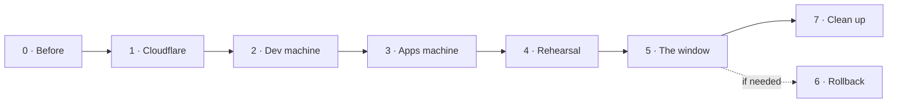

# The cutover: from one VPS on GitHub to two machines on Forgejo

This is the runbook for moving an installation from what runs today, **one rootful VPS that deploys from
GitHub**, to the default setup of [setup.md](setup.md): a **dev machine** (Forgejo, the Jenkins controller,
the build agents) and an **apps machine** (every environment), both rootless, with **Forgejo** as the git
server and **GitHub** as a push-mirrored copy. It covers rollout steps 2 to 5 and 8 of the
[design](superpowers/specs/2026-10-22-self-hosted-git-and-ci-design.md#rollout): Cloudflare, the two machines,
the maintenance window, and the clean-up. The work per repository afterwards (rollout steps 6 and 7: each
repository's `yggdrasil.yml`, `ci/` scripts, Renovate configuration and first release) is not here: it is
[moving-repositories.md](moving-repositories.md), which lands the branch prepared for each repository.

It does not repeat how to set a machine up: [setup.md](setup.md) does, and this page says which of its steps to
follow, in which order, and with which answers. What this page adds is the order, the checks between the
steps, and the window itself. Follow it from top to bottom. Every step says what to type, what you should see
(**Success looks like**), what to do when you don't (**If it fails**) and how to undo it (**Back out**). Stop
at the first step that does not look like its success line: the steps after it assume it.



| Section | Where | When | Time |
|---|---|---|---|
| [0. Before you start](#0-before-you-start) | Paper, the old VPS, GitHub | Days before | 1 hour |
| [1. Cloudflare](#1-cloudflare) | Cloudflare, your machine | Days before | 1 hour, plus name-server propagation |
| [2. The dev machine](#2-the-dev-machine) | Dev machine | Days before | 2 hours |
| [3. The apps machine](#3-the-apps-machine) | Apps machine | Days before | 1 hour, plus the env files |
| [4. Rehearse the move](#4-rehearse-the-move) | Your machine, the old VPS, the apps machine | The days before | 2 hours |
| [5. The window](#5-the-window) | Everywhere | One evening; production is off | 3 to 6 hours |
| [6. Rollback](#6-rollback) | Everywhere | Only if the window goes wrong | 1 hour |
| [7. Clean up](#7-clean-up) | GitHub, the old VPS | After the new apps machine has run a release | 30 min |
| [8. What you check by hand](#8-what-you-check-by-hand) | Browser, your machine | After the window | 30 min |

**Conventions.**

- Each command says where it runs: **your machine** (Git Bash on Windows; `python` if `python3` isn't on the
  path), **the old VPS** (as its admin, `<old admin>`), **the dev machine** or **the apps machine**, as the
  admin (`artur`) or as `ygg`. Placeholders are in angle brackets: `<old ip>`, `<dev ip>`, `<apps ip>`.
- **No secret goes on a command line.** Tokens are read with `read -rs` into a variable of the shell and
  exported; the scripts take them from the environment, and `curl` gets them on its standard input
  (`--config -`), from `printf`, a shell builtin that starts no process. Nothing in this page needs a real
  secret written into it: where one is asked for, the text says `<owner token>` and which token it is.
- On your machine, run the migration commands from a clone of your fork of yggdrasil (`cd <your clone of
  yggdrasil>`), and keep what they print. Make a folder for it, and let a piped command fail as itself:
  ```bash
  mkdir -p ~/cutover-log && set -o pipefail
  ```

## 0. Before you start

### 0.1 Write down today's setup

Fill this in first; later steps use every line.

| What | How to find it | Yours |
|---|---|---|
| The old VPS's address and admin | Your provider | `<old ip>`, `<old admin>` |
| The release the old VPS runs | On the old VPS: `git -C /opt/yggdrasil describe --tags` | e.g. `v0.7.4` |
| The old controller's address | On the old VPS: `grep '^JENKINS_URL=' /etc/yggdrasil/platform.env` | e.g. `https://jenkins.<old domain>/` |
| Today's domain(s) | `DOMAIN` in the same file (v0.7.4 has no `EXTRA_DOMAINS`), and any other domain the applications' env files name (0.4) | `<old domains>` |
| What production runs, per application | On the old VPS: `ygg status`: the `VERSION` and `COMMIT` columns of production | e.g. `heimdall-api 1.4.0 3f2a9c1` |
| The new machines | Two fresh Ubuntu 24.04 servers, rented now: their addresses are needed for DNS in section 1 | `<dev ip>`, `<apps ip>` |
| Whether the old VPS serves names under `techcraftsmen.net` or `artur-rios.tech` | Is one of them in `<old domains>`? | yes / no |

Write `<old domains>` as an extended regular expression for the searches below, the dots escaped:
`old\.example\.com|other\.example\.org`.

### 0.2 The old controller's library is pinned

From [CHANGELOG, Upgrading an existing GitHub installation](../CHANGELOG.md#upgrading-an-existing-github-installation-to-the-pipeline):
before the release with this pipeline reached your fork's `main`, the old controller's library was pinned to
the release it ran, so that it keeps deploying from GitHub until the window.

On the old controller: **Manage Jenkins → System → Global Trusted Pipeline Libraries** (Global Pipeline
Libraries on older versions) → `yggdrasil` → **Default version**.

**Success looks like:** the Default version is the tag of 0.1 (`v0.7.4`), not `main`, and the old VPS's
checkout is at that tag too (0.1's `git describe`).
**If it fails:** set it now, as the CHANGELOG says, and keep the checkout at that tag (`git -C /opt/yggdrasil
checkout <tag>`).
**Back out:** nothing to undo: the pin stays until the old VPS is switched off.

### 0.3 The GitHub paths were tried on a scratch repository

From [CHANGELOG, Before relying on it on GitHub](../CHANGELOG.md#upgrading-an-existing-github-installation-to-the-pipeline)
and [setup.md, An existing GitHub installation](setup.md#an-existing-github-installation): the pipeline's
GitHub paths were tested against fakes only. The scratch run is the check: a throwaway GitHub repository with
a `yggdrasil.yml`, a catalog entry with `forge.type: github` and a release environment, run through a pull
request into `develop`, a push that deploys, and a release pull request into `main`.

**Success looks like:** the pull request shows `branch-policy` and its checks as statuses; the push deploys;
the release pull request deploys, merges, tags `v0.1.0` and publishes its release.
**If it fails:** do not merge the release into your fork's `main`; the old controller keeps the release it
has. Report what failed.
**Back out:** delete the scratch repository's catalog entry; keep the repository itself until 4.5, which uses it.

The window itself does not need the GitHub paths (from section 5 on, Forgejo is the git server), but the
weeks between the release and the window run the old controller's pinned library against `main`'s scripts,
and a rollback (section 6) goes back to them.

### 0.4 Where the old host names are

If the applications use another domain today, their addresses move to `techcraftsmen.net`: every env file
that names the old one (public host, API base URLs compiled into the web bundles) changes before the first
deploy on the new machine. Find every place now. On your machine, with every application repository cloned
next to each other under `<your clones>`:

```bash
old='<old domains>'
for repo in <your clones>/*/; do
  git -C "$repo" fetch --quiet origin
  git -C "$repo" grep -nIE "$old" \
    $(git -C "$repo" for-each-ref --format='%(refname:short)' refs/remotes/origin/main refs/remotes/origin/develop) -- \
    | sed "s|^|$(basename "$repo"): |"
done
```

(`for-each-ref` names `origin/main` and `origin/develop`, whichever of them the repository has.)

and on the old VPS, the env files (`-o` prints only the name that matched, never the secret on its line):

```bash
sudo grep -rnoE '<old domains>' /etc/yggdrasil
```

With the variables store on the old VPS, read each scope instead: `ygg vars list <application>@<environment>
--resolved | grep -E '<old domains>'` (secrets stay masked).

**Success looks like:** a list of `file:line` places. Env files are fixed in 3.4. A place in an application's
code that runs (not documentation, not tests) is a release of that application with the fix, before the
window, or it breaks on the new name.
**If it fails:** `fatal: not a git repository` means a folder that is not a clone: ignore its line.
**Back out:** read only; nothing to undo.

### 0.5 The tokens

Five secrets are used during the move. Make the ones you can now and keep them in your password manager.

| Token | Make it | Used by |
|---|---|---|
| Cloudflare DNS token | 1.2 | `cloudflare_dns.py`, both machines' `acme.env` |
| Forgejo owner token, scopes **`write:repository` and `read:user`** | 2.4, once Forgejo is up | `migrate.py`, `rules.py` (`FORGE_TOKEN`) |
| GitHub token for the window: a classic token with the `repo` scope, 7 days | 4.1 | `migrate.py`, `rules.py` (`GH_TOKEN`) |
| GitHub mirror token: fine-grained, Contents and Workflows **Read and write** on all your repositories | 4.1 | `migrate.py mirrors`, then Forgejo keeps it (`MIRROR_GITHUB_TOKEN`) |
| The webhook secret | setup.md 9.7 makes it on the dev machine | `rules.py` (`FORGE_WEBHOOK_SECRET`) |

**`read:user` is needed:** `migrate.py collaborators` looks each bot account up (`GET /users/<name>`), which
Forgejo refuses to a token with `write:repository` alone (`403 token does not have at least one of required
scope(s): [read:user]`, seen against Forgejo 16 while writing this page). The rest of the move works with
`write:repository` only.

## 1. Cloudflare

Rollout step 2. Both zones on Cloudflare, the token, the two settings the token cannot change, and the
records. Nothing in this section changes what the old VPS serves.

### 1.1 `artur-rios.tech` on Cloudflare

Only if it is not a Cloudflare zone yet (the dashboard's account home lists your zones). Its records come with
it, so `www.` and `blog.` keep pointing at Vercel until their sites move.

1. At the current DNS provider, export the zone or write down every record (name, type, value): it is what
   you check the import against, and the way back.
2. Follow [dns.md A2](dns.md#a2-move-its-dns-to-cloudflare) (DNSSEC off at the registrar first, **Add a
   domain**, the **Free** plan, the two name servers at the registrar).
3. Before you change the name servers, in the imported records: the `www` and `blog` `CNAME`s (to Vercel),
   and anything at the bare domain that points at Vercel, are **DNS only** (grey cloud), as Vercel wants; mail
   records (`MX`, `TXT`) are there as before.

**Success looks like:** Cloudflare marks the zone **Active**, and from any machine:
```bash
curl -s -H 'accept: application/dns-json' 'https://cloudflare-dns.com/dns-query?name=artur-rios.tech&type=NS'
curl -sI https://www.artur-rios.tech | grep -iE '^(HTTP|server)'
```
the first lists the two `*.ns.cloudflare.com` servers, the second still answers `200` from Vercel
(`server: Vercel`). Do the same for `blog.`.
**If it fails:** a site that stopped answering lacks a record: add it in Cloudflare as it was at the old
provider (step 1's list).
**Back out:** at the registrar, put the old name servers back; the old provider's zone was never changed.

`techcraftsmen.net` must be a Cloudflare zone too; if it is not, do the same for it.

### 1.2 The DNS token

Follow [dns.md A4](dns.md#a4-create-the-api-token): **Zone → Zone → Read** and **Zone → DNS → Edit**, one
*Zone Resources* row for `techcraftsmen.net` and one for `artur-rios.tech`, no end date. Then, on your machine:

```bash
read -rs CF_DNS_API_TOKEN && export CF_DNS_API_TOKEN      # paste the token, then Enter
printf 'header = "Authorization: Bearer %s"\n' "$CF_DNS_API_TOKEN" \
  | curl -s --config - https://api.cloudflare.com/client/v4/user/tokens/verify
```

**Success looks like:** `"status":"active"`. The dry run of 1.5 then proves it can read both zones.
**If it fails:** `Invalid API Token` is a copy mistake; make it again.
**Back out:** **My Profile → API Tokens → Roll** or **Delete** next to it.

### 1.3 SSL/TLS: Full (strict), both zones

The token cannot change zone settings, so this is by hand: in each zone, **SSL/TLS → Overview**, and choose
**Full (strict)** (under *Custom SSL/TLS* where the page offers *Automatic*). Write down the mode it had.
*Flexible* makes every page loop (`ERR_TOO_MANY_REDIRECTS`), and *Full* without *strict* accepts any
certificate ([hosts.md, Cloudflare settings](hosts.md#cloudflare-settings)).

**Success looks like:** the Overview page shows **Full (strict)** for both zones, and a proxied name the old VPS
serves today (if any) still opens without error: `curl -sI https://<a proxied name> | head -1` is not `526`.
**If it fails:** `526` means the origin behind that name has no valid certificate: put the old mode back and
fix that origin first.
**Back out:** choose the mode you wrote down.

### 1.4 The cache rule

APIs and the status API are never cached. In the zone `techcraftsmen.net`: **Caching → Cache Rules → Create
rule**, name `apis never cached`, **Edit expression**, and paste:

```text
starts_with(http.request.uri.path, "/api/") or http.host in {"heimdall-api.techcraftsmen.net" "heimdall-api-dev.techcraftsmen.net" "heimdall-api-hml.techcraftsmen.net" "fortuna-api.techcraftsmen.net" "fortuna-api-dev.techcraftsmen.net" "fortuna-api-hml.techcraftsmen.net"}
```

(the catalog's `api` applications with their `host`, in every environment's `hostSuffix`; add any other
API's names). **Cache eligibility: Bypass cache** → **Deploy**.

**Success looks like:** the rule is listed as active. Its proof comes after the window, in
[section 8](#8-what-you-check-by-hand): `cf-cache-status` is `DYNAMIC` or `BYPASS` on an API's answers.
**If it fails:** an expression error names the part: the hosts are written with spaces between them, no commas.
**Back out:** delete the rule.

### 1.5 The records

`scripts/cloudflare_dns.py` makes every record of [hosts.md, DNS records](hosts.md#dns-records) and marks each
with the comment `yggdrasil`. A record **without** that comment was made by hand: it is reported and never
changed, and the run exits `1`. That is what keeps this step from touching what the old VPS serves.

For `--apps`, give the address the bare domains and `*` should have **until the window**: `<old ip>` if the
old VPS serves names under these zones (0.1), else `<apps ip>`. First export each zone as it is (**DNS →
Records → Import and Export → Export**): it is the record of what was there, for 5.8 and a rollback. Then, on
your machine, with the token of 1.2:

```bash
python3 scripts/cloudflare_dns.py --dry-run --apps <old ip or apps ip> --dev <dev ip> --skip-caa artur-rios.tech
```

`--skip-caa artur-rios.tech` leaves that zone's `CAA` out (`CAA skipped on artur-rios.tech (--skip-caa)`): the
record allows Let's Encrypt only through DNS-01, and Vercel renews the certificates of `www.` and `blog.` through
Let's Encrypt over HTTP-01, so it would break them at their next renewal, weeks later, where no check made today
would see it. Every `cloudflare_dns.py` command of this page passes the flag. Drop it once `www.` and `blog.` have
moved off Vercel (plan 5); the next run then makes the record.

Read every line. The run is not trusted until you have: the wildcard's name filter and the format of the
`CAA` value were never checked against Cloudflare itself.

- `would create A git.techcraftsmen.net: <dev ip> (DNS only)`, the same for `jenkins.`, `traefik-dev.` and
  `grafana-dev.`, and `would create CAA techcraftsmen.net: 0 issue "letsencrypt.org; validationmethods=dns-01"`:
  expected.
- `... made by hand; change it or delete it yourself` for today's records (the bare domain and `*` of a zone
  the old VPS serves, the Vercel record at `artur-rios.tech`): expected now. Leave them; 5.8 deals with the
  ones that move.
- `a CNAME to ... is at this name`: expected for the Vercel names. At the bare domain or `*` of a zone that
  must reach the new apps machine, note it for 5.8.
- An `AAAA` record at a name the script wants is not looked at unless it carries the comment. Note any at the
  bare domains and `*` (**DNS → Records**, type `AAAA`): 5.8 deals with them.
- **If `JENKINS_URL` of 0.1 is `https://jenkins.techcraftsmen.net/`**, the new `jenkins` record takes that name
  from the old controller as soon as it exists: GitHub's webhooks then reach the new controller, which ignores
  them, and the old one only sees a change at its daily rescan (or **Scan Repository Now** in each job). The dev
  machine needs its names from 2.3 on, so in that case run the real command below when you start 2.3, keep 2.3
  to the window within a few days, and plan no release in between.
- **A hand-made `A jenkins.techcraftsmen.net`** (or `git.`, `traefik-dev.`, `grafana-dev.`) is reported `made by
  hand` and the script makes no record of its own beside it, so that name never reaches the dev machine. When
  you start 2.3, delete it, or set its *Comment* to `yggdrasil` so the script updates it in place, and run again.
  (5.8 checks it once more.)

Then the same without `--dry-run`:

```bash
python3 scripts/cloudflare_dns.py --apps <old ip or apps ip> --dev <dev ip> --skip-caa artur-rios.tech
```

**Success looks like:** `CAA skipped on artur-rios.tech (--skip-caa)`, `create` lines for what was missing (at
least the dev names and the `CAA` of `techcraftsmen.net`), `N of 9 records already right`, and an exit status
(`echo $?`) of `0`, or of `1` with a `to see to:` list that holds **only** the hand-made records above. From any
machine, `nslookup git.techcraftsmen.net 1.1.1.1` prints `<dev ip>`. In `techcraftsmen.net`, **SSL/TLS → Edge
Certificates** still shows the Universal certificate **Active**. That proves only today: the edge certificate,
and the certificates of anything else under the zone, renew later, against the new `CAA`. Cloudflare's own
renewals are its business with the CAs it uses; if one of yours fails in the weeks after, the `CAA` is the first
thing to look at (Back out).
**If it fails:** `zone ... not found: does the token have access to it?` is the token's *Zone Resources*
(1.2); a `CAA` that Cloudflare refuses names its value: report it before going on.
**Back out:** delete the records with the comment `yggdrasil` in the dashboard (**DNS → Records**, the
*Comment* column); nothing else was changed. A `CAA` that turns out to block a certificate: delete it and pass
`--skip-caa techcraftsmen.net` too until the cause is gone.

## 2. The dev machine

Rollout step 3: OS hardening, users, rootless engines, Traefik, Forgejo, monitoring, the new Jenkins
controller and the build agents; the Forgejo accounts and bots; Jenkins configured against Forgejo, with the
repositories still on GitHub.

### 2.1 Prepare it

[setup.md step 8](setup.md#8-prepare-each-machine), all of it, with `--role dev`.

**Success looks like:** `ygg check --role dev` (as the admin, after `sudo -v`) has every row `ok`, but the
Backups rows (until 3.5) and `renovate github token` (a `warn` until 2.7, and for good if you don't set one).
**If it fails:** each row names its fix; `ygg install --role dev` is safe to run again.
**Back out:** the machine is new: rebuild it from the provider's image.

### 2.2 The catalog the dev machine reads

The dev machine's Jenkins must be configured against Forgejo now, while your fork's `main` still describes a
GitHub installation, which the old controller reads. So the dev machine's checkout gets the two blocks of 5.9
as a local change that is never committed there. As `ygg`, `nano /opt/yggdrasil/catalog.yaml`, and add after
the `repository:` line:

```yaml
forge:
  type: forgejo
  url: https://git.techcraftsmen.net
  developers: [claude]
mirror:
  github: artur-rios
  releases: true
```

- `forge`: the git server is Forgejo. `jenkinsUser` stays at its default, `jenkins`; `developers: [claude]` may
  merge into `develop` besides you ([catalog.md](catalog.md#git-server)).
- `mirror`: every repository has a copy under `github.com/artur-rios`, and releases are copied there too.

**Success looks like:** `python3 /opt/yggdrasil/scripts/catalog.py forge type` prints `forgejo` and
`python3 /opt/yggdrasil/scripts/catalog.py mirror github` prints `artur-rios`.
**If it fails:** `catalog.py validate` names the line.
**Back out:** `git -C /opt/yggdrasil checkout -- catalog.yaml`.

### 2.3 Forgejo, the controller and the agents

[setup.md step 9](setup.md#9-the-dev-machine), with these answers:

- **9.1**, the GitHub App key: the dev machine uses the old controller's App (the same App ID), with a key of its
  own. In the App's **General** page, **Generate a private key** (an App can have several: the old controller
  keeps its own), then 9.1 as written. 7.4 says how.
- **9.2**: `DOMAIN=techcraftsmen.net`, `PLATFORM_HOST_SUFFIX=-dev`, `CLOUDFLARE_PROXIED=false`,
  `COMPOSE_PROFILES=forge` first, `YGGDRASIL_LIBRARY_VERSION` the latest release tag that exists
  (`git tag --list 'v*'` in your clone, the one the dry runs of 4 use; it is on Forgejo after 5.11), `GITHUB_APP_ID`
  the old controller's. The pipeline of the repositories' plan arrives with the release of
  [5.8a](#58a-the-release-that-carries-the-repositories-plan), when you set the variable to its tag.
- **9.6**: the first account is the owner, `--username artur-rios`: the catalog's `owner` is the Forgejo owner of
  every repository.
- **9.7**: `jenkins`, `jenkins-ci` and `renovate` with their tokens, **and a fourth account, `claude`**, made the
  same way with no token (its development user comes later): `migrate.py collaborators` gives it write access
  and `verify` checks it. The collaborators of 9.7's last paragraph are **not** given by hand: the repositories
  are not there yet; 5.14 does it.
- **9.4**: Jenkins' jobs exist for every catalog application, and each one's scan fails to find its repository
  on Forgejo: expected until the window. GitHub's webhook stays active for the old controller.
- **9.8**: both build agents.

**Success looks like:** as `ygg`, `/opt/yggdrasil/scripts/platform.sh ps` lists `forgejo`, `jenkins` and
`traefik` `(healthy)`; `https://git.techcraftsmen.net` and `https://jenkins.techcraftsmen.net` open without a
certificate warning; **Manage Jenkins → Nodes** shows `ci` and `release` connected and `vps` offline (it comes up
in 3.3).
**If it fails:** [setup.md, Troubleshooting](setup.md#troubleshooting).
**Back out:** `platform.sh down` as `ygg`; the volumes stay.

### 2.4 The owner's token

In Forgejo, signed in as `artur-rios`: **Settings → Applications → Generate New Token**, name `cutover`,
*Repository and Organization Access* **All**, permissions **repository: Read and Write** and **user: Read**,
**Generate Token**. Then on your machine:

```bash
read -rs FORGE_TOKEN && export FORGE_TOKEN      # the token, then Enter
printf 'header = "Authorization: token %s"\n' "$FORGE_TOKEN" \
  | curl -sS --config - https://git.techcraftsmen.net/api/v1/user -o /dev/null -w '%{http_code}\n'
```

**Success looks like:** `200` (that call needs `read:user`).
**If it fails:** `403`: the user scope is missing; `401`: a copy mistake.
**Back out:** **Settings → Applications**, **Delete** next to it (7.3 does).

### 2.5 Forgejo may deliver webhooks to Jenkins

As `ygg`:

```bash
docker inspect --format '{{range .Config.Env}}{{println .}}{{end}}' \
  "$(docker ps -q --filter label=com.docker.compose.project=yggdrasil --filter label=com.docker.compose.service=forgejo)" \
  | grep ALLOWED_HOST_LIST
```

**Success looks like:** `FORGEJO__webhook__ALLOWED_HOST_LIST=external,jenkins`: the public
`https://jenkins.techcraftsmen.net` (which this page uses, as setup.md step 12 does) and the internal
`http://jenkins:8080` are both allowed. A delivery is tried for real in 5.18.
**If it fails:** the checkout is older than this release: `git -C /opt/yggdrasil pull`, then `platform.sh up`.
**Back out:** nothing changed.

### 2.6 The rootless proofs

As the admin:

```bash
cd /opt/yggdrasil && sudo -v && scripts/prove-machine.sh dev
```

`scripts/prove-machine.sh` proves, on the real machine, what the design says about the rootless setup. Run it as
the admin with `sudo` working, never as root (it refuses). It prints one row per proof, `ok`, `FAIL` or `look`,
and exits `1` on any `FAIL`.

**Success looks like:** four `ok` rows: `no root services`, `ci -> ygg (host)`, `ci -> ygg (docker)` and
`testcontainers`; exit `0`.
**If it fails:** a `FAIL` row says what was reached or what could not be proven. `ci -> ygg (docker)` saying
`refused for another reason`: read its message. This script has not run on a real machine before, and two
things in it are unproven there: how `sudo` passes a file on standard input (`testcontainers`), and the wording
of the engine's refusal to mount another user's directory, which the row matches. Stop if the message is not
a permission refusal.
**Back out:** read only; it removes its own `ygg-prove-*` containers.

### 2.7 Renovate, once by hand

[setup.md 9.9](setup.md#99-renovate): `RENOVATE_TOKEN`, and optionally `RENOVATE_GITHUB_COM_TOKEN`, in
`/etc/yggdrasil-renovate/renovate.env`, then as the admin:

```bash
cd /opt/yggdrasil && sudo -u renovate env XDG_RUNTIME_DIR=/run/user/$(id -u renovate) scripts/renovate.sh run
```

**Success looks like:** Renovate pulls its image, signs in to `https://git.techcraftsmen.net/api/v1` with the
token (no authentication error) and reports each catalog repository as not found: they arrive in the window,
and 5.18 runs it again.
**If it fails:** `renovate: ...` lines are the script's own (a setting); an authentication error from Renovate
is the token or its scopes (9.7).
**Back out:** nothing to undo; the timer runs it daily from now on, harmlessly.

## 3. The apps machine

Rollout step 4: a new VPS with the `ygg` user and its rootless engine, the platform, checked with no
application deployed yet.

### 3.1 Prepare it

[setup.md step 8](setup.md#8-prepare-each-machine) with `--role apps`.

**Success looks like:** `ygg check --role apps` has every row `ok` but the Backups rows (until 3.5).
**If it fails:** each row names its fix; `ygg install --role apps` again.
**Back out:** rebuild it.

### 3.2 The catalog on the apps machine

The apps machine runs no Jenkins and its checkout keeps your fork's `main` as it is: nothing to edit.

### 3.3 The platform

[setup.md step 10](setup.md#10-the-apps-machine): `ENVIRONMENTS=development,homologation,production`,
`COMPOSE_PROFILES=apps,agent`, `DOMAIN=techcraftsmen.net`, `EXTRA_DOMAINS=artur-rios.tech`,
`CLOUDFLARE_PROXIED=true`, `JENKINS_URL=https://jenkins.techcraftsmen.net/`, and the `vps` node's name and
secret from the dev machine's Jenkins (**Manage Jenkins → Nodes → vps**).

Until the window the domains may still point at the old VPS, and the firewall lets only Cloudflare in, so check
the certificates **from the apps machine itself**, as `ygg`:

```bash
curl -kvI --resolve yggdrasil.techcraftsmen.net:443:127.0.0.1 https://yggdrasil.techcraftsmen.net 2>&1 | grep -i issuer
```

**Success looks like:** an issuer with `(STAGING)` first; after setup.md 10's step 4 (the real certificate),
Let's Encrypt's without `(STAGING)`, and the same for a name under `artur-rios.tech`. `platform.sh ps` shows
every service `Up`, `traefik`, `status` and `console` `(healthy)`. In Jenkins, the `vps` node is connected.
**If it fails:** `docker logs yggdrasil-traefik-1 2>&1 | grep -iE 'acme|error' | tail -20`, and
[dns.md troubleshooting](dns.md#troubleshooting). The `vps` node offline: the agent's log (`docker logs
yggdrasil-agent-1`) says why; `nslookup jenkins.techcraftsmen.net 1.1.1.1` must print `<dev ip>` (1.5).
**Back out:** `platform.sh down` as `ygg`.

### 3.4 The application env files

[setup.md step 11](setup.md#11-application-env-files), one per application and environment, from the old VPS's,
with the new host names (0.4) written in now. First, as `ygg` on the apps machine, the environment's directory as
setup.md 11 makes it (`install -d -m 750 /etc/yggdrasil/<environment>`). Then, to carry a file without showing its
secrets, from your machine (`scp -3` copies between the two hosts through yours, without storing it):

```bash
scp -3 <old admin>@<old ip>:/etc/yggdrasil/production/heimdall-api.env ygg@<apps ip>:/etc/yggdrasil/production/heimdall-api.env
```

then, as `ygg` on the apps machine, `chmod 600` it and edit its host names (`nano`). A file the old admin cannot
read: on the old VPS, `sudo install -m 600 -o "$USER" <file> ~/` first, copy that one, and delete it afterwards.
With the variables store on the old VPS, `ygg vars export <scope>` there and `ygg vars import <scope> <file>` here,
through a file of mode `600` that you delete afterwards. The database passwords and keys stay what they were: the
data comes with them (5.4).

**Success looks like:** as `ygg`, `grep -rnoE '<old domains>' /etc/yggdrasil` prints nothing (with a store,
`ygg vars list <application>@<environment> --resolved | grep -E '<old domains>'` for each), and
`python3 /opt/yggdrasil/scripts/catalog.py environments <application>` lists exactly the environments you made
files for.
**If it fails:** a line names the file and the old name: edit it.
**Back out:** the files are new; delete them.

### 3.5 The proofs and the backups

As the admin, `cd /opt/yggdrasil && sudo -v && scripts/prove-machine.sh apps`.

**Success looks like:** `no root services` `ok`. The `client addresses` row is a `look`, and says there is no
request yet: it is read again in 5.20, once the names point here.
**If it fails:** as in 2.6.
**Back out:** read only.

Then the backups between the two machines: [hosts.md, Backups](hosts.md#7-backups-and-restore), the keys in both
directions and the dev machine's `backup.conf` with `volume yggdrasil_jenkins` for now. Forgejo's item and the
apps machine's `backup.conf` wait for the data, in 5.21.

**Success looks like:** on the dev machine, as `ygg`, `ygg backup run` ends without an error and `ls
~/received/from-dev` on the apps machine shows the day.
**Back out:** remove the key's line from the receiver's `~/.ssh/authorized_keys`.

## 4. Rehearse the move

On the days before the window, with production still running from GitHub. Nothing here is visible to users.

### 4.1 The two GitHub tokens

- **For the window** (`GH_TOKEN`): GitHub → **Settings → Developer settings → Personal access tokens → Tokens
  (classic) → Generate new token (classic)**, note `cutover`, an expiration a few days after the window, scope
  **`repo`**. It lists your private repositories, deletes their rulesets, sets their settings, and is handed to
  Forgejo, which reads the issues, pull requests and releases with it. 7.3 revokes it.
- **For the mirrors** (`MIRROR_GITHUB_TOKEN`): **Fine-grained tokens → Generate new token**, name
  `forgejo-mirror`, resource owner `artur-rios`, the longest expiry you accept (write its date down: on that day
  every mirror stops; 7.3 says how to give them a new one), **All repositories**, repository permissions
  **Contents: Read and write** and **Workflows: Read and write** (the mirror pushes commits that touch
  `.github/workflows`).

On your machine:

```bash
read -rs GH_TOKEN && export GH_TOKEN
read -rs MIRROR_GITHUB_TOKEN && export MIRROR_GITHUB_TOKEN
export MIRROR_GITHUB_USER=artur-rios
printf 'header = "Authorization: Bearer %s"\n' "$GH_TOKEN" | curl -sS --config - -I https://api.github.com/user | grep -i '^x-oauth-scopes'
printf 'header = "Authorization: Bearer %s"\n' "$MIRROR_GITHUB_TOKEN" \
  | curl -sS --config - https://api.github.com/repos/artur-rios/<a private repository> -o /dev/null -w '%{http_code}\n'
```

**Success looks like:** `x-oauth-scopes: repo`, then `200`.
**If it fails:** `401`: a copy mistake; `404` on the second: the fine-grained token does not cover that repository.
**Back out:** delete them on the same pages.

### 4.2 Your catalog, locally

`migrate.py` and `rules.py` read the Forgejo side and the mirror from the catalog, so your clone of yggdrasil
gets the two blocks of 2.2 now, **uncommitted** (the old controller reads `main`, and they go there in 5.9):
add them to `catalog.yaml`, then `python3 scripts/catalog.py validate`.

**Success looks like:** `validate` passes and `git status` shows `catalog.yaml` modified, nothing committed.
**Back out:** `git checkout -- catalog.yaml`.

### 4.3 The inventory

```bash
python3 scripts/migrate.py inventory | tee ~/cutover-log/inventory-rehearsal.txt
```

(Before 4.2, `python3 scripts/migrate.py --github-owner artur-rios inventory` does the same.) One line per
repository: name, `private` or `public`, fork `yes`/`no`, open pull requests, in the catalog `yes`/`no`; then the
totals.

**Success looks like:** the totals line, `<N> repositories: ...` (60 today; this `<N>` is the count every later
step expects), and exit `0`. Keep the file: it tells you which
repositories are **private and in the catalog** (6 lists them), which are archived, and which have open pull
requests.
**If it fails:** exit `1` with `<repository>: N open pull requests: finish or close them first` is the list of
work before the window: merge or close each (Dependabot's included); the window starts only when this exits `0`.
`the GitHub token is ...'s, not artur-rios's`: `GH_TOKEN` must be the owner's.
**Back out:** read only.

### 4.4 One import, and its verify

Import one small repository, to see a real GitHub migration (issues, pull requests, releases) and how long it
takes, then look at it with `verify`. Delete the copy afterwards (Back out, below): a copy imported now is not
imported again in the window (`already imported`), and would miss every commit made on GitHub since.

```bash
python3 scripts/migrate.py import --only <small repository> | tee ~/cutover-log/import-rehearsal.txt
python3 scripts/migrate.py verify --only <small repository>
```

**Success looks like:** `<small repository>: imported`, exit `0`, and on Forgejo the issues, pull requests and
releases are there (compare their counts with GitHub's by eye). `verify` prints `on Forgejo ok`, `visibility ok`
and `default branch ok` (for a release-model catalog repository whose GitHub default branch is not `develop`,
that row is a `FAIL` until `rules.py` sets `develop` in 5.15; a `rules: basic` one keeps GitHub's); the other rows `FAIL` (`no push mirror`, `issues are on`, ...)
because the rest of the move has not run: that is expected here, and it is what the window fixes. Note how long
the import took: the window imports the others one after the other.
**If it fails:** `import failed: ...` is Forgejo's own message. A client timeout (`timed out`) does not stop the
migration on Forgejo's side: wait until the repository on Forgejo has its content (watch its page) before running
import again. An import that left an empty repository is reported `exists but looks unfinished (empty): delete it
on Forgejo and run import again`: do that, by hand (the repository's **Settings → Danger Zone → Delete this
repository**). `MIGRATE_TIMEOUT=3600` (seconds) gives a large repository longer than the default 30 minutes.
**Back out:** delete the copy on Forgejo the same way: do it now, so that the window imports it fresh.

### 4.5 One mirror, and its error

The push mirror is the one part of the move that cannot be tried without GitHub: Forgejo pushes with
`--mirror`. Try it on **one repository that has pull requests and that you can spare** (the scratch repository
of 0.3 is the right one): `prepare-github` deletes its rulesets, turns its issues off and rewrites its
description, and from then on the mirror overwrites its GitHub side with Forgejo's.

Give it a Dependabot file first, if it has none, so that the rehearsal carries a `prepare-github` commit to
GitHub as the window does for most repositories: on GitHub, in the scratch repository's default branch, **Add
file → Create new file**, `.github/dependabot.yml`, with the two lines `version: 2` and `updates: []`, **Commit
changes** (an empty `updates` list: Dependabot opens nothing). Then, on your machine:

```bash
python3 scripts/migrate.py import --only <scratch>
python3 scripts/migrate.py prepare-github --only <scratch>
python3 scripts/migrate.py mirrors --only <scratch>
python3 scripts/migrate.py verify --only <scratch>
```

Wait a minute after `mirrors` (it asks for one sync, which Forgejo runs in the background) before `verify`.

Before it makes a mirror, `mirrors` compares GitHub's branches and tags with Forgejo's: the mirror's first push
deletes on GitHub whatever Forgejo lacks, so a repository where GitHub has a branch or tag Forgejo does not, a
branch whose commit is not in Forgejo's branch of that name, or a tag at another commit, is refused, each ref
named, and gets no mirror. Here Forgejo's copy is a minute old, so nothing is refused: the Dependabot commit puts
Forgejo's default branch ahead of GitHub's, which takes nothing from GitHub.

**Success looks like:** `deleted .github/dependabot.yml on <default branch>`, then `push mirror created`, `sync
requested`; then verify's `push mirror ok synced <time>` and `refs ok`. On GitHub, the default branch's latest
commit is `chore: stop dependabot; renovate replaces it`, by you. Look at the mirror on Forgejo as well: the
repository's **Settings → Repository → Mirror settings** lists it with its last update and no error.
**If it fails:**
- **`the first mirror push would delete or move what only GitHub has: <ref> ...`**: the guard. Something reached
  GitHub after the import (a push, a merged pull request). Delete the copy on Forgejo (Back out) and start this
  step again. The refusal ends ``or run `mirrors --only <repo> --allow-prune` once you've checked``: that would
  make this one repository's mirror anyway and delete or move each ref it names. That is `--mirror` working,
  and from the window on Forgejo is the record (against a Forgejo standing in for GitHub, while writing this
  page, a branch made on the copy only was refused, then deleted by the first sync with `--allow-prune`), but it
  is never what the window wants.
- **The mirror's last error names `refs/pull/...` (`deny updating a hidden ref`, or similar).** Forgejo keeps
  each imported pull request's head as `refs/pull/<n>/head`, and GitHub refuses pushes there. Against a Forgejo
  stand-in, Forgejo 16 pushed the branches and no `refs/pull/*` and had no error, but GitHub was not there to
  prove it. If the error shows up: **stop, and decide before mirroring all of them.** `verify` fails the push mirror
  row of every repository with pull requests while it does, so the window cannot end with verify clean.
- `has a push mirror to ..., not to ...`: remove that mirror on Forgejo yourself.
**Back out:** on Forgejo, delete the push mirror (Mirror settings) and the copy (Danger Zone): do it now, as in
4.4. The scratch repository's GitHub side stays as `prepare-github` left it; delete it on GitHub too
(**Settings → Delete this repository**), unless you want it moved with the others.

### 4.6 The volumes, compared

Each application's data is a Docker volume named `<project>_<volume>`, and the new deploys use the project
`<application>-<environment>`. On the old VPS (its engine is rootful: `docker` there is `sudo docker`):

```bash
sudo docker volume ls --filter label=com.docker.compose.project \
  --format '{{.Name}}\t{{.Label "com.docker.compose.project"}}\t{{.Label "com.docker.compose.volume"}}'
```

For each application, the names the new deploy will use are `<application>-<environment>_<name>`, one for each
key under the top-level `volumes:` of its stack's files (`stacks/<application>.yml`, or the repository's own
`docker-compose.yml`); a volume with a `name:` there is exactly that name.

**Success looks like:** every application volume of the list has a name the new deploys will use. The
platform's own (`yggdrasil_*`: the old Jenkins, the certificates, metrics and logs) are not carried: the new
machines have their own, and the old Jenkins' history stays on the old VPS.
**If it fails:** a renamed project or volume needs the volume renamed in the move, which `volumes.sh` does not
do: after 5.5, before 5.6, rename `<old name>.tar` to `<new name>.tar` in `~/cutover` and change the first three
columns of its line in `manifest.tsv` (`<new name>`, its project, its Compose volume) with `nano`. The size and
the checksum columns stay: they are the file's, and the file did not change. A volume without the Compose
labels that holds data is not carried by `volumes.sh` at all: carry it as
[hosts.md, Upgrading](hosts.md#9-upgrading-a-host-from-rootful-docker) step 2 does.
**Back out:** read only.

Then put the two scripts on the old VPS, from your clone (at the release with this runbook):

```bash
ssh <old admin>@<old ip> mkdir -p cutover-tools
scp scripts/volumes.sh scripts/docker-engine.sh <old admin>@<old ip>:cutover-tools/
```

`volumes.sh` sources `docker-engine.sh` from its own folder; the old VPS needs nothing else of the repository.

### 4.7 One volume, rehearsed

The volumes go once, in the window, from the old VPS's rootful engine to `ygg`'s rootless one, and a database
whose files come out with the wrong owners only shows when production does not start. Rehearse it now with one
volume that holds a database and that nothing needs: one of an on-demand environment (`development` or
`homologation`) from 4.6's list, stopped. Not production's, which runs until 5.3: `volumes.sh` refuses a volume
that a running container mounts.

On the old VPS, check that no running container mounts it (the first command prints nothing; else `ygg env stop
<environment>` first), then export it alone, to a directory of its own (5.4 refuses a directory that holds an
export, so not `/srv/cutover`), and hand the files to the admin:

```bash
sudo docker ps --filter volume=<volume> --format '{{.Names}}'
sudo bash ~/cutover-tools/volumes.sh export /srv/cutover-rehearsal <volume>
sudo chown -R "$USER": /srv/cutover-rehearsal
```

From your machine, copy it to `ygg` on the apps machine, as 5.5 does:

```bash
scp -3 -r <old admin>@<old ip>:/srv/cutover-rehearsal ygg@<apps ip>:
```

On the apps machine, as `ygg`, give it a scratch name first, so that it can never be taken for the volume a
deploy will use: rename its `.tar`, and in `manifest.tsv` change the first three columns of its one line (the
volume's name, its project, its Compose volume) to `rehearsal-scratch_data`, `rehearsal-scratch` and `data`,
leaving the size and the checksum as they are (4.6 says why). Then import it:

```bash
cd ~/cutover-rehearsal && mv <volume>.tar rehearsal-scratch_data.tar && nano manifest.tsv
/opt/yggdrasil/scripts/volumes.sh import ~/cutover-rehearsal
```

Then start the database image the application uses on it, once, and read it:

```bash
docker run -d --name ygg-rehearsal-db -v rehearsal-scratch_data:<data path> <image>
sleep 15; docker logs ygg-rehearsal-db 2>&1 | tail -5
docker exec ygg-rehearsal-db psql -U <user> -d <database> -c '\dt'
```

- `<image>` and `<data path>`: the database service's `image:` and the path its volume is mounted at, in the
  application's stack file (4.6): the same image, so that the same version reads the files.
- `<user>` and `<database>`: `POSTGRES_USER` and `POSTGRES_DB` (the user's name when it is not set) in that
  environment's env file (3.4). No password is needed: the image asks for one only to create a database, and
  `psql` inside the container connects over its socket, which the image trusts. A database of another kind: its
  own image and client, the same way.

Last, remove what the rehearsal made, on the apps machine as `ygg` and on the old VPS:

```bash
docker rm -f ygg-rehearsal-db && docker volume rm rehearsal-scratch_data && rm -r ~/cutover-rehearsal
```
```bash
sudo rm -r /srv/cutover-rehearsal
```

**Success looks like:** `volumes: exported 1 volume(s) to /srv/cutover-rehearsal`; `volumes: creating
rehearsal-scratch_data`, then `volumes: imported 1 volume(s) from /home/ygg/cutover-rehearsal`; the log ends
with `database system is ready to accept connections` (after `Skipping initialization`: it found its data), and
`\dt` lists the application's tables.
**If it fails:** `used by a running container, stop it first`: that environment is on; stop it. `nothing
imported: ...` names the file or the manifest line that is wrong: a renamed `.tar` must be the manifest's first
column with `.tar` after it. The database refuses to start (`Permission denied`, `wrong ownership`, `could not
open file`): the owners of its files did not come through, and the window's import would break every database
the same way. **Stop and report it**; the window does not start.
**Back out:** the last two commands; the old VPS's volume was only read.

### 4.8 Go or no go

The window starts only when all of these hold:

- [ ] 0.2, 0.3 and 0.4 are done, and no application's code needs a release for its host names.
- [ ] `inventory` exits `0`: no open pull request anywhere.
- [ ] 2.3 to 2.7 and 3.3 to 3.5 looked like their success lines.
- [ ] 4.4 and 4.5 worked, and the mirror had no `refs/pull` error.
- [ ] 4.4's rehearsal copy is deleted on Forgejo (and 4.5's, with its mirror): one left there reads `already
  imported` in 5.11 and misses every commit made on GitHub since (5.13 would then refuse it).
- [ ] 4.7's volume started on the apps machine with its data readable, and the rehearsal's volume, container and
  files are removed.
- [ ] You know how long an import takes, and the window is long enough for 4.3's `<N>` of them.
- [ ] The tokens of 0.5 are in your password manager.

## 5. The window

Rollout step 5, in one sitting. Production is off from 5.3 to 5.17. The data and the repositories move together,
since the new deploy agent cannot use the new controller until the repositories are on Forgejo. From 5.3 on,
nobody merges, pushes to GitHub, or deploys: a commit pushed to GitHub after 5.11 is one Forgejo's copy lacks,
and 5.13 refuses that repository's mirror rather than let its first push delete it (`--allow-prune` would).

### 5.1 Announce

Tell the users of the applications that production is off from now for the window, and its end time. Pause
anything outside yggdrasil that writes to the applications.

**Success looks like:** the notice is out.
**Back out:** say the window is cancelled.

### 5.2 The shell, and no open pull requests

On your machine, in your clone of yggdrasil, one shell for the whole window, with every token of 0.5 (from your
password manager) and the Jenkins address:

```bash
set -o pipefail
read -rs CF_DNS_API_TOKEN && export CF_DNS_API_TOKEN          # 1.2
read -rs FORGE_TOKEN && export FORGE_TOKEN                    # 2.4, the owner's
read -rs GH_TOKEN && export GH_TOKEN                          # 4.1, the classic one
read -rs MIRROR_GITHUB_TOKEN && export MIRROR_GITHUB_TOKEN    # 4.1, the fine-grained one
read -rs FORGE_WEBHOOK_SECRET && export FORGE_WEBHOOK_SECRET  # cat /etc/yggdrasil/forge-webhook-secret on the dev machine
export MIRROR_GITHUB_USER=artur-rios FORGE_JENKINS_URL=https://jenkins.techcraftsmen.net
python3 scripts/migrate.py inventory | tee ~/cutover-log/inventory.txt
```

**Success looks like:** exit `0`, the totals line as in 4.3.
**If it fails:** close or merge what it names (only the owner can now), and run it again.
**Back out:** read only.

### 5.3 Stop the old VPS

On the old VPS, as its admin, with its own checkout (the old release):

```bash
for environment in $(python3 /opt/yggdrasil/scripts/catalog.py environments); do ygg env stop "$environment" --force; done
/opt/yggdrasil/scripts/platform.sh down
sudo docker ps --format '{{.Names}}'
```

- `ygg env stop <environment> --force`: every application of the environment, production included. An
  environment that is not on this host (`local`) is refused: ignore that line.
- `platform.sh down`: Traefik, the old controller, the agent and the rest. The old controller must not run:
  the mirror pushes of 5.13 are pushes to `develop` on GitHub, which it would deploy.

Then GitHub's own automation. The first mirror push of 5.13 puts the Dependabot commit of 5.12 on the default
branch of every repository that had the file, which is most of them: a push, so every GitHub Actions workflow
that runs `on: push` there starts, publishing and deploying ones included. And a scheduled workflow that commits
to GitHub would keep making commits Forgejo does not have: each one fails `verify`'s `refs` row until the next
sync overwrites it. List both kinds, from 5.2's inventory, on your machine (`gh` reads `GH_TOKEN`):

```bash
for repo in $(awk -F'\t' 'NF == 5 { print $1 }' ~/cutover-log/inventory.txt); do
  if ! files=$(gh api "repos/artur-rios/$repo/contents/.github/workflows" --jq '.[].path' 2>~/cutover-log/gh-error.txt); then
    grep -q '(HTTP 404)' ~/cutover-log/gh-error.txt || echo "$repo skipped: $(cat ~/cutover-log/gh-error.txt)" >&2
    continue
  fi
  for file in $files; do
    body=$(gh api -H 'Accept: application/vnd.github.raw' "repos/artur-rios/$repo/contents/$file")
    grep -qE '^on:.*\bpush\b|^[[:space:]]+push:|cron:' <<<"$body" && echo "$repo $file"
  done
done | tee ~/cutover-log/workflows.txt
```

A repository without `.github/workflows` is skipped: GitHub answers `404`, and `gh api` then exits `1` with
GitHub's error JSON on its standard output, which the loop would otherwise split into names to fetch. Any other
failure skips the repository too, with a line `<repo> skipped: <gh's error>` on the terminal (not in the file).

Each line is a repository's workflow on its default branch that runs on a push (`on: push`, `on: [push, ...]`,
or `push:` under `on:`) or on a schedule (`cron:`). Open each one: disable every one that publishes, deploys or
releases on a push, and every scheduled one that commits or pushes to GitHub. One that only builds and tests may
stay. Disable them with this helper, which also writes down what it disabled, for a rollback:

```bash
disable() { gh workflow disable "$(basename "$2")" -R "artur-rios/$1" && echo "$1 $2" >> ~/cutover-log/workflows-disabled.txt; }
disable <repo> .github/workflows/<file>      # one line of workflows.txt, for each to disable
```

They stay disabled after the window: what they did moves to Jenkins with each repository (rollout steps 6 and 7,
[moving-repositories.md](moving-repositories.md)).

**Success looks like:** `sudo docker ps` prints nothing (or only containers that are not yggdrasil's);
`workflows.txt` lists the workflows, and `gh workflow list -R artur-rios/<repo> --all` shows each one you disabled
as `disabled_manually`.
**If it fails:** `sudo docker stop <name>` for what is left. A `gh` error naming `HTTP 403`: `GH_TOKEN` lacks the
`repo` scope (4.1). A `<repo> skipped: ...` line: that repository's workflows were not looked at; fix what it
names, and run the loop again.
**Back out:** `/opt/yggdrasil/scripts/platform.sh up`, then `ygg env start production` (and the on-demand
environments that were on); the workflows: `while read -r repo file; do gh workflow enable "$(basename "$file")"
-R "artur-rios/$repo"; done < ~/cutover-log/workflows-disabled.txt`.

### 5.4 Export the volumes

On the old VPS, the only place this runs as root (its engine is rootful). The volumes are named on the command
line: every volume Compose made, but the platform's own `yggdrasil_*` (4.6):

```bash
sudo docker volume ls --filter label=com.docker.compose.project --format '{{.Name}}' | grep -v '^yggdrasil_' > ~/cutover-volumes.txt
cat ~/cutover-volumes.txt
sudo bash ~/cutover-tools/volumes.sh export /srv/cutover $(cat ~/cutover-volumes.txt)
```

Look at the list before the third line: it must be 4.6's application volumes. If it is empty, stop: given no
volume name, `volumes.sh` exports every Compose volume, the platform's too.

It refuses, before it writes anything, a volume that a running container mounts (a database copied while it runs
is no backup), one without the Compose labels, and a `/srv/cutover` that already holds an export. Each volume
becomes `/srv/cutover/<volume>.tar`, and `manifest.tsv`, written last, lists each with its labels, size and
SHA-256. The files are root's, mode `600`.

**Success looks like:** `volumes: exporting <volume>` for each, then `volumes: exported N volume(s) to
/srv/cutover`, with N the number of application volumes of 4.6.
**If it fails:** `used by a running container, stop it first: ...`: `sudo docker stop` it (5.3 missed it), run again.
`/srv/cutover/manifest.tsv exists`: a finished export is there; use it, or move it away. A failed run leaves no
`manifest.tsv` and no half file: run it again.
**Back out:** the volumes were only read. `sudo rm -r /srv/cutover` once you no longer need the copy (keep it
until 7.1).

### 5.5 Copy them to the apps machine

The files are root's. Hand them to the admin, then copy them to `ygg` on the apps machine. From your machine,
with your SSH agent forwarded for this one session (`ssh -A`: the old VPS then logs in to the apps machine with
your key, which the install copied to `ygg`):

```bash
ssh -A <old admin>@<old ip>
sudo chown -R "$USER": /srv/cutover
rsync -a --info=progress2 /srv/cutover/ ygg@<apps ip>:cutover/
exit
```

`chown` keeps the modes: the directory and files stay readable by the admin alone.

The apps machine's own names go through Cloudflare, which carries no SSH: use its address. Without an agent
(Windows: the *OpenSSH Authentication Agent* service, then `ssh-add`), copy through your machine instead:
`scp -3 -r <old admin>@<old ip>:/srv/cutover ygg@<apps ip>:`.

**Success looks like:** on the apps machine, as `ygg`, `ls ~/cutover` shows every `.tar` and `manifest.tsv`.
Whether each arrived whole is checked by the import.
**If it fails:** run `rsync` again: it carries on. `Host key verification failed`: answer the question it asks
the first time (`ssh ygg@<apps ip>` from the old VPS once).
**Back out:** `rm -r ~/cutover` on the apps machine.

### 5.6 Import them

On the apps machine, as `ygg` (it refuses root here: the rootless engine is `ygg`'s). If 4.6 found a volume to
rename, rename it first, as 4.6 says.

```bash
/opt/yggdrasil/scripts/volumes.sh import ~/cutover
```

It checks the size and checksum of every file against the manifest, then that every volume it would fill is
missing, or empty with the same labels, and only then creates each volume with its Compose labels and unpacks
it inside a container of `ygg`'s engine, which is what gives the files the owners the containers expect.

**Success looks like:** `volumes: creating <volume>` for each, then `volumes: imported N volume(s) from
/home/ygg/cutover`, N as in 5.4; `docker volume ls` lists them.
**If it fails:** `nothing imported: ...` lists every file or volume that is wrong, and nothing was created: a file
that is not what was exported is copied again (5.5). An untar that fails removes the volumes this run created;
but a volume that **existed** empty before the run may be left half filled: `docker volume rm <volume>` (nothing
uses it yet), then import again.
**Back out:** `docker volume rm` each volume of the manifest; the old VPS still has the originals.

### 5.7 Host names

The env files were written with the new names in 3.4. Check again, on the apps machine as `ygg`:

```bash
grep -rnoE '<old domains>' /etc/yggdrasil
```

and run 0.4's loop over your clones once more: it must find nothing that 0.4 did not.

**Success looks like:** the first prints nothing; the loop finds only the places you already decided about.
**If it fails:** edit the file it names.
**Back out:** nothing changed.

### 5.8 DNS: the domains point at the new apps machine

First, by hand in each zone's **DNS → Records**, the records the script leaves alone but that would keep
sending visitors to the old VPS:

- a hand-made `A` at the bare domain or `*` (1.5 reported it): **Edit**, set its *Comment* to `yggdrasil`, so the
  script updates it in place; a hand-made `CNAME` there: delete it, **except** at `artur-rios.tech`'s bare domain
  when it points at Vercel (`cname.vercel-dns.com`), which stays until that site moves (plan 5), like the other
  Vercel records;
- a hand-made `A` at `jenkins.`, `git.`, `traefik-dev.` or `grafana-dev.` (1.5's last bullet, if it was not dealt
  with then): delete it, or give it the comment;
- a hand-made `AAAA` at the bare domain or `*` (the old VPS's IPv6, noted in 1.5): delete it, or pass the new
  machine's IPv6 as `--apps6` and give it the comment;
- a hand-made record at a name of an application or of the platform (`heimdall`, `yggdrasil`, ...): a specific
  record wins over the wildcard: delete it;
- the Vercel records of `artur-rios.tech` (`www`, `blog`, and the bare domain's if it points there) stay as they
  are.

Then, on your machine:

```bash
python3 scripts/cloudflare_dns.py --dry-run --apps <apps ip> --dev <dev ip> --skip-caa artur-rios.tech
python3 scripts/cloudflare_dns.py --apps <apps ip> --dev <dev ip> --skip-caa artur-rios.tech
```

**Success looks like:** the dry run's `would update A techcraftsmen.net: address <old ip> -> <apps ip>` (and
`proxied on` for a record that was DNS only) for the bare domains and `*`, nothing for the dev names; the real
run the same without `would`. It exits `0`, or `1` with only the Vercel records of `artur-rios.tech` under
`to see to:`. Proxied records change at Cloudflare's edge within seconds: from your machine,
`curl -sI https://yggdrasil.techcraftsmen.net | grep -iE '^(HTTP|server)'` answers `server: cloudflare` with the
new machine's console behind it (a `200`, or Traefik's `404` for an application not deployed yet), and
`nslookup jenkins.techcraftsmen.net 1.1.1.1` prints `<dev ip>`.
**If it fails:** a `made by hand` line for a record that should move: its comment is not exactly `yggdrasil`.
**Back out:** the same command with `--apps <old ip>` ([Rollback](#6-rollback)). Records it made proxied stay
proxied: turn the proxy off by hand where it was off before, and put back what you deleted above, both from
1.5's zone export.

### 5.8a The release that carries the repositories' plan

yggdrasil itself moves first, and is released, before 5.9, because everything after 5.9 depends on it: 5.9 puts the
forge blocks on `main`; 5.10 to 5.18 read `main`'s catalog, which must list every repository (the plan that prepared
the repositories adds the ones the older catalog lacks, and their checks); and the new controller loads the pipeline
library at a release tag, and the `scripts/` it runs at the same tag, so it needs a tag that has this plan's
pipeline. Until now that plan sat on `feature/plan-5-repositories`, and yggdrasil's own move branch,
`feature/move-to-forgejo` in the worktree `D:\Repositories\yggdrasil-move`, on top of it. The old controller is
stopped (5.3), so nothing reads `develop` or `main` while you do this, and pushes still go to GitHub. On your
machine, in your clone of yggdrasil. Before 5.9's catalog change (4.2) is committed, put it aside (`git stash`) and
bring it back at the end (`git stash pop`).

1. **The plan, onto `develop`.** As the repository's administrator (the rulesets let you push; a refused push names
   the rule):

   ```bash
   git switch develop && git pull
   git merge --no-ff feature/plan-5-repositories -m "chore: merge the repositories' plan"
   git push origin develop
   ```

2. **yggdrasil's move branch, rebased onto it, then onto `develop`.** The branch was cut from the plan before its last
   commits:

   ```bash
   git -C D:/Repositories/yggdrasil-move rebase develop
   git switch develop
   git merge --no-ff feature/move-to-forgejo -m "chore: move yggdrasil to forgejo and jenkins"
   git push origin develop
   ```

   Read the rebase's conflicts, if any, as yggdrasil's own files: the move branch's `ci/` scripts and `yggdrasil.yml`,
   its trimmed `.github/workflows` (the Windows jobs, run on every push to the mirror) and its links. Write the new
   head in the checklist's *Prepared branch* cell
   ([migration-checklist.md](migration-checklist.md)).

3. **The release, as yggdrasil releases on GitHub.** A release branch is a snapshot of `develop` and carries no commits
   of its own, so first, on `develop`, give `## [Unreleased]` of `CHANGELOG.md` its version heading (`## [x.y.z] -
   <date>`, above a new empty `## [Unreleased]`), through a `feature/` branch merged as in 1. `x.y.z` is the version
   after the last of `git tag --list 'v*'`; for the repositories' plan, a new minor version. Then:

   ```bash
   git switch develop && git pull
   git switch -c release/<x.y.z> && git push -u origin release/<x.y.z>
   ```

   Open the pull request `release/<x.y.z>` into `main` on GitHub and merge it with a merge commit, as the
   administrator (its old checks are gone with the old controller and the trimmed workflows). Then tag the merge
   commit, **annotated**:

   ```bash
   git switch main && git pull
   git tag -a v<x.y.z> -m v<x.y.z> && git push origin v<x.y.z>
   ```

   GitHub Actions may start workflows for these pushes: let them run or cancel them, they change nothing here. The
   tag is what the controller loads. Its release files are not built now (Jenkins builds a tag it finds within a day
   of its creation, which may be 5.18's scan: then this is yggdrasil's first release on Forgejo, and its end-to-end
   test, read like any other in [moving-repositories.md](moving-repositories.md#step-4-the-first-release-publish-or-site-deploy)).

4. **The controller, on the new tag.** On the dev machine, as `ygg`: in `platform.env`
   (`/etc/yggdrasil/platform.env`), set `YGGDRASIL_LIBRARY_VERSION=v<x.y.z>`, then:

   ```bash
   cd /opt/yggdrasil && git fetch --tags && git checkout v<x.y.z>
   scripts/platform.sh up
   ```

   Compose recreates the controller. The tag is on GitHub only until 5.11 imports yggdrasil: no build runs before
   that, and 5.18's scan is the first to load the library.

**Success looks like:** `git ls-remote --tags origin 'v<x.y.z>*'` prints the tag and its `^{}` commit (annotated);
`git show v<x.y.z>:jenkins/library/vars/yggdrasilPipeline.groovy | grep -c finalize` prints a number above `0`;
`scripts/platform.sh ps` shows `jenkins` `(healthy)`; `grep '^YGGDRASIL_LIBRARY_VERSION='
/etc/yggdrasil/platform.env` prints the new tag.
**If it fails:** a refused push to `develop` or `main`: the rulesets (you are the administrator: the message names
the rule). A rebase conflict: resolve it in `yggdrasil-move`, `git rebase --continue`. `platform.sh up` stopping
without the variable: it is set in the file the controller reads, not in your shell.
**Back out:** nothing of it is read before 5.18, so leave it. To go back to the old pipeline, set
`YGGDRASIL_LIBRARY_VERSION` to the tag 2.3 used, `platform.sh up`. A wrong release is a new patch release: never move or
delete the tag.

### 5.9 The catalog goes to `main`

Now the forge and mirror blocks go into your fork's `main`, on GitHub, so that the import carries them to Forgejo.
`main` is the release of 5.8a: the `git pull` below brings the repositories' plan in, and your catalog change of 4.2
goes on top of it. The old controller is stopped (5.3), so nothing reads them yet. First keep what `prepare-github` will change on
GitHub, to put it back in a rollback. On your machine:

```bash
gh repo list artur-rios --limit 200 --json name,description,hasIssuesEnabled,isArchived > ~/cutover-log/github-before.json
python3 - <<'EOF'
import json, os, pathlib, subprocess
def gh(path):
    done = subprocess.run(["gh", "api", path], capture_output=True, text=True)
    if done.returncode == 0:
        return json.loads(done.stdout)
    print(f"  error: {path}: {(done.stderr or done.stdout).strip()}")
    return None
log = pathlib.Path(os.path.expanduser("~/cutover-log/github-before"))
log.mkdir(exist_ok=True)
for repo in json.load(open(log.parent / "github-before.json", encoding="utf-8")):
    if repo["isArchived"]:
        continue
    base = f"repos/artur-rios/{repo['name']}"
    listed = gh(f"{base}/rulesets?includes_parents=false&per_page=100")
    rulesets = [gh(f"{base}/rulesets/{ruleset['id']}") for ruleset in listed or []]
    fixes = (gh(f"{base}/automated-security-fixes") or {}).get("enabled")
    (log / f"{repo['name']}.json").write_text(json.dumps(
        {"rulesets": rulesets, "rulesets_listed": listed is not None, "security_fixes": fixes}, indent=2), encoding="utf-8")
    print(f"{repo['name']}: {len(rulesets)} rulesets, automated security fixes {fixes}")
EOF
git switch main && git pull
git add catalog.yaml && git commit -m "chore: move the git server to forgejo" && git push origin main
git rev-parse HEAD > ~/cutover-log/catalog-commit.txt
```

(Your local change of 4.2 is the commit; if `git pull` refuses because of it, `git stash`, `git pull`, `git
stash pop`.)

- `github-before.json`: each repository's description and whether its issues are on.
- `github-before/<repository>.json`: each ruleset in full (every repository's, the catalog's and the others',
  which nothing else could put back) and whether automated security fixes were on (`true`, `false`, or `null`
  where GitHub does not say, a repository without the feature). A private repository on a plan without rulesets
  has `"rulesets_listed": false` and none to keep.

**Success looks like:** `github-before.json` lists 4.3's `<N>` repositories, the loop prints a line for each one
that is not archived, the push goes through, and `python3 scripts/catalog.py forge type` prints `forgejo`. Two
kinds of `error:` line above a repository's line are expected: `.../automated-security-fixes: ... (HTTP 404)` (a
repository without the feature: `null`), and `.../rulesets...: ... (HTTP 403)` for a **private** repository on a
plan without rulesets (`"rulesets_listed": false`).
**If it fails:** a refused push names the rule; you are the repository's administrator. Any other `error:` line
(a `403` on a public repository's rulesets, a `401`, a `5xx`) means that repository's snapshot is incomplete:
its rulesets could not be read, so a rollback could not put them back. Fix the cause (`GH_TOKEN` and its `repo`
scope, 4.1) and run the snapshot again before going on. A `0 rulesets` line for a public repository that has
some, without an error: the same.
**Back out:** `git revert --no-edit "$(cat ~/cutover-log/catalog-commit.txt)" && git push origin main`.

### 5.10 The repository move: the shell has everything

The rest of the move runs in 5.2's shell. Check it holds every variable, without printing a value:

```bash
env | grep -E '^(GH_TOKEN|FORGE_TOKEN|MIRROR_GITHUB_TOKEN|MIRROR_GITHUB_USER|FORGE_JENKINS_URL|FORGE_WEBHOOK_SECRET|CF_DNS_API_TOKEN)=.' | cut -d= -f1 | sort
```

**Success looks like:** the seven names (a variable that is empty is left out; no value is printed).
**If it fails:** export the missing one as in 5.2.
**Back out:** nothing to undo.

The order that follows is fixed: **import → prepare-github → mirrors → collaborators → rules.py → verify**.
Each command is safe to run again; one that fails on a repository says so, goes on with the next, and exits `1`
listing the failures at the end; running it again picks up where it stopped. Each has `--dry-run` (after
`migrate.py`, before the command: `python3 scripts/migrate.py --dry-run import`), which reads everything and
writes nothing; it was run in this order against a Forgejo of the live test suite, with GitHub replaced by a fake,
while this page was written.

### 5.11 Import

```bash
python3 scripts/migrate.py import | tee ~/cutover-log/import.txt
```

Every repository of `artur-rios` on GitHub, forks included, through Forgejo's GitHub migration: issues, labels,
milestones, releases, pull requests and the wiki, private as on GitHub. One repository at a time; each waits up
to 30 minutes (`MIGRATE_TIMEOUT`).

**Success looks like:** `<repository>: imported` for each (`already imported` on a second run), exit `0`.
**If it fails:** the failures are listed at the end; run it again for the rest, after the cases of 4.4: after a
client timeout, wait for Forgejo to finish that repository before running again, and delete an `unfinished
(empty)` one by hand. A repository whose import timed out but has commits reads `already imported` on the next
run although its issues or pull requests may be incomplete: compare its counts on Forgejo and GitHub by eye, and
if they differ, delete it on Forgejo and import it again with `--only <repository>`. `nothing imported: finish
or close the open pull requests`: Dependabot opened one since 5.2 (it runs until 5.12 turns it off); close it on
GitHub and run again.
**Back out:** the copies are Forgejo's only; GitHub was only read.

### 5.12 Prepare the GitHub copies

First the dry run, over every repository: it reads everything and writes nothing. Read it, then the real run:

```bash
python3 scripts/migrate.py --dry-run prepare-github | tee ~/cutover-log/prepare-github-dry-run.txt
python3 scripts/migrate.py prepare-github | tee ~/cutover-log/prepare-github.txt
```

Per repository: on Forgejo, Dependabot's file (`.github/dependabot.yml`, or `.yaml`) is deleted on the default
branch in a commit by the token's owner (you), `chore: stop dependabot; renovate replaces it`; on GitHub, every
ruleset but `mirror tags` is deleted (they would refuse the mirror's pushes), issues are turned off, the
description becomes `Mirror of https://git.techcraftsmen.net/artur-rios/<repo> — contribute there`, and
automated security fixes are switched off.

**Success looks like:** the dry run: `would delete .github/dependabot.yml on develop` (or `no dependabot file`),
`would delete ruleset '...'`, `would set issues off and the description`, ... for each repository, exit `0`, and
no repository you did not expect (a `not on Forgejo` is 5.11 first). The real run: for each repository its lines
(`deleted .github/dependabot.yml on develop` or `no dependabot file`; `deleted ruleset '...'`; `issues are off
and the description is set`; ...) or `already prepared on GitHub`, exit `0`. Two kinds of note are expected and
are not failures:
- `archived on GitHub: left as it is`: an archived repository takes no setting on GitHub. It is imported, gets
  no mirror, and `verify` says `archived on GitHub: Forgejo only`.
- `rulesets not available here: nothing to delete`: a private repository on a plan without rulesets.
**If it fails:** `not on Forgejo: run import first`: 5.11 for it. A repository whose Forgejo step failed is not
touched on GitHub: run again.
**Back out:** [Rollback](#6-rollback), "GitHub settings". The Dependabot commit is on Forgejo only until 5.13.

### 5.13 The push mirrors

The dry run first, over every repository, then the real run:

```bash
python3 scripts/migrate.py --dry-run mirrors | tee ~/cutover-log/mirrors-dry-run.txt
python3 scripts/migrate.py mirrors | tee ~/cutover-log/mirrors.txt
```

Each repository gets a push mirror to `https://github.com/artur-rios/<repo>.git`: every branch and tag, on every
commit and every 8 hours, with the mirror token, and one sync is asked for at once. The first sync pushes with
`--mirror`: it carries the Dependabot deletion to GitHub, a push to the default branch there that starts its `on:
push` workflows (5.3 disabled the ones that publish or deploy), and it would delete on GitHub every branch and
tag Forgejo does not have. So before it makes a repository's mirror, `mirrors` compares GitHub's branches and
tags with Forgejo's (the dry run too: it only reads), and **refuses a repository** where GitHub has a branch or
tag Forgejo lacks, a branch whose commit is not Forgejo's head of that branch or older in its history (Forgejo
having the commit on another branch is not enough: GitHub's `main` fast-forwarded to a commit of `develop` would
be set back; nor is a commit of a history unrelated to Forgejo's branch, such as an orphan `gh-pages`, which
Forgejo's compare counts as 0 commits apart both ways, so `mirrors` asks both ways and wants Forgejo's head
ahead), or a tag at another commit. After 5.3's freeze there is none; a refusal is a push that reached
GitHub after 5.11, or a copy left from 4.4.

**Success looks like:** the dry run: `would create a push mirror {...}` (the password `***`) and `would request
the sync` for each, exit `0`. The real run: `push mirror created` and `sync requested` for each (`archived on
GitHub: no mirror` for the archived ones), exit `0`.
**If it fails:** ``the first mirror push would delete or move what only GitHub has: <ref> only on GitHub; GitHub's
<branch> at <sha> is not in Forgejo's <branch> (<sha>): the first push would rewind it: ... or run `mirrors --only
<repo> --allow-prune` once you've checked``: that repository gets no mirror; the others go on. Find who pushed it;
bring it to Forgejo (a stale copy: delete it on Forgejo and `import --only <repo>` again, then `prepare-github
--only <repo>`), and run `mirrors` again. Only if what it names must go, `python3
scripts/migrate.py mirrors --only <repo> --allow-prune` makes the mirror anyway, and its first push deletes or
moves each ref named (the line says which). `could not make the push mirror: ...`: Forgejo's message; a
`401`/`403` from GitHub later shows in `verify` as the mirror's last error, and is the mirror token (4.1). Run
again: a mirror that exists and has pushed is `already there`; one that never synced is compared again, then
gets its sync asked for. One whose last sync failed (a `last error`; Forgejo still records the time, so it reads
as synced) is compared again too, and is refused the same way, or is `already there (its last sync failed; ...)`:
read its error in `verify`. With `--only <repo> --allow-prune` such a mirror gets its sync asked for at once
(`its last sync failed: sync requested (the push --allow-prune let go)`), so the push you accepted happens now. A refused repository whose mirror exists but never synced (a run stopped between
the two) also prints `deleted its unsynced push mirror so Forgejo can't push it on its own`: left there, Forgejo
would make that first push itself, on a commit or within 8 hours. Having never pushed, it loses nothing; the run
that passes the guard makes it again. A mirror that has synced, its last sync failed or not, is never deleted.
**Back out:** [Rollback](#6-rollback), step 1: delete every push mirror first. Stopping Forgejo only pauses them:
the next start pushes Forgejo's state over GitHub again.

### 5.14 The bots' access

```bash
python3 scripts/migrate.py collaborators | tee ~/cutover-log/collaborators.txt
```

On every catalog repository (`python3 scripts/catalog.py repository-names`): `jenkins` write, `jenkins-ci` read,
`renovate` write, `claude` write. It runs before `rules.py` because Forgejo drops a user without write access
from a protection's lists, silently.

Your fork of yggdrasil is not a catalog repository, but Jenkins reads its library and its `scripts/` from it with
`jenkins-ci`'s token, and every deploy clones it. On Forgejo, in `artur-rios/yggdrasil`: **Settings →
Collaborators**, add `jenkins-ci` with **Read**.

**Success looks like:** `<repo>: <bot>: write granted` (or `read granted`, `already write`) for each repository
and bot, exit `0`; `jenkins-ci` listed under yggdrasil's collaborators.
**If it fails:** `<bot>: not on Forgejo: create it first (docs/setup.md 9.7)`: make it (2.3), run again.
`could not look for the user on Forgejo: ... 403 ... [read:user]`: `FORGE_TOKEN` lacks the user scope (2.4).
**Back out:** Forgejo only; nothing on GitHub.

### 5.15 The rules

```bash
python3 scripts/rules.py --dry-run | tee ~/cutover-log/rules-dry-run.txt
python3 scripts/rules.py | tee ~/cutover-log/rules.txt
```

[setup.md step 12](setup.md#12-apply-the-branch-rules): per catalog repository, the settings (`develop` as the
default branch for the release model; a basic repository, such as a site deployed on `main` or a fork on `master`,
keeps the default branch it was imported with), the protections of `develop`, `main`, `release/*` and the version
tags, the Jenkins webhook
(`https://jenkins.techcraftsmen.net/gitea-webhook/post`, with the secret), and on its GitHub copy the ruleset
`mirror tags`.

**Success looks like:** per repository `protected branch 'develop'`, `'main'`, `'release/*'`, `protected tags
'v*'` (a basic one: `delete head branches on merge, merge settings (default branch kept)` and `develop`, `main`
only), `created the Jenkins webhook`, and for the copy `created ruleset 'mirror tags'`; **no line starting
`warning:`**. It exits `0`; or `1` with `the mirror tags were not applied to N GitHub copies: ...`, which is
expected **only** for the repositories that are private and in the catalog (4.3's file) on a plan without
rulesets: their line says `not applied: ... 403 ...`. Their tags on GitHub are not protected until the plan
changes; `verify` accepts it (`rulesets not available here`).
**If it fails:** `warning: Forgejo left jenkins off who may merge ...`: that bot lacks write access: 5.14, then
`rules.py` again (the run itself exits `0` with the warning, so read the lines). A line `<repo>: <error>` with
nothing after it stopped the run: fix it, run again. A `404` on a copy: it is not on GitHub under `artur-rios`.
**Back out:** [Rollback](#6-rollback), "Rulesets".

### 5.16 Verify: the gate

```bash
python3 scripts/migrate.py verify | tee ~/cutover-log/verify.txt
```

Read only. One row per check, tab-separated: repository, check, `ok` or `FAIL`, detail; then `<N> repositories,
<K> checks failed`. Each repository has `on Forgejo`, `default branch`, `visibility`, `push mirror`, `refs`,
`rulesets` and `issues`; a catalog repository also `webhook` and `collaborators`.

**Success looks like:** `<N> repositories, 0 checks failed` (4.3's `<N>`), exit `0`. Only then do pushes go to
Forgejo. Rows that are `ok` with a note: `github ok archived on GitHub: Forgejo only`, and `rulesets ok rulesets
not available here`.
**If it fails:** each `FAIL` row belongs to a step; fix it there and run `verify` again:

| Check | Means | Back to |
|---|---|---|
| `on Forgejo` | not imported | 5.11 |
| `default branch` | a release-model catalog repository's is not `develop` (`wants develop`); any other's (a `rules: basic` catalog repository's included, which `rules.py` leaves alone) differs from GitHub's | a release-model catalog repository: 5.15 (`rules.py` sets `develop`); any other: set it back to GitHub's in its **Settings → Branches** on Forgejo |
| `visibility` | `public on Forgejo, private on GitHub` (or the other way) | the copy's **Settings → Repository → Visibility** on Forgejo, to GitHub's; a private repository shown public was readable by anyone signed in since 5.11: say so in 5.22 |
| `push mirror` | `no push mirror`, `never synced`, `last error: ...`, or `another push mirror to ...` | 5.13; for an error, read it (4.5); a sync can be asked by hand: **Settings → Repository → Mirror settings → Synchronize now**; another mirror: delete it there, unless you made it on purpose |
| `refs` | a branch or tag differs, or is on one side only (every branch and tag is compared); `nothing compared` | wait a minute and run again (the first sync may still run); `only on GitHub` after that is a push to GitHub during the window, which the next sync deletes: get it from whoever pushed it; `nothing compared`: neither side listed a branch of a copy that has some: run again, and report it if it stays |
| `rulesets` | `missing: mirror tags`, `unexpected: ...`, or `mirror tags is disabled, not active` | 5.15, or 5.12; one not active: its **Settings → Rules → Rulesets** on GitHub, **Enforcement status: Active** |
| `issues` | `issues are on` | 5.12 |
| `webhook` | no webhook, `not an active gitea hook`, or `FORGE_JENKINS_URL not set` | 5.15, with 5.10's variables; a hook that is inactive or of another type: delete it on Forgejo (**Settings → Webhooks**), then 5.15 makes it again |
| `collaborators` | a bot is missing, or has another permission | 5.14 |

Then the protections, which `verify` does not read: `rules.py` again, as a dry run, must find nothing to change
on Forgejo.

```bash
python3 scripts/rules.py --dry-run > ~/cutover-log/rules-after.txt 2> ~/cutover-log/rules-after.err; echo "exit $?"
tr -d '\r' < ~/cutover-log/rules-after.txt | awk '
  /^artur-rios\/[^ ]+$/ { copy = 0; next }
  /^[^ ]+ \(the GitHub copy\)$/ || /^[^ ]+ \(GitHub copy [^ ]+\): not applied: / { copy = 1; next }
  !copy && !/ unchanged/'
diff <(python3 scripts/catalog.py repository-names | tr -d '\r' | sort) \
     <(tr -d '\r' < ~/cutover-log/rules-after.txt | sed -n 's|^artur-rios/\([^ ]*\)$|\1|p' | sort)
tr -d '\r' < ~/cutover-log/rules-after.err | grep -Ev '^the mirror tags were not applied to [0-9]+ GitHub (copy|copies): '
```

`rules.py` prints a repository's Forgejo side under its name (`artur-rios/<repo>`), then its GitHub copy's under
`artur-rios/<repo> (the GitHub copy)`, or one line `<repo> (GitHub copy artur-rios/<repo>): not applied: ...` for
a copy GitHub refused. Both streams go to the log: `rules-after.txt` and `rules-after.err`. A run that stops on an
error (`<repo>: <error>` on stderr) leaves out every repository after it, and a check of what it printed alone
would pass, so there are three checks, and each prints nothing when it holds:

- the `awk`: the lines on Forgejo's side that do not say `unchanged`, and any line outside a repository (`webhooks
  skipped: ...`, `mirror tags not applied: ...`). `tr -d '\r'` first: Python on Windows ends its lines with
  `\r\n`, which the patterns would not match.
- the `diff`: every catalog repository has its `artur-rios/<repo>` line. A name after `<` was never reached.
- the `grep`: stderr holds nothing but the one line `the mirror tags were not applied to N GitHub copies: ...`,
  when that applies.

**Success looks like:** `exit 0`, or `exit 1` with that one line in `rules-after.err`, naming the same copies as
5.15 (the private ones on a plan without rulesets); and the `awk`, the `diff` and the `grep` all print nothing.
On Forgejo every line is `repository settings unchanged`, `protection of branch '...' unchanged`, `tag protection
'v*' unchanged` or `Jenkins webhook unchanged (...)`. Under each copy, `would update ruleset 'mirror tags'` is
expected: `rules.py` rewrites that ruleset on every run without comparing it.
**If it fails:** a `would ...` line from the `awk` names what differs on Forgejo (a protection changed by hand
since 5.15, a bot dropped from a list): run 5.15's real `rules.py` again, then this check. A `note: ...` line is a
protection the model does not have: look at it on Forgejo, and delete it there if it is stale. `webhooks skipped:
...`: the shell lacks 5.10's `FORGE_JENKINS_URL` and `FORGE_WEBHOOK_SECRET`, so the hooks were not compared:
export them, run again. Names from the `diff`, with `<repo>: <error>` from the `grep`: the run stopped at `<repo>`;
fix what the error names (a `5xx`: run again), then run the whole check again. Any other line from the `grep` (a
traceback, `no GitHub token`): fix that first.

**Back out:** read only, both.

From here, pushes go to Forgejo.

### 5.17 Production, deployed by hand

The images did not move: each application is built again on the apps machine, from the commit production ran on
the old VPS (0.1), so no database migration runs. As `ygg` on the apps machine, for each application of
production (`python3 /opt/yggdrasil/scripts/catalog.py applications --deployable`):

```bash
cd /opt/yggdrasil && git pull
git clone https://git.techcraftsmen.net/artur-rios/<application>.git ~/yggdrasil-apps/<application>
git -C ~/yggdrasil-apps/<application> checkout --quiet <commit>
ygg deploy production <application> ~/yggdrasil-apps/<application> <version>-<commit>
```

- `git pull`: the checkout gets 5.9's commit (once; skip it for the next applications).
- `git clone`: asks for a user name, `artur-rios`, and a password: the owner token of 2.4. Git keeps neither,
  since `ygg` has no credential helper. Nothing on Forgejo is readable signed out.
- `<commit>` and `<version>`: 0.1's `COMMIT` and `VERSION` of that application, e.g. `3f2a9c1` and `1.4.0`:
  `ygg deploy production heimdall-api ~/yggdrasil-apps/heimdall-api 1.4.0-3f2a9c1`, the version as Jenkins
  writes it.

**Success looks like:** `deploy: <application> <version>-<commit> to production as project
<application>-production (previous: none)`, then `deploy: <application> <version>-<commit> is healthy`; `ygg
status` shows it `running`, `healthy`, with 0.1's version and commit; its public address answers.
**If it fails:** `deploy: missing or unreadable env file ...`: 3.4. `did not become healthy`: `docker logs` of its
container; the usual cause is a variable or a volume name (4.6). A data volume that the deploy created empty
(`docker volume ls` shows a name 4.6 did not expect) means the names did not match. Stop the application
(`docker stop $(docker ps -q --filter label=com.docker.compose.project=<application>-production)`), then carry
that one volume again under the right name: `mkdir ~/cutover-fix`, move its `.tar` there renamed, write a
`manifest.tsv` there with its one line renamed (4.6), and `volumes.sh import ~/cutover-fix`. The volume the
deploy made is empty and has the same labels, so it is filled; deploy again.
**Back out:** `ygg env stop production --force`.

### 5.18 The new controller sees the repositories

On the dev machine, as `ygg`, the local change of 2.2 is now the same as `main`'s; drop it and pull:

```bash
cd /opt/yggdrasil && git checkout -- catalog.yaml && git pull
docker restart yggdrasil-jenkins-1
```

Then in Jenkins, for each job: **Scan Repository Now**. Jenkins finds `develop` and `main` (and any `release/*`)
and builds each branch it finds for the first time: `develop` deploys to development and `release/*` to
homologation, each left stopped since they are on demand; `main`'s build deploys nothing (production deploys on
a release, and was deployed by hand in 5.17). That is why the env files and the volumes came first.

Then run the **`tag-check`** job once (**Build with Parameters**, `FORGET` empty), to start its record of the
releases ([setup.md, Version tags](setup.md#version-tags-tag-check-and-repairs)); before this point it could only
have said `NOT CHECKED`. Finally, in one catalog repository on Forgejo,
**Settings → Webhooks →** the hook **→ Test Delivery**, and Renovate once more (2.7's command).

**Success looks like:** each job's *Scan Repository Log* ends `Finished: SUCCESS` listing `develop` and `main`;
the `develop` builds end green with `deploy: development is on demand and <application> was not running: stopped
it again`; `tag-check` is green (`<N> release tags checked`; `unknown target: released from 'main', not a
commit` lines are imported releases that name a branch, and not failures); the test delivery has a green mark
and response `200`; Renovate skips every repository, which has no Renovate configuration of its own yet.
**If it fails:** a scan that finds no branches: `jenkins-ci` cannot read the repository (5.14). Every build
failing to load the library: `YGGDRASIL_LIBRARY_VERSION` is not a tag on Forgejo's yggdrasil, or `jenkins-ci`
cannot read yggdrasil (5.14). A webhook delivery refused by Forgejo: 2.5. More in
[setup.md, Troubleshooting](setup.md#troubleshooting).
**Back out:** `platform.sh down` on the dev machine stops Jenkins (and Forgejo, which pauses the mirrors only
until it starts again: [Rollback](#6-rollback), step 1).

### 5.19 Your clones point at Forgejo

In each clone on your machine (and anyone else's), keep GitHub as a second remote, for reading only:

```bash
git remote rename origin github
git remote add origin https://git.techcraftsmen.net/artur-rios/<repo>.git
git fetch origin
for branch in $(git for-each-ref --format='%(refname:short)' refs/heads); do
  git rev-parse -q --verify "refs/remotes/origin/$branch" >/dev/null && git branch -u "origin/$branch" "$branch"
done
```

- `remote rename origin github`: the GitHub copy stays reachable as `github`, which is what a tag is repaired
  from ([setup.md](setup.md#version-tags-tag-check-and-repairs)). Never push to it: the next mirror sync
  overwrites what you pushed.
- `git fetch origin` asks for your Forgejo user and a token (the Git Credential Manager keeps it); or use SSH,
  `ssh://git@git.techcraftsmen.net:2222/artur-rios/<repo>.git`, with your key added in Forgejo's **Settings → SSH
  / GPG Keys**.
- The loop makes each local branch track Forgejo's branch of the same name.

The hosts' own checkouts (`/opt/yggdrasil` on both machines) keep pulling from GitHub: the copy has the same
commits, is public, and needs no credential, where Forgejo would need one on each host.

**Success looks like:** `git remote -v` shows `origin` at `git.techcraftsmen.net` and `github`; `git status` on
`develop` says `Your branch is up to date with 'origin/develop'`.
**If it fails:** `Authentication failed`: the token, or its scope.
**Back out:** `git remote remove origin && git remote rename github origin`.

### 5.20 Check every environment

On the apps machine, as `ygg`, `ygg status`; then, from your machine:

```bash
read -rs STATUS_TOKEN      # the apps machine's YGGDRASIL_STATUS_TOKEN, from your password manager
printf 'header = "Authorization: Bearer %s"\n' "$STATUS_TOKEN" \
  | curl -s --config - https://yggdrasil.techcraftsmen.net/api/status | head -c 300; echo
curl -s https://techcraftsmen.net/cdn-cgi/trace | grep '^ip='
```

Open each application's address, sign in where it has users, and look at data you know. Then `ygg env start
development` and `ygg env start homologation` on the apps machine, look at them the same way, and stop them again
(`ygg env stop development`, `ygg env stop homologation`). Last, as the admin, `cd /opt/yggdrasil && sudo -v && scripts/prove-machine.sh apps`.

**Success looks like:** `ygg status` shows production `running`, `healthy`, at 0.1's versions; the status API's
JSON lists the three environments; the applications show the data they had; the `client addresses` row lists, among
the latest, the `ip=` of the second command (your address as Cloudflare saw it), never a Cloudflare address or an
internal one for everyone.
**If it fails:** an application without its data: 5.17's last case. One address for every client:
[setup.md, Troubleshooting](setup.md#troubleshooting) (`CLOUDFLARE_PROXIED`, `cloudflare-ips`).
**Back out:** [Rollback](#6-rollback).

### 5.21 Back up the new data

Now that the data is there: on the dev machine add `forgejo` to `backup.conf` (it fails while Forgejo has no
repository, which is why 3.5 left it out); on the apps machine write `backup.conf` with each application's
volumes and databases ([hosts.md, backup.conf](hosts.md#backupconf)). On each, as `ygg`:

```bash
ygg backup run && ygg backup list
```

**Success looks like:** `Newest: <today>, complete`, and the day appears in `~/received/from-<machine>` on the other.
**If it fails:** [setup.md, Troubleshooting](setup.md#troubleshooting), the backup row.
**Back out:** remove the items again.

### 5.22 Announce the end

Tell the users production is back, and anyone who pushes that the repositories are at
`https://git.techcraftsmen.net` (GitHub is a read-only copy from now on). Leave the old VPS as it is, stopped,
with `/srv/cutover`: it is the rollback until the new apps machine has run a release (7.1).

## 6. Rollback

The old VPS, untouched since 5.3, is the way back. What can be undone depends on how far the window went:

| Up to | What changed | Undone by | Not undone |
|---|---|---|---|
| 5.3 to 5.7 | The old VPS is stopped; its volumes were read; copies on the apps machine; GitHub workflows disabled | Starting the old VPS (step 6 below); the workflows enabled again (step 3) | Nothing |
| 5.8 | DNS points at the apps machine | `cloudflare_dns.py --apps <old ip>`, and the records deleted by hand in 5.8 put back from 1.5's zone export | A record that was DNS only before stays proxied until you switch it back by hand |
| 5.9 | `catalog.yaml` on `main` names Forgejo | Reverting the commit | Nothing |
| 5.11 | Copies on Forgejo | Nothing to undo on GitHub | The copies stay on Forgejo; delete them before trying the window again, or they are `already imported` and stale |
| 5.12 | GitHub: rulesets deleted, issues off, the description, automated security fixes off. Forgejo: the Dependabot commits | 5.9's snapshot (`github-before.json`, `github-before/`): descriptions, issues, every ruleset and the security fixes that were on; a revert per repository | A ruleset 5.9 could not read (a private repository on a plan without them has none) |
| 5.13 | GitHub has Forgejo's state: the Dependabot commits | Deleting every push mirror (step 1; stopping Forgejo only pauses them); the commits are reverted | A branch or tag that only GitHub had, only where `--allow-prune` let it go: `mirrors` refuses every other such repository. Nothing brings one back but a clone that has it |
| 5.14, 5.15 | Forgejo collaborators and protections; `mirror tags` on the GitHub copies | Nothing to undo for the old controller: `mirror tags` only stops a version tag being moved or deleted | |
| 5.17 on | Production ran on the apps machine | Carrying its volumes back, the same way in the other direction | **What production wrote on the new machine is lost** unless you carry it back. **Pull requests and issues opened on Forgejo stay on Forgejo.** |

**Going back, in order.** Skip the steps the window never reached.

1. **Delete every push mirror, then stop the new system** (5.13 reached). Stopping Forgejo is not enough: the next
   `platform.sh up` starts its mirror schedule again, and the first sync pushes Forgejo's state over GitHub with
   `--mirror`, undoing the reverts below and deleting whatever was pushed to GitHub since. So first, on your
   machine, with the owner's token (2.4) and 5.2's `inventory.txt`:
   ```bash
   read -rs FORGE_TOKEN && export FORGE_TOKEN
   forgejo=https://git.techcraftsmen.net
   api() { printf 'header = "Authorization: token %s"\n' "$FORGE_TOKEN" | curl -fsS --config - "$@"; }
   for repo in $(awk -F'\t' 'NF == 5 { print $1 }' ~/cutover-log/inventory.txt); do
     if ! listed=$(api "$forgejo/api/v1/repos/artur-rios/$repo/push_mirrors" 2>&1); then
       echo "$repo skipped: $listed"; continue
     fi
     for name in $(printf '%s' "$listed" \
         | python3 -c 'import json, sys; print("\n".join(m["remote_name"] for m in json.load(sys.stdin)))'); do
       api -X DELETE -o /dev/null -w "$repo $name %{http_code}\n" "$forgejo/api/v1/repos/artur-rios/$repo/push_mirrors/$name"
     done
   done
   ```
   - `api`: `curl` with the token in a header it reads from standard input, never in its arguments; `-f` makes an
     error answer fail.
   - `GET .../push_mirrors` lists a repository's push mirrors, each with its `remote_name`; `DELETE
     .../push_mirrors/<remote_name>` removes one. A repository with none (an archived one) prints nothing. One
     whose list fails is skipped with a line, and the loop goes on: a repository the window never imported
     (`skipped: curl: (22) ... 404`) has no mirror to delete.

   Success: one line `<repository> <remote_name> 204` per mirror, and running the loop again prints only the
   `skipped: ... 404` lines of the repositories Forgejo does not have. If it fails: `skipped: curl: (22) ... 403`
   (or `401`) on every repository is the token (an empty one too: `read` was not answered); fix it and run again.

   Then as `ygg`, `/opt/yggdrasil/scripts/platform.sh down` on the dev machine (no deploy, no Jenkins) and `ygg env
   stop production --force` on the apps machine. **Start Forgejo again only after the mirrors are gone**, or with mirroring
   off: `FORGEJO__mirror__ENABLED: "false"` added to the `forgejo` service's `environment` in
   `/opt/yggdrasil/platform/compose.yml` (a local change; `git checkout -- platform/compose.yml` undoes it). Forgejo
   then refuses every mirror request with `Mirror feature is disabled`.
   Before 5.13 there is no mirror: `platform.sh down` alone.
2. **DNS back** (5.8 reached), on your machine:
   ```bash
   python3 scripts/cloudflare_dns.py --apps <old ip> --dev <dev ip> --skip-caa artur-rios.tech
   ```
   Success: `update A techcraftsmen.net: address <apps ip> -> <old ip>` and the same for `*` and
   `artur-rios.tech`. Then put back, from 1.5's zone export, the records you deleted by hand in 5.8, and turn the
   proxy off where it was off. If the old controller's name was `jenkins.techcraftsmen.net`, set that record back
   to `<old ip>` by hand, and remove its comment so the script leaves it alone.
3. **The repositories on GitHub** (5.9 reached). The rulesets were deleted, so these pushes go through:
   - the catalog: in your clone of yggdrasil, `git switch main && git pull github main` (or `origin`, if 5.19
     has not run), `git revert --no-edit "$(cat ~/cutover-log/catalog-commit.txt)"`, `git push <that remote>
     main`. The old controller reads `main`'s catalog and scripts, and would otherwise take the git server for
     Forgejo;
   - the Dependabot files (5.13 reached): for each repository that `prepare-github.txt` says `deleted
     .github/dependabot.yml on <branch>`, in a clone from GitHub:
     ```bash
     git switch <branch> && git pull <remote> <branch>
     git revert --no-edit "$(git log -1 --format=%H --grep='^chore: stop dependabot; renovate replaces it$')"
     git push <remote> <branch>
     ```
     `<remote>` is GitHub's: `github` in a clone 5.19 switched to Forgejo, `origin` in one it did not.
   - the workflows 5.3 disabled (5.3 reached), on your machine:
     ```bash
     while read -r repo file; do gh workflow enable "$(basename "$file")" -R "artur-rios/$repo"; done < ~/cutover-log/workflows-disabled.txt
     ```
4. **Rulesets** (5.12 reached), every repository's, as 5.9 kept them:
   ```bash
   python3 - <<'EOF'
   import json, os, pathlib, subprocess
   fields = ("name", "target", "enforcement", "bypass_actors", "conditions", "rules")
   for path in sorted(pathlib.Path(os.path.expanduser("~/cutover-log/github-before")).glob("*.json")):
       for ruleset in json.loads(path.read_text(encoding="utf-8"))["rulesets"]:
           if ruleset is None:
               print(f"{path.stem}: a ruleset 5.9 could not read: NOT back")
               continue
           body = {key: ruleset[key] for key in fields if key in ruleset}
           try:
               subprocess.run(["gh", "api", "-X", "POST", f"repos/artur-rios/{path.stem}/rulesets", "--input", "-",
                               "--silent"], input=json.dumps(body), text=True, check=True, capture_output=True)
           except subprocess.CalledProcessError as error:
               print(f"{path.stem}: ruleset '{body['name']}' NOT back: {(error.stderr or error.stdout).strip()}")
               continue
           print(f"{path.stem}: ruleset '{body['name']}' back")
   EOF
   ```
   Success: a line for each ruleset 5.9 printed; each repository's **Settings → Rules → Rulesets** lists them
   again, and the `mirror tags` that `rules.py` made (it can stay: it only stops a version tag being moved or
   deleted). A ruleset GitHub refuses is a `NOT back: ...` line with GitHub's words, and the loop goes on with the
   next one: one that exists already (an `HTTP 422` that says its name is taken, from an earlier run of the loop) is
   back, and needs nothing; any other: put it back by hand from its file in `github-before/`.

   Without 5.9's snapshot, `rules.py` with the catalog reverted (no `forge` block: GitHub) puts back the catalog
   repositories' rulesets, not quite as they were ([CHANGELOG](../CHANGELOG.md#upgrading-an-existing-github-installation-to-the-pipeline),
   [setup.md, An existing GitHub installation](setup.md#an-existing-github-installation)): `branch-policy` and the
   `checks` are required but bound to no app, not to GitHub Actions; `release tags` has no administrator bypass any
   more, so not even you can move or delete a version tag without disabling it; an owner-tagged repository gets a
   new ruleset, `release tag creation`. The other repositories' rulesets are gone for good then.
   ```bash
   python3 scripts/rules.py --dry-run
   python3 scripts/rules.py
   ```
5. **GitHub settings** (5.12 reached): issues and descriptions as they were, and automated security fixes back on
   where 5.9 found them on:
   ```bash
   python3 - <<'EOF'
   import json, os, pathlib, subprocess
   log = pathlib.Path(os.path.expanduser("~/cutover-log"))
   for repo in json.load(open(log / "github-before.json", encoding="utf-8")):
       if repo["isArchived"]:
           continue
       name = f"artur-rios/{repo['name']}"
       subprocess.run(["gh", "repo", "edit", name, "--description", repo["description"] or "",
                       f"--enable-issues={str(repo['hasIssuesEnabled']).lower()}"], check=True)
       saved = log / "github-before" / f"{repo['name']}.json"
       if saved.exists() and json.loads(saved.read_text(encoding="utf-8"))["security_fixes"]:
           subprocess.run(["gh", "api", "-X", "PUT", f"repos/{name}/automated-security-fixes", "--silent"], check=True)
   EOF
   ```
   Success: no error; a repository's page shows its old description and its Issues tab again, and **Settings →
   Code security** shows automated security fixes on where they were.
6. **Carry production's data back, then start the old VPS.** The data comes first: nothing starts on the old VPS
   until its volumes hold what they should.

   **Only if production took writes on the new machine that you want to keep** (5.17 reached): carry its volumes
   back, the way they came; else go to the start below. On the apps machine, as `ygg`, with production stopped
   (step 1):
   ```bash
   /opt/yggdrasil/scripts/volumes.sh export ~/carry-back $(cut -f1 ~/cutover/manifest.tsv)
   ```
   If 4.6 renamed a volume, rename it back the same way in `~/carry-back` (its `.tar` and the first three columns
   of its `manifest.tsv` line), to the old VPS's name. Copy `~/carry-back` to the old VPS as 5.5 did in the other
   direction (`scp -3 -r ygg@<apps ip>:carry-back <old admin>@<old ip>:`). There, the old containers still exist,
   only stopped, and `ygg env start` restarts exactly those, so the volumes cannot be removed: empty each one in
   place, then import into it, which fills an existing empty volume whose labels match (and creates one the old VPS
   never had):
   ```bash
   for volume in $(cut -f1 ~/carry-back/manifest.tsv); do
     sudo docker volume inspect "$volume" >/dev/null 2>&1 || continue   # not there: the import creates it
     sudo docker run --rm -v "$volume":/v busybox:1.37.0@sha256:bdf57e528e45e4433820e045b29b4597825a1c9e38353532d90a01445013f82e \
       sh -c 'find /v -mindepth 1 -delete'
   done
   sudo bash ~/cutover-tools/volumes.sh import ~/carry-back
   ```
   Success: `volumes: <volume> exists, empty, with the same labels: filling it` for each (`creating <volume>` for one
   the old VPS never had), then `volumes: imported N volume(s)`. The old data is still in `/srv/cutover`, if this
   goes wrong.

   **Then start the old VPS**, on it as its admin: `/opt/yggdrasil/scripts/platform.sh up`, then `ygg env start
   production` (and the on-demand environments that were on).
7. **Check**: the old console shows production up; a push to an application's `develop` on GitHub deploys it.
8. **Tell the users**, and write down where it went wrong before trying again. A new attempt starts at 4.8, with
   the Forgejo copies deleted first (each one's **Settings → Danger Zone**), which needs Forgejo running: only once
   step 1 has deleted every push mirror.

## 7. Clean up

Rollout step 8, once the new apps machine has run a release (rollout step 7, the first repository's).

### 7.1 The old VPS

At the provider, take a snapshot of the old VPS (or keep `/srv/cutover` somewhere safe), then power it off. Delete
it when you no longer want the way back.

**Success looks like:** the provider shows it stopped; nothing of yours answers at `<old ip>`.
**Back out:** power it on; section 6 applies as long as 7.2 has not run. Once 7.2 has deleted the old
controller's key and reduced the App, the old controller can no longer act on GitHub: going back then also means
a new private key for it (setup.md 7.4, 9.1 on the old VPS) and the App's permissions and webhook as setup.md 7.2
lists them.

### 7.2 The GitHub App, reduced

The App now only reads Actions results, starts the Windows workflows and makes the GitHub copies of releases. In
the App's settings (**Developer settings → GitHub Apps → Edit**):

1. **Permissions & events → Repository permissions**: **Actions: Read and write**, **Checks: Read-only**,
   **Contents: Read and write**, **Metadata: Read-only**; every other one **No access** (Pull requests and Commit
   statuses go). Under *Subscribe to events*, nothing. **Save changes**.
2. **General → Webhook**: untick **Active**, **Save changes**: no controller listens for GitHub's events now.
3. **General → Private keys**: delete the old controller's key, keeping the dev machine's. Which one is which: on
   the dev machine, `openssl pkey -in /etc/yggdrasil/github-app.pem -pubout -outform DER | openssl dgst -sha256
   -binary | openssl base64` prints the fingerprint GitHub shows next to the key to keep (`SHA256:...`).

**Success looks like:** the App's permissions page lists exactly those four; the installation (**Settings →
Applications → Installed GitHub Apps → Configure**) shows the same; the next release with a `mirror` makes its
GitHub copy as before.
**If it fails:** a release that cannot reach GitHub names the permission in its log: add that one back.
**Back out:** set the permissions back; an increase asks you to accept it on the installation.

### 7.3 The window's tokens

Revoke the classic GitHub token `cutover` (**Personal access tokens → Tokens (classic) → Delete**) and the
Forgejo token `cutover` (**Settings → Applications → Delete**). Keep the mirror token, which Forgejo uses, and
the Cloudflare token, which `acme.env` uses. For a later `rules.py` run, make a Forgejo token with
`write:repository` only, as setup.md step 12 says.

**Success looks like:** neither is listed any more.
**Back out:** make new ones.

**The mirror token, later.** Before the expiry date you wrote down in 4.1, or at once if it leaked, give the
mirrors a new token. A new token reaches no existing mirror: Forgejo keeps each mirror's credentials with the
mirror (in the repository's git configuration on disk), and its API cannot change them. So the mirrors are made
again. On your machine, in your clone of yggdrasil (its `main` has the catalog's `forge` and `mirror` blocks
since 5.9), with a Forgejo owner token made as 2.4 says (7.3 deleted the window's) and a GitHub token that lists
your private repositories (4.1's classic kind, or `gh auth login`):

1. Make the new fine-grained token as 4.1 does (same name with a date, same permissions).
2. In one shell: `FORGE_TOKEN`, `GH_TOKEN`, and `MIRROR_GITHUB_TOKEN` (the new one) with `read -rs` and
   `export`, and `export MIRROR_GITHUB_USER=artur-rios FORGE_JENKINS_URL=https://jenkins.techcraftsmen.net`, as
   5.2 does. Then `python3 scripts/migrate.py inventory > ~/cutover-log/inventory.txt` (its exit does not matter
   here: the delete loop reads the names).
3. The first code block of [Rollback](#6-rollback) step 1, in this shell: its `forgejo=` and `api()` lines,
   then its `for repo` loop. Its first line, `read -rs FORGE_TOKEN`, may be left out (step 2 exported the token);
   what follows the block there (`platform.sh down`, stopping production) is not for this. The loop deletes every
   push mirror. Pushes to Forgejo are not mirrored from now until step 4; its first sync carries them.
4. `python3 scripts/migrate.py mirrors`: each repository gets its mirror again, with the new token. Its check
   before the first push passes, since GitHub holds Forgejo's state.
5. A minute later, `python3 scripts/migrate.py verify`: `0 checks failed`. Then delete the old token on GitHub.

### 7.4 Every clone

The ones on other machines get 5.19 too. **Success looks like:** `git remote get-url origin` names
`git.techcraftsmen.net` everywhere you work.

Not in this page: turning GitHub Pages off and deleting the Vercel projects happen per site as each one moves
(rollout steps 6 and 7; [moving-repositories.md](moving-repositories.md#step-5-switch-the-old-host-off-sites)).

## 8. What you check by hand

The design's tests that only you can run, on the real machines. Tick each when it holds.

**The mirror**

- [ ] A commit on Forgejo reaches GitHub. In a clone (after 5.19):
  ```bash
  git switch -c feature/mirror-check develop && git commit --allow-empty -m "chore: mirror check"
  git push -u origin feature/mirror-check
  git ls-remote origin refs/heads/feature/mirror-check && git ls-remote github refs/heads/feature/mirror-check
  ```
  Within a minute both lines print the same commit.
- [ ] A tag on Forgejo reaches GitHub: `git tag mirror-check-1 && git push origin mirror-check-1`, then `git ls-remote
  github refs/tags/mirror-check-1` prints it (a `v*` tag is only Jenkins' to make).
- [ ] GitHub Actions ran on it: `gh run list -R artur-rios/<repo> --branch feature/mirror-check` lists a run, in a
  repository whose workflows run on such a push (after rollout step 6, its Windows/macOS jobs).
- [ ] Clean up: `git push origin --delete feature/mirror-check mirror-check-1`; the next sync deletes both on GitHub.

**Cloudflare**

- [ ] The apps machine refuses who does not come through Cloudflare: from your machine,
  `curl -sk --connect-timeout 10 https://<apps ip>/ -o /dev/null -w '%{http_code}\n'` prints `000` and fails
  (exit `28`, a timeout, or `7`).
- [ ] Real client addresses: 5.20's `client addresses` row shows yours; heimdall-api's own log of a sign-in shows
  your address, not Cloudflare's.
- [ ] APIs are not cached: `curl -sI https://heimdall-api.techcraftsmen.net/<a path> | grep -i cf-cache-status`,
  twice, prints `DYNAMIC` or `BYPASS` both times, never `HIT` (or `MISS`, which means it may be cached); the same
  for `https://yggdrasil.techcraftsmen.net/api/status`.
- [ ] SSL mode: both zones' **SSL/TLS → Overview** say **Full (strict)**.

**Rootless**

- [ ] `scripts/prove-machine.sh dev` and `scripts/prove-machine.sh apps` (2.6, 5.20): every row `ok`, and the
  `look` row read.

**Backups**

- [ ] The restore of Forgejo from a dump is proven by the test suite (`scripts/test_backup_live.py`, which runs
  [hosts.md, Restoring](hosts.md#restoring) as written). Do one real restore drill later, on a scratch engine:
  put a date for it in your calendar.
