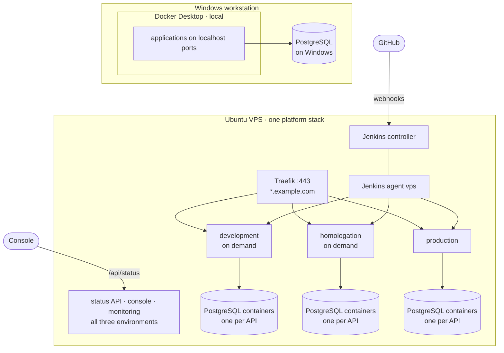

# Example: Docker Desktop and one VPS

> **Read [hosts.md](../../hosts.md) and [setup.md](../../setup.md) first.** This example was written
> for a single VPS before hosts had roles and before the platform ran on rootless Docker. The parts
> that name the VPS's setup are updated to the current model (the one-machine layout: role `apps`,
> profiles `apps,jenkins` then `apps,jenkins,agent`, `ygg` as the only service user, rootless Docker,
> `750`/`600` env files owned by `ygg`), the **PostgreSQL** section included: each API's database is a
> container of its stack, on `ygg`'s rootless engine, no longer a PostgreSQL on the host. The part that
> still predates it is the **Windows** `local` environment, which is unchanged because Docker Desktop is
> not a yggdrasil host. The two-machine
> layout (a dev machine with Forgejo and Jenkins, an apps machine) is in hosts.md.

A complete installation on two machines: a Windows workstation and one Ubuntu VPS. It is the
setup this repository's [`catalog.yaml`](../../../catalog.yaml) describes: two systems, heimdall and
fortuna, each an ASP.NET Core API with a Flutter web UI, and four environments, three of them on
the VPS.

| Environment | Where | `mode` | `trigger` | Runs | Reached at |
|---|---|---|---|---|---|
| `local` | Windows workstation, **Docker Desktop** | `ports` | `manual` | While you deploy it | `http://localhost:<port>` |
| `development` | The **VPS** | `proxy` | `branch` (`develop`) | On demand | `https://<host>-dev.example.com` |
| `homologation` | The **VPS** | `proxy` | `branch` (`release/*`) | On demand | `https://<host>-hml.example.com` |
| `production` | The **VPS**, which also runs the Jenkins controller (the one-machine layout, [setup.md step 0](../../setup.md#0-plan-the-installation)) | `proxy` | `release` | Always | `https://<host>.example.com` |



The environment section of the catalog:

```yaml
environments:
  - id: local
    name: Local
    mode: ports
    trigger: manual
  - id: development
    name: Development
    trigger: branch
    branches: develop
    agent: vps
    hostSuffix: -dev
    onDemand: true
  - id: homologation
    name: Homologation
    trigger: branch
    branches: release/*
    agent: vps
    hostSuffix: -hml
    onDemand: true
  - id: production
    name: Production
    trigger: release
    agent: vps
```

- The three VPS environments share one rootless Docker engine (`ygg`'s), one platform stack, one `DOMAIN` and one
  Jenkins agent, `vps`. Each application runs in each of them as its own Compose project
  (`heimdall-api-development`, `heimdall-api-homologation`, `heimdall-api-production`), so they
  never replace each other's containers ([catalog.md](../../catalog.md#several-environments-on-one-host)).
- `hostSuffix` tells their host names apart under the one domain: `heimdall-dev.example.com`,
  `heimdall-hml.example.com`, `heimdall.example.com`.
- `onDemand` keeps development and homologation stopped until you need them, so they cost the VPS
  nothing while nobody uses them.

Env file templates for every application in each environment are in [`env/`](env). They use
`example.com` as the domain: replace it with yours, and fill in the secrets. In this page,
`example.com` stands for your domain too. Type the real value in the files: `platform.sh` reads
them with bash.

## DNS

Cloudflare hosts the domain (`ACME_DNS_PROVIDER=cloudflare`, `CF_DNS_API_TOKEN` in `acme.env`: an
API token with **Zone → Zone → Read** and **Zone → DNS → Edit** on the zone; step by step in
[dns.md](../../dns.md)). One record covers every environment of the VPS:

| Record | Points at | Proxy |
|---|---|---|
| `*.example.com` (name `*`) | The VPS's public IP | Either: **DNS only** to start, **Proxied** once the real certificate works ([dns.md A7](../../dns.md#a7-optional-the-cloudflare-proxy)), with `CLOUDFLARE_PROXIED=true` in `platform.env` from then on |

`heimdall-api-dev`, `heimdall-hml`, `fortuna`, `yggdrasil`, `jenkins` ... are all one label under
`example.com`, so the record and Traefik's one `*.example.com` certificate cover them, and adding
an application or an environment to the VPS never needs a DNS change. `local` needs no record:
it is reached at `localhost`.

## The VPS

Follow [setup.md](../../setup.md) steps 6 and 7, prepare the VPS with `ygg install --role apps`
([step 8](../../setup.md#8-prepare-each-machine)), then 9.1 to 9.5 (the controller's steps, which on
one machine also run the environments) and 11: the VPS is the controller host and the only host.
Everything is done as `ygg`. The lines of `platform.env` this example fixes, on top of every
variable of [setup.md 9.2](../../setup.md#92-the-env-files-first-pass):

```
ENVIRONMENTS=development,homologation,production
DOMAIN=example.com
# true once the proxy is on (the DNS table above)
CLOUDFLARE_PROXIED=false
JENKINS_URL=https://jenkins.example.com/
# apps,jenkins at step 9.2: `apps` is required, ENVIRONMENTS is refused without it.
# apps,jenkins,agent from step 9.5
COMPOSE_PROFILES=apps,jenkins
JENKINS_AGENT_NAME=vps
JENKINS_AGENT_URL=http://jenkins:8080/
```

Keep comments on their own lines, as here: `platform.sh` and Compose read the file differently, and
a comment after a value isn't safe in both.

Jenkins creates one agent, `vps`, for the three environments (**Manage Jenkins → Nodes → vps**: its
secret goes in `JENKINS_AGENT_SECRET` at step 9.5). One `YGGDRASIL_STATUS_TOKEN` covers the three
environments: the console reads all of them from the one status API.

Size the VPS for production plus whatever runs at the same time: each on-demand environment that is
on adds this example's four containers (two APIs, two web UIs), with their memory, next to
production's. Stop them when you are done (below).

### PostgreSQL

Each API has its own PostgreSQL in every environment: the `db` service that
[`stacks/heimdall-api.proxy.yml`](../../../stacks/heimdall-api.proxy.yml) and
[`stacks/fortuna-api.proxy.yml`](../../../stacks/fortuna-api.proxy.yml) add to the repository's own Compose
file (`postgres:18.6`, pinned by digest). It runs in `ygg`'s rootless engine like the API, with its data in
the volume `<application>-<environment>_db`, on the project's own network only: no port and no shared
network, so development and homologation can never reach production's data, and no other application
reaches any of it. The API reaches it as `DB_HOST=db`. The image's superuser, `postgres`, has the
password `DB_SUPERUSER_PASSWORD`, the one its volume was initialised with.

There is **a database and a login per environment and application**. The env file templates of the API
repositories name them:

| Application | `development` | `homologation` | `production` |
|---|---|---|---|
| heimdall-api | `heimdall_development`, owner `heimdall_development_owner`, login `heimdall_development_svc` | `heimdall_homologation`, owner `heimdall_homologation_owner`, login `heimdall_homologation_svc` | `heimdall`, owner `heimdall_owner`, login `heimdall_svc` |
| fortuna-api | `fortuna_development`, login `fortuna_development` | `fortuna_homologation`, login `fortuna_homologation` | `fortuna`, login `fortuna` |

(An installation older than these templates may use other names: this repository's own production logs
in as `heimdall`. [cutover.md 0.1](../../cutover.md#01-write-down-todays-setup) reads them.)

heimdall-api's database belongs to an owner role that applies the migrations, and the API runs as a
login that owns nothing, so it cannot switch off the audit trail's triggers (heimdall-api's Threat
Model, TH-18). Its repository's `scripts/sql/new-deployment.sql` creates both and the database; it holds
no password, so each is set after it. The login's password goes in that environment's `DB_PASSWORD`, the
owner's in `HEIMDALL_MIGRATIONS_CONNECTIONSTRING` (with `Host=db`).

**A new environment's database** is made before its first deploy, which would otherwise start the API
against an empty PostgreSQL with none of its roles. As `ygg`, for heimdall-api in development: the
superuser's password, then the volume with the Compose labels the deploy looks for (so that Compose
takes it for its own), then a temporary container of the same image on it, which gets the password
through a private file, never the command line:

```bash
openssl rand -base64 32 | ygg vars set heimdall-api@development DB_SUPERUSER_PASSWORD=-
docker volume create --label com.docker.compose.project=heimdall-api-development --label com.docker.compose.volume=db heimdall-api-development_db
envfile=$(mktemp ~/db.XXXXXX)
printf 'POSTGRES_PASSWORD=%s\n' "$(ygg vars get heimdall-api@development DB_SUPERUSER_PASSWORD --reveal)" > "$envfile"
docker run -d --name ygg-new-db --env-file "$envfile" -v heimdall-api-development_db:/var/lib/postgresql postgres:18.6@sha256:edb0c08dc33befd0262ab3b5cf1c4f3f8cfd8b09e88c05b45adee29d6761ddb6
rm "$envfile"
until docker exec ygg-new-db pg_isready -q -U postgres --host 127.0.0.1; do sleep 2; done
```

- `openssl rand ... | ygg vars set ... =-`: the value goes straight into the store, never on screen;
  `KEY=-` reads it from standard input.
- `printf`, a shell builtin, writes the password into a `600` file of `ygg`'s home, which `rm` deletes
  once the container has it.
- `pg_isready --host 127.0.0.1`: over TCP. While the image initialises a new volume it runs a temporary
  server on its socket only, which answers too early.

Then the roles and the database, through the container's own `psql`, and the two passwords, each asked
for at a prompt (`\password` sends only its hash):

```bash
cd ~/yggdrasil-apps/heimdall-api
docker exec -i ygg-new-db psql -X -U postgres -d postgres -v owner=heimdall_development_owner \
    -v runtime=heimdall_development_svc -v database=heimdall_development < scripts/sql/new-deployment.sql
docker exec -it ygg-new-db psql -X -U postgres -c '\password heimdall_development_owner'
docker exec -it ygg-new-db psql -X -U postgres -c '\password heimdall_development_svc'
docker stop ygg-new-db && docker rm ygg-new-db
```

The same for homologation with its names. fortuna-api keeps one login per database, made the same way,
in a temporary container on `fortuna-api-<environment>_db`:

```bash
docker exec -it ygg-new-db createuser -U postgres --pwprompt fortuna_development
docker exec ygg-new-db createdb -U postgres --owner fortuna_development fortuna_development
```

Then the store: `DB_HOST=db` once per API (`ygg vars set heimdall-api DB_HOST=db`), the passwords you just
typed (`DB_PASSWORD`, and the owner's in `HEIMDALL_MIGRATIONS_CONNECTIONSTRING`, each with `ygg vars set
... KEY=-`), and deploy. The deploy's `db` finds the volume filled and skips its initialisation.

Run each `new-deployment.sql` line once more after that environment's first deploy has created the
tables, this time in the stack's own container (`docker exec -i heimdall-api-development-db-1 psql -X -U
postgres -d postgres -v ... < scripts/sql/new-deployment.sql`): the second run takes `DELETE` on the
audit trail away from the login. A heimdall-api database that belongs to the API's own login, as
`createdb --owner` made it before, is moved to the two roles with `scripts/sql/separate-owner.sql`, the
same way: heimdall-api's operations guide, "Separating the migration owner from the runtime login", has
the order.

An existing database moves in from a PostgreSQL on the host with a dump and a restore into such a
container: [cutover.md, 5.4 and 5.6a](../../cutover.md#56a-the-databases-into-their-containers) do it for
this installation, and 5.21 backs them up every night (`postgres <application>-<environment>-db-1
postgres` in `backup.conf`).

### The env files

Twelve files, one per application and environment, in `/etc/yggdrasil/<environment>/` on the VPS,
owned by `ygg` ([setup.md step 11](../../setup.md#11-application-env-files)). For the APIs, start from the
repository's own `docker/<environment>.env.example`, which documents every variable and has that
environment's values; the templates in [`env/`](env) only list what yggdrasil relies on. The web
UIs have no template of their own: [`env/`](env) has their whole files.

```bash
# as ygg, who owns /etc/yggdrasil
install -d -m 750 /etc/yggdrasil/development /etc/yggdrasil/homologation /etc/yggdrasil/production
cp ~/yggdrasil-apps/heimdall-api/docker/development.env.example /etc/yggdrasil/development/heimdall-api.env
cp /opt/yggdrasil/docs/examples/docker-desktop-and-vps/env/development/heimdall-ui.env.example /etc/yggdrasil/development/heimdall-ui.env
# ... and so on for each application and environment, then:
chmod 600 /etc/yggdrasil/*/*.env
```

`ygg config <application> <environment>` opens one of them, and redeploys after a change
([cli.md](../../cli.md#on-a-machine-without-a-store)).

**With the variables store** ([variables.md](../../variables.md)), the same templates are `vars import`
input and nothing is copied into `/etc/yggdrasil` by hand. On the VPS, once:

```bash
cd /opt/yggdrasil
ygg vars init                  # prints the key: store it in your password manager
e=docs/examples/docker-desktop-and-vps/env
ygg vars import heimdall-api@development ~/yggdrasil-apps/heimdall-api/docker/development.env.example
ygg vars import heimdall-ui@development  $e/development/heimdall-ui.env.example
ygg vars edit heimdall-api@development    # fill in DB_PASSWORD, HEIMDALL_MIGRATIONS_CONNECTIONSTRING and the secrets
# ... and so on for each application and environment
```

Then give the values the environments share one home. `DB_HOST` is `db` for both APIs in every
environment, so it moves up to each API's own scope (with `vars import --all` it is offered as a
move-up; by hand: `vars set heimdall-api DB_HOST=db`, then `vars unset` it from
`heimdall-api@<environment>`). No secret is shared between applications: heimdall-api signs its tokens with its
own `HEIMDALL_AUTH_SIGNING_KEY`, and fortuna-api verifies them with the public keys at
`FORTUNA_HEIMDALL_JWKS_URL` (`http://heimdall-api.development:8080/.well-known/jwks.json`), which
the env file already has. Check what an application gets with:

```bash
ygg vars list fortuna-api@development --resolved
```

## Local: Docker Desktop

(To keep the `local` variables in the encrypted store instead of `env/local/*.env`, see
[variables.md](../../variables.md#moving-to-the-store).)

No platform stack and no Jenkins: `deploy.sh` publishes each application on the workstation and
points the APIs at the PostgreSQL installed on Windows (`heimdall_local`, `fortuna_local`). From Git
Bash, in your checkout of the fork, with the application repositories cloned next to it
(`../heimdall-api`, `../heimdall-ui`, ...):

```bash
python3 --version && pip install pyyaml              # once, for scripts/catalog.py
export YGG_SECRETS_DIR="$PWD/env"                    # filled-in env/**/*.env files are gitignored
mkdir -p env/local
cp ../heimdall-api/docker/local.env.example env/local/heimdall-api.env   # and fill in
cp docs/examples/docker-desktop-and-vps/env/local/heimdall-ui.env.example env/local/heimdall-ui.env
scripts/deploy.sh local heimdall-api ../heimdall-api dev
scripts/deploy.sh local heimdall-ui  ../heimdall-ui  dev
```

| Application | Address | Env file starts from |
|---|---|---|
| heimdall-api | `http://localhost:8080` | `heimdall-api/docker/local.env.example` |
| fortuna-api | `http://localhost:8083` | `fortuna-api/docker/local.env.example` |
| heimdall-ui | `http://localhost:8081` (on `127.0.0.1` only) | [`env/local/heimdall-ui.env.example`](env/local/heimdall-ui.env.example) |
| fortuna-ui | `http://localhost:8082` (on `127.0.0.1` only) | [`env/local/fortuna-ui.env.example`](env/local/fortuna-ui.env.example) |

- If `python3 --version` opens the Microsoft Store, install Python from python.org and turn off the
  `python3` *App execution alias* in Windows settings: `deploy.sh` calls `python3`.
- The APIs' local templates publish on every interface, for testing from a phone; write
  `API_PORT=127.0.0.1:8080` to keep an API on this machine only.
- Docker Desktop forwards the containers' connections to PostgreSQL through its own VM, so Windows'
  PostgreSQL sees them come from `127.0.0.1`: its stock `pg_hba.conf` already allows them.
- Without yggdrasil, each API repository also runs on its own:
  `docker compose --env-file docker/local.env up -d --build`. To debug from the IDE, run the APIs
  with `dotnet run` and the UIs with `flutter run`.

## The applications

Each system is an API plus a Flutter web UI:

| Application | Host (`hostSuffix` added per environment) | Health | Metrics |
|---|---|---|---|
| `heimdall-api` | `heimdall-api` | `/healthcheck` | `:9464` |
| `heimdall-ui` | `heimdall` | `/healthz` | — |
| `fortuna-api` | `fortuna-api` | `/healthcheck` | `:9464` |
| `fortuna-ui` | `fortuna` | `/healthz` | — |

- **Same-origin APIs.** Each web UI calls its API on its own origin. It's built with
  `https://<ui host>` as its API base URL, and the API's proxy overlay also routes
  `https://<ui host>/api/…` to the API (every API route already starts with `/api/`). So the browser
  needs no CORS, which matters because fortuna-api has no CORS support at all. The APIs keep their
  own host names for the mobile and desktop clients.
- **Service to service.** fortuna-api validates tokens against the heimdall-api **of its own
  environment**. It calls heimdall-api's alias on the `edge` network
  (`http://heimdall-api.development:8080/` in development), not its public host through Traefik, so
  Fortuna's users never share the per-source limit Traefik puts on Heimdall's `/api/auth/` routes.
  fortuna-api 3.1.0 or later accepts that plain-HTTP URL because it resolves to a private address.
  It verifies Heimdall's ES256 tokens with the public keys at `FORTUNA_HEIMDALL_JWKS_URL`
  (`http://heimdall-api.<env>:8080/.well-known/jwks.json`), so no secret is shared: only
  heimdall-api holds its `HEIMDALL_AUTH_SIGNING_KEY`.
- **ASP.NET environments.**

  | | `local` | `development` | `homologation` | `production` |
  |---|---|---|---|---|
  | heimdall-api | `Development` | `Development` | `Staging` | `Production` |
  | fortuna-api | `Development` | `Development` | `Production` | `Production` |

  heimdall-api runs homologation as `Staging`, so e-mails are logged instead of sent and no Mailgun
  account is needed. fortuna-api runs it as `Production`, because it treats every other ASP.NET
  environment as a debugging one. Development exposes Swagger and the developer exception page on
  the internet: one more reason to keep it stopped while nobody uses it.

## Day to day

| Task | How |
|---|---|
| Work on `develop` | `ygg env start development` on the VPS, then use `https://heimdall-dev.example.com` |
| Test a release | Push `release/x.y.z`, then `ygg env start homologation` |
| Try a branch Jenkins doesn't deploy by itself | In Jenkins, the application's job → the branch (`develop`, `release/*` or `main`) → **Build with Parameters** → `DEPLOY_TO` `development`: deploys it and leaves development running |
| Done for now | `ygg env stop development` (or `homologation`) |
| See what is on | `ygg env status`, or the console |

What Jenkins does meanwhile:

- A push to `develop` deploys development; a push of `release/x.y.z`, homologation. If the
  environment is **stopped**, the deploy still builds the new version, starts it, waits for it to
  be healthy (rolling back a broken one as usual) and **stops it again**: the next
  `env start` runs the new version. If it is on, it stays on.
- The release pull request deploys production, which is always on, then merges and tags.

**The console** (`https://yggdrasil.example.com`, or the Windows and Android apps with one host:
that URL and the VPS's `YGGDRASIL_STATUS_TOKEN`) shows the VPS as one host with its three
environments. Each system card has a chip per environment, e.g. `Development · Stopped`,
`Homologation · Stopped`, `Production · Up`; expanded, a section per environment lists its
applications. `Stopped` is neutral, not a problem: it doesn't count for *Problems only*.
`local` isn't shown: it has no status API.

**Logs and metrics** in Grafana (`https://grafana.example.com`) carry an `environment` label:
`{environment="homologation"}` in Loki, where `stack` is the Compose project
(`heimdall-api-homologation`); `environment="production"` on the APIs' metrics in Prometheus.
