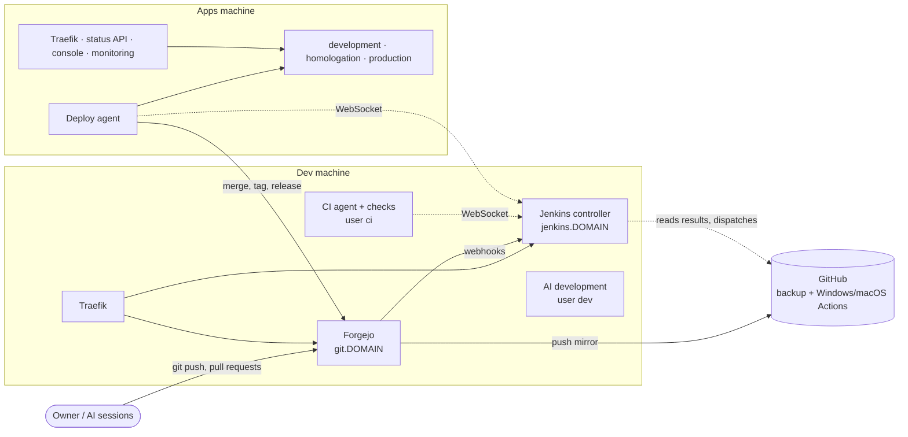
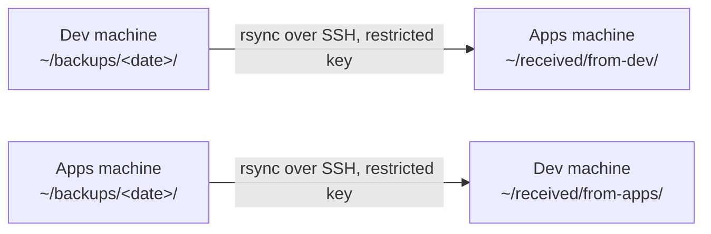

# The two machines

yggdrasil runs on two Ubuntu servers. This page is for the person who sets them up and looks after
them: what runs where, who the users are, which files the installer writes and why, where every
secret lives, how backups work and how to restore from them. It assumes you have never seen the
design. The step-by-step setup is in [setup.md](setup.md); this page is the reference behind it.

1. [Two machines](#1-two-machines)
2. [Domains and Cloudflare](#2-domains-and-cloudflare)
3. [Users](#3-users)
4. [System settings](#4-system-settings)
5. [Rootless Docker](#5-rootless-docker)
6. [Credentials](#6-credentials)
7. [Backups and restore](#7-backups-and-restore)
8. [Adding a machine](#8-adding-a-machine)
9. [Upgrading a host from rootful Docker](#9-upgrading-a-host-from-rootful-docker)

## 1. Two machines



The diagram shows the finished design. What `ygg install` and the platform Compose file build is the machines
themselves: Traefik, Forgejo, the Jenkins controller, the monitoring, the deploy agent and the build agents.
The pipeline that runs on them (the checks on the CI agent, the release builds on the release agent, Renovate)
is [setup.md, The pipeline](setup.md#the-pipeline). Moving an installation from one VPS on GitHub to these machines,
its repositories to Forgejo with their GitHub mirrors, is [cutover.md](cutover.md).

| | Dev machine (`--role dev`) | Apps machine (`--role apps`) |
|---|---|---|
| Purpose | Git server, CI/CD, AI development | Every environment of every application |
| Runs | Traefik, Forgejo, the Jenkins controller, monitoring, the CI agent and its checks, Renovate, AI sessions | Traefik, status API, console, monitoring, the applications, the deploy agent |
| Compose profiles in `platform.env` | `forge,jenkins`, run by `ygg` | `apps,agent`, run by `ygg` |
| Build agents | `ci` (4 executors) and `release` (1), each started by `ygg agent up --user …` ([agent.env](#6-credentials), [setup.md 9.8](setup.md#98-the-ci-and-release-agents)) | none: its deploy agent is the `agent` profile |
| Public names | `git.techcraftsmen.net`, `jenkins.techcraftsmen.net`, and its own dashboards: `traefik-dev.techcraftsmen.net`, `grafana-dev.techcraftsmen.net` | **`techcraftsmen.net`**: the applications and APIs, `yggdrasil.`, `traefik.`, `grafana.`. **`artur-rios.tech`**: the static and docs sites |
| Cloudflare | DNS only (grey cloud) | Proxied (orange cloud) |
| Inbound ports | 22 (SSH), 80, 443, 2222 (Forgejo's git over SSH) | 22; 80 and 443 only from Cloudflare's address ranges |
| Jenkins agents | `ci`, `release` | its deploy agent (`vps` in the default catalog) |

What the profiles are:

| Profile | Starts | On |
|---|---|---|
| (none) | Traefik, Prometheus, Loki, Alloy, Grafana and the Docker socket proxies | every machine |
| `apps` | The status API (with its socket proxy) and the console | a machine that runs applications. `ENVIRONMENTS` belongs to it: `platform.sh` refuses `ENVIRONMENTS` without `apps` |
| `forge` | Forgejo | the dev machine |
| `jenkins` | The Jenkins controller | the dev machine |
| `agent` | The Jenkins agent that deploys to this machine's applications | the apps machine |

The `ci` and `release` build agents are not in this list. They are not part of the platform stack:
each has its own Compose file, [platform/build-agent.yml](../platform/build-agent.yml), and its own
engine. See [Rootless Docker](#5-rootless-docker).

Other things to know:

- **The Jenkins controller moved** from the apps machine to the dev machine. The apps machine no
  longer runs the `jenkins` profile. Its deploy agent dials out to `https://jenkins.<DOMAIN>`
  over a WebSocket on 443, like every agent. No agent port is opened anywhere.
- **Each machine monitors itself.** Each runs its own Prometheus, Loki, Alloy and Grafana for its own
  engine. On the dev machine, which has no `apps` profile and so no status API to discover
  targets from, Prometheus reads a written-out list
  ([prometheus-static.yml](../platform/prometheus/prometheus-static.yml)).
- **The firewall works now.** Rootful Docker writes its own firewall rules and bypasses `ufw`.
  Rootless Docker publishes a port as an ordinary listening process, so the `ufw` rules apply to
  it. If a port is not allowed in `ufw`, nobody reaches it.
- **Size.** The CPU is the shared resource on the dev machine. The `ci` user is capped at 6 of the 8
  CPUs and 20 GB of memory, so AI sessions stay responsive during a build. The caps are on the
  user's systemd slice, so they cover the user's whole engine, not one container.

## 2. Domains and Cloudflare

There are two domains, both zones on Cloudflare:

| Domain | Used for |
|---|---|
| `techcraftsmen.net` | The applications and APIs, the platform's names, and the dev machine's `git.` and `jenkins.` |
| `artur-rios.tech` | Static and docs sites |

Substitute your own. A machine serves `DOMAIN` and, if you set it, `EXTRA_DOMAINS`
(comma-separated) in its `platform.env`. The apps machine sets `DOMAIN=techcraftsmen.net` and
`EXTRA_DOMAINS=artur-rios.tech`. The dev machine sets only `DOMAIN=techcraftsmen.net`. Traefik asks
Let's Encrypt for one certificate per domain, covering the domain and `*.` the domain, using the
DNS-01 challenge through Cloudflare's API. DNS-01 never goes through the proxy, so renewals keep
working with the proxy on.

### DNS records

On each domain:

| Record | Points to | Proxy |
|---|---|---|
| `A` `*` | the apps machine | **Proxied** (orange) |
| `A` the bare domain | the apps machine | **Proxied** |
| `A` `git`, `jenkins`, `traefik-dev`, `grafana-dev` (techcraftsmen.net only) | the dev machine | **DNS only** (grey) |
| `CAA` the bare domain: `0 issue "letsencrypt.org; validationmethods=dns-01"` | n/a | n/a |

A specific record wins over the wildcard, so these four names reach the dev machine and
everything else reaches the apps machine.

`scripts/cloudflare_dns.py` makes all of these through Cloudflare's API, with the comment `yggdrasil` on
each. Run it once when building the machines, and again at the cutover with the new apps machine's address
(with the old address it is the rollback):

```bash
read -rs CF_DNS_API_TOKEN && export CF_DNS_API_TOKEN      # paste the token, then Enter
python3 scripts/cloudflare_dns.py --dry-run --apps <apps ipv4> [--apps6 <apps ipv6>] --dev <dev ipv4> [--dev6 <dev ipv6>] [--skip-caa <zone>]
```

(`read -rs` keeps the token out of the shell's history and off the screen; `export` hands it to the script.)

Take `--dry-run` off to apply. The token is the one in `acme.env` (`CF_DNS_API_TOKEN`) and is read from the
environment, never from an argument. `AAAA` records are made only when `--apps6` / `--dev6` is given. The
script creates what is missing, updates in place a record it made whose address or proxy flag is wrong,
and never deletes anything. It reports, and exits 1 for, what it must leave to you: a record of the same
name and type without the `yggdrasil` comment (made by hand, such as a Vercel `A` on the bare domain), a
`CNAME` at a name where it wants an `A` (Cloudflare allows none beside a `CNAME`), and an `AAAA` it made for
an address you no longer pass ("stale: delete it by hand or pass `--apps6`"). It does not look at other
names: an old `www` or `blog` `CNAME` keeps winning over the wildcard until you delete it.

The `CAA` record, one per zone: `0 issue "letsencrypt.org; validationmethods=dns-01"`: only Let's Encrypt may issue certificates for
the zone, and only after a DNS-01 proof, which needs the Cloudflare API token. Traefik proves control by DNS-01
alone, so nothing legitimate is lost; without the record, whoever answers on port 80 of a name's address (a
process on the dev machine that got there before Traefik, say) could pass Let's Encrypt's HTTP-01 check and get a
certificate for `git.` or `jenkins.`. The dev machine also keeps its other users off
ports below 1024 ([the low ports](#etcsystemdsystemuser-uidsliced50-yggdrasil-portsconf-dev-machine)); the record
covers what that can't.

Something that gets its certificates over HTTP-01 is refused by that record too. `artur-rios.tech`'s `www.` and
`blog.`, and `techcraftsmen.net`'s company page (`www.` and the bare domain), are served by Vercel until their sites
move, and Vercel renews their certificates through Let's Encrypt over HTTP-01, so those zones' `CAA` waits:
`--skip-caa artur-rios.tech --skip-caa techcraftsmen.net` leaves it out ("CAA skipped on <zone> (--skip-caa)"):
neither created, updated nor reported. Drop each zone's flag once its Vercel sites have moved
([cutover.md, 1.5](cutover.md#15-the-records)).

Why the dev machine is not proxied:

- **Git over SSH** (port 2222) cannot pass Cloudflare's proxy: it only carries web traffic.
- **Large pushes over HTTPS** would hit the proxy's limit on a request's size (about 100 MB on the
  free plan).

Every machine runs its own Traefik dashboard and Grafana, and `*.techcraftsmen.net` reaches the apps
machine, so the two machines cannot both be `traefik.` and `grafana.`. The optional platform variable
`PLATFORM_HOST_SUFFIX` (empty by default) is put after `traefik` and `grafana` in the dashboard's and
Grafana's names (and Grafana's root URL): the apps machine leaves it empty and keeps `traefik.<DOMAIN>`
and `grafana.<DOMAIN>`; the dev machine sets `PLATFORM_HOST_SUFFIX=-dev` in its `platform.env` and its
dashboards are `traefik-dev.<DOMAIN>` and `grafana-dev.<DOMAIN>`. Those two names need their own
DNS-only records pointing at the dev machine (the table above), because the wildcard would send them
to the apps machine. The certificate already covers them: it is for `*.<DOMAIN>`.

### Cloudflare settings

| Setting | Value | Why |
|---|---|---|
| SSL/TLS mode | **Full (strict)** | Cloudflare checks the apps machine's certificate too. *Flexible* makes every page loop (`ERR_TOO_MANY_REDIRECTS`), and *Full* (without strict) accepts any certificate. Set it on both zones. |
| API token | **Zone → Zone → Read** and **Zone → DNS → Edit**, on both zones (one *Zone Resources* row for each) | Traefik proves domain control with it. Put it in `acme.env` on each machine. [dns.md A4](dns.md#a4-create-the-api-token) |
| Cache Rule | **Bypass cache** for the APIs and for the status API | See below |

**Caching.** Cloudflare caches static file extensions by default. A JSON response is not cached by
default either, but make sure of it. In the zone: *Caching → Cache Rules → Create rule*, name it
`apis never cached`, and match the requests that must always reach the application: the path
starts with `/api/` (the status API and the web UIs' same-origin API calls), or the host name is
one of your APIs' (`heimdall-api.techcraftsmen.net`). Set *Cache eligibility* to **Bypass cache**.
After the first deploy of a site, load it and check that the new version is the one you see; if it
is not, purge the cache (*Caching → Configuration → Purge Everything*). Flutter's `main.dart.js` has
no hash in its name and is the usual cause ([dns.md A7](dns.md#a7-optional-the-cloudflare-proxy)).

### The origin lock

The apps machine's firewall accepts 80 and 443 **only from Cloudflare's published address ranges**.
Nobody reaches it by connecting to its address instead of going through Cloudflare. The ranges
change rarely. `ygg install --role apps` downloads them from `https://www.cloudflare.com/ips-v4` and
`/ips-v6` and adds one `ufw` rule per range, marked with the comment `yggdrasil-cloudflare`.
`ygg check --role apps` compares the rules with Cloudflare's current list and says what is missing
or out of date. Run `ygg install` again to update them. A download that fails or returns anything but
address ranges changes no Cloudflare rule: a firewall built from half an answer would lock real
visitors out or let everyone in. The rest of the firewall is still set, and fails closed: SSH in,
everything else refused (on a new machine, 80 and 443 stay closed until a download works). After the
ranges change, `scripts/platform.sh up` (as `ygg`) makes Traefik trust the new ones.

### Client addresses

Behind Cloudflare every connection comes from a Cloudflare address, and the visitor's own is in the
`X-Forwarded-For` header. Rate limits count by client address (heimdall-api's sign-in limit, for
one), so Traefik must see the real one. On the apps machine set `CLOUDFLARE_PROXIED=true` in
`platform.env`. Then:

- `ygg install` writes Cloudflare's ranges, one per line, to `/etc/yggdrasil/cloudflare-ips`.
- `platform.sh` gives that file to `scripts/traefik_config.py`, which makes Traefik trust the
  forwarded headers **from those ranges only** (`forwardedHeaders.trustedIPs`, on ports 80 and 443).
  From anyone else the header would let a client choose the address Traefik logs and counts.
- With `CLOUDFLARE_PROXIED=true` and no `cloudflare-ips` file, `platform.sh up` stops and says
  to run `ygg install`. With `false` (the dev machine, whose clients connect directly) the file is
  not read.

The trust check needs the TCP source address of the connection, which the engine's network mode
keeps. See [Rootless Docker](#5-rootless-docker).

## 3. Users

Rules on both machines:

- **`root` cannot log in.** No SSH login, no password.
- **SSH accepts keys only**, and only for the users listed with a login below.
- **One admin user** (`artur`, the person installing) has `sudo`, with a password, for work on the
  operating system only: updates, packages, users, the firewall, the system settings. It runs no
  services and has no Docker engine.
- **No rootful Docker, no `docker` group.** Each service user runs its own rootless Docker engine.
- **Service users have no `sudo`** and are in no privileged group. Each has its own range of
  subordinate user and group ids (`/etc/subuid`, `/etc/subgid`, written by `useradd`), not
  overlapping, so the containers of different users map to different ids on the host.
- **Home directories are `750`.** One service user cannot read another's files.
- **Security updates install by themselves** ([unattended upgrades](#4-system-settings)).

### Apps machine

| User | Login | `sudo` | Runs, in its own rootless engine | Owns |
|---|---|---|---|---|
| `root` | No | n/a | the operating system | |
| `artur` (the admin) | SSH key | Yes, with a password | nothing | |
| `ygg` | SSH key | No | Traefik, status API, console, Prometheus, Loki, Alloy, Grafana, the socket proxies, every application in every environment, the deploy agent | `/opt/yggdrasil` (the checkout), `/etc/yggdrasil` (secrets) |

The platform and the applications share one engine on purpose. Traefik reaches the applications
over that engine's `edge` network, and the deploy agent drives the engine they run in.

### Dev machine

| User | Login | `sudo` | Runs, in its own rootless engine | Holds |
|---|---|---|---|---|
| `root` | No | n/a | the operating system | |
| `artur` (the admin) | SSH key | Yes, with a password | nothing | |
| `ygg` | SSH key | No | Traefik, Forgejo, the Jenkins controller, Prometheus, Loki, Alloy, Grafana, the socket proxies | Forgejo's data and its GitHub mirror token; Jenkins' home with every Jenkins credential; `/opt/yggdrasil`, `/etc/yggdrasil` |
| `ci` | None (`nologin`) | No | the CI agent and every check container | the CI agent's secret (`agent.env`); Jenkins binds the read-only token for a build's checkout and the check's allowed credentials for that check only |
| `renovate` | None (`nologin`) | No | Renovate, on a systemd user timer | the `renovate` Forgejo token |
| `release` | None (`nologin`) | No | the release agent and its build containers: release files, signing, package publishing | the release agent's secret (`agent.env`); Jenkins binds the read-only token, the signing keys and the nuget.org key for the steps that need them only |
| `dev` | SSH key | No | AI development sessions and the containers they run | its own Forgejo account's token |

`ygg install --role dev` creates all five and gives each its own engine, its own `/etc/yggdrasil-<user>`
directory and its own linger. What `dev` runs, and what is in its directory, comes with a later plan;
`renovate`'s daily run is [below](#renovate-the-daily-run).

**Why a separate `release` user.** Release files ship through the apps' built-in updaters and to
nuget.org. If they were built in the `ci` engine, a check from a pull request by `claude` or Renovate
could reach the build's containers while it runs and change what comes out. The release agent runs
only builds the owner started, so the code it builds was merged by the owner. Signing happens
there, never on the controller and never on the apps machine.

### What each user may do

- **`ygg` on the dev machine** is the most sensitive account: Jenkins' credentials can merge, tag
  and deploy. Only the owner logs in as it.
- **`ci`** can read code and post nothing. A compromised check could read the repositories and the other
  containers of the `ci` engine, and nothing else. It cannot push, merge, tag or deploy. `ygg check`
  verifies that no other service user (`ci`, `release`, `dev`, `renovate`) can read `ygg`'s Docker socket or its
  secrets, and that `ci` cannot read `release`'s socket or `agent.env`. None of them can bind a port below 1024.
- **`dev`** pushes to Forgejo as its own account (`claude`). It can push `feature/` and `fix/`
  branches, open pull requests and merge into `develop`. It cannot push `release/*`, merge into
  `main` or create `v*` tags.

### How the owner logs in

| For | Log in as | Do |
|---|---|---|
| Daily work: platform, deploys, variables, backups | `ygg`: `ssh ygg@<host>` | `cd /opt/yggdrasil`, then `ygg …` or `scripts/platform.sh …`. The login shell points `docker` at `ygg`'s engine. |
| System work: updates, packages, users, firewall, `ygg install`, `ygg check`, `ygg agent` | the admin: `ssh artur@<host>` | `sudo` for what needs root. `ygg agent` and the engine rows of `ygg check` run commands as another user through `sudo`. |
| AI development (dev machine) | `dev`: `ssh dev@<host>` | its own engine and Forgejo account |

`ygg install` copies the admin's `~/.ssh/authorized_keys` to `ygg` (and `dev`) when that user has none,
after asking. A user that already has keys is never touched.

## 4. System settings

Every file that `ygg install --role dev|apps` writes outside a home directory, with its exact
content. Each step is safe to run again, writes nothing when the file already holds the content,
and is shown by `ygg check` as a row. The commands behind each one are in
[setup.md step 8](setup.md#8-prepare-each-machine).

### `/etc/sysctl.d/90-yggdrasil.conf`

```text
net.ipv4.ip_unprivileged_port_start=80
```

Lets a process that is not root bind ports 80 and 443. Without it the rootless Traefik cannot
publish them. SSH on 22 stays privileged.

### `/etc/apparmor.d/usr.bin.rootlesskit`

```text
abi <abi/4.0>,
include <tunables/global>

"/usr/bin/rootlesskit" flags=(unconfined) {
  userns,

  include if exists <local/usr.bin.rootlesskit>
}
```

Ubuntu 24.04 and 26.04 block unprivileged user namespaces by default
(`kernel.apparmor_restrict_unprivileged_userns`). Rootless Docker's helper, `rootlesskit`, needs
one. This profile allows it, and only it. `ygg install` reloads AppArmor after writing it.

### `/etc/systemd/system/user@.service.d/delegate.conf`

```text
[Service]
Delegate=cpu cpuset io memory pids
```

Lets users' systemd units control CPU, memory and process limits (cgroup v2). Without it a rootless
engine cannot apply `cpus:` or `mem_limit:` to a container, and the `ci` caps below do nothing.

### `/etc/apt/apt.conf.d/20auto-upgrades`

```text
APT::Periodic::Update-Package-Lists "1";
APT::Periodic::Unattended-Upgrade "1";
```

Security updates install themselves. Nobody logs in to these machines to run them.

### `/etc/systemd/system/user-<uid>.slice.d/limits.conf` (dev machine)

```text
[Slice]
CPUQuota=600%
MemoryMax=20G
```

`<uid>` is the `ci` user's. The limit is on the user's slice, so it covers the whole `ci` engine:
six CPUs (600% is six full ones) and 20 GB of memory. A build cannot starve Forgejo, the release agent
or an AI session.

### `/etc/systemd/system/user-<uid>.slice.d/50-yggdrasil-ports.conf` (dev machine)

```text
[Slice]
SocketBindDeny=tcp:1-1023
SocketBindDeny=udp:1-1023
```

One per user that runs code the owner didn't write or hasn't reviewed: `ci`, `release`, `renovate` and `dev`
(`<uid>` is that user's). The unprivileged-ports setting above lets every user bind 80 and 443, not only `ygg`:
without this, a check in `ci`'s engine could publish `-p 80:80 -p 443:443`, take the ports while `ygg`'s Traefik
restarts, and pass Let's Encrypt's HTTP-01 check for `git.` or `jenkins.`. The rule is on the user's slice, so it
covers the user's engine and every container in it, a container binding port 80 inside its own network
included: such a check must listen on 1024 or above. `ygg check` shows a "low ports" row per user. The
[`CAA` record](#dns-records) closes the same door at the certificate authority, once it exists: while the company
page is still on Vercel, techcraftsmen.net carries no CAA record (`--skip-caa techcraftsmen.net`), and this rule is
the only guard for `git.` and `jenkins.`.

> **To verify on the real host:** that the rule takes effect on a running slice after `systemctl daemon-reload`
> (or only once the user's manager restarts: `sudo systemctl restart user@<uid>`), and that it refuses the
> bind of rootlesskit's port forwarder: as `ci`, `docker run --rm -p 80:80 nginx` should fail to publish.

### `/etc/ssh/sshd_config.d/00-yggdrasil.conf`

```text
PermitRootLogin no
PasswordAuthentication no
KbdInteractiveAuthentication no
AllowUsers artur ygg dev
```

`AllowUsers` lists the admin (whoever ran the install; `artur` here) first, then the role's SSH
users: `ygg` on the apps machine, `ygg` and `dev` on the dev machine. `ci`, `release` and `renovate`
have `/usr/sbin/nologin` as their shell.

Three things make this file safe:

- **The name sorts first.** sshd uses the *first* value it finds for a setting, reading the files of
  `sshd_config.d` in alphabetical order. Cloud images ship `50-cloud-init.conf` with
  `PasswordAuthentication yes`. A file named `90-…` would lose to it and do nothing. `00-` wins. (An
  `90-yggdrasil.conf` from an earlier version of the installer is removed once the new file works.)
- **Install checks that it works.** After writing the file it runs `sshd -t` (is the syntax right?) and
  `sshd -T` (what will sshd really run with?) and compares the four settings. If either fails, it puts
  the file back as it was, does not reload SSH and stops with the reason.
- **Install refuses to lock you out.** Switching passwords off is only safe if a key gets the admin in.
  If the admin has no `~/.ssh/authorized_keys`, `ygg install` stops at the start, before changing
  anything, and says so. Put your public key in it first (`ssh-copy-id` from your own computer).

Then it runs `systemctl try-reload-or-restart ssh` (on 24.04 and later SSH may be socket-activated, where a
plain reload can find nothing to reload). Keep your current SSH session open and test a new one
before closing it.

### Rootful Docker, switched off

`docker.service`, `docker.socket` and `containerd.service` are **disabled and masked**
(`systemctl disable --now` then `systemctl mask`). The Docker packages install them and enable them,
and the rootful engine answers on `/var/run/docker.sock` to anyone in the `docker` group, which
means root. Masking means an upgrade of `docker-ce` cannot turn them back on. Every member of the
`docker` group is removed from it: the group is emptied, not deleted (the packages own it, and
`ygg check` only asks that it has no members).

### In each service user's home

| Path | Why |
|---|---|
| `~/.config/systemd/user/docker.service.d/override.conf` | Keeps client addresses. See [Rootless Docker](#5-rootless-docker). |
| `~/.profile`, between `# >>> yggdrasil >>>` and `# <<< yggdrasil <<<` | A login shell's `docker` talks to the user's own engine. A later install replaces the block instead of adding a second. |
| `/var/lib/systemd/linger/<user>` (made by `loginctl enable-linger`) | Starts the user's systemd, and so its engine, at boot with nobody logged in. The file is empty. |

`~/.config/systemd/user/docker.service.d/override.conf`:

```ini
[Service]
Environment="DOCKERD_ROOTLESS_ROOTLESSKIT_NET=slirp4netns"
Environment="DOCKERD_ROOTLESS_ROOTLESSKIT_PORT_DRIVER=slirp4netns"
```

The block `ygg install` adds at the end of `~/.profile` (after a blank line, and replacing an earlier
block of its own; `<uid>` is the user's id, `id -u`). Everything outside the two marker lines is left
as it is:

```sh
# >>> yggdrasil >>>
export DOCKER_HOST=unix:///run/user/<uid>/docker.sock
# <<< yggdrasil <<<
```

### In `ygg`'s home

`~/.config/systemd/user/yggdrasil-backup.service` and `yggdrasil-backup.timer` are copies of
[platform/systemd](../platform/systemd), the nightly backup ([Backups](#7-backups-and-restore)).
Their content, with the comments in the files:

`yggdrasil-backup.service`:

```ini
# The nightly backup of this machine to the other one (scripts/backup.sh), a user unit of ygg: it is
# installed into ~ygg/.config/systemd/user/ by `ygg install` (step backup-timer) and started by the timer
# next to it. What to back up and where to is in $YGG_SECRETS_DIR/backup.conf (env/backup.conf.example).
[Unit]
Description=Back up yggdrasil to the other machine
# The dumps are taken through ygg's rootless engine, which is the user unit docker.service: a catch-up run
# at boot (the timer is Persistent) must wait for it.
After=docker.service
Wants=docker.service

[Service]
Type=oneshot
# A user unit doesn't read ygg's .profile, which is where its shells get DOCKER_HOST: %t is the user's
# runtime directory, where its rootless engine keeps the socket.
Environment=DOCKER_HOST=unix://%t/docker.sock
ExecStart=/opt/yggdrasil/scripts/backup.sh run
```

`yggdrasil-backup.timer`:

```ini
# Starts yggdrasil-backup.service every night. Persistent: a machine that was off at 03:30 backs up when
# it is next on. The random delay keeps the two machines (and any others) from calling each other at the
# same second.
[Unit]
Description=Back up yggdrasil every night

[Timer]
OnCalendar=*-*-* 03:30:00
Persistent=true
RandomizedDelaySec=15m

[Install]
WantedBy=timers.target
```

### Renovate: the daily run

Dev machine only. `ygg install` (step `renovate-timer`) copies [platform/systemd](../platform/systemd)'s
`yggdrasil-renovate.service` and `yggdrasil-renovate.timer` into `~renovate/.config/systemd/user/`, as
`renovate`, and enables the timer, the same way as the backup's. The timer fires every day at 05:00 (plus a
random delay of up to 30 minutes; `Persistent=true`, so a machine that was off at 05:00 runs it when it is next
on). The service runs `/opt/yggdrasil/scripts/renovate.sh run` after `renovate`'s own `docker.service`.

`renovate.sh` runs the pinned `renovate/renovate` image (an exact version and its digest, both written in the
script) in `renovate`'s own engine: **never the `ci` engine and never Jenkins**, because Renovate runs
package-manager code while holding a token that can push. It visits only the repositories of
[`catalog.yaml`](catalog.md) (`python3 scripts/catalog.py repository-names`, as `<owner>/<repository>`),
opens pull requests from `renovate/*` branches into `develop`, and skips a repository that has no Renovate
configuration of its own (no onboarding pull requests).

Its settings are `/etc/yggdrasil-renovate/renovate.env` (`ygg install` copies
[env/renovate.env.example](../env/renovate.env.example) there: `renovate:renovate`, mode `600`). Fill in as `renovate`
(`RENOVATE_TOKEN`, the `renovate` Forgejo user's token with `write:repository` and `write:issue`;
`RENOVATE_ENDPOINT` can stay empty, it is then `<forge url>/api/v1` from the catalog). The container gets the file
as `--env-file`, a copy made for the run in `renovate`'s runtime directory (mode `600`, removed afterwards), so
the token is never an argument of any command. `ygg check` shows whether the token is set and how the last
run went; `journalctl --user -u yggdrasil-renovate` (as `renovate`) has its log, and
`scripts/renovate.sh run` starts one by hand, which is how to try it once before relying on the timer
([setup.md 9.9](setup.md#99-renovate)).

`RENOVATE_GITHUB_COM_TOKEN` is optional: a GitHub fine-grained token with read-only access to public
repositories (no permissions of its own). With it, Renovate reads the release notes and changelogs of
dependencies hosted on GitHub as that account; without it, it asks anonymously and meets GitHub's rate limit,
and the pull requests lose their notes. `renovate.sh` passes it to the container as `GITHUB_COM_TOKEN`, through
the same run-scoped env file as the Forgejo token (never an argument), and never prints it; `ygg check` warns
(`renovate github token`) while it is empty, and says nothing of its value.

To update Renovate, change `RENOVATE_IMAGE` in `scripts/renovate.sh` to a newer version and its digest
(`docker buildx imagetools inspect renovate/renovate:<version>`) in a pull request, after reading the release
notes.

### The CI engines: the weekly prune

Dev machine only. Every build in `ci`'s and `release`'s rootless engines leaves images and build cache behind,
and nothing else removes them. `ygg install` (step `prune-timer`, right after the engines) copies
[platform/systemd](../platform/systemd)'s `yggdrasil-prune.service` and `yggdrasil-prune.timer` into
`~/.config/systemd/user/` of **each** of `ci` and `release`, as that user, and enables the timer, the same way
as the backup's and Renovate's. The timer fires on Sundays at 03:00 (plus a random delay of up to an hour;
`Persistent=true`, so a machine that was off then prunes when it is next on). The service runs, after the
user's own `docker.service` and against its own engine (`DOCKER_HOST=unix://%t/docker.sock`):

```bash
docker system prune --all --force --filter until=168h
docker builder prune --all --force --filter until=168h
```

That is, every image no container uses and all build cache that has not been used for a week; what a build of
the last seven days could still reuse stays. Volumes are never pruned. `ygg check --role dev` has a row
`prune timer ci` and `prune timer release`, which is `ok` while the units are the checkout's copies and the
timer is enabled; `systemctl --user list-timers` and `journalctl --user -u yggdrasil-prune` (as that user) show
the next and the last run. No other user's engine is pruned: `ygg`'s holds the platform and the deployed
applications, which are not leftovers.

### Other files and rules

| What | Content |
|---|---|
| `/etc/yggdrasil-role` | The role: `dev` or `apps`. `ygg check` and `ygg install` without `--role` use it. Written before the first step that changes anything, so an install that stops halfway keeps its role. |
| `/opt/yggdrasil` | Owned by `ygg`, mode `755`: `ygg` deploys from this checkout, and the backup unit runs its `scripts/backup.sh`. `ygg install` refuses to run from a checkout anywhere else. |
| `/etc/yggdrasil`, and `/etc/yggdrasil-<user>` for every other service user | Owned by `<user>:<user>`, mode `750`. `ygg` gets `platform.env` and `acme.env` copied from [env/](../env); `ci` and `release` get `agent.env`; `renovate` gets `renovate.env`. Files `600`. A file that is already there is never touched. |
| `/etc/yggdrasil/cloudflare-ips` (apps machine) | Cloudflare's ranges, owned by `ygg`. Read by Traefik's configuration. |
| `/etc/yggdrasil/traefik.yml` | Not written by `ygg install`: `platform.sh up` renders Traefik's static configuration there (as `ygg`, mode `600`) once the engine is checked, and Traefik's container mounts it. The other commands (`down`, `ps`, `logs`, `config`) render a throwaway copy and leave this one alone. It stays there so that Traefik starts again after a crash or a reboot; deleting it takes ingress down at the next restart of the container, until the next `platform.sh up`. `platform.sh` refuses to run as root, since a root-owned file here is one the rootless Traefik can't read. |
| `ufw` rules | Dev: `OpenSSH`, `80,443/tcp`, `2222/tcp`. Apps: `OpenSSH`, and for each Cloudflare range `allow proto tcp from <range> to any port 80,443 comment yggdrasil-cloudflare`. The defaults: `deny incoming`, `allow outgoing`. Then `ufw` is turned on, with SSH allowed first so the session that runs the install is not cut. `ygg check` reports any other rule that lets everyone in. |
| Packages | `git curl openssl python3 apache2-utils ca-certificates python3-yaml python3-cryptography uidmap dbus-user-session slirp4netns docker-ce docker-ce-cli containerd.io docker-ce-rootless-extras docker-buildx-plugin docker-compose-plugin ufw rsync unattended-upgrades`. Docker's come from its own apt repository; the distribution's `docker.io` and similar are removed first, if you agree. |

## 5. Rootless Docker

Each service user has **its own Docker engine**, running as that user:

| | |
|---|---|
| Started by | the user's own systemd (`systemctl --user`), the unit `docker.service`, made by `dockerd-rootless-setuptool.sh install` |
| Starts at boot | because of linger. Without it the engine would stop with the user's last session and be gone after a reboot. |
| Socket | `/run/user/<uid>/docker.sock` |
| The `docker` CLI finds it by | `DOCKER_HOST=unix:///run/user/<uid>/docker.sock`, set in the user's `~/.profile` |
| Images, volumes | in the user's home (`~/.local/share/docker`), invisible to every other user |

The yggdrasil scripts (`platform.sh`, `agent.sh`, `backup.sh`) use only the engine of the user running
them. They take the socket from `DOCKER_HOST`, else from `/run/user/<uid>/docker.sock`, and refuse
an engine that is not rootless. They never use `/var/run/docker.sock`. If there is no engine, they say
`run 'ygg install'`.

**Container root is the service user.** In a rootless engine, uid 0 inside a container is the
service user on the host, and the container's other ids map to the user's own subordinate range.
Root in a container can therefore touch only what that user can touch, and nothing else on the
machine. That is why the socket proxies and the agents run as `user: "0:0"`: they must open the
user's socket and read the user's files, and this gives them no more than the user has. The platform
does not rely on that alone: containers drop capabilities, run `no-new-privileges`, and the services
that face the internet do not hold the socket at all (Traefik, Alloy and the status API each read
Docker through a read-only socket proxy of their own).

One consequence for files you mount from the host: a container process that runs as another uid than
root (the Jenkins controller runs as uid 1000) is a *different* host id, not the admin and not
`ygg`. It can read a mounted file only if the file's "other" permission bit allows it. See
[setup.md 9.1](setup.md#91-the-github-app-key).

**Why `slirp4netns`, and client addresses.** By default a rootless engine publishes ports through a
helper that makes every client look like one internal address. Traefik would then see every visitor
as the same address, and every per-client rate limit (heimdall-api's sign-in limit) would treat the whole
internet as one client. The two `DOCKERD_ROOTLESS_ROOTLESSKIT_*` lines in the user's `override.conf`
switch the network and the port driver to `slirp4netns`, which keeps the real source address of a
connection. `ygg check` shows a "client addresses" row per user. After a change the engine must restart
(`systemctl --user restart docker`, as that user). To see it working, read Traefik's access log, which
records the client address of each request: `docker logs yggdrasil-traefik-1 2>&1 | tail -5`, run as `ygg`
after a request from a machine whose address you know. What to expect differs by machine:

- **Dev machine** (DNS only, clients connect directly): your own public address. An address like `10.0.2.2`
  or the engine's own for every request means the `slirp4netns` settings are not in force.
- **Apps machine** (behind Cloudflare's proxy): a **Cloudflare** address, from one of the ranges in
  `cloudflare-ips`, never yours: Cloudflare is what connects. That is the `slirp4netns` part working. Your
  own address is in the `X-Forwarded-For` header, which Traefik trusts from those ranges only
  ([Client addresses](#client-addresses)); an application behind it sees it there. The same internal address
  for every request would mean, here too, that the settings are not in force.

**The firewall applies.** A rootless engine publishes ports as ordinary listening processes, so `ufw`
sees them. This is why the dev machine opens 2222 for Forgejo in `ufw` and why the apps machine can
restrict 80 and 443 to Cloudflare.

**Isolation, checked.** `ygg check --role dev` proves that `ci`, `release`, `dev` and `renovate` cannot read
`ygg`'s engine socket or `/etc/yggdrasil/platform.env`, and that `ci` cannot read `release`'s engine socket or
`/etc/yggdrasil-release/agent.env`. It first proves that its test can fail (that commands run as that user, that
the path exists) so a green row means something. `scripts/prove-machine.sh dev` (or `apps`), run once by the admin on
a new machine, proves the rest on the real thing: from a container of `ci`'s engine, `ygg`'s socket, home and secrets
are out of reach; Testcontainers reaches a published port; no service runs as root; and, on the apps machine, which
client addresses Traefik logs ([cutover.md, 2.6](cutover.md#26-the-rootless-proofs)).

## 6. Credentials

Where every secret lives. A line marked **later** is created by a later part of the move to Forgejo and
Jenkins: nothing creates it yet, and the table says where it will live. The Jenkins credentials are defined by
Configuration as Code from files the controller mounts (`platform/jenkins/controller/casc*.yaml`); a build agent
holds one only while the build step it is bound to runs. The credentials of the repositories' own checks and
release builds (`reportgenerator-license` and the signing keys) are the exception: the owner creates them in
Jenkins by hand, as **secret text** (the pipeline binds them with `string`, so a keystore is kept base64-encoded,
as it was a GitHub secret), under exactly the ID shown. The catalog's `credentials` and `releaseCredentials` say which
job may bind each one, and `scripts/test_catalog.py` checks that this table has a row for every id there.

| Credential | Lives with | Can | Created |
|---|---|---|---|
| `forge-write`: the Forgejo token of `forge.jenkinsUser` (`jenkins`), `FORGE_WRITE_TOKEN_FILE` | The Jenkins controller (a file in `/etc/yggdrasil`, `ygg`, dev); bound by Jenkins on the controller, to post statuses, and on the **publish agent** (`forge.publishAgent`, the deploy agent of the last release environment), for the steps that merge, tag, release and upload. Never on the `ci` or `release` agent | Write every repository; the only account allowed to merge into an application's `main` and create its `v*` tags; post statuses | now: [setup.md 9.7](setup.md#97-the-forgejo-accounts-and-tokens) |
| `forge-read`: the Forgejo token of `jenkins-ci` (read-only), `FORGE_READ_TOKEN_FILE` | The Jenkins controller; bound for repository scans (controller) and for checkouts on every agent: CI, release and deploy | Read every repository, including yggdrasil's own (the library and the scripts) | now: setup.md 9.7 |
| `forge-webhook`: the webhook secret, `FORGE_WEBHOOK_SECRET_FILE` | The Jenkins controller; the same value is `FORGE_WEBHOOK_SECRET` in the operator's shell for `rules.py` | Signs the webhooks `rules.py` creates. The Gitea plugin verifies no signature, so Jenkins checks nothing with it (a forged webhook only triggers a scan); it stays here as the one place the secret lives. Forgejo never shows it again: to change it, delete the hooks and run `rules.py` again | now: setup.md 9.7 |
| Forgejo `renovate` bot token (`write:repository`, `write:issue`), `RENOVATE_TOKEN` | `renovate` user (dev), `/etc/yggdrasil-renovate/renovate.env` | Push `renovate/*` branches (and any unprotected branch) and open pull requests | now: [Renovate](#renovate-the-daily-run) |
| GitHub fine-grained token (read-only, public repositories, no permissions; optional), `RENOVATE_GITHUB_COM_TOKEN` | `renovate` user (dev), `/etc/yggdrasil-renovate/renovate.env` | Read the release notes and changelogs of GitHub-hosted dependencies without the anonymous rate limit | now: [Renovate](#renovate-the-daily-run) |
| Forgejo `claude` account | `dev` user | Push `feature/` and `fix/`, open pull requests, merge into `develop` | later |
| Forgejo owner account (`artur-rios`, site admin) | The owner | Everything, including the admin override | now: [first account](#the-first-forgejo-account) |
| Forgejo owner token (`write:repository`; for the move, `read:user` too, which `migrate.py collaborators` needs to look the bots up), `FORGE_TOKEN` | The operator's shell, for a run of `python3 scripts/rules.py` or `scripts/migrate.py` (typed in, not kept in a file) | Set the repositories' settings, branch and tag protections and webhooks; import the repositories, make their push mirrors, give the bots their access | now: [setup.md, step 12](setup.md#12-apply-the-branch-rules), [cutover.md](cutover.md#24-the-owners-token) |
| GitHub mirror token (fine-grained: Contents and Workflows write on the mirrored repositories) | Forgejo (`ygg`, dev): with each push mirror, in that repository's git configuration on disk, inside Forgejo's data volume. So the nightly Forgejo dump ([Backups](#7-backups-and-restore)) carries it, and a copy of it sits in the apps machine's `~/received/from-dev` | Push to the GitHub copies. It cannot move or delete a version tag there: nobody bypasses the copies' `mirror tags` ruleset, so such a push fails and Forgejo shows the mirror's sync failing ([setup.md](setup.md#version-tags-tag-check-and-repairs)) | at the move: `scripts/migrate.py mirrors` hands it to Forgejo ([cutover.md](cutover.md#41-the-two-github-tokens)). A new token reaches no existing mirror: rotating it means making the mirrors again ([cutover.md, 7.3](cutover.md#73-the-windows-tokens)) |
| GitHub token for the copies' rulesets (`gh auth login`, or `GH_TOKEN`; Administration read and write on the mirrored repositories) | The operator's shell, for `python3 scripts/rules.py` on a Forgejo installation with a `mirror` (not kept in a file) | Set the `mirror tags` ruleset on each GitHub copy | now: [setup.md, step 12](setup.md#12-apply-the-branch-rules) |
| `github-app`: the GitHub App `yggdrasil` (App ID, PKCS#8 key `GITHUB_APP_KEY_FILE`). On a GitHub installation it is the git server's write identity and everything below; on Forgejo it exists only with a `mirror`, reduced to Actions read and write, Checks read, Contents read and write, Metadata read | The Jenkins controller; bound by Jenkins on the **publish agent** only (Forgejo with a mirror), never on the `ci` or `release` agent | On Forgejo: read Actions results, download Actions artifacts, dispatch workflows, create releases on GitHub and upload their files. Contents write is needed for releases; it could also push to the GitHub copy, which the next mirror push would overwrite. It no longer writes statuses or pull requests | [setup.md step 7](setup.md#7-create-the-github-app); reduced after the move ([cutover.md](cutover.md#72-the-github-app-reduced)) |
| `github-read`: a second, read-only GitHub App (contents, metadata, pull requests, commit statuses), `GITHUB_READ_APP_ID`, `GITHUB_READ_APP_KEY_FILE` | The Jenkins controller; optional, GitHub installations only; bound for the CI agent's checkout and status reads | Read the repositories. Without it the CI agent uses `github-app`, whose token can write: an accepted risk, and every build log says so | now: [setup.md 9.2](setup.md#92-the-env-files-first-pass) |
| Jenkins agent secrets | Each agent's env file: `/etc/yggdrasil-ci/agent.env`, `/etc/yggdrasil-release/agent.env`, and the deploy agent's `JENKINS_AGENT_SECRET` in `platform.env` | Connect as that agent | now: [setup.md 9.8](setup.md#98-the-ci-and-release-agents) |
| Application secrets, platform passwords | `/etc/yggdrasil` of the machine that uses them (`platform.env`, `<environment>/<application>.env`, or the [variables store](variables.md)) | As today | now |
| Cloudflare API token (DNS edit on the `techcraftsmen.net` and `artur-rios.tech` zones only) | `acme.env` on each machine | Prove domain control for certificates; edit those two zones' DNS records | now |
| `reportgenerator-license`: secret text, the ReportGenerator license key (`REPORTGENERATOR_LICENSE` on GitHub) | Jenkins credential the owner creates (Manage Jenkins, Credentials, System, Global: kind **Secret text**, the ID exactly as written). Used by the `credentials` of the 12 libraries (dotnet-configuration to dotnet-webapi-util), cerberus-api, heimdall-api and fortuna-api, and of the docs sites whose deploy runs their coverage check (each library's `-docs` and heimdall-api-docs). Bound only into the check that names it, never on `renovate/*` builds | Unlock ReportGenerator's pro reports in the `test`/`coverage` checks | later: create it before the first build |
| `nuget-api-key`: the nuget.org API key, `NUGET_API_KEY_FILE` | The Jenkins controller (a file in `/etc/yggdrasil`); optional. The id is fixed and bound only on the release agent, in the step that pushes a library's packages (`scripts/nuget-push.sh`), where no repository code runs. No check or release build can bind it | Publish the owner's packages. It is on `dotnet`'s command line inside the push container | now: [setup.md, Owner tags and NuGet](setup.md#owner-tags-and-nuget) |
| `heimdall-ui-android-keystore`: secret text, the Android keystore, base64-encoded (`HEIMDALL_UI_KEYSTORE_BASE64` on GitHub) | Jenkins credential the owner creates (Manage Jenkins, Credentials, System, Global: kind **Secret text**, the ID exactly as written). Used by the `releaseCredentials` of heimdall-ui: bound only on its release build, on the release agent, never by a check | Hold the key that signs Heimdall web's Android package | later: create it before the first release build |
| `heimdall-ui-android-keystore-password`: secret text, the keystore's password (`HEIMDALL_UI_KEYSTORE_PASSWORD` on GitHub) | Jenkins credential the owner creates (Manage Jenkins, Credentials, System, Global: kind **Secret text**, the ID exactly as written). Used by the `releaseCredentials` of heimdall-ui: bound only on its release build, on the release agent, never by a check | Open the keystore | later: create it before the first release build |
| `heimdall-ui-android-key-alias`: secret text, the signing key's alias in the keystore (`HEIMDALL_UI_KEY_ALIAS` on GitHub) | Jenkins credential the owner creates (Manage Jenkins, Credentials, System, Global: kind **Secret text**, the ID exactly as written). Used by the `releaseCredentials` of heimdall-ui: bound only on its release build, on the release agent, never by a check | Name the key to sign with | later: create it before the first release build |
| `heimdall-ui-android-key-password`: secret text, the signing key's password (`HEIMDALL_UI_KEY_PASSWORD` on GitHub) | Jenkins credential the owner creates (Manage Jenkins, Credentials, System, Global: kind **Secret text**, the ID exactly as written). Used by the `releaseCredentials` of heimdall-ui: bound only on its release build, on the release agent, never by a check | Unlock the key | later: create it before the first release build |
| `maestro-signing-key`: secret text, the Ed25519 secret key that signs the update manifest, base64-encoded (`MAESTRO_RELEASE_SECRET_KEY_BASE64` on GitHub) | Jenkins credential the owner creates (Manage Jenkins, Credentials, System, Global: kind **Secret text**, the ID exactly as written). Used by the `releaseCredentials` of maestro: bound only on its release build, on the release agent, never by a check | Sign what installed copies of Maestro trust | later: create it before the first release build |
| `maestro-signing-public-key`: secret text, the matching Ed25519 public key, base64-encoded (`MAESTRO_RELEASE_PUBLIC_KEY_BASE64` on GitHub) | Jenkins credential the owner creates (Manage Jenkins, Credentials, System, Global: kind **Secret text**, the ID exactly as written). Used by the `releaseCredentials` of maestro: bound only on its release build, on the release agent, never by a check | Let the release build verify the manifest it signed (the Windows package keeps its GitHub secret) | later: create it before the first release build |
| `orpheus-android-keystore`: secret text, the Android keystore, base64-encoded (`ANDROID_KEYSTORE_BASE64` on GitHub) | Jenkins credential the owner creates (Manage Jenkins, Credentials, System, Global: kind **Secret text**, the ID exactly as written). Used by the `releaseCredentials` of orpheus: bound only on its release build, on the release agent, never by a check | Hold the key that signs Orpheus' Android builds | later: create it before the first release build |
| `orpheus-android-keystore-password`: secret text, the keystore's password (`ANDROID_KEYSTORE_PASSWORD` on GitHub) | Jenkins credential the owner creates (Manage Jenkins, Credentials, System, Global: kind **Secret text**, the ID exactly as written). Used by the `releaseCredentials` of orpheus: bound only on its release build, on the release agent, never by a check | Open the keystore | later: create it before the first release build |
| `orpheus-android-key-alias`: secret text, the signing key's alias in the keystore (`ANDROID_KEY_ALIAS` on GitHub) | Jenkins credential the owner creates (Manage Jenkins, Credentials, System, Global: kind **Secret text**, the ID exactly as written). Used by the `releaseCredentials` of orpheus: bound only on its release build, on the release agent, never by a check | Name the key to sign with | later: create it before the first release build |
| `orpheus-android-key-password`: secret text, the signing key's password (`ANDROID_KEY_PASSWORD` on GitHub) | Jenkins credential the owner creates (Manage Jenkins, Credentials, System, Global: kind **Secret text**, the ID exactly as written). Used by the `releaseCredentials` of orpheus: bound only on its release build, on the release agent, never by a check | Unlock the key | later: create it before the first release build |
| GitHub read-only token for github-readme-stats: **not a Jenkins credential** | An application variable of the apps machine (`/etc/yggdrasil/production/github-readme-stats.env`, or the [variables store](variables.md)), which its stack hands to the container as `env_file` when it runs (`stacks/github-readme-stats.yml`); never a build argument, so no `credentials` entry in the catalog | Read public GitHub data (a fine-grained token with no permissions) | later: the owner sets it when the site is deployed |
| Backup SSH key (`~/.ssh/yggdrasil-backup`) | `ygg`, on each machine; its public half on the other | Send backups to the other machine, and nothing else (it can only run `rrsync` in one directory) | now: [Backups](#7-backups-and-restore) |

### Secrets that go away

These secrets of the GitHub workflows have no Jenkins credential, and the owner creates nothing for them
([the checklist](migration-checklist.md#credentials) lists them by repository):

| Secret | Why it goes |
|---|---|
| `GITHUB_TOKEN` (GitHub's own: every library, dotnet-libraries, fortuna-api, heimdall-api) | Dropped: GitHub issues it to each run. It only pushed to GitHub Packages (dropped) or read it, posted the `audit` check run (Jenkins reports `audit` itself), or fetched the coverage artifact for the Pages build (the docs site takes the report through `deploy.inputs`) |
| `NUGET_API_KEY` (every library) | Not needed in the catalog: it is the release agent's fixed `nuget-api-key` above, bound around the push step alone |
| `VERCEL_TOKEN` and the like | Dropped: no workflow holds one (Vercel's git integration deployed the five sites), and the integration goes. `VERCEL_GIT_COMMIT_SHA` and `VERCEL_ENV` become build arguments the deploy passes |
| The GitHub Pages deployment permissions | Dropped: Pages is no longer used; each docs site is an application of its own |

### The first Forgejo account

Registration is closed, so the owner's account is created from the command line, once Forgejo is
up. Run this as `ygg` on the dev machine:

```bash
docker exec "$(docker ps -q --filter label=com.docker.compose.project=yggdrasil --filter label=com.docker.compose.service=forgejo)" \
  forgejo admin user create --admin --username artur-rios --email you@example.com --random-password
```

- `docker ps -q --filter label=…`: prints the id of the running Forgejo container. Compose puts these
  two labels on every container, so the command does not depend on the container's name, which
  varies with the Compose version.
- `docker exec <id> forgejo admin user create`: runs Forgejo's own command inside that container, as
  the image's `git` user.
- `--admin`: the account is a site administrator.
- `--username`, `--email`: the account's name and address. Use your own.
- `--random-password`: generates a password and prints it once (`generated random password is …`).
  Sign in at `https://git.<DOMAIN>` with it and change it.

## 7. Backups and restore

GitHub receives only git data: not pull requests, issues, check results or release files. So each
machine copies its own data every night to the other, and each machine holds the other's.



### What runs

`ygg install` puts two units in `ygg`'s home and enables the timer:

| Unit | Does |
|---|---|
| `yggdrasil-backup.timer` | Fires every night at 03:30, plus a random delay of up to 15 minutes so the two machines do not call each other in the same second. `Persistent=true`: a machine that was off at 03:30 backs up when it is next on. |
| `yggdrasil-backup.service` | Runs `/opt/yggdrasil/scripts/backup.sh run`, after `docker.service` of the user (the timer's catch-up run at boot must wait for the engine). It gets `DOCKER_HOST` itself, since a user unit does not read `~/.profile`. |

You can run it by hand as `ygg`: `ygg backup run`. `ygg backup list` shows the days and files kept in
`~/backups`, then the newest day and whether it has a file for every item of `backup.conf`
(`Newest: 2026-10-21, complete …` or `… INCOMPLETE: no forgejo.zip`). `systemctl --user list-timers`, `systemctl --user status yggdrasil-backup` and
`journalctl --user -u yggdrasil-backup` show the timer and its last run.

`backup.sh run`:

1. Reads `backup.conf` completely and **refuses a file with anything wrong in it before dumping
   anything** (an unknown item, a missing target, no items at all). A copy of the template with every
   item still commented out is refused too, rather than "backing up" nothing every night and reporting
   success.
2. Takes a lock on `~/backups`, so two runs (a slow night and the next timer, or one by hand) never
   overlap.
3. Dumps each item into `~/backups/<YYYY-MM-DD>/`, with permissions only `ygg` has (`umask 077`: the
   dumps hold databases and repositories). Each dump is written to `….partial` and renamed when whole,
   so a failed one never leaves a file that looks like a backup. One item failing does not stop the
   others, but the exit status says so.
4. Deletes the local days beyond `BACKUP_KEEP` (7 by default), keeping the newest, **except, for each item
   of `backup.conf`, its newest good file**: an item that has failed for longer than `BACKUP_KEEP` days keeps
   its last good dump, in its old day, alone (the rest of that day goes). Without that, a week of failures
   would delete the last good copy here and, through `--delete`, on the other machine.
5. Sends `~/backups/` to `BACKUP_TARGET` with `rsync -a --delete`, so the other machine has the same days.

A timer started before `backup.conf` exists fails loudly in the journal, instead of being silently
missing. `ygg check` notices failing backups too: under **Backups** it shows whether `backup.conf` is there,
the result of the last run (`systemctl --user show yggdrasil-backup.service`), and how old the newest day
in `~/backups` is, with a warning past 36 hours.

### `backup.conf`

`ygg install` does **not** copy `backup.conf`, because what to back up and where to send it depends on the
other machine. Do it by hand, as `ygg`:

```bash
cp /opt/yggdrasil/env/backup.conf.example /etc/yggdrasil/backup.conf
chmod 600 /etc/yggdrasil/backup.conf
nano /etc/yggdrasil/backup.conf
```

- `cp …`: copies the template into the secrets directory, next to `platform.env`.
- `chmod 600`: only `ygg` reads it.

It is plain `NAME=value` lines, then one item per line. Comments and empty lines are fine, on their own
lines.

| Setting | Meaning | Default |
|---|---|---|
| `BACKUP_TARGET` | Where to send, as rsync writes it: `<user>@<host>:<path>`. Required. | |
| `BACKUP_KEY` | The SSH key that logs in there | `~/.ssh/yggdrasil-backup` |
| `BACKUP_KEEP` | How many days to keep in `~/backups` | `7` |

| Item | Becomes | How |
|---|---|---|
| `forgejo` | `forgejo.zip` | `forgejo dump` inside the container of the `forgejo` service of the `yggdrasil` Compose project (found by its labels), copied out and deleted from the container |
| `volume <name>` | `volume-<name>.tar.gz` | a throwaway `busybox` container with the volume mounted read-only runs `tar`. Whatever uses the volume keeps running |
| `postgres <container> <user>` | `postgres-<container>.sql.gz` | `pg_dumpall` in that container as that database user |

A volume's name is its Compose project, an underscore and its name in the Compose file. The
platform's are `yggdrasil_jenkins`, `yggdrasil_forgejo-data`, `yggdrasil_grafana` and so on
(`docker volume ls`). An application's are `<application>-<environment>_<volume>`.

For example, on the dev machine:

```text
BACKUP_TARGET=ygg@203.0.113.20:.
forgejo
volume yggdrasil_jenkins
```

and on the apps machine:

```text
BACKUP_TARGET=ygg@git.example.com:.
volume shop-api-production_data
postgres shop-db-1 postgres
```

The `:.` after the host means "the directory the key is restricted to", explained next. The host is the
other machine's address (`203.0.113.20` is a documentation address: use the real one) or a name that points
straight at it. The apps machine's own names are proxied by Cloudflare, which carries web traffic only, so
SSH to them does not work: use its IP address or a DNS-only record. SSH is on port 22 on both machines.

`forgejo` dumps fail while Forgejo has no repository at all (`Failed to include repositories`). Leave the item
out until the first repository exists, or the nightly run reports a failure.

### The key, on both machines

Do this for each direction (dev sends to apps, apps sends to dev). "Sender" is the machine that runs
the backup; "receiver" is the one that stores it.

1. **On the sender, as `ygg`**, make a key with no passphrase (the timer runs unattended):
   ```bash
   ssh-keygen -t ed25519 -N "" -C "yggdrasil-backup@$(hostname)" -f ~/.ssh/yggdrasil-backup
   cat ~/.ssh/yggdrasil-backup.pub
   ```
   - `-t ed25519`: the key type. `-N ""`: no passphrase. `-C`: a label that says which machine the key
     belongs to. `-f`: where it is written. `BACKUP_KEY` defaults to this path.
2. **On the receiver, as `ygg`**, make the directory the sender may write to, and allow the key:
   ```bash
   mkdir -p ~/received/from-dev
   nano ~/.ssh/authorized_keys
   ```
   Add one line at the end, with the public key from step 1:
   ```text
   restrict,command="rrsync ~/received/from-dev" ssh-ed25519 AAAA… yggdrasil-backup@dev
   ```
   - `from-dev` is the sender's name: `from-apps` on the dev machine.
   - `restrict`: turns off everything SSH can do for this key: a shell, port forwarding, agent forwarding.
   - `command="rrsync …"`: whatever the key asks for, the receiver runs `rrsync`, which lets only `rsync`
     through, and only inside that directory. A stolen key gets nothing outside it: no shell, no other
     file. Inside it, it can do whatever `rsync` can, since `rrsync` is given neither `-wo` (write only) nor
     `-no-del`: read the backups received there (databases and repositories), overwrite them and delete them.
     The sender needs that (`--delete` keeps the copy to the same days), so guard the private key like the data
     it sends, and keep the sender's own `~/backups` as the second copy.
     (`rrsync` is part of the `rsync` package, which `ygg install` installs.)
   - The path in `BACKUP_TARGET` is **relative to that directory**: `:.` is the directory itself.
3. **Accept the receiver's host key once, by hand**, on the sender as `ygg`:
   ```bash
   ssh -i ~/.ssh/yggdrasil-backup ygg@<receiver>
   ```
   It shows the receiver's fingerprint and asks `Are you sure…?`. Compare it with
   `ssh-keygen -lf /etc/ssh/ssh_host_ed25519_key.pub` run on the receiver, then answer `yes`. The
   command then ends with a refusal from `rrsync`, which only accepts `rsync`. That is expected: the key
   may only run `rsync`. The unattended backup needs this step because
   `rsync` runs `ssh` with `BatchMode=yes`, which refuses to ask questions.
4. **Try it**, on the sender: `ygg backup run`. Then on the receiver: `ls ~/received/from-dev`.

Why the receiving directory is `~/received/…` and not inside `~/backups`: each machine sends all of
`~/backups` to the other. A directory inside it would be sent back, and the copies would nest one
level deeper every night.

### Restoring

All of this runs as `ygg` on the machine being restored. A backup of a machine is on the *other*
machine, in `~/received/from-<machine>/<YYYY-MM-DD>/`. To bring it back to a rebuilt machine, copy it
over with the same restricted key (the receiver lets it read as well as write):

```bash
mkdir -p ~/restore
rsync -a -e "ssh -i ~/.ssh/yggdrasil-backup" ygg@<other-machine>:. ~/restore/
```

- `rsync -a`: copies recursively and keeps modes and times.
- `-e "ssh -i …"`: uses the backup key.
- `ygg@<other-machine>:.`: the restricted directory, as above. The days are then in `~/restore/<date>/`.

If the machine still has its own `~/backups/<date>/`, use that directly.

A rebuilt machine has also lost its backup key. Generate a new one as in step 1 of
[The key](#the-key-on-both-machines), and on the **other** machine replace the old
`yggdrasil-backup@<rebuilt machine>` line in `~/.ssh/authorized_keys` with the new public key (the same
`restrict,command="rrsync …"` prefix). Until you do, the rebuilt machine can neither fetch its backup nor
send a new one. Do this before the `rsync` above, which uses that key.

**Forgejo, from a dump** (`forgejo.zip`). The dump holds the database, the repositories, the settings
and the data directory. Put the steps in this order: Forgejo must be stopped while its data is replaced.

1. Start the platform once so the volume exists (on a rebuilt machine), then find and stop Forgejo:
   ```bash
   cd /opt/yggdrasil && scripts/platform.sh up
   forgejo=$(docker ps -aq --filter label=com.docker.compose.project=yggdrasil --filter label=com.docker.compose.service=forgejo)
   docker stop "$forgejo"
   ```
2. Replace the volume's content with the dump's:
   ```bash
   docker run --rm -v yggdrasil_forgejo-data:/var/lib/gitea -v "$HOME/restore/2026-10-22":/backup:ro busybox:1.37.0@sha256:bdf57e528e45e4433820e045b29b4597825a1c9e38353532d90a01445013f82e sh -c '
     set -e
     find /var/lib/gitea -mindepth 1 -delete
     mkdir /tmp/dump && cd /tmp/dump && unzip -q /backup/forgejo.zip
     cp -a data/. /var/lib/gitea/
     mkdir -p /var/lib/gitea/data /var/lib/gitea/git/repositories
     if [ -d /var/lib/gitea/attachments ]; then mv /var/lib/gitea/attachments /var/lib/gitea/data/; fi
     if [ -d repos ]; then cp -a repos/. /var/lib/gitea/git/repositories/; fi
     chown -R 1000:1000 /var/lib/gitea'
   ```
   - `-v yggdrasil_forgejo-data:/var/lib/gitea`: Forgejo's volume, mounted where Forgejo keeps its data.
   - `-v "$HOME/restore/2026-10-22":/backup:ro`: the day to restore (change the date), read-only.
   - `find … -mindepth 1 -delete`: empties the volume first, so nothing of the new, empty installation is left
     mixed in.
   - `unzip`, then `cp -a data/.`: the dump's `data/` is Forgejo's whole data directory (database, keys,
     settings, indexes). `repos/` holds the git repositories and goes to `git/repositories`.
   - `mv … attachments`: the dump stores the attachments (release files, issue attachments) as
     `data/attachments`, which the copy above puts in `/var/lib/gitea/attachments`; Forgejo reads them from
     `/var/lib/gitea/data/attachments`. Without this step everything looks restored, and every release file
     answers `500`.
   - `chown -R 1000:1000`: Forgejo runs as uid 1000 inside the container.
   - `busybox:1.37.0@sha256:…`: the image `backup.sh` and `volumes.sh` use (`TAR_IMAGE` in
     `scripts/docker-engine.sh`), pinned by version and digest so that a restore runs what the tests ran, never
     whatever `busybox` is on the day you need it. It has `find`, `unzip`, `cp` and `tar`; the volume restore below and
     [section 9](#9-upgrading-a-host-from-rootful-docker) use it too.
3. Start it and look:
   ```bash
   docker start "$forgejo"
   docker ps --filter id="$forgejo" --format '{{.Status}}'
   ```
   After a minute the status is `Up … (healthy)`. Sign in and open a repository. The dump also holds
   `forgejo-db.sql`, a plain SQL copy of the database, in case the copied database file turns out damaged.

**A volume, from its tar** (`volume-<name>.tar.gz`). Stop whatever uses the volume first (for the Jenkins
home, `scripts/platform.sh down`).

```bash
docker run --rm -v yggdrasil_jenkins:/volume -v "$HOME/restore/2026-10-22":/backup:ro busybox:1.37.0@sha256:bdf57e528e45e4433820e045b29b4597825a1c9e38353532d90a01445013f82e \
  tar -C /volume -xzf /backup/volume-yggdrasil_jenkins.tar.gz
```

- `-v yggdrasil_jenkins:/volume`: the volume to fill. Docker creates it if it is not there.
- `tar -C /volume -xzf …`: unpacks the archive into it, keeping the owners. Run as the container's
  root, which is `ygg`, it can set them.

Start the platform again. Compose may warn that the volume "was not created by Docker Compose" if
you restored it before the first `up`: it uses it anyway.

**A PostgreSQL dump** (`postgres-<container>.sql.gz`): into the new, running database container,
`gunzip -c postgres-<container>.sql.gz | docker exec -i <container> psql -U <user> -d postgres`.

## 8. Adding a machine

Another apps host (a second `ygg` engine for more applications, or one environment per host) is set
up like the first apps machine:

1. **Ubuntu 24.04 or 26.04 LTS** with an admin user that has `sudo` and your key in `~/.ssh/authorized_keys`.
2. **The checkout and the install**, as in [setup.md step 8](setup.md#8-prepare-each-machine): clone into
   `/opt/yggdrasil`, then `ygg install --role apps`. It creates its own `ygg` user and engine; nothing
   is shared with the other machines.
3. **DNS and Cloudflare**: a wildcard record and the bare-domain record for its domain, proxied, and
   `CLOUDFLARE_PROXIED=true`. If it shares a domain with the first apps machine, only one of them
   can have the wildcard; give the new one a domain of its own (`DOMAIN=staging.example.com`). A
   Cloudflare certificate at the edge covers one level only, as in
   [dns.md A7](dns.md#a7-optional-the-cloudflare-proxy).
4. **Its deploy agent**: the environments it runs set a new `agent` in the catalog. After the dev
   machine restarts Jenkins, the agent exists; copy its secret into the new machine's `platform.env`
   ([setup.md step 10](setup.md#10-the-apps-machine)).
5. **Backups**: its own `backup.conf` and key as in [Backups](#7-backups-and-restore). Send them to
   the dev machine, with another directory there: `rrsync ~/received/from-<machine>`.

## 9. Upgrading a host from rootful Docker

For a host set up with the earlier guide (your user in the `docker` group, `/etc/yggdrasil` owned by you
with group `docker`) that you want to move to the apps machine layout **on the same server**. Plan for
downtime: the applications are off while you move their data.

1. **Stop everything, with the old checkout.** Before `git pull`, because the new `platform.sh`
   refuses a rootful engine.
   ```bash
   for environment in $(python3 /opt/yggdrasil/scripts/catalog.py environments); do ygg env stop "$environment" --force; done
   /opt/yggdrasil/scripts/platform.sh down
   ```
   - `ygg env stop <environment> --force`: stops every application of the environment, even one that is
     not on demand. (An environment that is not on this host is refused: skip it.)
   - `platform.sh down`: stops the platform. The volumes stay.
2. **Back up the volumes**, still on the rootful engine. First a private place for the archives, then
   one archive per volume of `docker volume ls` that holds data (the platform's `yggdrasil_*`, every
   application's, and your databases), and a copy of the secrets:
   ```bash
   sudo install -d -m 700 -o "$USER" /srv/migration
   docker run --rm -v <volume>:/volume:ro -v /srv/migration:/out busybox:1.37.0@sha256:bdf57e528e45e4433820e045b29b4597825a1c9e38353532d90a01445013f82e tar -C /volume -czf /out/volume-<volume>.tar.gz .
   sudo cp -a /etc/yggdrasil /srv/migration/etc-yggdrasil
   ```
   - `install -d -m 700 -o "$USER"`: creates `/srv/migration`, readable by you only. The archives hold your
     databases and secrets.
   - `docker run --rm … busybox tar`: a throwaway container with the volume mounted read-only writes its
     content to a `.tar.gz` in `/srv/migration`. Run it once per volume.
   Dump a database that runs outside Docker with its own tools.
3. **Update and install.** `git pull` in `/opt/yggdrasil`, then `ygg install --role apps` as the admin
   (the user with `sudo`). It creates `ygg`, disables and masks the rootful Docker, gives `ygg` an
   engine, hands the checkout to `ygg`, sets the firewall and writes the other files of
   [System settings](#4-system-settings). It also removes every user from the `docker` group, yours
   included: from now on you use `sudo` for system work and `ygg` for Docker.
4. **Hand the secrets to `ygg`.** The installer never touches a file that is already there, so the old
   files keep their old owner and group:
   ```bash
   sudo chown -R ygg:ygg /etc/yggdrasil
   sudo chmod -R u=rwX,go= /etc/yggdrasil
   sudo chmod 750 /etc/yggdrasil
   ```
   - `chown -R ygg:ygg`: `ygg` owns the directory and everything in it.
   - `chmod -R u=rwX,go=`: only `ygg` can read or write. The capital `X` keeps directories enterable.
   - `chmod 750`: the directory itself as the installer makes it (`ygg check` reports anything else).
   The GitHub App key (`github-app.pem`), if this host ran the controller, moves to the dev machine
   ([setup.md step 9](setup.md#9-the-dev-machine)). If this host **keeps** the controller (`apps,jenkins,agent`),
   the key must stay readable by the controller's container user, which is not `ygg` (uid 1000 in the container
   is a subordinate id on the host), so give it back its `644`:
   ```bash
   sudo chmod 644 /etc/yggdrasil/github-app.pem
   ```
   The directory's `750` still keeps everyone but `ygg` out: the container reaches the file through its
   mount ([setup.md 9.1](setup.md#91-the-github-app-key)).
5. **Restore the volumes into `ygg`'s engine.** First, as the admin, give `ygg` the archives (`ygg` has no
   `sudo`):
   ```bash
   sudo chown -R ygg:ygg /srv/migration
   ```
   Then log in as `ygg` (`ssh ygg@<host>`; the install copied your key) and unpack each one:
   ```bash
   docker run --rm -v <volume>:/volume -v /srv/migration:/backup:ro busybox:1.37.0@sha256:bdf57e528e45e4433820e045b29b4597825a1c9e38353532d90a01445013f82e tar -C /volume -xzf /backup/volume-<volume>.tar.gz
   ```
   The images are not moved: the next deploy builds them again.
6. **Edit `platform.env`**: add `apps` to `COMPOSE_PROFILES` (`apps,agent`, or `apps,jenkins,agent` if this
   host keeps the controller) and set `DOMAIN`, `EXTRA_DOMAINS` and `CLOUDFLARE_PROXIED` as in [section 2](#2-domains-and-cloudflare).
   `DOCKER_GID` is gone: delete it. A `ENVIRONMENTS` without `apps` in `COMPOSE_PROFILES` is refused, with the
   instruction to add it (the status API and the console moved to that profile).
7. **Start the platform**, as `ygg`: `cd /opt/yggdrasil && scripts/platform.sh up`. Then redeploy each
   application (`ygg deploy <environment> <application>`, or Jenkins).
8. **Clean up** the old engine once everything has run for a while: its data is still in `/var/lib/docker`,
   which is where a rollback would start.
