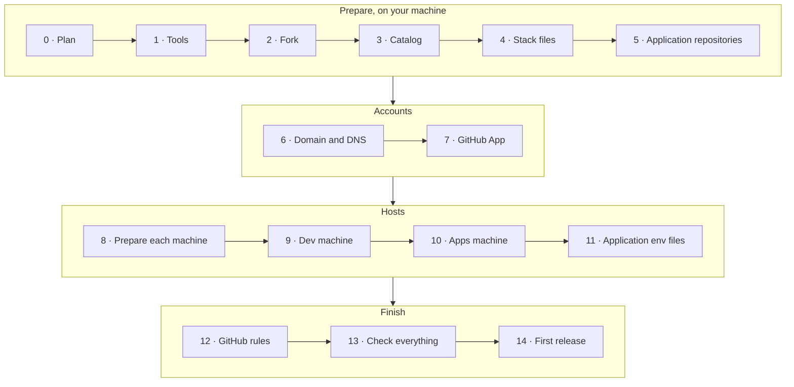

# Setting up yggdrasil

This guide takes you from nothing to a first release deployed by yggdrasil. Follow the steps in
order: each one only needs what the previous ones produced. The path it follows is this
repository's default setup: **two machines**, a dev machine (the Jenkins controller and the git
server) and an apps machine (development, homologation and production), plus a `local` environment
on your workstation. Other layouts (everything on one machine, one host per environment, or
anything in between) change only a few answers of step 0. What the two machines are, who the users
on them are and why the installer does what it does is in [hosts.md](hosts.md). An older example
installation, with the controller on the same VPS as the environments, is in
[examples/docker-desktop-and-vps](examples/docker-desktop-and-vps/README.md).



| Step | Where | Time |
|---|---|---|
| [0. Plan the installation](#0-plan-the-installation) | Paper | 10 min |
| [1. Install the tools](#1-install-the-tools-on-your-machine) | Your machine | 10 min |
| [2. Fork yggdrasil](#2-fork-yggdrasil) | GitHub, your machine | 5 min |
| [3. Write the catalog](#3-write-the-catalog) | Your machine | 20 min |
| [4. Write the stack files](#4-write-the-stack-files) | Your machine | 10 min per application |
| [5. Prepare each application repository](#5-prepare-each-application-repository) | Each application repository | 10 min per application |
| [6. Domain and DNS](#6-domain-and-dns) | DNS provider | 15 min, plus propagation |
| [7. Create the GitHub App](#7-create-the-github-app) | GitHub | 10 min |
| [8. Prepare each machine](#8-prepare-each-machine) | Each machine | 20 min per machine |
| [9. The dev machine](#9-the-dev-machine) | Dev machine | 30 min |
| [10. The apps machine](#10-the-apps-machine) | Apps machine, and other hosts | 15 min per host |
| [11. Application env files](#11-application-env-files) | Each host | 5 min per application |
| [12. Apply the GitHub rules](#12-apply-the-github-rules) | Your machine | 5 min |
| [13. Check everything](#13-check-everything) | Browser | 10 min |
| [14. The first release](#14-the-first-release) | An application repository | 10 min |

## 0. Plan the installation

Decide these before touching anything, and write the answers down: every later step uses them.

| Decision | Example | Notes |
|---|---|---|
| **GitHub owner** | `acme` | The user or organisation that owns the application repositories. Your fork of yggdrasil goes there too. |
| **Environments**, in promotion order | `local`, `development`, `homologation`, `production` | For each: its `trigger` (`manual`, `branch` or `release`), its `mode` (`proxy`, or `ports` for a workstation), and whether it runs only while used (`onDemand`). See [catalog.md](catalog.md#environments). |
| **Machines**, their roles and the environments each runs | a **dev** machine (the Jenkins controller and Forgejo) and an **apps** machine (`development`, `homologation`, `production`); `local` on your workstation | Each machine is an Ubuntu 24.04 server with a role: `dev` or `apps` ([The two machines](hosts.md#1-two-machines)). It runs one environment or several: environments sharing a host share its platform stack, its Jenkins agent and its domain. A `ports` environment (a workstation) needs no host setup. See [Planning the hosts](#planning-the-hosts). |
| **The controller host** | the dev machine | The one host that runs the Jenkins controller. It must be reachable from the internet on 443, for GitHub's webhooks, and from the other hosts' agents. |
| **Domain per machine** | `example.com` | Every public name is one label under it: `heimdall.example.com`, and in an environment with a `hostSuffix`, `heimdall-dev.example.com`. A machine can serve more than one domain (`EXTRA_DOMAINS`). Your own domain on Cloudflare, or a free DuckDNS subdomain: [dns.md](dns.md). |
| **Systems and applications** | `shop` = `shop-api` + `shop-web` | Each application is one repository with a Dockerfile and a `/health`-style endpoint. |

A minimal installation is **one** environment (`production`, `trigger: release`) on **one** machine
that also runs the controller. Start there if you are trying yggdrasil out: it is a machine with
role `apps` whose `COMPOSE_PROFILES` also has `jenkins` (and, once the controller has made the
agent's secret, `agent`), as step 9.5 describes. Adding an environment to that host later is a
catalog entry and one line of its `platform.env` ([Adding things](#an-environment)).

### Planning the hosts

| Layout | Catalog | Each host |
|---|---|---|
| **Two machines** (the default) | As in the next row, for the apps machine. The dev machine runs no environment | Dev machine: `--role dev`, profiles `forge,jenkins`, no `ENVIRONMENTS`. Apps machine: `--role apps`, profiles `apps,agent`. [hosts.md](hosts.md) |
| **One machine for everything** | As in the next row | `--role apps`, profiles `apps,jenkins` and then `apps,jenkins,agent`: the controller and the environments share one machine and one engine. Still supported, behind Cloudflare's proxy (the `apps` role opens 80 and 443 to Cloudflare only). It has none of the dev-machine users; the `forge` profile also works there if you want Forgejo. A host without Cloudflare in front is not covered by `ygg install`: set it up by hand ([step 8](#8-prepare-each-machine) lists what to do) and open 80 and 443 in `ufw` yourself |
| **Several environments on one host** | The environments of the host set the same `agent` (`vps`) and each a distinct `hostSuffix` (`-dev`, `-hml`; production can keep none). `onDemand: true` on those used only now and then | One platform stack; `ENVIRONMENTS` in its `platform.env` lists them all; one `DOMAIN`, one `*.DOMAIN` DNS record and certificate for all of them |
| **One environment per host** | `hostSuffix` empty; `agent` left out (it defaults to the environment's id) | One platform stack each, with `ENVIRONMENTS` naming its one environment, and its own `DOMAIN` (`example.com`, `staging.example.com`), each with its own `*.DOMAIN` record |
| **Mixed** | Production on a host of its own; development and homologation sharing another, with their own `agent` and suffixes | As above, per host |

Every application runs in each environment as its own Compose project, `<application>-<environment>`,
so environments on one Docker engine never touch each other
([catalog.md](catalog.md#several-environments-on-one-host)). Two `ports` environments on one
workstation would publish the same ports, though: keep one per machine.

### What each host needs

- **Ubuntu 24.04 LTS** for the `dev` and `apps` roles (the installer refuses another version): a
  VPS or a VM, with an admin user that has `sudo` and logs in with an SSH key. Docker Engine, the
  Compose plugin (v2.24 or later, for `!reset` in the overlays) and the rest come from
  `ygg install` ([step 8](#8-prepare-each-machine)).
- Roughly **2 GB of RAM** for the platform, **4 GB** on the host that also runs the Jenkins
  controller, plus what your applications need in every environment that runs at the same time. A
  stopped on-demand environment uses no memory. The dev machine also runs Forgejo and the checks:
  see [hosts.md](hosts.md#1-two-machines) for its sizing.
- `git`, `bash`, `openssl`, and `python3` with PyYAML (the installer adds them).
- Inbound ports, set by the installer: **dev** 22, 80, 443 and 2222 (Forgejo's git over SSH);
  **apps** 22, and 80 and 443 only from Cloudflare's address ranges. Nothing else inbound.

## 1. Install the tools on your machine

On the machine you work from (Linux, macOS, or Windows with Git Bash):

| Tool | Why | Install |
|---|---|---|
| `git` | Everything | [git-scm.com](https://git-scm.com/downloads) |
| `python3` + PyYAML | Validating the catalog, applying the GitHub rules | `pip install pyyaml` (Ubuntu: `sudo apt install python3-yaml`) |
| GitHub CLI `gh` | Applying the GitHub rules | [cli.github.com](https://cli.github.com), then `gh auth login` as an admin of the repositories |
| `openssl` | Generating tokens, converting the GitHub App key | Included with Git Bash, macOS and most Linux distributions |
| `ssh` | Reaching the hosts | Included |

Check them:

```bash
git --version && python3 -c "import yaml; print('PyYAML ok')" && gh auth status && openssl version
```

On Windows, use `python` if `python3` isn't on the path.

## 2. Fork yggdrasil

Your installation lives in your own copy of this repository: your catalog, your stack files. Its
**`main`** branch is what counts: every host runs a checkout of it, and every deploy clones it
([details](#where-jenkins-and-the-hosts-read-the-catalog)).

The [license](../LICENSE) allows this copy: you may fork or import the repository, change it and
run it on hosts you control to deploy your own applications. You may not redistribute it or offer
it to others as a service.

1. On GitHub, **Fork** this repository into your owner (step 0), and untick *Copy the `develop`
   branch only*: this repository's default branch is `develop`, its work in progress, while
   releases are merged into `main`, the branch your installation runs. For a private copy, use
   *Import repository* or create an empty private repository and push `main` to it: forks of
   public repositories can't be private.
2. Clone its `main` branch:
   ```bash
   git clone -b main https://github.com/<owner>/<repository>.git
   cd <repository>
   ```

## 3. Write the catalog

[`catalog.yaml`](../catalog.yaml) describes the installation. The one in the repository is a
working example ([examples/docker-desktop-and-vps](examples/docker-desktop-and-vps/README.md)):
replace it with yours. Full reference: [catalog.md](catalog.md).

1. **Top level**: `owner` is your GitHub owner. `repository` is your fork's name (omit it if it's
   `yggdrasil`).
2. **`environments`**: the ones from step 0, in promotion order. The shipped ones are the default
   layout, a workstation and one VPS:
   ```yaml
   environments:
     - id: local
       name: Local
       mode: ports
       trigger: manual
     - id: development
       name: Development
       trigger: branch
       branches: develop
       agent: vps
       hostSuffix: -dev
       onDemand: true
     - id: homologation
       name: Homologation
       trigger: branch
       branches: release/*
       agent: vps
       hostSuffix: -hml
       onDemand: true
     - id: production
       name: Production
       trigger: release
       agent: vps
   ```
   For one host per environment, drop `agent` and `hostSuffix` ([Planning the hosts](#planning-the-hosts)).
   Add `approval: true` to an environment that should wait for someone to click **Deploy**.
3. **`systems`**: replace `heimdall` and `fortuna` with your systems and applications. For each
   application:
   - `id`: the repository name (or set `repository`).
   - `kind`: `api`, `web` or `worker`.
   - `health`: the URL the status API probes over the Docker network, `http://<id>:<port>/<path>`.
     Write the plain id: in each environment the status API probes `<id>.<environment>`.
   - `host`: its public host name under `DOMAIN`, if it has one. Each environment adds its
     `hostSuffix`.
   - `metrics`: `<id>:<port>`, if it exposes Prometheus metrics.
   - `checks`: the names of the GitHub Actions jobs that run on **every** pull request of that
     repository. Look them up in a recent pull request's *Checks* tab, which shows
     `<workflow> / <job>`: write only the job part (`test`, not `CI / test`). Don't list
     `branch-policy`: it's always required.
4. **Keep the `yggdrasil` system** at the end as it is: it makes the console show the platform's
   own health.
5. Validate, and see what each application will do where:
   ```bash
   python3 scripts/catalog.py validate
   python3 scripts/catalog.py plan <application-id>
   ```

## 4. Write the stack files

`scripts/deploy.sh` combines Compose files from `stacks/` with the application's repository. The
ones in `stacks/` are working examples: copy the closest one and rename what it names.

| The application's repository | Files to add in `stacks/` |
|---|---|
| **Has its own `docker-compose.yml`** | `<id>.proxy.yml`: Traefik labels, the `edge` and `telemetry` networks with the alias `<id>.${YGG_ENVIRONMENT}`, and `ports: !reset []`. Example: [heimdall-api.proxy.yml](../stacks/heimdall-api.proxy.yml). |
| **Has only a Dockerfile** | `<id>.yml`: the service, built from `${APP_DIR}` and tagged `<id>:${IMAGE_TAG}`. Plus `<id>.proxy.yml`, and `<id>.ports.yml` if a `ports` environment deploys it. Examples: [heimdall-ui.yml](../stacks/heimdall-ui.yml) and its overlays. |

Rules to keep:
- Name everything the environments of one host share after the environment too, from
  `${YGG_ENVIRONMENT}`, which `deploy.sh` exports: the network alias `<id>.${YGG_ENVIRONMENT}`,
  and the Traefik routers and services `<id>-${YGG_ENVIRONMENT}`. Write the labels as a list
  (`- traefik.http.routers.<id>-${YGG_ENVIRONMENT}.rule=...`): Compose substitutes variables in
  values, not in mapping keys.
- Tag the images the stack builds `<id>:${IMAGE_TAG}`: `deploy.sh` sets it to
  `<environment>-<version>`, and rolls back and prunes only those.
- In `proxy` mode, nothing publishes a host port: only Traefik does.
- Host names come from the env file (`PUBLIC_HOST`, `UI_HOST`), not hard-coded.
- Use named volumes, not relative bind mounts (`./data:/data`). Under Jenkins, Compose runs inside
  the agent container, so a relative path points into the agent's workspace, not the host.

Delete the example stack files of applications you removed from the catalog. Then check and publish:

```bash
python3 scripts/catalog.py validate
git add -A && git commit -m "chore: describe this installation" && git push origin main
```

Push to **`main`**: it's the branch Jenkins and the hosts read.

## 5. Prepare each application repository

For every application in the catalog:

1. **A Dockerfile** that builds the application, and a **health endpoint** matching the catalog's
   `health`. Give the container a health check (`HEALTHCHECK` in the Dockerfile, or `healthcheck:`
   in the Compose file): `deploy.sh` waits for it to report healthy, and rolls back if it doesn't.
2. **A `develop` branch.** If the repository has none:
   ```bash
   git switch main && git pull && git switch -c develop && git push -u origin develop
   ```
3. **The three template files** from [`templates/application/`](../templates/application), on
   `develop`:
   - `Jenkinsfile`: replace `<application-id>` with the catalog id.
   - `.github/workflows/branch-policy.yml`: as is.
   - `CONTRIBUTING.md`: replace `<owner>` and `<repository>` (your fork of yggdrasil) and
     `<application-id>`. It has changes recorded in a `CHANGELOG.md`: if the repository has none,
     start one with a `## [Unreleased]` heading
     ([Keep a Changelog](https://keepachangelog.com/en/1.1.0/)).
4. **CI** that runs the jobs listed in the catalog's `checks` on pull requests into `develop` and
   `main`.
5. Commit and push to `develop`. Until the rules are applied (step 12) a direct push works; after,
   only pull requests do.

## 6. Domain and DNS

Follow [dns.md](dns.md) up to and including **A4** (Cloudflare) or **B1** (DuckDNS). With the default
two machines you end up with **two domains on Cloudflare** (the applications' and the sites'; one
domain also works) and:

- on each domain, a `*.<DOMAIN>` record and the bare-domain record for the **apps machine**'s public
  IP, **proxied** (orange cloud). One wildcard covers every environment of the machine:
  `heimdall-dev.<DOMAIN>`, `heimdall-hml.<DOMAIN>` and `heimdall.<DOMAIN>` are all one label under it;
- on the application domain, records of their own for the **dev machine**'s names, `git`, `jenkins`,
  `traefik-dev` and `grafana-dev`, pointing at its IP and **DNS only** (grey cloud): git over SSH cannot pass Cloudflare's
  proxy. A specific record wins over the wildcard ([hosts.md, Domains and Cloudflare](hosts.md#2-domains-and-cloudflare));
- SSL/TLS mode **Full (strict)** on both zones;
- one API token, with **Zone Read** and **DNS Edit** on both zones, which goes into each machine's
  `acme.env` at step 9.2 or 10. For DuckDNS: its token.

Check each name resolves, from any machine:

```bash
nslookup yggdrasil.<DOMAIN> 1.1.1.1
nslookup jenkins.<DOMAIN> 1.1.1.1
```

The first prints a Cloudflare address while the record is proxied (the proxy hides the machine's
IP); the second prints the dev machine's own. Test a name **under** the domain.

The controller's address will be `https://jenkins.<DOMAIN>`, with the `DOMAIN` of the machine that
runs it. Note it down: steps 7 and 9 need it.

## 7. Create the GitHub App

Jenkins talks to GitHub as a GitHub App, not as you. So it doesn't inherit your ruleset bypass, and
its merges go through the same rules as everyone's.

By the end of this step you have two things, both needed in step 9:

| What | Where it goes |
|---|---|
| The app's **App ID**, a number like `1234567` | `GITHUB_APP_ID` in the controller's `platform.env` |
| The app's **private key**, a `.pem` file | `/etc/yggdrasil/github-app.pem` on the controller host |

Create the app under the **same owner** as the repositories (the `owner` in `catalog.yaml`): your
personal account, or the organisation.

### 7.1 Open the form

| Owner | Path | Direct link |
|---|---|---|
| Personal account | Profile picture (top right) → **Settings** → **Developer settings** (last item of the left sidebar) → **GitHub Apps** → **New GitHub App** | `https://github.com/settings/apps/new` |
| Organisation | The organisation's page → **Settings** → **Developer settings** → **GitHub Apps** → **New GitHub App** | `https://github.com/organizations/<owner>/settings/apps/new` |

Creating an app in an organisation needs you to be one of its owners. GitHub may ask for your
password or a two-factor code before showing the form.

### 7.2 Fill in the form

The form is one long page. Go through it top to bottom:

**Basic information**

| Field | Value | Why |
|---|---|---|
| GitHub App name | Anything unique on GitHub, e.g. `acme-yggdrasil` | Shown as the author of Jenkins' merges, tags and statuses |
| Description | Optional, e.g. `Deploys with yggdrasil` | |
| Homepage URL | `https://jenkins.<DOMAIN>` | Required by the form, only informational. `<DOMAIN>` is the controller host's domain, from step 6 |

**Identifying and authorizing users**, and **Post installation**: leave every field empty and every
box unchecked. Jenkins acts as the app, never on behalf of a user.

**Webhook**

| Field | Value | Why |
|---|---|---|
| Active | **Unchecked for now** | The controller doesn't exist yet, and GitHub would pile up failed deliveries. Step 9.4 checks it |
| Webhook URL | `https://jenkins.<DOMAIN>/github-webhook/`, trailing slash included | Where GitHub notifies Jenkins of pushes and pull requests. Fill it in now if the form allows; otherwise in step 9.4 |
| Webhook secret | Empty | |
| SSL verification | Enabled | The controller has a real certificate by the time the webhook is active |

**Permissions → Repository permissions.** Expand the section, and set exactly these; leave every
other one at *No access*:

| Permission | Access | What Jenkins does with it |
|---|---|---|
| Contents | Read and write | Checks the code out, merges the release pull request, creates the `vx.y.z` tag and release, deletes the release branch |
| Actions | Read and write | Starts the application's release-artifact workflow after deployment and waits for its verified draft release to be published |
| Pull requests | Read and write | Finds release pull requests and merges them |
| Commit statuses | Read and write | Sets the `deploy/<environment>` statuses that `main`'s ruleset requires |
| Checks | Read-only | Waits for every GitHub Actions check of a release pull request before deploying |
| Metadata | Read-only | Selected automatically: every app has it |

**Organization permissions** and **Account permissions**: leave them all at *No access*.

**Subscribe to events.** This list only shows events the permissions above allow, so set the
permissions first. Check:

| Event | Why |
|---|---|
| Push | A pushed branch that matches an environment's `branches` deploys there |
| Pull request | A `release/x.y.z → main` pull request starts the release |
| Repository | Jenkins notices renamed or deleted repositories |

If the events can't be checked while the webhook is inactive, check them in step 9.4 when you
activate it.

**Where can this GitHub App be installed?** **Only on this account.** Nobody else should install
your deploy app.

Click **Create GitHub App**.

### 7.3 Note the App ID

GitHub opens the app's **General** page. In the **About** section at the top, copy the **App ID**
(a number). Don't confuse it with the **Client ID** just below it, which starts with `Iv`: Jenkins
doesn't use the client ID.

You can come back to this page any time: **Developer settings → GitHub Apps → Edit** next to the app.

### 7.4 Generate the private key

1. On the same **General** page, scroll to **Private keys** at the bottom.
2. Click **Generate a private key**. Your browser downloads a file named like
   `acme-yggdrasil.2026-09-25.private-key.pem`.
3. Keep it somewhere safe until step 9.1 copies it to the controller host, then delete your copy.

The key lets anyone act as the app on every repository it's installed on: never commit it, and
never paste it in a chat or an issue. GitHub keeps only its public half, so it can't show you the
key again. If you lose it or it leaks, generate a new one here and **Delete** the old one: the App ID
stays the same, only `/etc/yggdrasil/github-app.pem` changes.

### 7.5 Install the app on the repositories

Creating the app gives it no access to anything yet: installing it does.

1. In the app's settings, click **Install App** in the left sidebar.
2. Click **Install** next to your owner (the account or organisation from `catalog.yaml`).
3. Choose **Only select repositories** and pick:
   - every application repository in the catalog (`python3 scripts/catalog.py applications --deployable`
     lists their ids; an application with a `repository` field uses that name);
   - your fork of yggdrasil: Jenkins loads its pipeline library from it.
4. GitHub lists the permissions from 7.2. Click **Install**.

To change the repositories later (when you add an application, say), go to the owner's
**Settings** → **Applications** → **Installed GitHub Apps** (for an organisation: **Settings** →
**GitHub Apps**) → **Configure** next to the app → **Repository access**. A repository the app
isn't installed on gets no Jenkins job branches and never deploys.

## 8. Prepare each machine

On **each** machine: the dev machine and the apps machine, or the one machine of a single-machine
setup. What you get, and why each piece exists, is in [hosts.md](hosts.md): read its
[Users](hosts.md#3-users) and [System settings](hosts.md#4-system-settings) once.

You need, before you start:

- A fresh **Ubuntu 24.04 LTS** server.
- An **admin user** on it (this guide calls it `artur`) with `sudo`, which you log in as over SSH **with a
  key**. Your public key must be in the admin's `~/.ssh/authorized_keys`. Test it from your own
  computer: `ssh artur@<host>` must not ask for a password. The installer switches passwords off, and
  refuses to start if there is no key to let you back in.
- A **second SSH session** open while you install, in case something locks you out.

### 8.1 Get the checkout

As the admin:

```bash
sudo apt update && sudo apt install -y git python3 python3-yaml
sudo install -d -o "$USER" /opt/yggdrasil
git clone -b main https://github.com/<owner>/<repository>.git /opt/yggdrasil
```

- `apt install git python3 python3-yaml`: the little the installer itself needs to start. It installs the
  rest.
- `install -d -o "$USER" /opt/yggdrasil`: creates the directory, owned by you for now (`$USER` is filled
  in by the shell; type it as is). The installer hands it to `ygg`. Keep the path: the rest of this guide
  uses it, and so do the systemd units of the backup.
- `git clone -b main …`: your fork's `main` branch, where your catalog is. `<owner>` is the `owner` of
  `catalog.yaml` and `<repository>` your fork's name (`yggdrasil` unless you renamed it). For example:
  `git clone -b main https://github.com/acme/yggdrasil.git /opt/yggdrasil`.

A **private** fork needs a credential. Create a read-only
[deploy key](https://docs.github.com/en/authentication/connecting-to-github-with-ssh/managing-deploy-keys)
for this machine and clone over SSH instead:

```bash
ssh-keygen -t ed25519 -N "" -C "yggdrasil@$(hostname)" -f ~/.ssh/id_ed25519
cat ~/.ssh/id_ed25519.pub
```

- `-t ed25519`: the key type. `-N ""`: no passphrase, so `git pull` works unattended.
- `-C "yggdrasil@$(hostname)"`: a label that tells you, on GitHub, which machine the key belongs to.
- `-f ~/.ssh/id_ed25519`: where the key is written. That is SSH's default key, so `git` uses it
  without further configuration. If the file already exists, skip `ssh-keygen` and use it.

Paste the printed public key in your fork → **Settings → Deploy keys → Add deploy key**, with
*Allow write access* unchecked. Then clone with the SSH URL:
`git clone -b main git@github.com:<owner>/<repository>.git /opt/yggdrasil`. After the install the checkout
belongs to `ygg`, who pulls from then on: repeat the key steps as `ygg`, and add that key to the fork too.

### 8.2 Look first

```bash
cd /opt/yggdrasil
scripts/ygg.sh check --role dev        # or: --role apps
```

- `scripts/ygg.sh`: the `ygg` command, run from the checkout. Once step 8.4 has installed it, `ygg` works from
  any directory.
- `check`: reads the machine and prints one row per piece, `ok`, `warn` or `missing`, and changes
  nothing. A new machine has mostly `missing` rows.
- `--role dev` or `--role apps`: the role to check against. Without it, `check` uses the role the install
  wrote to `/etc/yggdrasil-role`, and `workstation` (today's checks for a laptop or an older host) if
  there is none.

### 8.3 Install

```bash
scripts/ygg.sh install --role dev      # or: --role apps
```

Run it as the admin, not as `root` (it refuses root) and not with `sudo`: it asks `sudo` itself for each
thing that needs it. It checks the machine, then goes through the parts below **in this order**, saying
what it is about to do and asking `Do this?` before each. It skips what is already right, checks the
machine again after each part, and is safe to run again. If you say no to a part, it moves on to the next.
The files it writes, with their content, are in [hosts.md, System settings](hosts.md#4-system-settings).

Next to each part is what you would type to do it by hand. Every command is run as the admin with `sudo`.

1. **Packages.** Docker's `apt` repository ([docs.docker.com/engine/install](https://docs.docker.com/engine/install/ubuntu/)),
   then:
   ```bash
   sudo apt install -y git curl openssl python3 apache2-utils ca-certificates python3-yaml python3-cryptography \
     uidmap dbus-user-session slirp4netns ufw rsync unattended-upgrades \
     docker-ce docker-ce-cli containerd.io docker-ce-rootless-extras docker-buildx-plugin docker-compose-plugin
   ```
   - `uidmap`, `slirp4netns`, `dbus-user-session` and `docker-ce-rootless-extras`: what rootless Docker needs.
   - `apache2-utils`: `htpasswd`, for the Traefik dashboard password. `python3-yaml`: PyYAML, which
     `scripts/catalog.py` needs. `python3-cryptography`: for the [variables store](variables.md).
   - `rsync`: the nightly backup. `ufw`: the firewall. `unattended-upgrades`: part 4.
   - Ubuntu's own `docker.io`, `docker-compose` and `containerd`/`runc` packages clash with Docker's.
     The installer removes them if you agree. By hand:
     `sudo apt remove docker.io docker-doc docker-compose docker-compose-v2 podman-docker containerd runc`.
     Images, containers and volumes stay.
2. **Turn off the machine's own Docker.**
   ```bash
   sudo systemctl disable --now docker.service docker.socket containerd.service
   sudo systemctl mask docker.service docker.socket containerd.service
   sudo gpasswd -d <user> docker        # once for each member of: getent group docker
   ```
   - `disable --now`: stops them and keeps them from starting at boot.
   - `mask`: makes them impossible to start, even by an upgrade of `docker-ce`. The Docker packages start the
     rootful engine; it would answer on `/var/run/docker.sock` to anyone in the `docker` group, which is root.
   - `gpasswd -d <user> docker`: removes a user from the group. Nobody should be in it.
3. **System settings.** The sysctl, AppArmor and systemd files of
   [hosts.md](hosts.md#4-system-settings) (`/etc/sysctl.d/90-yggdrasil.conf`,
   `/etc/apparmor.d/usr.bin.rootlesskit`, `/etc/systemd/system/user@.service.d/delegate.conf`), then:
   ```bash
   sudo sysctl --system
   sudo systemctl restart apparmor.service
   sudo systemctl daemon-reload
   ```
   - `sysctl --system`: loads the new setting, which lets a non-root process bind ports 80 and 443.
   - `restart apparmor.service`: loads the profile that allows rootless Docker's user namespaces on
     Ubuntu 24.04.
4. **Unattended upgrades.** The file `/etc/apt/apt.conf.d/20auto-upgrades` of hosts.md: security updates
   install themselves.
5. **Service users.** `ygg` on an apps machine; `ygg`, `ci`, `release`, `renovate` and `dev` on a dev machine:
   ```bash
   sudo useradd --create-home --user-group --shell /bin/bash ygg
   sudo useradd --create-home --user-group --shell /usr/sbin/nologin ci
   sudo chmod 750 /home/ygg /home/ci
   ```
   - `--create-home --user-group`: a home directory and a group of the same name. `useradd` also gives the user
     its own range in `/etc/subuid` and `/etc/subgid`, which its rootless engine needs.
   - `--shell /bin/bash` for the users that log in over SSH (`ygg`, and `dev`); `/usr/sbin/nologin` for
     `ci`, `release` and `renovate`, which only run services.
   - `chmod 750`: closes each home to the other users. The users have no password, no `sudo` and are in no
     privileged group. If the admin user has the same name as one of them, it is left alone.
6. **The `ci` limits** (dev machine): `/etc/systemd/system/user-<uid>.slice.d/limits.conf` with six CPUs and
   20 GB (`CPUQuota=600%`, `MemoryMax=20G`), where `<uid>` is `id -u ci`, then `sudo systemctl daemon-reload`.
7. **SSH.** First your key goes to the SSH users that have none:
   ```bash
   sudo install -d -m 700 -o ygg -g ygg /home/ygg/.ssh
   sudo install -m 600 -o ygg -g ygg ~/.ssh/authorized_keys /home/ygg/.ssh/authorized_keys
   ```
   - `install -d -m 700 -o ygg -g ygg`: creates `.ssh`, readable by `ygg` only.
   - `install -m 600 -o ygg -g ygg <from> <to>`: copies your keys to `ygg`, who owns them, readable by it
     alone. The installer asks first, and never replaces keys that are there.

   Then the drop-in `/etc/ssh/sshd_config.d/00-yggdrasil.conf` of hosts.md (no root login, no passwords,
   `AllowUsers` the admin and the role's SSH users), and:
   ```bash
   sudo sshd -t
   sudo sshd -T | grep -E '^(permitrootlogin|passwordauthentication|kbdinteractiveauthentication|allowusers) '
   sudo systemctl try-reload-or-restart ssh
   ```
   - `sshd -t`: the file's syntax is valid.
   - `sshd -T`: what SSH will really run with. The four lines must show `no`, `no`, `no` and your users. If
     another file sets one of them first (cloud images ship `50-cloud-init.conf`), the name `00-…` is
     what wins; if something still does, remove the drop-in again and find what sets it.
   - `try-reload-or-restart ssh`: applies it. Open a **new** SSH session to test before you close the old one.

   The installer does the checks itself and puts the file back if they fail.
8. **The checkout** goes to `ygg`: `sudo chown -R ygg:ygg /opt/yggdrasil && sudo chmod 755 /opt/yggdrasil`.
   `-R`: everything in it. `755`: others can read it, so `ci` and `release` can run the agent script.
9. **The secrets directories.**
   ```bash
   sudo install -d -m 750 -o ygg -g ygg /etc/yggdrasil
   sudo install -m 600 -o ygg -g ygg /opt/yggdrasil/env/platform.env.example /etc/yggdrasil/platform.env
   sudo install -m 600 -o ygg -g ygg /opt/yggdrasil/env/acme.env.example /etc/yggdrasil/acme.env
   sudo install -d -m 750 -o ci -g ci /etc/yggdrasil-ci
   sudo install -m 600 -o ci -g ci /opt/yggdrasil/env/agent.env.example /etc/yggdrasil-ci/agent.env
   ```
   - `/etc/yggdrasil` is `ygg`'s; every other service user has `/etc/yggdrasil-<user>` (`ci` and `release` get an
     `agent.env`, the others an empty directory).
   - `-m 750`: the owner reads and writes, its group reads, nobody else gets in. Files are `600`: the owner only.
     They hold passwords and tokens.
   - A file that is already there is never replaced.
10. **The firewall.** Dev machine:
    ```bash
    sudo ufw allow OpenSSH && sudo ufw allow 80,443/tcp && sudo ufw allow 2222/tcp && sudo ufw enable
    ```
    Apps machine: SSH, and 80 and 443 only from Cloudflare's published ranges:
    ```bash
    sudo ufw allow OpenSSH
    { curl -fsS https://www.cloudflare.com/ips-v4; echo; curl -fsS https://www.cloudflare.com/ips-v6; echo; } | grep . > ~/cloudflare-ips
    for range in $(cat ~/cloudflare-ips); do
      sudo ufw allow proto tcp from "$range" to any port 80,443 comment yggdrasil-cloudflare
    done
    sudo install -m 644 -o ygg -g ygg ~/cloudflare-ips /etc/yggdrasil/cloudflare-ips
    sudo ufw enable
    ```
    - `ufw allow OpenSSH` comes first, so turning the firewall on does not cut your session.
    - `2222/tcp`: Forgejo's git over SSH (the dev machine only).
    - `from "$range" … comment yggdrasil-cloudflare`: lets one Cloudflare range in on the two web ports and
      labels the rule, so that a later `ygg install` knows it is its own and can update it.
    - `| grep .`: drops the blank lines between the two lists, so the file is exactly one range per line,
      as the installer writes it (otherwise `ygg check` reports the file as different).
    - `cloudflare-ips`: the same ranges, which Traefik trusts for the visitor's address
      ([hosts.md](hosts.md#client-addresses)). Rootless Docker publishes ports as ordinary
      processes, so these rules apply to them: Docker no longer goes around `ufw`.
    - If Cloudflare's list cannot be downloaded, the installer changes nothing about the firewall.
      It never opens 80 and 443 to everyone to make up for it.
11. **Rootless Docker for each service user.** For `ygg` (and the same for each of the others):
    ```bash
    sudo loginctl enable-linger ygg
    ```
    then, **as that user** (`ssh ygg@<host>`; for a user that cannot log in, run each command through
    `sudo -u ci env XDG_RUNTIME_DIR=/run/user/$(id -u ci) DBUS_SESSION_BUS_ADDRESS=unix:path=/run/user/$(id -u ci)/bus <command>`):
    ```bash
    mkdir -p ~/.config/systemd/user/docker.service.d
    nano ~/.config/systemd/user/docker.service.d/override.conf      # exactly the three lines of hosts.md
    dockerd-rootless-setuptool.sh install
    systemctl --user daemon-reload
    systemctl --user enable --now docker
    printf '\n%s\n%s\n%s\n' '# >>> yggdrasil >>>' "export DOCKER_HOST=unix:///run/user/$(id -u)/docker.sock" '# <<< yggdrasil <<<' >> ~/.profile
    ```
    - `loginctl enable-linger`: starts the user's systemd at boot and keeps it running with nobody logged in.
      Without it the engine stops with the user's last session.
    - `override.conf`: switches the engine's network and port driver to `slirp4netns`, so that Traefik sees
      the real address of each visitor. Its exact content is in
      [hosts.md, In each service user's home](hosts.md#in-each-service-users-home); the reason in
      [Rootless Docker](hosts.md#5-rootless-docker).
    - `dockerd-rootless-setuptool.sh install`: Docker's own tool; it makes the user's `docker.service`.
    - `systemctl --user enable --now docker`: starts the engine now and at every boot.
    - The `~/.profile` lines point the user's `docker` command at its own engine. The marker comments are
      what the installer looks for: it replaces the block between them on every run instead of adding another
      (the block's exact form is in [hosts.md](hosts.md#in-each-service-users-home)).
12. **The nightly backup**, as `ygg`:
    ```bash
    mkdir -p ~/.config/systemd/user
    cp /opt/yggdrasil/platform/systemd/yggdrasil-backup.service /opt/yggdrasil/platform/systemd/yggdrasil-backup.timer ~/.config/systemd/user/   # their content: hosts.md
    systemctl --user daemon-reload
    systemctl --user enable --now yggdrasil-backup.timer
    ```
    The timer fires at 03:30. It fails, loudly, until you write `backup.conf`: see
    [hosts.md, Backups](hosts.md#7-backups-and-restore).
13. **The role**: `echo dev | sudo tee /etc/yggdrasil-role` (or `apps`). Later `ygg check` and `ygg install`
    without `--role` use it.

When it finishes it prints the check again. Every row should be `ok`. The rows about the engines and the
isolation of `ci` and `release` need `sudo` without a password prompt; run `sudo -v` first so they are
checked.

### 8.4 The `ygg` command

```bash
scripts/ygg.sh self-install
```

This links `/usr/local/bin/ygg` to the checkout and installs tab completion, so `ygg` works from any
directory ([cli.md](cli.md#install)). Until then, `scripts/ygg.sh` works in its place in the steps below.

### 8.5 Check it

From your own computer, log in as `ygg` (the install copied your key) and test its engine:

```bash
ssh ygg@<host>
docker info --format '{{.SecurityOptions}}' && docker run --rm hello-world && docker compose version
python3 /opt/yggdrasil/scripts/catalog.py validate
```

- `docker info --format '{{.SecurityOptions}}'`: must list `name=rootless`. If it fails with
  `permission denied` or cannot connect, see [Troubleshooting](#troubleshooting).
- `docker run --rm hello-world`: runs a test container, which prints `Hello from Docker!`.
- `docker compose version`: prints the Compose plugin's version: v2.24 or later.
- `catalog.py validate`: reads the catalog and prints how many environments, systems and applications it has.

**From here, you work as `ygg`** (`ssh ygg@<host>`) for everything about the platform: the env files,
`platform.sh`, `ygg vars`, `ygg deploy`, `ygg backup`. You work as the admin (`ssh artur@<host>`) for
`sudo`, `ygg check`, `ygg install` and `ygg agent`.

### 8.6 Not on Ubuntu 24.04, or not behind Cloudflare

`ygg install --role dev|apps` refuses another system. A host like that has to do the same by hand: a
rootless Docker engine for the user that will run `platform.sh` (parts 1, 2, 3 and 11 above, with your
own user), `net.ipv4.ip_unprivileged_port_start=80`, and your own firewall. `platform.sh` needs only that
user's engine; it finds the socket from `DOCKER_HOST`, else `/run/user/<uid>/docker.sock`, and refuses a
rootful one.

## 9. The dev machine

Everything in this step, and in step 10, is done as `ygg` (`ssh ygg@<host>`), in `/opt/yggdrasil`. The
dev machine runs Traefik, the monitoring, **Forgejo** (profile `forge`) and the **Jenkins controller**
(profile `jenkins`). It is the controller host. The controller comes up in two passes: first the
controller alone, because each agent's secret only exists once the controller has created the agent;
then the agents. On the default two machines the agent that deploys runs on the apps machine
([step 10](#10-the-apps-machine)); the `ci` and `release` build agents on this machine are started with
`ygg agent` ([cli.md](cli.md#build-agents)). In a single-machine setup the deploy agent runs here, as
9.5 says.

### 9.1 The GitHub App key

Copy the `.pem` from [step 7.4](#74-generate-the-private-key) to the machine, to `ygg`. From your
computer, in the folder it was downloaded to (PowerShell on Windows works too):

```bash
scp <app>.private-key.pem ygg@<controller-host>:~/
```

- `<app>.private-key.pem`: the downloaded file's name, e.g. `acme-yggdrasil.2026-09-25.private-key.pem`.
- `ygg@<controller-host>`: the `ygg` user on the dev machine, e.g. `ygg@203.0.113.10`.
- `:~/`: puts it in `ygg`'s home directory.

Then, as `ygg` on the machine, in its home directory, convert it and delete the original:

```bash
cd ~
openssl pkcs8 -topk8 -inform PEM -outform PEM -nocrypt -in <app>.private-key.pem -out /etc/yggdrasil/github-app.pem
chmod 644 /etc/yggdrasil/github-app.pem
rm <app>.private-key.pem
```

- `openssl pkcs8 -topk8 -nocrypt`: rewrites the key as an unencrypted PKCS#8 key, the only format
  Jenkins' GitHub App credential accepts. GitHub's download is PKCS#1.
- `chmod 644`: the Jenkins controller runs as uid 1000 *inside its container*, which in a rootless
  engine is not `ygg` (that is container root) but an id from `ygg`'s subordinate range. It reads the
  file as "other", so "other" needs the read bit. Nobody else on the machine can reach it: the
  directory `/etc/yggdrasil` is `750`, owned by `ygg`.

### 9.2 The env files, first pass

`/etc/yggdrasil/acme.env`: your DNS provider's credential from step 6, e.g.
`CF_DNS_API_TOKEN=<token>` ([dns.md A5](dns.md#a5-configure-the-host) or
[B2](dns.md#b2-configure-the-host)).

`/etc/yggdrasil/platform.env`: every variable is documented in the file. Edit it with
`nano /etc/yggdrasil/platform.env` and fill in:

| Variable | Value |
|---|---|
| `ENVIRONMENTS` | **Empty** on a dev machine, which runs no environment (`platform.sh` refuses it without the `apps` profile). On a single machine: the ids of the environments it runs, comma-separated, no spaces, exactly as in `catalog.yaml`: `development,homologation,production` |
| `COMPOSE_PROFILES` | `forge,jenkins` (**not** `agent`). A single machine: `apps,jenkins` (**not** `apps,jenkins,agent` yet) |
| `DOMAIN` | This machine's domain, e.g. `example.com`. `git.` and `jenkins.` are under it |
| `EXTRA_DOMAINS` | Empty on the dev machine |
| `CLOUDFLARE_PROXIED` | `false`: the dev machine's names are DNS only. On a single machine behind Cloudflare, `true` ([hosts.md](hosts.md#client-addresses)) |
| `PLATFORM_HOST_SUFFIX` | `-dev` on the dev machine: its Traefik dashboard and Grafana are then `traefik-dev.<DOMAIN>` and `grafana-dev.<DOMAIN>`, not the apps machine's `traefik.` and `grafana.`. They need DNS-only records to this machine ([step 6](#6-domain-and-dns), [hosts.md](hosts.md#dns-records)). Leave it empty on a single machine |
| `ACME_EMAIL` | Your e-mail address: the Let's Encrypt account's contact. Not an `@example.com` one |
| `ACME_DNS_PROVIDER` | `cloudflare`, `duckdns`, ... |
| `ACME_CA_SERVER` | **Uncomment** it (remove the `#`): the staging CA, for this first run |
| `TRAEFIK_DASHBOARD_USERS` | `admin:` and a password hash, in single quotes. See below |
| `GRAFANA_ADMIN_PASSWORD` | A password for Grafana's `admin` user |
| `YGGDRASIL_STATUS_TOKEN` | A random token, at least 32 characters. Compose wants it on every machine, even one without the status API; the console needs it where there is one: keep a copy in your password manager |
| `JENKINS_URL` | `https://jenkins.<DOMAIN>/` |
| `JENKINS_ADMIN_PASSWORD` | A password for the Jenkins `admin` user |
| `GITHUB_APP_ID` | The App ID from [step 7.3](#73-note-the-app-id) |
| `GITHUB_APP_KEY_FILE` | `/etc/yggdrasil/github-app.pem`, from 9.1 |

Use letters and digits only in passwords: `platform.sh` reads the file with bash, and Compose and
Jenkins read it too, so `$`, spaces, quotes or `;&()` break it. The secrets can be generated
straight into the file:

```bash
f=/etc/yggdrasil/platform.env
hash=$(htpasswd -nB admin)      # asks twice for the Traefik dashboard password you choose
sed -i "s|^TRAEFIK_DASHBOARD_USERS=.*|TRAEFIK_DASHBOARD_USERS='$hash'|" "$f"
sed -i "s|^GRAFANA_ADMIN_PASSWORD=.*|GRAFANA_ADMIN_PASSWORD=$(openssl rand -hex 16)|" "$f"
sed -i "s|^YGGDRASIL_STATUS_TOKEN=.*|YGGDRASIL_STATUS_TOKEN=$(openssl rand -hex 32)|" "$f"
sed -i "s|^JENKINS_ADMIN_PASSWORD=.*|JENKINS_ADMIN_PASSWORD=$(openssl rand -hex 16)|" "$f"
grep -E '^(GRAFANA_ADMIN_PASSWORD|YGGDRASIL_STATUS_TOKEN|JENKINS_ADMIN_PASSWORD)=' "$f"
```

- `htpasswd -nB admin`: prints `admin:<bcrypt hash>` for the user `admin`, without writing a file.
- `openssl rand -hex 16` / `-hex 32`: 32 / 64 random hexadecimal characters.
- `sed -i "s|^NAME=.*|NAME=value|" "$f"`: replaces the whole `NAME=` line of the file. `|` separates
  the parts because the hash contains `/`.
- The last line prints the generated passwords and token: save them in your password manager.

There is no Docker group or socket setting any more (`DOCKER_GID` is gone). `platform.sh` finds `ygg`'s
own engine and mounts its socket. Traefik, Alloy and the status API don't hold the socket: each one
reads Docker through a socket proxy of its own, which allows only the read-only requests that client
makes, and the proxies run as container root, which is `ygg` on the host.

Leave the agent section for 9.5, and the first Forgejo account for 9.6.

**With the variables store** ([variables.md](variables.md)), fill in both files as above, then
move them into the encrypted store, which becomes their only source (skip this to keep the files):

```bash
ygg vars init          # prints the key: store it in your password manager, then type saved
ygg vars import --all  # platform.env, acme.env and any application env files; renames them *.env.imported
```

Change a value later with `ygg vars set platform KEY=value` (or `vars edit platform`),
and delete the `*.env.imported` files once `platform.sh up` has worked. The check below works
either way. Check the settings:

```bash
/opt/yggdrasil/scripts/platform.sh config > /dev/null && echo "platform.env OK"
```

It prints `platform.env OK`, or names the missing variable (it also renders Traefik's configuration,
`traefik.yml`, from the settings, and stops if they are wrong). `platform.sh up` checks the rest (each of
`ENVIRONMENTS` against the catalog, the Jenkins variables) before starting anything.

### 9.3 Start it and check the certificate

```bash
/opt/yggdrasil/scripts/platform.sh up
```

The first start builds images and takes several minutes. It returns once the services are up, with a
table of them: on the dev machine `forgejo`, `jenkins` and `traefik` are `(healthy)`. Then follow [dns.md, Bring it up](dns.md#3-start-the-platform-against-the-staging-ca)
from step 3:

1. Read Traefik's errors with `docker logs yggdrasil-traefik-1 2>&1 | grep -iE 'acme|error' | tail -20`.
2. Check the staging certificate **from your own computer**: `curl -kvI https://yggdrasil.<DOMAIN> 2>&1 | grep -i issuer`
   shows an issuer with `(STAGING)`.
3. Fix any error now, against the staging CA, which isn't rate limited: see
   [dns.md troubleshooting](dns.md#troubleshooting).
4. Switch to the real certificate ([dns.md step 4](dns.md#4-switch-to-the-real-certificate)): put the
   `#` back in front of `ACME_CA_SERVER` in `platform.env`, then:
   ```bash
   /opt/yggdrasil/scripts/platform.sh down
   docker volume rm yggdrasil_letsencrypt
   /opt/yggdrasil/scripts/platform.sh up
   ```
   From your computer, `curl -I https://jenkins.<DOMAIN>/login` now works without `-k`, and
   `https://git.<DOMAIN>` shows Forgejo's sign-in page.

### 9.4 Jenkins and the webhook

1. Open `https://jenkins.<DOMAIN>` and sign in as `admin` with `JENKINS_ADMIN_PASSWORD`. Jenkins has
   created, from the catalog:
   - one job per application, with no branches yet: the first scans find no `Jenkinsfile` on
     `main`;
   - one agent per host it deploys to, named after the environments' `agent` (`vps` for the
     default VPS: **Manage Jenkins → Nodes**), all offline for now.
2. Back in the GitHub App's **General** page ([step 7.3](#73-note-the-app-id)), tick
   **Webhook → Active**, check the Webhook URL is `https://jenkins.<DOMAIN>/github-webhook/` and
   the events **Push**, **Pull request** and **Repository** are checked, and click **Save changes**.
3. In the app's **Advanced** tab, **Recent Deliveries** lists what GitHub sent. If there's a `ping`,
   it should have a green check. If there's none yet, push any commit to an application repository's
   `develop`: its `push` delivery must get a green check and a `200` response. Use *Redeliver* after
   fixing anything.

### 9.5 The env files, second pass: this host's agent

Only for a single machine that runs the environments too. On two machines the deploy agent is on the
apps machine: go to 9.6, then step 10.

Under **Manage Jenkins → Nodes → \<this host's agent\>** (`vps`), copy the secret: the long
hexadecimal string after `-secret` in the connection command. Then, in `platform.env`:

| Variable | Value |
|---|---|
| `COMPOSE_PROFILES` | `apps,jenkins,agent` |
| `JENKINS_AGENT_NAME` | The agent's name: the `agent` this host's environments set in the catalog (`vps`), or the environment's id when it sets none |
| `JENKINS_AGENT_SECRET` | The secret |
| `JENKINS_AGENT_URL` | `http://jenkins:8080/`: on this host, the agent reaches the controller over the Docker network |

The agent drives `ygg`'s engine through its socket. It runs as container root, which is `ygg` on the host:
it can do what `ygg` can, and no more. Then:

```bash
/opt/yggdrasil/scripts/platform.sh up
```

The node now shows as connected in Jenkins.

One agent deploys to every environment of the host, with two executors; deploys of one application
never overlap. If this host's environments are all `trigger: manual` with no `agent`, Jenkins has
no agent for them: leave `COMPOSE_PROFILES=apps,jenkins`.

### 9.6 The first Forgejo account

Forgejo (profile `forge`) is at `https://git.<DOMAIN>`: registration is closed and nothing is visible
without signing in, so the first account is made from the command line, once, as `ygg`:

```bash
docker exec "$(docker ps -q --filter label=com.docker.compose.project=yggdrasil --filter label=com.docker.compose.service=forgejo)" \
  forgejo admin user create --admin --username <name> --email <you@example.com> --random-password
```

- `docker ps -q --filter label=…`: prints the id of the running Forgejo container. Compose puts these two
  labels on every container, so the command does not depend on its name, which varies with the Compose
  version.
- `docker exec <id> forgejo admin user create`: runs Forgejo's own command in that container.
- `--admin`: a site administrator. `--username`, `--email`: yours.
- `--random-password`: makes a password and prints it once (`generated random password is …`). Sign in with
  it at `https://git.<DOMAIN>` and change it.

Importing the repositories, the bot accounts and the webhooks come with the next parts of the move to
Forgejo; until then Jenkins keeps building from GitHub.

## 10. The apps machine

For each apps machine (and any other host that runs environments), prepared as in step 8 with
`--role apps`, once the controller is up (step 9). Everything here is done as `ygg`. In a
single-machine setup the machine is the controller host, so skip to the `ports` environments below.
This host's env files are simpler, because the controller is elsewhere. Each host has its own
variables store, if you use one: after filling in the files, `ygg vars init` and
`ygg vars import --all` there, as in [9.2](#92-the-env-files-first-pass).

- `acme.env`: the DNS credential, as in 9.2.
- `platform.env`:

  | Variable | Value |
  |---|---|
  | `ENVIRONMENTS` | This host's environment ids, comma-separated, e.g. `development,homologation,production` |
  | `COMPOSE_PROFILES` | `apps,agent` (**`apps`**: `ENVIRONMENTS` is refused without it) |
  | `DOMAIN` | **This** machine's domain, e.g. `example.com` |
  | `EXTRA_DOMAINS` | More domains it serves, e.g. `example.org` for the static sites. Each gets its own certificate |
  | `CLOUDFLARE_PROXIED` | `true`: the machine is behind Cloudflare's proxy. Needs `/etc/yggdrasil/cloudflare-ips`, which `ygg install --role apps` wrote |
  | `ACME_*`, `TRAEFIK_DASHBOARD_USERS`, `GRAFANA_ADMIN_PASSWORD` | As in 9.2, `ACME_CA_SERVER` uncommented for the first run |
  | `YGGDRASIL_STATUS_TOKEN` | A new `openssl rand -hex 32`: one token per host, covering all its environments |
  | `JENKINS_URL` | The **controller's** URL: `https://jenkins.<controller's DOMAIN>/` |
  | `JENKINS_AGENT_NAME`, `JENKINS_AGENT_SECRET` | From **Manage Jenkins → Nodes → \<this host's agent\>** on the controller |
  | `JENKINS_AGENT_URL` | **Empty**: the agent then dials `JENKINS_URL` |
  | `JENKINS_ADMIN_PASSWORD`, `GITHUB_APP_*` | Not needed: leave them empty |

Then, as on the controller host:

1. `/opt/yggdrasil/scripts/platform.sh config > /dev/null && echo "platform.env OK"`.
2. `/opt/yggdrasil/scripts/platform.sh up`.
3. Check the staging certificate from your computer:
   `curl -kvI https://yggdrasil.<this DOMAIN> 2>&1 | grep -i issuer` shows `(STAGING)`.
4. Put the `#` back in front of `ACME_CA_SERVER`, then
   `platform.sh down`, `docker volume rm yggdrasil_letsencrypt`, `platform.sh up`.

The agent dials the controller out over a WebSocket on 443, so this machine needs no inbound port for
Jenkins. Its node turns connected in Jenkins.

**`ports` environments** (`local`, on a developer's workstation) need no platform, agent or DNS: `deploy.sh` publishes
each application on the host: on `127.0.0.1` through `stacks/<app>.ports.yml`, or as the
application's own `docker-compose.yml` publishes it when it has one (often every interface). Set one up any time, from your fork's checkout, with the application
repositories cloned next to it:

```bash
export YGG_SECRETS_DIR=~/yggdrasil-env      # holds <environment>/<application>.env, or vars.db and vars.key
scripts/deploy.sh local shop-api ../shop-api dev
```

- `local`: the environment id. `shop-api`: the application id.
- `../shop-api`: a checkout of the application's repository.
- `dev`: the version to label the image with.

### Firewall

A rootless engine publishes ports as ordinary listening processes, so the `ufw` rules of step 8 apply to
them (rootful Docker went around `ufw`). In these stacks only Traefik publishes ports (80 and 443; and
Forgejo's 2222 on the dev machine): no other service has a `ports:` entry in `proxy` mode. Metrics, the
status API's internal port and Prometheus stay on the Docker networks. Keep it that way when writing stack
files.

## 11. Application env files

On each host, one set of variables per application and environment the host runs (twelve on the
default VPS: four applications in three environments): its configuration and secrets, plus what its
stack files need. Each environment has its own secrets, database and host names. They live in
**env files**, or in the host's [variables store](variables.md), where a value shared by several
applications or environments is defined once.

**In the variables store** (after `vars init`, [9.2](#92-the-env-files-first-pass)):

```bash
cd /opt/yggdrasil
ygg vars import heimdall-api@development ~/yggdrasil-apps/heimdall-api/docker/development.env.example
ygg vars set heimdall-api@development DB_PASSWORD=-       # typed hidden
ygg vars set @development DB_HOST=postgres.example.com    # shared by every application of development
ygg vars edit heimdall-api@development                    # or all of it in $EDITOR
```

`<application>@<environment>` is one application in one environment, `@<environment>` all of an
environment, `<application>` one application everywhere ([scopes](variables.md#scopes-and-layers)).
`ygg config <application> <environment>` and `add` use the store too. The rest of this
step describes what goes in; the files below are for a host without a store.

`ygg config <application> <environment>` creates a missing file from the stack files and
opens it ([cli.md](cli.md#on-a-machine-without-a-store)). By hand:

```bash
install -d -m 750 /etc/yggdrasil/<environment>
nano /etc/yggdrasil/<environment>/<application>.env
chmod 600 /etc/yggdrasil/<environment>/<application>.env
```

- Run as `ygg`, who owns `/etc/yggdrasil`.
- `<environment>`: one of this host's environment ids, e.g. `development`. `<application>`: the
  application's id, e.g. `shop-api`.
- `install -d -m 750`: creates the environment's directory, for `ygg` alone.
- `chmod 600`: only `ygg` reads and writes the file. The deploy agent reads it as container root, which
  is `ygg` on the host, so it needs no group.

What goes in it:

- Start from the application repository's own env template, if it has one.
- Add what the stack files read. The overlays in this repository use:
  - `PUBLIC_HOST`: the application's host name, `<host><hostSuffix>.<DOMAIN>`, matching its
    catalog `host` and the environment's `hostSuffix` (`shop-api-dev.example.com` in development,
    `shop-api.example.com` in production);
  - `UI_HOST`: for a web UI, or an API served under its UI's origin.
- A web UI's build arguments (an API base URL, say) are compiled into its bundle: public, and
  different per environment. `deploy.sh` builds the image once per environment for that reason.
- An application calling another reaches the one **of its own environment**: on the `edge` network
  at `<id>.<environment>` (`http://shop-api.development:8080`), or at its public host name
  when it needs HTTPS. The plain `<id>` alias no longer exists.

`deploy.sh` passes this file (or, with the store, the same variables rendered from it) to Compose (`--env-file`): it fills in the `${VAR}` references of the
Compose files. A variable reaches the application's container only where its `docker-compose.yml`
or `stacks/<id>.yml` names it, in `environment:` (`DB_PASSWORD: ${DB_PASSWORD:?}`) or with
`env_file:`.

`python3 /opt/yggdrasil/scripts/catalog.py environments <application-id>` lists the environments an
application deploys to. [examples/docker-desktop-and-vps/env](examples/docker-desktop-and-vps/env)
has examples for four applications in the four default environments.

## 12. Apply the GitHub rules

On your machine, in your fork, with `gh` authenticated as an admin of the repositories:

```bash
python3 github/rulesets.py --dry-run     # what would change, per repository
python3 github/rulesets.py               # apply
```

For each application repository, this:
- makes `develop` the default branch
- deletes head branches on merge
- creates the `develop`, `main` and `release tags` rulesets, with the checks from the catalog and one `deploy/<environment>` per release environment

To apply to some repositories only, name them: `python3 github/rulesets.py shop-api shop-web` (the
repository names: an application's `repository`, or its `id`).

Rulesets on **private** repositories need a paid GitHub plan. From now on, `develop` and `main`
change only through pull requests.

## 13. Check everything

| Check | Where | Expected |
|---|---|---|
| Platform containers | `/opt/yggdrasil/scripts/platform.sh ps` on each host | Every service `Up`; `traefik`, `status` and `console` also `(healthy)`. `forgejo` and `jenkins` only on the dev machine (the controller host), `agent` where the profile is on. Run as `ygg` |
| Certificates | `https://yggdrasil.<DOMAIN>` for each host | No browser warning |
| Webhooks | GitHub App → Advanced → Recent Deliveries | Green checks |
| Agents | Jenkins → Manage Jenkins → Nodes | Every agent connected |
| Jobs | Jenkins → each application's job → *Scan Repository Log* | Ends with `Finished: SUCCESS`. Before the first release it lists no branch, or only matching `release/*` ones: `main` gets a `Jenkinsfile` when the first release merges |
| Agent can read the env files | `docker exec yggdrasil-agent-1 ls /etc/yggdrasil/<environment>` on each host, for each of its environments | Lists the application env files, no `Permission denied` |
| Console | `https://yggdrasil.<DOMAIN>` | The host, with a chip per environment it runs. The platform system is `up`. Applications are `not deployed` until the first release |
| Status API | `curl -H "Authorization: Bearer <YGGDRASIL_STATUS_TOKEN>" https://yggdrasil.<DOMAIN>/api/status` | JSON with every environment of the host, and every system that has an application in one of them |
| Grafana | `https://grafana.<DOMAIN>` (`grafana-dev.<DOMAIN>` on the dev machine), `admin` / `GRAFANA_ADMIN_PASSWORD` | Prometheus and Loki data sources work |

**Windows and Android consoles**: download them from the releases of
[artur-rios/yggdrasil](https://github.com/artur-rios/yggdrasil/releases) (your fork has none until you
create a GitHub release `vX.Y.Z`, which `release.yml` attaches them to). Then add each host in
the console's **Hosts** screen with its URL (`https://yggdrasil.<DOMAIN>`) and its
`YGGDRASIL_STATUS_TOKEN`: one entry shows every environment of the host.

## 14. The first release

In an application repository prepared in step 5:

```bash
git switch develop && git pull
git switch -c release/0.1.0 && git push -u origin release/0.1.0
```

1. Environments whose `branches` match `release/*` deploy it (homologation, in the default
   catalog). Follow it in Jenkins, in the application's job, on the `release/0.1.0` branch. An
   on-demand environment that is stopped is stopped again once the new version is healthy: run
   `ygg env start homologation` on its host to try it
   ([On-demand environments](#on-demand-environments)).
2. Open the pull request `release/0.1.0 → main`. Once its checks pass, Jenkins deploys it to each
   release environment in order, asking for approval where the catalog says so (**Deploy** in the
   build's page).
3. After the last one, Jenkins merges the pull request and creates `v0.1.0`. With
   `releaseArtifacts: true`, it creates an immutable tag and private draft, dispatches the
   application's release-artifact workflow, and waits for its validated artifacts to publish;
   otherwise it creates the public release directly. It then deletes the branch. The console shows
   the version, commit and deploy time.

If a deploy fails, it rolls back to the previous image and the pull request stays open. With
`releaseArtifacts: true`, a packaging or upload failure after the merge leaves the release as a
private draft and fails the Jenkins build.
The build's console output says why: usually a missing env file variable, a health check that never
passes, or a failed artifact workflow. Fix it on `develop` (or on the host, for an env file) and cut
a new release.

Day to day from here: [README.md#day-to-day](../README.md#day-to-day).

## Where Jenkins and the hosts read the catalog

| Reader | Reads |
|---|---|
| Jenkins controller: jobs, agents, what a build deploys where | The controller host's `/opt/yggdrasil/catalog.yaml` |
| Each deploy: `scripts/deploy.sh` and `stacks/` | A fresh clone of your fork's `main`, made by the agent for the build |
| `platform.sh`, the status API, Prometheus, hand deploys | That host's `/opt/yggdrasil` |

So a change to the catalog or the stack files goes to `main` first, then to every host, as `ygg`:

```bash
cd /opt/yggdrasil && git pull
scripts/platform.sh up
docker restart yggdrasil-status-1                        # every host: re-reads the catalog
docker restart yggdrasil-jenkins-1                       # the controller host only
```

Variables are not part of this: `deploy.sh` and `platform.sh` read them from the variables store
or the env files each time they run, so a changed variable needs no restart, only the next deploy of
the application (or `platform.sh up` for the platform's own).

`platform.sh up` alone isn't enough: the catalog is mounted into the running containers as a single
file, and they keep seeing the old one until they restart. Jenkins creates new jobs and agents only
when it starts; it never deletes agents (remove them in **Manage Jenkins → Nodes**).

## On-demand environments

An environment with `onDemand: true` (development and homologation in the default catalog) runs
only while someone uses it. On its host:

```bash
ygg env start development     # starts every application of development
ygg env stop development      # stops them again
ygg env status                # which environments of this host are on
```

| | While it is stopped | While it is on |
|---|---|---|
| A Jenkins deploy on a push (`trigger: branch`) | Builds the new version, starts it, waits for it to be healthy (rolling back a broken one as usual), then stops it again: the next `env start` runs it. The build log says `deploy: development is on demand and <application> was not running: stopped it again` | Deploys and leaves it running |
| **Build with Parameters → `DEPLOY_TO`** (on `develop`, a `release/*` branch or `main`), or `DEPLOY_START=1 scripts/deploy.sh ...` | Deploys and leaves it running | The same |
| The console and the status API | `stopped`: neutral, not a problem, not probed | Its applications' health, as anywhere |

`env stop` refuses an environment that isn't on demand (production) unless you add `--force`.
Details: [cli.md](cli.md#start-and-stop-environments).

## Adding things

### An application

`ygg add` does 1, 2 and 4 on the host you run it on, and prints the rest
([cli.md](cli.md#set-up-an-application)).

1. **Catalog:** add it under its system (or a new system) in `catalog.yaml`: `id`, `kind`, `health`, and if they apply `host`, `metrics` and `checks`. Add `environments` only if it doesn't deploy everywhere.
2. **Stack files** in `stacks/`, as in [step 4](#4-write-the-stack-files).
3. **The application's repository**, as in [step 5](#5-prepare-each-application-repository). Add it to the GitHub App's repositories ([step 7.5](#75-install-the-app-on-the-repositories)).
4. **Env files** on each host it deploys to, as in [step 11](#11-application-env-files).
5. **Apply:**
   - push the catalog and stack files to `main` of your fork
   - `python3 github/rulesets.py <repository>`
   - on every host, pull and restart as in [Where Jenkins and the hosts read the catalog](#where-jenkins-and-the-hosts-read-the-catalog): Jenkins creates the new job, the status APIs and Prometheus pick it up

### An environment

**On a host that already runs others** (a `staging` next to development, homologation and
production on the VPS, say): no new platform, agent or DNS record.

1. **Catalog:** add it to `environments`, in promotion order, with the host's `agent` (`vps`), a
   `hostSuffix` of its own (`-stg`), `onDemand: true` if it should run only while used, and its
   other options. Push to `main`.
2. **Host:** pull, add it to `ENVIRONMENTS` in `platform.env`
   (`development,homologation,staging,production`), then `scripts/platform.sh up` and restart the
   status API (and, on the controller host, Jenkins), as in
   [Where Jenkins and the hosts read the catalog](#where-jenkins-and-the-hosts-read-the-catalog).
   The DNS record and the certificate already cover `<host>-stg.<DOMAIN>`.
3. **Env files:** for each application, as in [step 11](#11-application-env-files), with the
   suffixed host names (`PUBLIC_HOST=shop-api-stg.example.com`).
4. `python3 github/rulesets.py`, if it's a release environment: `main` now also requires its
   `deploy/<id>`.

**On a host of its own:**

1. **Catalog:** add it to `environments`, in promotion order, with its options, and push to `main`.
2. **DNS:** the host's `*.<DOMAIN>` record, as in [step 6](#6-domain-and-dns).
3. **Host:** prepare it as in [step 8](#8-prepare-each-machine).
4. **Apply:**
   - On the controller host, pull and restart Jenkins as in [Where Jenkins and the hosts read the catalog](#where-jenkins-and-the-hosts-read-the-catalog). Jenkins creates the new agent.
   - Bring the new host up as in [step 10](#10-the-apps-machine), with the new agent's secret.
   - `python3 github/rulesets.py`, if it's a release environment: `main` now also requires its `deploy/<id>`.
5. **Env files:** for each application on the new host, as in [step 11](#11-application-env-files).

### A system

A system is only a grouping: add it with its applications to `catalog.yaml`, then add the applications as above.

## Observability

- **Grafana** at `https://grafana.<DOMAIN>`, with Prometheus and Loki provisioned. Good starting dashboards to import: *ASP.NET Core* (19924), *Traefik* (17346), *Jenkins* (9964).
- **Metrics**: every catalog application with `metrics` is scraped, once per environment of the host, labelled `system`, `app`, `kind` and `environment`, through the status API's service discovery. Platform components are scraped once, without `environment`. Serve metrics on a port that is neither published nor routed.
- **Logs**: Alloy ships every container's stdout to Loki, labelled `environment` (from the container's `yggdrasil.environment` label; platform containers have none), `stack` (the Compose project, `<application>-<environment>`), `service`, `container` and `level` (read from JSON logs' `Level`/`level`). For example: `{environment="production", stack="shop-api-production"} | json | Level="Error"`.

## Troubleshooting

A service's log, as `ygg`: `docker logs yggdrasil-<service>-1 2>&1 | tail -50`, e.g. `yggdrasil-jenkins-1`,
`yggdrasil-agent-1`. (`platform.sh logs <service>` follows it live; Ctrl+C to stop.)

| Symptom | Likely cause |
|---|---|
| `required variable ... is missing a value` | A variable of `platform.env` is empty: see [9.2](#92-the-env-files-first-pass) |
| `platform: '...' (ENVIRONMENTS in ...) is not an environment in catalog.yaml` | A typo in `ENVIRONMENTS` (comma-separated, no spaces), or the host's checkout is behind: `git pull` in `/opt/yggdrasil` |
| `platform: JENKINS_AGENT_NAME must be set ...` (or `JENKINS_AGENT_SECRET`) | `COMPOSE_PROFILES` includes `agent` before the agent exists: see [9.5](#95-the-env-files-second-pass-this-hosts-agent) and [10](#10-the-apps-machine) |
| `Cannot connect to the Docker daemon at unix:///var/run/docker.sock` | `docker` is using the machine's own engine, which is switched off and masked. There is no `docker` group and no rootful engine: Docker belongs to `ygg`. Log in as `ygg` (`ssh ygg@<host>`), whose login shell points `docker` at its own engine |
| `permission denied` on `/run/user/<uid>/docker.sock` | You are another user than the socket's owner. A rootless socket is private to its user: the admin cannot use `ygg`'s engine, and `ci` cannot use `ygg`'s (`ygg check` makes sure of that). Run the command as the user the engine belongs to; `ygg agent …` does that for `ci` and `release` |
| `no rootless Docker engine for <user>: run 'ygg install'` (from `platform.sh`, `agent.sh` or `backup.sh`) | The user has no running engine: `ygg install` was not run for this role, or its `docker.service` stopped (`systemctl --user status docker`, as that user). A `docker` run by `sudo -u` also needs `XDG_RUNTIME_DIR` set |
| `the Docker engine at ... runs as root; the platform runs on rootless Docker only` | `DOCKER_HOST` or the socket points at a rootful engine. Use the user's own ([hosts.md](hosts.md#5-rootless-docker)) |
| Traefik's access log, or heimdall-api's rate limit, sees one address (Cloudflare's, or an internal one) for everyone | Two different causes. **An internal address** for every client: the engine is not on `slirp4netns`. `ygg check` shows the "client addresses" row; `ygg install` writes `override.conf`, and the engine must restart after it (`systemctl --user restart docker`, as that user). **Cloudflare's address**, on the apps machine: `CLOUDFLARE_PROXIED` is `false`, so Traefik trusts no forwarded header. Set it `true`, make sure `/etc/yggdrasil/cloudflare-ips` exists (`ygg install --role apps`), and `platform.sh up`. A client that reaches the machine without Cloudflare is refused by the firewall |
| The engine is not running after a reboot, or stops when you log out | Linger is off for that user: `loginctl enable-linger <user>` (`ygg install` does it; `ygg check` shows the "linger" row). Without it the user's systemd, and the engine under it, stop with its last session |
| `blocked request` in the log of a `yggdrasil-*docker-proxy-1`; with it the status API logs `docker proxy answered 403`, Traefik loses its routes or Alloy stops shipping logs | That client asked Docker for something its proxy's allowlist in `platform/compose.yml` doesn't allow, typically after an upgrade of Traefik or Alloy. The log line names the request: check it against the client before adding it ([status-api.md, Docker access](status-api.md#docker-access)) |
| `/etc/yggdrasil/github-app.pem` is a directory | `platform.sh up` ran with the `jenkins` profile before the key existed, and Docker created a directory in its place. `sudo rm -r` it, then do [9.1](#91-the-github-app-key) |
| Jenkins starts, but with no jobs or credentials errors | `GITHUB_APP_ID` wrong, the key not converted to PKCS#8, or not readable by uid 1000 ([9.1](#91-the-github-app-key)). The Jenkins log says which |
| A job's scan finds no branches | Expected before the first release (no `Jenkinsfile` on `main` yet). Otherwise, the GitHub App isn't installed on that repository |
| An agent stays offline | Wrong `JENKINS_AGENT_SECRET` or `JENKINS_AGENT_NAME`, or `JENKINS_URL` not reachable from that host. The agent's log says which |
| A new application or environment doesn't appear in Jenkins or the console | The containers still see the old catalog: restart them as in [Where Jenkins and the hosts read the catalog](#where-jenkins-and-the-hosts-read-the-catalog) |
| `deploy: missing or unreadable env file ...` | The application's env file isn't at `/etc/yggdrasil/<environment>/<application>.env`, or the agent can't read it: `ygg` must own the directories (`750`) and the file (`600`) ([8.3, part 9](#83-install), [11](#11-application-env-files)). A host moved from the earlier guide still has the old owner and group: [hosts.md, Upgrading](hosts.md#9-upgrading-a-host-from-rootful-docker) |
| `platform: ENVIRONMENTS is set but COMPOSE_PROFILES lacks apps` | Add `apps` to `COMPOSE_PROFILES`: the status API and the console moved to that profile |
| `platform: no last-good copy ...` or `the last-good copy ... has no traefik.yml` | `--last-good` reads what the last successful `up` from the variables store kept. A copy from before Traefik's configuration became a file lacks `traefik.yml`: run one `platform.sh up` from the store first |
| `CLOUDFLARE_PROXIED is true but there is no <secrets>/cloudflare-ips` | Run `ygg install --role apps` as the admin: it downloads Cloudflare's ranges |
| `ygg check` says ssh `is there but sshd runs with ...` | Another file sets that SSH option before `00-yggdrasil.conf`: `sudo sshd -T` shows the winner, `grep -ri <option> /etc/ssh/sshd_config /etc/ssh/sshd_config.d`. See [hosts.md](hosts.md#etcsshsshd_configd00-yggdrasilconf) |
| The nightly backup fails (`journalctl --user -u yggdrasil-backup`, as `ygg`) | `missing backup.conf`, `BACKUP_TARGET is not set`, `no items in …`: [hosts.md, Backups](hosts.md#7-backups-and-restore). `Host key verification failed` or `Permission denied (publickey)`: the receiving machine's host key was not accepted once by hand, or its `authorized_keys` line is wrong |
| A **Build with Parameters → `DEPLOY_TO`** build waits forever | The `manual` environment has no `agent` in the catalog, so Jenkins has no node for it. Set `agent`, or deploy it by hand with `scripts/deploy.sh` |
| An application is `stopped` right after a Jenkins deploy | Expected in an on-demand environment that was stopped: the deploy checked the new version and stopped it again. `ygg env start <environment>` ([On-demand environments](#on-demand-environments)) |
| `YGG_ENVIRONMENT is set by scripts/deploy.sh` from `docker compose` | A stack's proxy overlay used without `deploy.sh`, which exports it. Deploy with `deploy.sh`, or export `YGG_ENVIRONMENT=<environment>` and `-p <application>-<environment>` |
| After upgrading from 0.4, Traefik routes an application to the old container, or a deploy fails on a name already in use | The project from before 0.5 (`<application>`, without the environment) still runs: `docker compose -p <application> down` ([CHANGELOG, Upgrading from 0.4 to 0.5](../CHANGELOG.md#upgrading-from-04-to-05)) |
| `deploy/<environment>` never appears on the pull request | The release environment's agent is offline, or a GitHub check never finishes (a path-filtered workflow in `checks`) |
| Certificates, DNS, webhook deliveries | [dns.md troubleshooting](dns.md#troubleshooting) |
