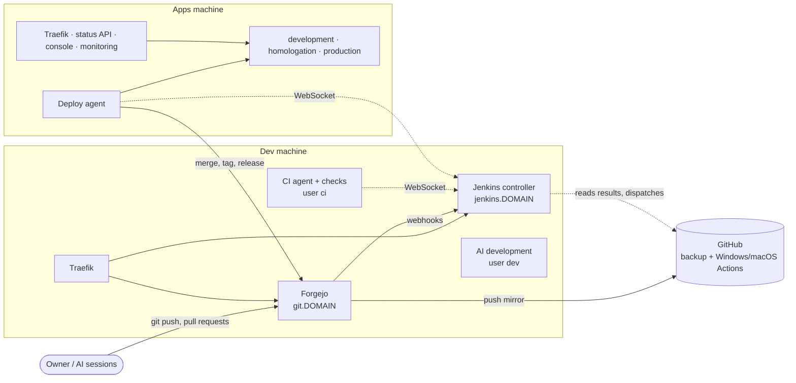

# Self-hosted git, CI and sites: Forgejo and Jenkins on two machines, GitHub as a mirror

Status: design, 2026-10-22, awaiting the owner's approval. Replaces the earlier draft
`2026-10-22-jenkins-ci-design.md` (CI only), which this design absorbs.

## Intent

yggdrasil depends on GitHub for almost everything around a deploy: hosting the repositories, pull requests,
the branch rules, every test and build (GitHub Actions), the merge, the tag and the release. The owner's
sites also live on GitHub Pages and Vercel. The owner doesn't want to depend on GitHub anymore, and moves
**all 60 repositories** and **every site** to two self-hosted machines, on two domains: `techcraftsmen.net` for applications and APIs, `artur-rios.tech` for static and docs sites.

yggdrasil is also a product others use with GitHub, so it **keeps supporting GitHub** as the git server.
Forgejo becomes the **default**, and the owner's choice.

After this change, for the owner's installation:

- **Forgejo**, self-hosted, is where the repositories live and where pull requests, branch rules, check
  results, merges, tags and releases happen.
- **Every site** (docs, the personal and company pages, the blog) runs on the apps machine, deployed by
  yggdrasil like any application.
- **Jenkins** runs the branch policy, every test and build that can run on Linux, and the deploys it
  already does.
- **GitHub** stays for two things only: a **backup copy** of every repository (Forgejo pushes to it
  automatically), and the **Windows and macOS jobs**, which can't run on a Linux machine.
- **Two machines**: a dev machine (git, CI/CD, AI development) and an apps machine (every environment).
- **Nothing runs as root.** Every service runs in a rootless Docker engine under its own unprivileged user.

Everything is documented in the repository: the two machines, the users, what runs where, and which
credential lives where.

## Goals

1. **yggdrasil supports two git servers**, Forgejo (the default) and GitHub (today's behavior, kept). An
   installation picks one in the catalog.
2. Forgejo is the primary git server for all 60 of the owner's repositories.
3. Forgejo pushes every change (branches, tags, Jenkins' merges) to the matching GitHub repository.
4. Branch policy and every Linux check run in Jenkins, on the dev machine, and report to Forgejo under
   today's check names, for **every repository that has CI today**, deployed by yggdrasil or not.
5. Windows and macOS jobs keep running on GitHub Actions, on the mirrored commits. Jenkins copies their
   results to Forgejo, and waits for them before a release, with a manual skip if GitHub doesn't answer.
6. Releases (merge, tag, release notes, release files) happen on Forgejo, with a copy on GitHub. Release
   files that need Windows are built on GitHub and attached to both releases by Jenkins.
7. **Every site moves to the apps machine**: the 19 GitHub Pages sites and the 5 Vercel projects, on
   `artur-rios.tech` (static and docs sites) and `techcraftsmen.net` (applications and APIs).
8. **Libraries** (the `dotnet-*` packages) are tested by Jenkins and published to nuget.org by Jenkins.
9. Renovate replaces Dependabot.
10. Two machines, with the user plan below. No service runs as root on either.
11. Everything above is documented for an operator: a new `docs/hosts.md`, and a rewrite of `docs/setup.md`.

## Non-goals

- **Redirects from the old addresses** (owner's decision). `artur-rios.github.io/<repo>` and the `vercel.app`
  addresses stop working; links to them in the repositories are updated, links elsewhere break.
- **Deploying the applications that aren't deployed today** (alexandria, cerberus, maestro, orpheus,
  user-management-api). They get CI and releases; deploying one later is a catalog entry.
- **Vercel's preview deployments per pull request.** Sites that use the release flow get development and
  homologation environments like the applications instead.
- **GitHub Packages.** Libraries publish to nuget.org only (designer's call): no repository's NuGet
  configuration reads the GitHub Packages feed, and publishing to it needs a classic GitHub token.
- New checks, or changes to what any check verifies (like for like).
- Checks on plain feature-branch pushes. Checks run on pull requests, as today.
- **Pull requests from forks** (owner's decision): Jenkins doesn't build them, so they get no checks. The
  owner merges one with the admin override, or pushes its branch into the repository first.
- Moving build history from the current Jenkins (designer's call): the new controller starts empty from its
  configuration as code.
- Showing the dev machine's services (Forgejo, Jenkins) in the console. A possible follow-up.
- Updating the owner's agent skills that use `gh` against GitHub issues (`implement-use-case`,
  `generate-specs-from-brainstorm`, …). A separate follow-up once issues live on Forgejo.

## Anti-goals

- **CI must not be able to touch production or the git server.** Check code (and every dependency it pulls)
  runs in an engine that can't reach the other users' engines or files, and holds no credential that can
  push, merge, tag or deploy.
- **No service runs as root**, and no user who runs services can become root (no sudo, no `docker` group).
- **The skip must not hide a failure.** It is offered when GitHub doesn't answer, never when a GitHub
  Actions check reported a failure.
- **No second copy of the release logic.** Releases still go through `release()` in
  `yggdrasilPipeline.groovy`.
- **The mirror must not be a second source of truth.** Nothing is pushed or merged on GitHub directly. The
  one thing Jenkins writes there is each release, a copy of the Forgejo release with the same tag, notes
  and files.
- **Nobody but the owner can change what Jenkins runs with its credentials**: the Jenkinsfiles, the shared
  library and the catalog.

## Decided by the owner

- Forgejo as the self-hosted git server, primary for everything; GitHub kept as a backup and for the
  Windows and macOS jobs. Every push reaches both.
- Windows and macOS jobs stay on GitHub Actions; everything else is self-hosted. If GitHub is unavailable,
  the owner can choose to skip those jobs and deploy anyway.
- `main` requires only what Jenkins reports, so a skipped release can still merge. `develop` requires the
  Windows/macOS results too; during a GitHub outage the owner merges into `develop` with the admin override.
- Two machines, both Ubuntu VPS, 8 vCPU, 32 GB RAM, 400 GB NVMe: one for AI development, CI/CD and the git
  server; one for the applications.
- Rootless Docker. Nothing runs with root privileges, on either machine.
- Each application's check steps live in its own repository, declared in its Jenkinsfile.
- Pushes to `develop`/`main`/`release/*` run checks before deploying.
- Pull requests from forks get no checks.
- **Releases are published on GitHub too**, with the same files, so Chimera's built-in updater (which reads
  GitHub releases and accepts downloads only from `github.com`) and anyone downloading from GitHub keep
  working. Chimera's update code doesn't change.
- **Only the owner changes pipelines.** Changes to a `Jenkinsfile` reach `develop` only through the owner's
  (forced) merge; `main` receives them only as part of a release snapshot of `develop`, which Jenkins merges.
  Pull requests by anyone else are built with the target branch's Jenkinsfile.
  `claude` keeps everything else.
- **The apps machine is a new VPS.** Production can be off during the move.
- **yggdrasil keeps supporting GitHub** as a git server for those who want it; Forgejo is the default.
- **All 60 repositories move** to Forgejo, and **every GitHub Pages and Vercel site** moves to the apps
  machine.
- **Two domains, both behind Cloudflare**: `techcraftsmen.net` for applications and APIs, `artur-rios.tech` for static and docs sites. No redirect pages at the old GitHub Pages and Vercel addresses.

## The two machines



| | Dev machine | Apps machine |
|---|---|---|
| Purpose | Git server, CI/CD, AI development | Every environment of every application |
| Runs | Traefik, Forgejo, Jenkins controller, monitoring, the CI agent and its checks, Renovate, AI sessions | Traefik, status API, console, monitoring, the applications, the deploy agent |
| Public names | `git.techcraftsmen.net`, `jenkins.techcraftsmen.net`, `grafana-dev.techcraftsmen.net` (builder's call on the last) | **`techcraftsmen.net`**: the applications and APIs, `yggdrasil.`, `traefik.`, `grafana.`, and the bare domain (the company page). **`artur-rios.tech`**: the static and docs sites, and the bare domain (redirecting to `www.`) |
| Cloudflare | DNS only (not proxied): git over SSH can't pass Cloudflare's proxy, and large git pushes over HTTPS would hit its request size limit | Proxied |
| Inbound ports | 22 (SSH), 80, 443, 2222 (Forgejo's git over SSH) | 22; 80 and 443 **from Cloudflare's address ranges only** |
| Jenkins agents | `ci`, `release` | the apps machine's deploy agent (`vps` today) |

- **Two domains** (owner's decision): `techcraftsmen.net` for applications and APIs, `artur-rios.tech` for
  static and docs sites. Both are DNS zones on Cloudflare.
- **DNS.** On each domain, the apps machine gets a wildcard record and the bare-domain record, proxied. The
  dev machine's names get their own records, DNS only, which take precedence over the wildcard.
- **Certificates.** Each machine's Traefik gets Let's Encrypt certificates by DNS-01 through Cloudflare's API,
  as today but now for two domains: `techcraftsmen.net` and `*.techcraftsmen.net`, `artur-rios.tech` and
  `*.artur-rios.tech` (new: today one domain and only its wildcard). One Cloudflare API token, limited to DNS
  edits on the two zones, in `acme.env`. Cloudflare's SSL mode is **Full (strict)**, so the connection from
  Cloudflare to the apps machine is verified too (designer's call, rather than Cloudflare origin
  certificates, which would tie the origin to Cloudflare).
- **Client IPs behind Cloudflare.** Traefik trusts `X-Forwarded-For` and `CF-Connecting-IP` only from
  Cloudflare's address ranges (`forwardedHeaders.trustedIPs`), so heimdall-api's sign-in rate limit counts real
  clients, not Cloudflare. That trust check needs the TCP source address, which rootless Docker must keep
  (System settings).
- **Origin locked to Cloudflare.** The apps machine's firewall accepts 80 and 443 only from Cloudflare's
  published ranges, so nobody bypasses Cloudflare by connecting to the machine's address. The ranges change
  rarely; `ygg check` compares the firewall with Cloudflare's current list.
- **Caching.** Cloudflare caches what it caches by default (static file extensions). The builder sets a cache
  rule so the APIs and the status API are never cached, and checks that a new site deploy is visible (a purge
  after deploys, if needed).
- **How they talk.** Every Jenkins agent (CI and release on the dev machine, deploy on the apps machine) dials
  out to `https://jenkins.techcraftsmen.net` over WebSocket, as the deploy agent does today; no agent port is
  opened. The deploy agent calls Forgejo's API over HTTPS for merges, tags and releases. Forgejo's webhooks
  reach Jenkins over the dev machine's internal Docker network.
- **The Jenkins controller moves** from the apps machine to the dev machine. The apps machine no longer runs
  the `jenkins` Compose profile.
- **Monitoring.** Each machine runs its own Prometheus, Loki, Alloy and Grafana for its own engine, as
  every host does today. The dev machine's monitors the `ygg` engine (Forgejo, Jenkins, Traefik).
- **The firewall works now.** Rootful Docker writes its own iptables rules and bypasses `ufw`; rootless
  Docker publishes ports as ordinary listening processes, so `ufw` rules apply to them. setup.md says so.

### Sizing on the apps machine

The five applications in three environments, plus 24 sites (most of them a static web server using a few
megabytes; personal-page and github-readme-stats are Node processes of 100–200 MB), plus the platform, fit
well within 32 GB. Sites deploy to production only unless their table row says otherwise.

### Sizing on the dev machine

| What | RAM |
|---|---|
| Forgejo (SQLite, designer's call: one user, a handful of bots) | 0.5–1 GB |
| Jenkins controller | 2 GB |
| CI, 4 executors (Flutter, Playwright, .NET with PostgreSQL) | 12–16 GB at peak |
| AI development sessions and what they run | 4–8 GB |
| Traefik, monitoring, OS | 2–3 GB |

CPU is the shared resource: the `ci` user is capped at 6 of the 8 CPUs (and 20 GB of RAM) so AI sessions
stay responsive during a build. The caps are systemd limits on the user's slice, so they cover the user's
whole engine, not one container.

## Users and privileges

### Rules on both machines

- **`root`** can't log in (`PermitRootLogin no`; no password).
- **SSH** accepts keys only (`PasswordAuthentication no`) and only for the users listed with a login below
  (`AllowUsers`).
- **One admin user** (`artur`, the owner) has `sudo`, with a password, for OS work only: updates, packages,
  users, firewall, the system settings below. It runs no services and has no Docker engine.
- **No rootful Docker.** The `docker-ce` system service and socket are disabled (or never installed); there is
  no `docker` group. Each service user installs **rootless Docker** in its own account
  (`dockerd-rootless-setuptool.sh install`), started by systemd as a user service, and `loginctl enable-linger`
  keeps it running from boot without a login. Its socket is `/run/user/<uid>/docker.sock`; the user's shell
  profile sets `DOCKER_HOST` to it.
- **Service users have no `sudo`** and are in no privileged group. Each has its own subordinate uid/gid range
  (`/etc/subuid`, `/etc/subgid`), non-overlapping, so containers of different users map to different host ids.
- **Home directories are `750`**, so one service user can't read another's files.
- **"root" inside a container** is the service user on the host. Images that support a non-root user still run
  as it (defense in depth); the deploy and CI agents run as container root so they can read their user's files.
- **Unattended security upgrades** on (`unattended-upgrades`).

### System settings (once, by the admin)

| Setting | Why |
|---|---|
| `net.ipv4.ip_unprivileged_port_start=80` (`/etc/sysctl.d/`) | Lets the rootless Traefik bind 80 and 443. SSH (22) stays privileged. |
| `uidmap`, `docker-ce-rootless-extras`, and `slirp4netns` or `passt` packages | Rootless Docker's requirements. |
| An AppArmor profile allowing user namespaces for `rootlesskit` | Ubuntu 24.04 blocks unprivileged user namespaces by default (`kernel.apparmor_restrict_unprivileged_userns`). |
| `Delegate=cpu cpuset io memory pids` for `user@.service` | Lets rootless engines apply CPU and memory limits (cgroup v2). |
| Slice limits for `ci` (dev machine): `CPUQuota=600%`, `MemoryMax=20G` | The CI cap above. |
| A rootless network mode that **keeps client IPs** (slirp4netns or pasta port driver, configured in the user's `dockerd-rootless` environment) | heimdall-api's sign-in rate limit counts requests per client IP; the default rootless port driver shows every client as one internal address. The builder verifies with Traefik's access log. |
| `ufw`: the inbound ports in the table above; on the apps machine, 80 and 443 only from Cloudflare's ranges | Firewall; nobody reaches the apps machine without going through Cloudflare. |

### Apps machine

| User | Login | sudo | Runs, in its own rootless engine | Owns |
|---|---|---|---|---|
| `root` | No | n/a | the OS | |
| `artur` | SSH key | Yes (password) | nothing | |
| `ygg` | SSH key (daily `ygg` commands) | No | Traefik, status API, console, Prometheus, Loki, Alloy, Grafana, the socket proxies, every application in every environment, the deploy agent | `/opt/yggdrasil` (the checkout), `/etc/yggdrasil` (secrets, `750`, files `600`) |

The platform and the applications share one engine on purpose: Traefik reaches the applications over that
engine's `edge` network, and the deploy agent drives the engine they run in.

### Dev machine

| User | Login | sudo | Runs, in its own rootless engine | Holds |
|---|---|---|---|---|
| `root` | No | n/a | the OS | |
| `artur` | SSH key | Yes (password) | nothing | |
| `ygg` | SSH key | No | Traefik, Forgejo, Jenkins controller, Prometheus, Loki, Alloy, Grafana, socket proxies | Forgejo's data and its GitHub mirror token; Jenkins' home with every Jenkins credential; `/opt/yggdrasil`, `/etc/yggdrasil` |
| `ci` | None (service only) | No | the CI agent and every check container | the CI agent's secret, a read-only Forgejo token, the GitHub read token |
| `renovate` | None (service only) | No | Renovate, on a systemd user timer | the `renovate` Forgejo token |
| `release` | None (service only) | No | the **release agent** (`release`, 1 executor) and its build containers: release files, signing, package publishing | the signing keys and the nuget.org key, a read-only Forgejo token |

**Why a separate release agent** (designer's call). Release files ship through Chimera's and Maestro's
built-in updaters and to nuget.org. If they were built in the `ci` engine, a check from a pull request by
`claude` or Renovate running at the same moment could reach the build's containers and change the output
before it is validated. The release agent only runs builds the owner started (a release pull request into
`main`, or an owner-pushed tag), so the code it builds was merged by the owner or by Jenkins after the
owner's release flow. Signing happens here, never on the controller or on the apps machine.
| `dev` | SSH key | No | AI development sessions and the containers they run | its own Forgejo account's token |

### What each user may do

- **`ygg` (dev machine)** is the most sensitive account there: Jenkins' credentials can merge, tag and deploy.
  Only the owner logs in as it.
- **`ci`** can read code and post nothing. A compromised check could read the repositories and the
  `ci` engine's other containers, nothing else; it can't push, merge, tag or deploy (see Credentials).
- **`dev`** pushes to Forgejo as its own account (designer's call on the name, `claude`): it can push
  `feature/` and `fix/` branches, open pull requests and merge into `develop`; it can't push `release/*`,
  merge into `main` or create `v*` tags.

### Credentials

Where every secret lives. This table goes into `docs/hosts.md`.

| Credential | Lives with | Can |
|---|---|---|
| Forgejo `jenkins` bot token | Jenkins controller (`ygg`, dev); deploy agent (`ygg`, apps) | Write every repository; the only account allowed to merge into an application's `main` and create its `v*` tags; post statuses |
| Forgejo `jenkins-ci` bot token | CI agent (`ci`) and release agent (`release`) | Read every repository |
| Forgejo `renovate` bot token | The `renovate` user (dev) | Push branches not protected (in practice `renovate/*`) and open pull requests |
| Forgejo `claude` account | `dev` user | Push `feature/`/`fix/`, open pull requests, merge into `develop` |
| Forgejo owner account (`artur-rios`, site admin) | The owner | Everything, including the admin override |
| GitHub mirror token (fine-grained: Contents and Workflows write on the mirrored repositories) | Forgejo (`ygg`, dev) | Push to the GitHub copies |
| GitHub App `yggdrasil`, reduced to Actions read and write, Checks read, Contents read and write, Metadata read | Jenkins controller, and the deploy agent for the release step | Read Actions results, download Actions artifacts, dispatch workflows, create releases and upload their files. Contents write is needed for releases; it could also push to the GitHub copy, which the next mirror push would overwrite. It can no longer write statuses or pull requests. |
| GitHub read token (same App, or a fine-grained read-only token, builder's call) | CI agent, when a wait runs there | Read Actions results |
| Jenkins agent secrets | Each agent's env file | Connect as that agent |
| Application secrets, platform passwords | `/etc/yggdrasil` of the machine that uses them | As today |
| Cloudflare API token (DNS edit on the `techcraftsmen.net` and `artur-rios.tech` zones only) | `acme.env` on each machine | Prove domain control for certificates; edit those two zones' DNS records |
| ReportGenerator license | Jenkins credential, bound into the `test` checks that use it | Never bound on `renovate/*` builds |
| nuget.org API key | Jenkins credential, allowed only for the library repositories, bound only on the publish step, on the release agent | Publish the owner's packages |
| Maestro's update-manifest signing key (Ed25519, `MAESTRO_RELEASE_SECRET_KEY_BASE64` today) | Jenkins credential, allowed only for maestro, bound only on its release build, on the release agent | Sign what installed copies of Maestro trust |
| Orpheus' Android keystore and passwords (`ANDROID_KEYSTORE_*` today) | Jenkins credential, allowed only for orpheus, bound only on its release build, on the release agent | Sign Orpheus' Android builds |
| Any other secret a release workflow uses today | Same rule: a Jenkins credential, allowed per repository in the catalog, bound only on the release agent | The builder lists them from every `release*.yml` |
| GitHub read-only token for github-readme-stats | `/etc/yggdrasil` on the apps machine, as an application secret | Read public GitHub data |

## Git server: Forgejo or GitHub

yggdrasil keeps working with GitHub as the git server (owner's decision); Forgejo is the default and what
the owner uses. The catalog's `forge.type` picks one per installation.

| | `forgejo` (default) | `github` |
|---|---|---|
| Repositories, pull requests, merges, tags, releases | Forgejo | GitHub, as today |
| Branch rules | Forgejo protection rules (the rules script's Forgejo side) | Rulesets, as today (`rulesets.py`'s behavior) |
| Jenkins source | Gitea plugin | `github-branch-source` + GitHub App, as today |
| Jenkins checks (`checks:` in a Jenkinsfile) | Yes, statuses on Forgejo | Yes, statuses on GitHub |
| CI on GitHub Actions | Only Windows/macOS jobs, results copied to Forgejo | Any workflow, waited for as today; an application can keep all its CI there (a Jenkinsfile without `checks` behaves exactly as today) |
| Mirror to GitHub, release copies on GitHub | Optional (`mirror`) | n/a |
| Forgejo service on the dev machine | Yes (`forge` profile) | No |

- **One interface, two implementations.** The pipeline and the scripts talk to "the git server" through
  `scripts/forge.sh` (set-status, merge, tag, release, upload, delete-branch, the read commands), which
  dispatches to a Forgejo or a GitHub implementation by `forge.type`. Each feature in this design is written
  once against that interface. `scripts/github.sh` keeps the GitHub Actions commands (wait, dispatch, run
  artifacts), used by both types.
- **Rules**: one rules script with a Forgejo and a GitHub side, applying the same model (the tables in
  Branch and tag rules for Forgejo; today's rulesets, extended with Jenkins checks and `actionsChecks`, for
  GitHub). On GitHub, `actionsChecks` stay bound to GitHub Actions as today, and Jenkins' contexts are not
  bound.
- **The rest of this design is described for Forgejo.** On GitHub, the same features apply wherever they make
  sense without Forgejo: the two machines and the user plan, rootless Docker, the CI agent and its isolation,
  Jenkins checks, the skip, sites, libraries, Renovate. The CI agent's read-only identity on GitHub is a second
  GitHub App with Contents read and Commit statuses write (statuses are still posted from the controller
  side, as on Forgejo; builder's call on whether the CI side needs its own app at all).
- **Tests run against both.** Every `forge.sh` command and the rules script are tested for both types; the
  owner's installation exercises Forgejo end to end, and setup.md keeps a GitHub path that the builder checks
  with a scratch GitHub repository.
- **Docs** describe both: setup.md asks which git server first, then branches where steps differ.

## Forgejo

### Installation

- A service in yggdrasil's platform Compose file, on its own profile (`forge`), run by `ygg` on the dev
  machine, behind Traefik at `git.DOMAIN`. Image pinned like the other platform images.
- **Git over SSH** on port 2222 (Forgejo's built-in SSH server; the host's own SSH keeps 22). Git over HTTPS
  works too.
- **Registration closed**; accounts are created by the owner.
- **Sign-in required to view anything** (designer's call, `REQUIRE_SIGNIN_VIEW`): releases and public code are
  read from GitHub, so Forgejo, on the machine that holds every Jenkins credential, shows nothing to anonymous
  visitors.
- **Data**: a named volume in `ygg`'s engine (repositories, SQLite database, attachments, release files).
- **Backups** (designer's call): GitHub only receives git data, not pull requests, issues, check results or
  release files. A nightly `forgejo dump` and a Jenkins home backup are copied to the apps machine's `ygg`
  user (and the apps machine's volumes to the dev machine's, so each machine holds the other's backups).
  The builder picks the mechanism (a systemd user timer plus `rsync` over SSH with a key limited to one
  directory is enough). Restore steps go in `docs/hosts.md`.

### Accounts and repositories

- Repositories keep their names, under an owner with the same name as today's GitHub owner (`artur-rios`),
  so paths don't change.
- The bot accounts and the `claude` account of the Credentials table, with the repository permissions it
  states (collaborators, or teams if the owner is an organization; builder's call).
- **Import** (one time): Forgejo's GitHub migration, with a GitHub token, imports each repository with its
  issues, labels, milestones, releases and pull requests. Open pull requests are finished or closed on GitHub
  first, since an imported pull request isn't a working one.
- **Webhooks** to Jenkins on every repository (push, pull request, tags), with a secret, set by the same
  script that applies the branch rules (below).

### Branch and tag rules

`github/rulesets.py` is replaced by a script that applies these to every catalog repository through Forgejo's
API (idempotent, with `--dry-run`, like today's). Names are glob patterns.

| Rule | Settings |
|---|---|
| `develop` | No direct push, no force push, no deletion. Merge through a pull request whose required checks pass: `branch-policy`, the catalog's `checks`, and its `actionsChecks`. Merge allowed for the owner and `claude`. Squash or merge commit. |
| `main` | No direct push, no force push, no deletion. Required: `branch-policy`, `checks`, `deploy/<environment>` for each release environment. Merge allowed only for `jenkins` (applications) or the owner (yggdrasil, which isn't deployed by Jenkins). Merge commit only (Jenkins merges with a merge commit; Forgejo's merge styles are per repository, so the rule is "only Jenkins merges"). |
| Protected files, on `develop` only | `Jenkinsfile`: a pull request that changes it can be merged only by the owner (owner's decision), with a forced merge (Forgejo holds a protected file even for the owner otherwise). Renovate's updates to check images in a Jenkinsfile therefore wait for the owner. Not on `main`: it receives only release snapshots of `develop`, which Jenkins merges, and a protected file there would stop every release that changes a Jenkinsfile. |
| `release/*` | Only the owner may push. A push deploys to the branch environments, so the bots and `claude` must not be able to create one. |
| Version tags | Protected: in applications, only `jenkins` may create `v*`; in owner-tagged repositories (yggdrasil, maestro, orpheus, alexandria-ui, personal-lab, the libraries), only the owner may create their version tags (`v*`, or `[0-9]*` for the libraries). Nobody may move or delete them. **Accepted gap (Forgejo 16, found by the live tests; the owner's decision):** a tag protection is one allow-list for every change to a matching tag, so whoever may create the tags may also move them (a forced push) and delete them (a push, or the API when the tag has no release): `jenkins` an application's `v*` tags, the owner an owner-tagged repository's. Everyone else is refused, the owner included in applications. The gap is accepted on Forgejo and **detected**: the daily `tag-check` Jenkins job compares every published release's tag with the commit it was released from and fails naming each tag MOVED or DELETED. **The GitHub copies are immutable**: with a `mirror`, `rules.py` gives every repository's copy a `mirror tags` ruleset (no move, no deletion) that nobody bypasses, administrators included, so a mirror push that would move or delete a tag fails and the copy keeps the tag as released; a moved or deleted Forgejo tag is **repaired from the GitHub copy** (setup.md, step 12). A GitHub installation gets the same: its `release tags` ruleset has no bypass (the owner can no longer move or delete a tag there), and an owner-tagged repository's creation rule is a ruleset of its own, `release tag creation`, which administrators bypass. To fix a wrong tag on GitHub, the owner edits the ruleset first. |
| Repository settings | Default branch `develop`; delete the head branch after merge. |

- **Admin override.** The owner (repository admin) must be able to merge a pull request whose checks haven't
  passed, for emergencies and GitHub outages, as today's ruleset bypass allows. The builder confirms which
  Forgejo setting gives this and documents it.
- **Deleting release branches.** Jenkins deletes `release/x.y.z` after a release. If Forgejo can't let
  `jenkins` delete a branch matched by a protection rule, the release branches are kept and the
  `delete-branch` step becomes a no-op, documented. The builder confirms which.
- Required checks are matched by context name only (Forgejo doesn't bind statuses to an app).

### The GitHub mirror

- Each repository has a Forgejo **push mirror** to its GitHub repository, set to sync on every push (and on
  an interval, as a safety net). It pushes every branch and tag, including Jenkins' merges and tags, so the
  GitHub copy matches Forgejo, commit for commit.
- On GitHub, before the first mirror push: the rulesets are deleted (they would reject the mirror's pushes;
  Forgejo enforces the rules now), Dependabot is turned off (`.github/dependabot.yml` removed), the
  repository description says it's a mirror of `git.DOMAIN`, and issues are disabled. Pull requests can't
  be disabled on GitHub; README and CONTRIBUTING say where to contribute.
- The commit ids on both sides are the same, which is what lets Jenkins match GitHub Actions results to
  Forgejo commits.

## GitHub Actions: only Windows and macOS

### What stays

| Repository | Workflow (after) | Jobs | Used as |
|---|---|---|---|
| fortuna-api | `native-core-windows.yml` | native core build and test on Windows (path-filtered: `native/**`, `docs/openapi/fortuna.json`) | Waited for when it runs, never required |
| chimera | `ci-macos-windows.yml` | `Safari` (macOS), `Native (windows)` | `actionsChecks`: required on `develop`, waited for on releases |
| chimera | `release-windows.yml` | Windows packaging for a release | Release files (below) |
| yggdrasil | `ci-windows.yml` | `Console (Windows)` | `actionsChecks` |
| yggdrasil | `release-windows.yml` | Windows installer for a release | Release files |
| heimdall-ui, fortuna-ui | `release-windows.yml` | Windows build for a release | Release files |

Workflow file names are the builder's call. Everything else under `.github/workflows` is deleted, including
`branch-policy.yml`, heimdall-api's `build-docs.yml` (docs move, below) and yggdrasil's `release.yml`
(its Linux and Android parts move to Jenkins).

### Triggers

Pull requests no longer exist on GitHub. The check workflows run on **push** to any branch (the mirror pushes
the pull request's commits) and keep their path filters. Release workflows run on **`workflow_dispatch`**
only, started by Jenkins with the tag. None of them write to GitHub (no releases, no statuses); release
workflows upload their files as workflow artifacts, which Jenkins downloads (and puts in both releases).

### Results back to Forgejo

- `scripts/github.sh` keeps only reading: `wait-checks <repo> <sha> <timeout> [names…]` and the release
  workflow helpers (dispatch, find the run, download its artifacts).
- On pull requests into `develop`, after Jenkins' own checks, Jenkins waits for the `actionsChecks` on the
  head commit and posts each one to Forgejo as a status with the same name and the GitHub run as target URL.
  On a timeout or GitHub not answering, those statuses are set to `pending` with "GitHub Actions didn't
  answer", and the build ends (the owner can merge with the override, or rerun the build later).
- On the release pull request, the same wait, with the skip (below).
- **Waiting doesn't hold an executor**: polling runs outside `node()` (or on the controller), sleeping
  between looks, so a one-hour wait for macOS doesn't take one of the 4 CI executors. Builder's call on
  how.
- `wait-checks` considers only GitHub Actions check runs. Proof the workflows started: each name it's given
  must appear and complete. Without names (an application with no `actionsChecks`), it waits for whatever
  GitHub Actions runs exist on the commit; the race with a workflow not yet registered is accepted (the
  builder may add a short grace period). Exit codes: `0` passed, `1` a check failed, `2` timed out or GitHub
  didn't answer, including the mirror not having pushed the commit yet.

### The skip (release pull requests)

- Exit `1` fails the release, as today.
- Exit `2` asks, outside `node()` like the approval inputs: **"GitHub Actions checks didn't finish. Deploy
  without them?"**, with a **Deploy without GitHub Actions checks** button. Abort fails the release.
- After a skip the release continues as usual. It's recorded in the build log, the build description
  (`v1.4.0 (deployed without GitHub Actions checks)`) and the `deploy/<environment>` status descriptions.
  `main` doesn't require Actions results, so the merge goes through.
- Release files that need Windows can't be produced without GitHub: after a skip, the release is published
  without its Windows files and the build is marked **unstable**, with the missing files listed. The
  `actions-release` command (below) attaches them later.

## CI in Jenkins

### The CI agent

- An inbound WebSocket agent named and labeled `ci`, running in the `ci` user's rootless engine on the dev
  machine, with that engine's socket mounted (it's the `ci` user's own engine, which holds nothing but CI).
  Created by `init.groovy.d/agents.groovy` regardless of environments. **4 executors** to start.
- Its image: the deploy agent's minus what only deploys need, plus git: Docker CLI with Buildx, curl, jq,
  Python with PyYAML. No toolchains: each check names its image.
- **Workspace paths.** Checks run with `docker run` against the `ci` engine, so the agent's work directory is
  mounted at the same path on both sides (`/home/jenkins/agent`), and bind mounts mean the same thing in the
  agent and on the host.
- **Testcontainers** inside a check talks to the `ci` engine through the mounted socket (`docker: true`,
  below); the builder sets the Testcontainers overrides rootless Docker needs (socket path, host address,
  Ryuk).
- Disk: images and caches pile up; a scheduled prune keeps them bounded (builder's call).
- **It never sees a write credential.** It checks out with `jenkins-ci` (read-only), and posts nothing:
  statuses are posted from the controller (for example the HTTP Request plugin's `httpRequest`, which runs on
  the controller with a credential id) or from the deploy agent. Builder's call on which, under that rule.

### Declaring checks

Each application's Jenkinsfile passes its checks to the shared pipeline:

```groovy
@Library('yggdrasil') _
yggdrasilPipeline(stack: 'heimdall-api', checks: [
  'test':   [image: 'mcr.microsoft.com/dotnet/sdk:10.0', run: 'ci/test.sh', docker: true,
             credentials: [REPORTGENERATOR_LICENSE: 'reportgenerator-license'],
             junit: 'artifacts/test-results/**/*.trx', archive: 'artifacts/coverage-report/**'],
  'docker': [image: 'docker:cli', run: 'docker build .', docker: true],
  'check':  [image: 'mcr.microsoft.com/dotnet/sdk:10.0', run: 'ci/check-openapi.sh',
             paths: ['src/**', 'tools/ArturRios.Heimdall.OpenApiGen/**', 'scripts/openapi.py',
                     'docs/openapi/**', 'ci/check-openapi.sh']],
])
```

| Field | Meaning |
|---|---|
| key | The check name posted to Forgejo. Today's GitHub check names (below). |
| `image` | The container image the step runs in, pinned (builder's call on tag or digest). |
| `run` | Shell command or script, from the repository root. Steps move out of workflow YAML into `ci/` scripts, runnable by hand. |
| `docker` | `true` gives the step the `ci` engine (image builds, Testcontainers). Default `false`. |
| `credentials` | Environment variable → Jenkins credential id. Not bound on `renovate/*` builds. Only ids the catalog allows for that application (below), so a Jenkinsfile can't ask for a deploy credential. |
| `paths` | The check runs only if the change touches these globs (against the target branch for pull requests, the previous build's commit for pushes); otherwise it reports success, "skipped: no changes under …". Path-filtered today ⇒ path-filtered here, with today's paths. |
| `junit`, `archive` | Test results for Jenkins' report; files to keep with the build. What Actions uploaded as artifacts. |

Checks of one build run in parallel within the 4 executors; the build fails if any fails, after all have
reported. A Jenkinsfile without `checks` deploys only, as today, so applications can move one at a time.

### What moves

| Repository | Jenkins checks (catalog `checks`) | `actionsChecks` | Path-filtered, not required |
|---|---|---|---|
| heimdall-api | `test`, `docker` | | `check` (OpenAPI) |
| heimdall-ui | `Analyze and test`, `Regenerate and compare` | | |
| fortuna-api | `test`, `docker`, `check`, `audit` | | native core on Linux (`msrv`, Linux build); on Windows via Actions |
| fortuna-ui | `Analyze and test`, the three drift checks | | |
| chimera | `Analyze and test`, browser tests (Linux), `Native (linux)`, `Container`, `Accessibility and performance` | `Safari`, `Native (windows)` | |
| yggdrasil | `Status API`, `Console`, `Platform` | `Console (Windows)` | |

Plus `branch-policy` everywhere. Chimera's `Cross-platform` only aggregated browser, Safari and native results
and goes away; exact names of its split checks are the builder's call. heimdall-api's `test` also runs the
Python helper tests, the vulnerability scan and the coverage minimum, as its workflow does today.

### Branch policy

- One script, `scripts/branch-policy.sh <head-ref> <base-ref> <head-sha>`, with today's rules: into `develop`
  only `feature/*`, `fix/*` or `renovate/*` (replacing `dependabot/*`), not cut from `main`; into `main` only
  `release/x.y.z`, an unchanged snapshot of `develop`, for an untagged version.
- Run by the shared pipeline on every pull request into `develop` or `main`, on the CI agent, and reported
  as `branch-policy`.
- **Application extras**: the Jenkinsfile can pass `branchPolicy: [image: …, run: …]`, run after the common
  script with `HEAD_REF`, `BASE_REF`, `HEAD_SHA` and the yggdrasil checkout's path in its environment
  (Chimera's Dart branch-origin check, release readiness and catalog-contract validation). Chimera's contract
  tests name `Cross-platform` and its workflow files; they change in its cutover, together with its catalog
  entry, so both repositories agree.
- A pull request whose base is changed must be rechecked: the builder confirms Jenkins rebuilds it (webhook
  or rescan), or documents that it needs a push or "Build Now".

### Reporting and reuse

- Each check and `branch-policy` reports `pending`, then `success` or `failure`, with the build URL, on the
  commit the build ran (the pull request's head, or the pushed commit).
- **Reuse by commit**: a check that already has `success` from Jenkins on the same commit isn't run again, so
  a `release/x.y.z` push and its pull request, usually the `develop` head already checked, cost nothing.
  `branch-policy` is never reused (it depends on the refs).

### Pipeline flow

| Build | Today | After |
|---|---|---|
| Pull request into `develop` | nothing | branch-policy + checks, then the `actionsChecks` copied from GitHub |
| Pull request into `main` (not `release/x.y.z`) | nothing | branch-policy + checks (branch policy fails it) |
| Pull request `release/x.y.z` → `main` | wait for Actions, deploy, merge, release | branch-policy + checks, wait for Actions (with the skip), deploy release environments, merge, release (below) |
| Push to `develop`/`main`/`release/*` | deploy matching branch environments | checks, then deploy only if green |
| "Build with Parameters" `DEPLOY_TO` | deploy | unchanged: no checks (designer's call) |
| yggdrasil: pull requests and pushes | (Actions) | branch-policy + checks; never deploys |
| yggdrasil: `v*` tag | `release.yml` | release files (below) |

- Checks on `node('ci')`, deploys on the environment's agent; a build never holds a deploy agent while checks
  run. The release lock covers the release pull request's checks too.
- The multibranch jobs discover `develop` even when no environment's `branches` names it, and (yggdrasil only)
  `v*` tags.

### Jenkins and Forgejo

- The **Gitea plugin** (it serves Forgejo) replaces `github-branch-source`: Forgejo server and credentials in
  `casc.yaml`, multibranch jobs from the Job DSL with branch and pull request discovery (no fork discovery),
  webhooks from Forgejo.
- **Whose Jenkinsfile runs** (owner's decision): a pull request opened by the owner runs its own Jenkinsfile;
  one opened by anyone else (`claude`, `renovate`) runs the target branch's Jenkinsfile with the pull
  request's code. The builder confirms how the Gitea plugin expresses this trust rule. If it can't, the
  library refuses to run when a non-owner pull request changes the Jenkinsfile, and fails the build.
- **The library version is pinned**: `casc.yaml`'s `defaultVersion` names a yggdrasil release tag instead of
  `main`, so what the library does changes only when the owner moves the pin.
- `scripts/github.sh`'s write commands move to **`scripts/forge.sh`**, against Forgejo's API:
  `set-status`, `merge-pr` (merge commit, with the expected head commit), `release` (tag + release),
  `publish-release`, `delete-branch`, `upload-release-file`. `github.sh` keeps the read and dispatch commands
  for Actions.
- The shared library is loaded from Forgejo.

## Releases

- **Merge, tag, release** happen on Forgejo, by `jenkins`, after the last release environment deploys, as
  today.
- **The GitHub copy** (owner's decision): once the mirror has pushed the tag to GitHub (Jenkins waits for it),
  Jenkins creates a GitHub release for it with the same name, notes and files, through the GitHub App. For
  releases with files, both are drafts until every file is uploaded to both and checked, then both are
  published, GitHub last. Chimera's release metadata and checksums keep naming the GitHub repository, as
  today, since that's where its updater looks.
- **Release notes** are the version's section of the repository's `CHANGELOG.md` when there is one
  (designer's call: Forgejo can't generate notes the way GitHub's `generate_release_notes` does); otherwise
  the merged pull request titles since the previous tag.
- **Release files**, for repositories that publish any, are declared in the Jenkinsfile (builder's call on
  the shape): Linux, web and Android files built and signed by Jenkins on the **release agent**; Windows files
  from a GitHub release workflow, started by Jenkins with `workflow_dispatch` once the tag has reached GitHub
  through the mirror; an optional validation step run on the release agent over the complete set. Then:
  1. The tag and a **draft** Forgejo release are created.
  2. The files are built and gathered; the validation runs.
  3. The files are uploaded to both drafts (by the controller or the deploy agent, never the CI agent),
     checked against the validated set, and both releases are published.
  A failure leaves the draft unpublished and fails the build, as Chimera's `releaseArtifacts` does today.
- **Per repository:**
  - **chimera** (`releaseArtifacts: true`): today's `release-artifacts.yml` splits into Jenkins (verify,
    Linux packaging and smoke test, the complete-bundle validation) and GitHub (`release-windows.yml`).
  - **heimdall-ui, fortuna-ui**: today's tag build (web, Linux, Android on Linux; Windows on GitHub) becomes
    release files attached to the Forgejo release (today they stay as Actions artifacts; designer's call).
  - **Repositories that release but aren't deployed** (yggdrasil, maestro, orpheus, alexandria-ui,
    personal-lab): see Owner-tagged releases.
- A command to attach Windows files to an already published release (`forge.sh`/`github.sh`, builder's
  call), for releases published after a skip.

### Owner-tagged releases

Repositories with no release environment can't go through `release()`, which deploys a release pull request
before merging it. They keep releasing the way they do today (designer's call, like for like): **the owner
pushes the version tag**, and Jenkins does the rest.

- **Who tags**: the owner pushes a tag on `main` (`v1.2.3` for yggdrasil, maestro, orpheus and
  alexandria-ui; the bare `1.2.3` for the libraries). For yggdrasil, the owner merges its release pull request
  by hand first, as today. personal-lab today tags itself after a `main` deploy; it moves to the owner-tagged
  path too, with its site deploying on `main` as before (builder confirms nothing else depends on its
  automatic tags).
- **What Jenkins does** on a tag (tag discovery for these repositories): checks the tag's commit is on `main`
  (as their release workflows do today), builds and signs the release files on the release agent, gets any
  Windows files from GitHub, validates, creates the Forgejo release and its GitHub copy, uploads, publishes.
  For a library, it packs and pushes to nuget.org instead of creating release files.
- **A second, small entry point** in the shared library for this tag-driven path, next to `release()`, sharing
  the release-files steps with it, so there is still one copy of the release logic. The catalog's
  `repositories` entry says which path a repository uses and its tag pattern.
- **Tag rules**: in these repositories, only the owner may create tags matching their version pattern
  (`v*`, or `[0-9]*` for the libraries); nobody may move or delete them. So `claude` or Renovate can't
  trigger a release or a publish.

## Renovate

- Renovate runs as its own user, `renovate`, on the dev machine, in its own rootless engine, on a systemd
  user timer (daily; builder's call), against Forgejo, with the `renovate` token. It opens pull requests from
  `renovate/*` branches into `develop`. Designer's call, from the first anti-goal: Renovate runs package
  manager code (restores, lockfile updates) while holding a token that can push, so it gets neither the CI
  engine nor Jenkins. The remaining risk, which comes with any Renovate setup, is accepted and documented: a
  stolen token can push to unprotected branches, such as an open `feature/` branch.
- A repository-level Renovate config in each repository, covering what Dependabot covers today (the
  builder reads each `dependabot.yml`), plus the Jenkinsfile check images.
- `branch-policy` accepts `renovate/*` into `develop`.

## Every repository

All 60 repositories on the owner's GitHub account move to Forgejo (all are public on GitHub today). What
each needs depends on its kind:

| Kind | Repositories | On Forgejo and Jenkins |
|---|---|---|
| **Deployed application** | heimdall-api, heimdall-ui, fortuna-api, fortuna-ui, chimera | Catalog applications, as designed above |
| **Site** | the 19 GitHub Pages sites and 5 Vercel projects (Sites, below) | Catalog applications of a new kind, deployed to the apps machine |
| **Library** | dotnet-configuration, dotnet-data, dotnet-extensions, dotnet-jwt, dotnet-logging, dotnet-mediator, dotnet-messaging, dotnet-output, dotnet-test-util, dotnet-util, dotnet-validation, dotnet-webapi-util | Checks; a version tag publishes to nuget.org (Libraries, below). Their docs sites are sites. |
| **CI and releases, not deployed** | alexandria-api, alexandria-ui, cerberus-api, cerberus-ui, maestro, orpheus, personal-lab, ai-coding-skills, coding-challenge-library, dotnet-libraries, reveal.js | Checks (their workflows' Linux jobs), branch policy where they have one, and release files where they publish any (alexandria-ui, maestro, orpheus, personal-lab). Their Windows jobs stay on GitHub, under the same rules as the applications'. |
| **Code only** | every other repository: no workflows today | Imported and mirrored; no Jenkins job |
| **Archived** | dotnet-common, eocp-ecommerce-system-api, eocp-ecommerce-system-email-templates, eocp-ecommerce-system-ui | Imported as archived; **no push mirror** (GitHub rejects pushes to archived repositories, and nothing changes in them) |
| **Forks** | file-tree-generator, github-readme-stats, gui-challenges, hugo-theme-nuno, hugo-theme-re-terminal, hugo-theme-rusty-typewriter, landing-page, reveal.js, under-construction-template | Plain repositories on Forgejo; the GitHub copies stay forks. Upstream changes are fetched by hand (`git remote add upstream …`). |

A repository can be of more than one kind (orpheus has CI, releases and a docs site). The builder makes
the per-repository table final, in `docs/hosts.md` or a migration checklist, by reading each repository's
workflows; the kinds above are what the plan is built from.

- **Jenkins jobs for repositories that aren't applications** come from a new catalog list, `repositories`
  (below), so the Job DSL, the credentials allowlist and the rules script all read one place. Designer's call,
  rather than a Forgejo organization scan, because each repository's allowed credentials must be listed by the
  owner anyway.
- **Branch rules** apply to every repository that has a `branch-policy` workflow today (the release model);
  the others get `main`/`develop` protection against force pushes and deletion only.
- **Links**: every repository's references to `github.com/artur-rios/<repo>` stay valid (the mirror). Its
  references to `artur-rios.github.io/<repo>` and `*.vercel.app` change to the new addresses (owner's decision:
  no redirects), including NuGet package metadata (`PackageProjectUrl`) and READMEs.

## Sites

Each site becomes a catalog application deployed to the apps machine behind Traefik, built into a small image
by its repository's Dockerfile (a static web server for built sites; `next start` for server-rendered
Next.js; Node for github-readme-stats), with the same deploy, health check, rollback and monitoring as any
application.

| Site | Today | Address (designer's call) | Deploys |
|---|---|---|---|
| tech-craftsmen-company-page (Next.js, static export) | Vercel | `techcraftsmen.net` and `www.techcraftsmen.net` | release flow: homologation, production |
| personal-page (Next.js, server-rendered) | Vercel | `www.artur-rios.tech` (unchanged), with `artur-rios.tech` redirecting to it | release flow: development, homologation, production (it has branch policy and release tags today) |
| personal-blog (Hugo) | Vercel | `blog.artur-rios.tech` (unchanged) | production, on pushes to `main` |
| personal-lab (Hugo) | GitHub Pages | `lab.artur-rios.tech` | as today: production on `main`, release tags |
| under-construction-template (Vite) | Vercel | `placeholder.artur-rios.tech` | production, on pushes to `main` |
| github-readme-stats (Node) | Vercel | `readme-stats.techcraftsmen.net` (an API) | production, on pushes to `main` |
| Docs: heimdall-docs, fortuna-docs, alexandria-docs, orpheus docs, heimdall-api docs, dotnet-libraries and the 12 library docs | GitHub Pages | `docs.artur-rios.tech/<repository>` | production, on pushes to `main` (as their Pages workflows do today) |

- **Which domain** follows the owner's rule: static and docs sites on `artur-rios.tech`, applications and APIs
  on `techcraftsmen.net`. Two designer's calls on the edges: the **company page** is static but goes on
  `techcraftsmen.net`, since it's that domain's home page; **github-readme-stats** is an API, so it goes on
  `techcraftsmen.net`. personal-page is server-rendered, but it's the owner's personal site and already lives
  at `www.artur-rios.tech`, so it stays there.
- **Addresses that already exist stay**: `www.artur-rios.tech` and `blog.artur-rios.tech` keep serving the same
  sites, so the links in the LICENSE files, READMEs and profile don't change. The new addresses are the
  designer's call, and the owner can rename any before the plan. They follow one pattern: a subdomain per
  site, and one docs host with a path per repository, so the docs keep the `/<repository>/` layout they're
  built for on GitHub Pages (only the host in their `baseURL` changes) and 18 docs sites don't take 18 names.
- **One docs host, many applications**: each docs site is its own application whose Traefik router matches
  `Host(docs.artur-rios.tech) && PathPrefix(/<repository>)`. Routing lives in each application's stack file
  already, so this needs no change in Traefik's setup; the catalog needs a `path` next to `host` for the
  console's links and the status API (builder's call on the shape). `docs.artur-rios.tech/` itself shows an
  index of the docs sites (dotnet-libraries is already an index for the libraries; builder's call on whether it
  becomes the root).
- **More than one domain per machine** is new for yggdrasil. Today a host has one `DOMAIN` and every
  application is `<host><hostSuffix>.DOMAIN`. After: the platform lists its domains (the first is the default,
  used by the platform's own names), and an application says which domain it uses (default: the first). Its
  host names, including each environment's `hostSuffix` variants, are formed under that domain. Builder's call
  on the shape in `platform.env` and the catalog. Traefik requests a certificate per domain (above); the status
  API and the console use the full host names.
- **The bare domain** of either domain is new too: an application may claim it (`host` set to the domain
  itself, builder's call on the syntax), and may redirect it to another of its names (personal-page's
  `artur-rios.tech` → `www.`), with a Traefik redirect in its stack file.
- **Docs with coverage reports** (the 12 libraries, heimdall-api) take the report from the same build's
  `test` check: the pipeline passes archived check files into the image build (builder's call on how).
- **Vercel-specific settings** go: `VERCEL_GIT_COMMIT_SHA` and `VERCEL_ENV` in personal-page become the
  commit and environment yggdrasil's deploy passes as build arguments; `vercel.json` files are deleted. The
  Vercel projects are deleted after the new addresses work.
- **github-readme-stats** reads GitHub's API with a read-only GitHub token (it reports GitHub statistics,
  which the mirror keeps meaningful), stored like any application secret. The owner's profile README points
  to the new address.
- **Environments**: sites use the application `environments` overrides that exist today (for example,
  production only, with `trigger: branch` and `branches: main`). Sites with no development or homologation
  environment use none.

## Libraries

- Checks as for applications (Jenkinsfile `checks`: build, tests, coverage).
- **Publishing**: today a bare version tag on `main` (`1.2.3`) runs `publish-package.yml`, which pushes to
  nuget.org and GitHub Packages. After: the same tag, pushed to Forgejo by the owner, triggers the
  repository's Jenkins job, which packs and pushes to nuget.org on the release agent (Owner-tagged releases).
  The nuget.org API key is a Jenkins credential allowed only for the library repositories. GitHub Packages is
  dropped (non-goals).
- The libraries keep their versioning and tag conventions as they are.

## Catalog

- A new `forge` block says which git server the installation uses: `type: forgejo` (the default) with its
  `url`, or `type: github`. `owner` keeps its meaning on either. An optional `mirror` block (GitHub owner,
  whether releases are copied) applies to Forgejo installations. Builder's call on the exact shape.
- New `repositories`: the repositories Jenkins builds that aren't applications (libraries, CI-only
  repositories, yggdrasil itself), each with its checks, `actionsChecks`, allowed credentials and whether it
  publishes releases or packages.
- Applications gain what the sites need: which of the platform's domains they use, a `path` beside `host`,
  and a way to claim the bare domain.
- `checks` now means the checks Jenkins reports. On a release, the pipeline fails early if a catalog check
  isn't declared in the Jenkinsfile (the rule would otherwise wait forever).
- New `actionsChecks`: GitHub Actions job names required on `develop` and waited for on releases.
- `checksTimeout` keeps its meaning, for the wait on GitHub Actions.
- New per-application `credentials`: the Jenkins credential ids its checks may bind (heimdall-api:
  `reportgenerator-license`). The library refuses any other id, so a Jenkinsfile can never bind a deploy or
  merge credential. The catalog lives in yggdrasil, which only the owner merges.
- yggdrasil's own repository is an entry of `repositories`, so the Job DSL creates its checks-only job and the
  rules script applies its rules.
- `scripts/catalog.py` and the library's `resolve` stay in step; `catalog.py validate` checks the new fields.

## yggdrasil platform changes

- **Rootless everywhere**: every `/var/run/docker.sock` in `platform/compose.yml` (the agent, the socket
  proxies) becomes a variable (`DOCKER_SOCKET`, default the running user's rootless socket); `DOCKER_GID`
  and `group_add` go away; the agents run as container root. `scripts/platform.sh` and `deploy.sh` use
  `DOCKER_HOST`.
- **New profiles**: `forge` (Forgejo), `ci` (the CI agent, for the `ci` user) and `release` (the release
  agent, for the `release` user), each agent with its own small env file. The dev machine runs `forge`,
  `jenkins` and monitoring under `ygg`, `ci` under `ci` and `release` under `release`; the apps machine runs
  the platform and `agent` under `ygg`.
- **`ygg install` / `ygg check`** set up a machine as the dev machine or the apps machine: the system settings
  and users above (as the admin, with `sudo`), then rootless Docker for each service user (as that user).
  `ygg check` verifies each item, including "no rootful Docker running", "no service user can sudo", and that
  the `ci` engine can't reach the `ygg` engine.
- **The secrets directory** is owned by `ygg`, `750`, files `600`; the `docker` group explanation in
  setup.md goes.

## Implementation plans

Too big for one plan. It is planned and built as five, in this order:

1. **Host foundation**: rootless Compose, the `forge`, `ci` and `release` profiles, `ygg install`/`ygg check`
   for both machine roles, the system settings, backups, `docs/hosts.md` and the `docs/setup.md` rewrite.
   Testable without any repository.
2. **Git-server interface and catalog**: `forge.sh` for Forgejo and GitHub, the rules script for both,
   webhooks, and the catalog fields with `catalog.py` and `resolve` kept in step.
3. **Pipeline**: the CI and release agents, `checks`, `branch-policy.sh`, reuse by commit, waiting for and
   copying GitHub Actions results, the skip, releases and their GitHub copy, owner-tagged releases and library
   publishing, the Gitea plugin with the Job DSL and `casc.yaml`, the library pin, and what sites need from the
   pipeline (paths, the bare domain, check files in image builds).
4. **Machines and cutover runbook**: building both machines, moving the data, importing the 60 repositories,
   mirrors, rules and webhooks.
5. **Moving each repository, by kind**: the five applications and yggdrasil; the libraries (templated); the
   other repositories with CI or releases; the 24 sites (templated Dockerfiles and catalog entries). Done in each
   repository after the cutover, following the migration checklist.

Plans 1 to 3 are rollout step 1; plan 4 covers rollout steps 2 to 5.

## Rollout

The system keeps deploying from GitHub until the cutover, which happens in one maintenance window.

1. **yggdrasil changes**, developed and released on GitHub as today: everything in this design, with the
   library still able to run a Jenkinsfile without `checks`. **Before** that release merges, the current
   controller's library is pinned to the current yggdrasil release tag, so the live system keeps deploying
   from GitHub until the cutover.
2. **Cloudflare**: both zones on Cloudflare (moving `artur-rios.tech`'s name servers if it isn't there yet,
   keeping its current records, so `www.` and `blog.` keep pointing at Vercel until their sites move), the API
   token, SSL mode Full (strict).
3. **Dev machine**: OS hardening, users, rootless engines, Traefik, Forgejo, monitoring, the new Jenkins
   controller, the CI agent. Forgejo accounts and bots created; Jenkins configured against Forgejo but no
   repositories yet.
4. **Apps machine**, a new VPS (owner's decision): OS hardening, `ygg` user and rootless engine, the platform,
   checked with no applications yet.
5. **Cutover**, one maintenance window; production is off during it (owner's decision). The data move and the
   repository move happen together, since the new apps machine's deploy agent can't use the new controller
   until the repositories are on Forgejo:
   - **Data**: every environment on the old VPS is stopped; its volumes (databases included) are exported,
     copied to the new VPS and imported into `ygg`'s engine; DNS for both domains points at the new
     VPS; each environment is started and checked. If the applications use another domain today, their
     addresses move to `techcraftsmen.net` here: their env files (public host, API base URLs compiled into
     the web bundles) are updated before the first deploy, and the builder lists every place a host name
     appears. The old VPS stays untouched until the new one has run a release, so it is the rollback.
   - **Repositories**, with no merges or deploys meanwhile: open GitHub pull requests finished or closed;
     every repository imported into Forgejo; GitHub rulesets deleted and Dependabot turned off; push mirrors
     on; the rules script run against Forgejo; webhooks to Jenkins. From here, pushes go to Forgejo.
6. **Per repository, one at a time**, deployed applications first (heimdall-api, heimdall-ui, fortuna-api,
   fortuna-ui, chimera), then yggdrasil, then the libraries, the other CI repositories and the sites (order
   within those is the builder's call): a pull request on Forgejo that adds `ci/` scripts and the Jenkinsfile
   (`checks`, release files, publish step, site Dockerfile as the kind needs), the Renovate config, trims
   `.github/workflows` to the Windows/macOS jobs with their new triggers, updates links to the new addresses,
   and the catalog entry (in yggdrasil). The first pull request of each repository with rules can't satisfy
   both old and new rules: the owner merges it with the override after checking Jenkins' results.
   Repositories with no CI today need nothing beyond the import.
7. **Each repository's first release, publish or site deploy** after its cutover is its end-to-end test.
   A site is switched over when its new address serves it: its Pages workflow or Vercel project is then
   removed.
8. **Clean up**: the old VPS (with the old Jenkins controller) shut down; GitHub Pages off on every
   repository; the Vercel projects deleted; the GitHub App's permissions reduced; local clones' `origin`
   pointed at Forgejo.

## Testing

- `scripts/branch-policy.sh`: each rule and rejection, against a scratch repository, with today's messages.
- `forge.sh`: each command against a recorded or fake Forgejo API (the way `github.sh` is tested today);
  `github.sh wait-checks`: the proof, the names, the three exit codes, GitHub not answering.
- The rules script: `--dry-run` for an application with and without `actionsChecks`, and for yggdrasil.
- `catalog.py`: the new fields.
- Rootless setup: `ygg check` on both machines; from inside a check, the `ygg` engine's socket and files are
  unreachable; Traefik's access log shows real client IPs; `ps` shows no service process running as root.
- The pipeline: every build kind on the first repository moved, including a forced GitHub timeout to
  exercise the skip, and a release with release files.
- The mirror: a commit and a tag made on Forgejo appear on GitHub; GitHub Actions runs on them.
- Backups: a restore of Forgejo from a dump, on a scratch engine.
- **Both git servers**: `forge.sh` and the rules script tested for `forgejo` and `github`; a scratch GitHub
  repository run through a pull request, checks and a release with `forge.type: github`.
- Sites: each new address serves its site with a valid certificate (both domains, both bare domains), docs
  paths resolve under `docs.artur-rios.tech`, and the docs' internal links work under the new host.
- Cloudflare: the apps machine refuses connections that don't come from Cloudflare; heimdall-api sees real
  client IPs behind Cloudflare; API responses aren't cached; Cloudflare's SSL mode is Full (strict).
- Libraries: a publish to nuget.org of a pre-release version (or a dry run with `--skip-duplicate` against a
  test feed; builder's call) before the first real one.

## Documentation

"Document everything": every operator-facing change is written down, in the repository.

- **New `docs/hosts.md`**: the two machines (diagram, what runs where, names, ports, firewall); the two
  domains and Cloudflare (DNS records, proxied or not and why, SSL mode, the origin lock, client IPs, caching); the users on
  each, with what each may do and why; the system settings and why each is needed; the credentials table;
  backups and restore; how to add a third machine (another apps host).
- **`docs/setup.md`**, rewritten around the two machines: the choice of git server first (Forgejo, the
  default, or GitHub), then the order (dev machine first), installing and configuring Forgejo, importing
  repositories, the push mirrors, the reduced GitHub App, the CI agent, rootless Docker per user, and every
  step `ygg install` automates, as today's guide does for each command. The GitHub path stays complete.
- **New `docs/sites.md`** (or a section of catalog.md): how to add a site, static or server-rendered, on its
  own subdomain, on the docs host with a path, or on the bare domain.
- **New `docs/repositories.md`** (or a section of catalog.md): the `repositories` list, libraries and
  publishing, CI-only repositories.
- **A migration checklist** for the owner's 60 repositories (kind, what moves, new address, done), kept until
  the migration ends.
- **`README.md`**: the diagrams and the "what a release does" sequence (Forgejo, Jenkins checks, GitHub
  Actions only for Windows/macOS), the concepts table.
- **`docs/catalog.md`**: `forge`, `mirror`, `checks`, `actionsChecks`, `checksTimeout`, the `release` trigger.
- **`docs/cli.md`**: `ygg install` / `ygg check` for the two machine roles.
- **`CONTRIBUTING.md`** in yggdrasil and each repository with CI: where the repository lives, how to run the `ci/`
  scripts locally, that GitHub is a mirror, that fork pull requests get no checks.
- Header comments of `yggdrasilPipeline.groovy`, `forge.sh`, `github.sh`, the rules script, and each
  application's Jenkinsfile.
- `CHANGELOG.md`.

## Left to the builder

Marked "builder's call" throughout. Also: how checks run in parallel within the 4 executors; the Jenkins
plugins for test reports and archived files; the Renovate image and schedule; the backup mechanism; names of
new workflow files and of Chimera's split checks.

## Follow-ups (not in this design)

- The owner's agent skills that create and read GitHub issues, milestones and pull requests (`gh`), moved
  to Forgejo's API.
- The dev machine's services in the console.
